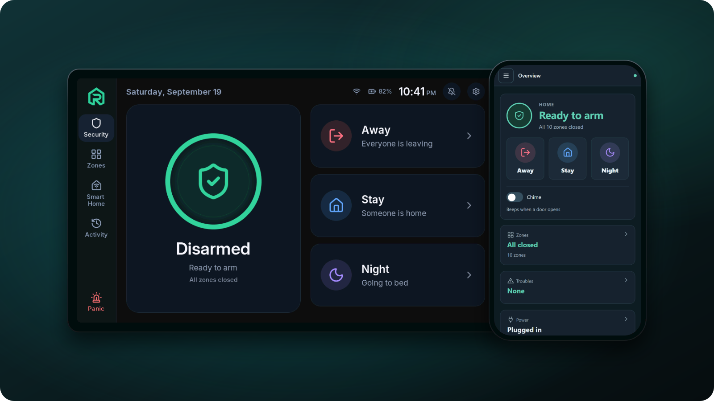
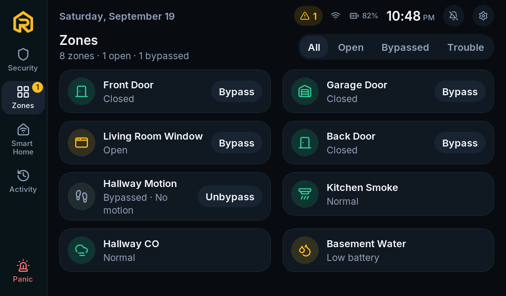
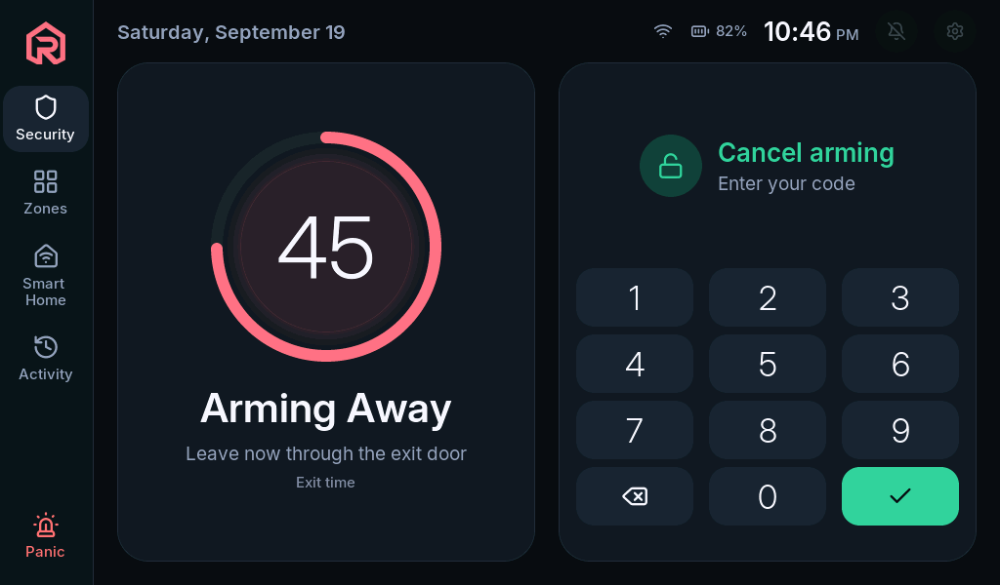
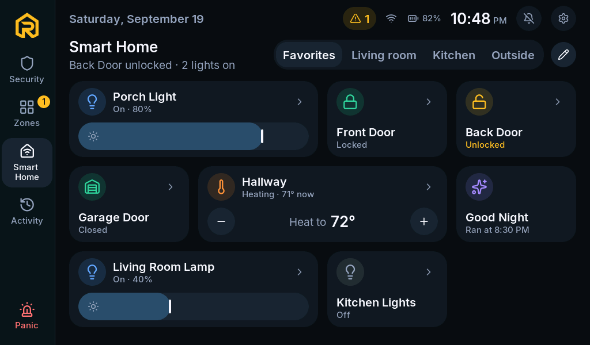

<p align="center">
  <a href="https://roboalarms.com">
    
  </a>
</p>

<h1 align="center">RoboAlarms Panel</h1>

<p align="center">
  <strong>Your home. Your alarm. Your rules.</strong><br />
  Open-source firmware that turns an ESP32-P4 touchscreen into a complete alarm panel.<br />
  It runs on your wall, not in someone's cloud, with no subscription.
</p>

<p align="center">
  <a href="https://github.com/RoboAlarms/alarm-panel/actions/workflows/host-tests.yml"></a>
  <a href="https://github.com/RoboAlarms/alarm-panel/actions/workflows/firmware.yml"></a>
  
  <a href="LICENSE"></a>
</p>

<p align="center">
  <a href="https://roboalarms.com">Website</a> ·
  <a href="https://docs.roboalarms.com">Documentation</a> ·
  <a href="https://docs.roboalarms.com/installer/flasher/">Flasher</a> ·
  <a href="https://github.com/RoboAlarms/ha-addon">Home Assistant</a> ·
  <a href="docs/features/README.md">Project status</a>
</p>

<p align="center">
  
</p>

Put it on the wall, connect your door, window and motion sensors, and arm it from the touchscreen
or any browser. When something happens, the panel sounds and your phone gets a notification.
Every alarm decision is made on the panel itself, so it keeps working when the internet doesn't.

> [!IMPORTANT]
> RoboAlarms is in active development and is **not a listed or certified alarm system**. It is
> an independent DIY project, not affiliated with any alarm manufacturer.

## Why RoboAlarms

- **Local by design.** The alarm engine runs on the panel. No cloud account and no monthly fee.
- **A proper alarm panel.** Partitions, a code for each person, entry and exit delays, bypass,
  chime, panic and alarm memory, with arming behaviour modelled on SIA CP-01.
- **Calm by design.** Nothing on the screen flashes, strobes or blinks. Steady colours, plain
  words and sound do the alerting, for a dark hallway at 3 a.m. and for people who are
  photosensitive.
- **Your sensors.** Wired zones, 433 MHz sensors and Home Assistant entities work today. Zigbee
  (through an ESP32-H2) and Z-Wave (through a Zooz ZAC93) are built and in testing.
- **Home Assistant, kept local.** A native integration that pairs with a code shown on both
  screens, with no MQTT broker. Plain MQTT with discovery is there too.
- **Any browser is a keypad.** The Panel Manager handles setup, people and codes, zones, activity
  and a remote keypad, over HTTPS on your own network.
- **Word when it matters.** Alarms and troubles reach your phone through ntfy or Pushover.
- **Updates you can trust.** Firmware is signed and rolls itself back if a new version fails its
  self-test.

| Every zone at a glance | Leaving the house | Your smart home, too |
| :---: | :---: | :---: |
|  |  |  |

## Get started

**Install it on a panel, no build tools needed.** Get an Elecrow CrowPanel Advanced (7" or 10.1"), install
the RoboAlarms Flasher, plug the panel in over USB-C and follow the guided install. The Flasher
backs up the board's factory software before it writes anything.
[Read the Flasher guide →](https://docs.roboalarms.com/installer/flasher/)

**Try it without hardware.** The simulator runs the real alarm engine and touchscreen in a window
on a Windows PC: arm it, open a door, pull the Wi-Fi and hear the sounder. It needs CMake, Ninja
and GCC.

```powershell
pwsh tools/ui_sim.ps1
```

**Build the firmware.** With [ESP-IDF v6.1](https://dl.espressif.com/dl/esp-idf/) installed:

```bash
git clone https://github.com/RoboAlarms/alarm-panel.git
cd alarm-panel
tools/idf.sh build                          # Windows: pwsh tools/idf.ps1 build
tools/idf.sh -p /dev/ttyACM0 flash monitor
```

Back up the board's factory flash before the first flash: there is no download of it. The
[developer guide](CONTRIBUTING.md#set-up-a-panel) shows how, and covers the P4's silicon revisions,
signing keys, the host tests and the screen preview.

## Hardware

### Required

| Panel | Inside | Screen |
| --- | --- | --- |
| **Elecrow CrowPanel Advanced 7"** | ESP32-P4 + ESP32-C6 (Wi-Fi) | 7" touchscreen, 1024 × 600 |
| **Elecrow CrowPanel Advanced 10.1"** | ESP32-P4 + ESP32-C6 (Wi-Fi) | 10.1" touchscreen, 1024 × 600 |

Pick either one: they are the same board with a different screen size, so they run the same
firmware with the same features.

### Optional add-ons

| Add-on | What it adds | Status |
| --- | --- | --- |
| **433 MHz receiver**, a CC1101 or a fixed receiver module | Wireless door, window and motion sensors, learned by triggering them | Works on a panel |
| **DS3231 clock module** | The right time through a power cut, with or without the internet | Works on a panel |
| **ESP32-H2** | Zigbee sensors, sirens, keypads and key fobs, with the panel as the coordinator | Built, in testing |
| **Zooz ZAC93** | Z-Wave sensors, keypads, switches and garage doors | Built, in testing |

## Under the hood

The alarm logic is a portable C11 engine with no heap and no RTOS, so every rule is tested on a PC
before it reaches hardware. On every push, CI runs the host tests with sanitizers, walks every
screen of the UI and builds the firmware. Around the engine sit ESP-IDF v6.1 services (Wi-Fi,
MQTT, HTTPS, signed updates) and an LVGL 9 touchscreen.
[components/README.md](components/README.md) maps the code, and
[docs/features](docs/features/README.md) holds each feature's requirements and design.

## Documentation

- **[User and installer guides](https://docs.roboalarms.com):** setting up the panel and living
  with it.
- **[Home Assistant integration](https://github.com/RoboAlarms/ha-addon):** the HACS integration
  and how to pair it.
- **[Developer guide](CONTRIBUTING.md):** building, testing and the rules the code follows.
- **[Feature documents](docs/features/README.md):** requirements, design and where each feature
  stands.
- **[Backlog](docs/BACKLOG.md):** what's next, in order.

## Contributing

External contributions are not being accepted at this time.

Found a bug? [Open an issue](https://github.com/RoboAlarms/alarm-panel/issues). Please report
security problems privately, as [SECURITY.md](SECURITY.md) describes.

## License

Licensed under [Apache-2.0](LICENSE). [NOTICE](NOTICE) lists the third-party code, fonts, icons
and data it includes or builds in, with their licences.
