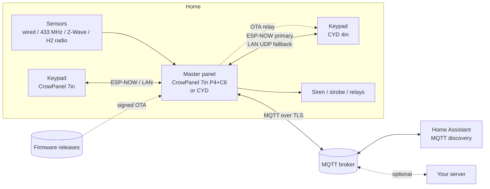

# 00 · Architecture and roadmap

**Status:** Living document - the goal, principles, component tiers, build options and the decision
log (ADR-001 to ADR-055; ADR-051 is a draft in docs/features/13), kept in step with the code; no open work of its own: what is left is in
the [backlog](../../BACKLOG.md) · **Milestone:** all · **Depends on:** -

## Goal
A DIY alarm panel that behaves like a modern keypad alarm system. It runs entirely on local
hardware and stays functional with no internet, no server and no router, and it can hand
information to Home Assistant or your own server when they're available.

## Principles
1. **Safety first.** Life-safety zones (fire, CO, 24 h) are always live. A failed network,
   keypad or update never disarms or silences the system.
2. **Offline first.** Master, keypads and sensors work without the internet. MQTT, Home
   Assistant and the optional server are extras.
3. **One portable core.** All alarm logic sits in `alarm_core` (C11). Devices and the PC run
   the same code.
4. **Classic keypad-panel semantics.** Same states, zone types, key sequences, delays and false-alarm rules
   (SIA CP-01). Deviations are deliberate and documented.
5. **Secure by default.** Encrypted links, signed updates, TLS to the broker. Public
   factory codes exist, but the panel nags until they're changed.
6. **Tested before flashed.** Behaviour is specified as requirements and proven with host tests.

## System context



## Devices and firmware images

| Image | Hardware | Roles | Notes |
|---|---|---|---|
| `crowpanel_p4` | CrowPanel Advanced 7" (ESP32-P4NRW32, 32 MB PSRAM, 16 MB flash) | master or keypad | Two builds: P4 silicon v1.x and v3.x |
| `crowpanel_c6_cp` | Onboard ESP32-C6-MINI-1-N4 | Wi-Fi/BLE co-processor | ESP-Hosted + our ESP-NOW bridge (M7) |
| `e32r40t` | 4" LCDWiki E32R40T, a "CYD" (ESP32, no PSRAM, 4 MB flash) | master first, keypad later | M9, on hold (docs/features/19, BL-079) |
| `h2_radio` | ESP32-H2 module | sensor radio co-processor | M10 |

Until the panel link exists (M7, BL-048) every firmware is a master. Then the role is chosen in
the first-boot wizard and stored in NVS, and changing it needs a factory reset.

## Software layers

```
+------------------------------------------------------------------------------+
| UI: LVGL Pro screens (exported C)         | classic keypad view              |
+------------------------------------------------------------------------------+
| keypad_model: status snapshot -> texts, sounds; builds commands (keyseq)     |
|   same code for the local keypad (loopback) and remote keypads (link)        |
+----------------------------------------------+-------------------------------+
| MASTER ONLY                                  | KEYPAD ONLY                   |
| alarm task -> alarm_core (portable engine)   | link client                   |
| sensor sources, outputs, event log, NVS      |                               |
| MQTT/HA reporter, OTA, link server           |                               |
+----------------------------------------------+-------------------------------+
| platform: ESP-IDF v6.1, FreeRTOS, BSP (display, touch, audio, backlight)      |
|           Wi-Fi via ESP-Hosted (C6), ESP-NOW bridge, SNTP, mDNS               |
+------------------------------------------------------------------------------+
```

### Threading model (device)
- **alarm task**: the only owner of `alarm_engine_t`. It drains a queue of zone events,
  commands and system troubles, calls `alarm_engine_tick()` at `alarm_engine_next_deadline()`,
  and turns engine callbacks into messages for other tasks.
- **ui task** (LVGL): renders from status snapshots and sends commands to the alarm task
  queue, or over the link when in keypad role.
- **audio task**: plays the continuous sounder pattern plus one-shot sounds.
- **net tasks**: MQTT client, link server/client, OTA, SNTP.
- **zones task** (M11): the zone hub behind its lock; polls the wired terminals every 10 ms
  when any is in use, runs the grace timers, and posts zone events to the alarm task queue.
  Sources with their own task (the 433 MHz receiver, the Z-Wave radio, the H2 radio UART, the
  Home Assistant link, the console's simulator) report into it; the alarm task never waits for
  it.

Engine callbacks never block; they post to queues. The engine is never re-entered from a callback.

## Repository layout

Components sit in tiers with one-way dependencies (ADR-034); the rules, the board model and
how to add a board are in [docs/features/33](../33-Modular-Architecture-and-Boards/README.md).

```
cmake/                      shared CMake: firmware projects (tiers, own board, version, signed
                            name), host helpers, LVGL, UI, board manifests
components/
  core/                     portable C11, host-tested; each has its tests in test/
    alarm_core                the engine (done)
    alarm_proto               MQTT JSON, HA link frames, firmware-update helpers (M5/M12)
    cc1101_regs               the CC1101 as data: receive tables, frequency word, RSSI (M14)
    event_log                 power-fail-safe log ring on raw flash (M4)
    h264_sps                  the remote keypad's H.264 pictures shown at once (docs/features/31)
    home_control              devices registry and HA device source (M13)
    http_redirect             plain HTTP sent on to the same page over HTTPS (docs/features/31)
    notify                    event sentences, categories, request builders (M15)
    power_monitor             mains and battery supervision (M2+)
    rf_decode                 433 MHz pulse decoders: EV1527 / PT2262, HT6P20B, HT12E, KeeLoq,
                              arctech (M14)
    rtc_clock                 the DS3231 clock module as data, and which clock to believe (M20)
    sounder                   the sounder's patterns and mixer (M3)
    storage                   SD card policy (M16)
    touch_calib               resistive touch calibration and filtering (docs/features/19)
    zigbee_host               H2 radio bring-up (M10)
    zone_hub                  zone sources: hub, bindings, simulator, wired, HA, Zigbee, RF,
                              Z-Wave (M11+)
    zwave_proto               Z-Wave on the wire: Serial API frames, command classes (M21)
    zwave_host                the Z-Wave host: the ZAC93 link, requests, S2/S0 crypto (M21)
    zwave_zones               Z-Wave devices as zones, and the panel's Z-Wave pages' logic (M21)
    board_info                a board described in data, and its validation (docs/features/33)
    ui_backend                the contract between the UI and whatever runs it (ADR-012)
  drivers/                  ESP-IDF chip drivers, no board knowledge
    rf_rx                     CC1101 over SPI, RMT capture of a receiver's data line (M14)
    rtc_ds3231                a DS3231 clock module on an I2C bus (M20)
    touch_xpt2046             the XPT2046 resistive touch controller (docs/features/19)
  boards/                   the board contract and one component per board
    board_api                 what every board provides, and board_info()
    board_crowpanel_p4        EK79007 display, GT911 touch, I2S audio, flicker guard (M2)
    board_e32r40t             the 4" LCDWiki board: ST7796S display, XPT2046 touch, bring-up
                              console (docs/features/19, on hold)
  services/                 ESP-IDF, board-agnostic, feature-gated
    platform_esp              alarm task, NVS store, event log writer, prefs, Wi-Fi, zones task
    alarm_features            the feature menu (Kconfig only); alarm_mem: memory placement
    ui_port_esp               the UI's backend on ESP-IDF
    net_mqtt  net_notify  ha_link  panel_ota  panel_web  dev_remote
    rf_service  zigbee_service  zwave_service  device_service  panel_storage  panel_clock
  ui/
    alarm_ui                  UI logic (Home, Settings, installer, setup), portable (M3/M4);
                              layouts/<WxH>/alarm_ui: the LVGL Pro projects, XML source of truth
  app/
    panel_app                 the start-up every board shares
firmware/crowpanel_p4/      the 7"'s application: board hooks + panel_app_run(); one per board
firmware/e32r40t/           the 4"'s application: the status screen until the full touch UI fits
                            in its RAM (docs/features/19, on hold)
host/                       PC builds: test runner, UI preview, interactive simulator
tools/                      build wrappers, generators, checks, device tools, the Flasher
docs/                       BACKLOG.md (the work left), manual/ (the Astro user and installer
                            guides), features/ (these design docs), bugs/, sensors/ (how real
                            sensors behave), research/, hardware/ (vendor links)
```

Built since: `components/core/i18n`, the language catalog (ADR-043, docs/features/37, G1
done 2026-09-28). Planned: the
4" board's audio and battery drivers (docs/features/19, on hold, BL-079); the panel link
transports and the C6 co-processor project (M7, BL-048). `components/README.md` indexes every
component.

## Decision log (ADRs)

| ID | Decision | Why |
|---|---|---|
| ADR-001 | Core in **C11**, static allocation, no RTOS | Matches ESP-IDF, LVGL and LVGL Pro exports; ports to the no-PSRAM ESP32 and to a PC simulator |
| ADR-002 | **ESP-IDF v6.1** (released 2026-08-27), pinned | Latest stable. Supports older ESP32-P4 silicon through `CONFIG_ESP32P4_SELECTS_REV_LESS_V3`. Ships mbedTLS 4, so all crypto uses the PSA API |
| ADR-003 | **LVGL 9 + LVGL Pro** (Editor 2.x) | XML UI in git, data binding through subjects, plain C export, free for open source |
| ADR-004 | **Keypads are thin terminals**; the master validates every code | Mirrors a wired keypad bus: keypads send keystrokes and show what the master says; one source of truth |
| ADR-005 | Keypad link: **ESP-NOW primary, LAN UDP fallback**, our own AEAD (order revised by ADR-054: Wi-Fi first) | Keeps working when the router is down (like a wired keypad bus); LAN gives speed and PC tooling |
| ADR-006 | **MQTT over TLS** with our own JSON; **Home Assistant** via discovery; server optional | Standard, debuggable, HA works on day one; no Contact ID or other legacy formats |
| ADR-007 | ESP32-H2 is reserved for **sensors** | Every CYD would need an H2 for keypad duty, and 802.15.4 is too slow for OTA relay |
| ADR-008 | **Signed OTA with rollback**, applied only while disarmed and idle | An update must never weaken protection |
| ADR-009 | **Factory codes** installer 69420 / master 123456 with a change-me reminder; codes **4-10 digits per user** (iPhone-style), stored as salted hashes; keypad commands use dedicated keys | Classic panels ship four-digit factory codes; ours are longer, per-user codes. The defaults are public, so the panel keeps reminding until they're changed |
| ADR-010 | **Host-first testing** with Unity; requirement IDs in tests | Alarm logic is safety-relevant and must be provable |
| ADR-011 | LVGL Pro exports are **committed**, and `tools/lvpro_gen.py` can regenerate them without the editor | The editor's exporter and CLI need a paid licence, so an open-source build and CI can't depend on them. The script emits the editor's file layout, so the editor can take over at any time |
| ADR-012 | UI logic is portable and reaches the system only through `ui_backend_t` | The same UI runs on the master, on remote keypads (M7, backend = panel link) and on a PC for screenshots and reviews |
| ADR-013 | The configuration is stored as a **self-describing blob** (field ids, `format`/`compat`), not a struct dump | Firmware updates and OTA rollbacks must never lose a configuration: newer firmware reads older blobs and older firmware reads newer ones; the struct layout and capacities can change freely |
| ADR-014 | **No flow needs a physical button**; a lost installer code is recovered on the touchscreen during 2 minutes after power-up, logged, reported, and can be switched off | The boards sit behind a case; reflashing must never be the answer to a lost code |
| ADR-015 | Integrations (Home Assistant) are **optional and live in their own Settings section**; general screens never mention them | The panel is a complete alarm on its own; integrations are compatibility, set up in one place |
| ADR-016 | **Three access groups** in Settings: open to anyone, shared by the master and the installer (Wi-Fi, time, integrations, event log), installer-only in installer mode (detection, delays, sirens, reporting options, codes, reset). The installer code doesn't manage household codes | A homeowner must never need the installer to join a new router (docs/features/14); the classic rule keeps family codes away from the installer |
| ADR-017 | MQTT client is **`espressif/mqtt` from the component registry** (ESP-IDF 6 moved it out); messages and store-and-forward are a **portable, host-tested component** (`alarm_proto`) | The protocol and the replay logic are provable on a PC; the client library is the maintained Espressif one |
| ADR-019 | **Zone sources are interfaces** (`zone_source_ops_t` + context, registered with a portable hub) with a separate binding blob; sources report by address through a sink and never see zones; the engine only sees zone numbers. The hub runs on its own task on the panel | Any sensor family can be added without touching the core or the UI flow; several families run at once, which mainstream panels don't allow; the mapping, grace timers and the blob are host-tested (docs/features/22) |
| ADR-020 | **Zigbee is the first-class wireless source**, paired to the panel's own coordinator (P4 + ESP32-H2 RCP); Home Assistant and 315-433 MHz RF are additional sources with their trust stated in the UI | Native Zigbee is supervised, encrypted and works without Wi-Fi or HA; the others widen the hardware choice without hiding their limits |
| ADR-021 | **Home Assistant through a native custom integration from HACS**: mDNS discovery, pairing confirmed on the panel's screen, mutual TLS to a local panel API, two-way on the same link; MQTT stays for other systems | The experience of ESPHome devices (discovered, one click, nothing long to type); the panel holds no HA credential and HA decides what it may read and control; the same code is the path to HA core later (docs/features/23) |
| ADR-022 | **Build profiles**: each optional feature is a component behind a Kconfig option | The same code base fits a P4 with 32 MB PSRAM and a CYD with none |
| ADR-023 | **Signed apps without eFuse Secure Boot** (RSA-3072, the Secure Boot v2 scheme), verified by `esp_ota_end()`; the release manifest is unsigned; one writer takes images from every transport; the boot slot switches only when the system is idle; a 60 s self-test confirms or rolls back | Remote attackers can't install anything, no eFuse is burnt on DIY boards, and the same key can later be burnt for real Secure Boot. The image is the trust anchor, so the manifest needs no second key (docs/features/13) |
| ADR-024 | **Nothing on the screen may flash** (photosensitivity safety: a panel is looked at in the dark by whoever walks past): no blinking UI, the display DMA keeps running during flash writes, and a flicker guard turns the backlight off if the refresh ever stalls | Found on the first hardware run: flash writes made the picture drop out about 9 times a second. Safety over looks (docs/features/06 P4-012, docs/features/07 UI-020) |
| ADR-025 | **Apache-2.0**, with bundled third-party material listed in `NOTICE` | Matches ESP-IDF and ESP-Hosted, the two dependencies whose code shapes this one; the patent grant suits a project that anyone may build hardware from. LVGL (MIT), Unity (MIT), Inter (OFL-1.1) and Lucide (ISC) are all compatible with it |
| ADR-026 | **One panel's particulars live in a git-ignored `PANEL.local.md`**, never in the tracked docs; `PANEL.local.example.md` is the template | Serial port, silicon revision, codes and who uses a panel differ per board. Keeping them out of the repo means a fresh clone can't flash the wrong build to somebody else's port, and nobody's household details ship with the source |
| ADR-027 | **A fixed address can never lock the panel out, and the connection check is read-only.** A fixed address is stored only when it is complete and its router sits on the panel's own network; one that fails those checks at start-up is turned off in NVS and the panel asks the router again; the cog that leads to the settings stays on Settings > Wi-Fi while the panel is offline. The check pings the router, looks one name up, opens two short TCP connections (a public resolver on 443, and the connected service) and asks the time server once - nothing about the panel is sent anywhere, and no setting changes | A wall panel with a typo in its address would otherwise need the service console or a factory reset to come back, and the owner is the one who has to find the fault. Reaching a public address without a name lookup is what tells DNS trouble apart from a router that can't get out (docs/features/09 NET-011, NET-012) |
| ADR-028 | **The panel sends its own notifications** (ntfy, Pushover) over HTTPS, rather than leaving push to a Home Assistant automation | A notification matters most exactly when the house's other computer is off, updating or unreachable, and Home Assistant is meant to stay optional. No account on our side, no monitoring contract, nothing between the panel and the phone (docs/features/26) |
| ADR-029 | **One copy of the event sentences**, in `components/core/notify`, wrapped by `ui_text.c` | The Activity list and a phone notification describe the same events; two tables would drift the first time somebody reworded one. The move is guarded by rendering every preview screenshot before and after and requiring them to be identical (docs/features/26) |
| ADR-030 | **One copy of the sounds**, in `components/core/sounder`; the panel's task, the PC simulator and the host tests all render the same mixer | What a panel sounds like is part of how it is understood - temporal-3 means fire and temporal-4 means CO to anybody woken by it - and it was the one thing that could only be checked by standing in front of the hardware. Portable, it is measured off the rendered PCM in CI and heard on the PC before a panel is flashed (docs/features/08) |
| ADR-044 | **Two kinds of 433 MHz receiver, one firmware** (numbered ADR-031 until 2026-09-28): a CC1101 (tunable, RSSI) or a fixed superheterodyne module (RX470-4 / WL101-341) on the same data pin; `auto` probes SPI for a CC1101 and otherwise recognises a module by the static its AGC puts on the line (`rf module` fixes it per panel) | The cheapest kits cost a fraction of a CC1101 and most sensors are 433.92 MHz only; one image for every panel keeps updates simple, and the CC1101 remains the choice for jamming by RSSI and for 315/345 MHz |
| ADR-018 | **The event log is the MQTT queue**: "reported" markers are published in log order and a delivered position is kept in NVS; at-least-once with `replayed` and `seq` for deduplication | Reports survive broker outages and power cuts without a second queue in flash; the order is the order they became due (the abort window can hold an alarm back) |
| ADR-034 | **Components in tiers with one-way dependencies** (2026-09-23): `components/core` (portable C11), `drivers` (chips, no board knowledge), `boards` (one per board + the contract), `services` (ESP-IDF, board-agnostic, feature-gated), `ui` (portable LVGL logic), `app` (the start-up every board shares, above services and the UI); a script checks the rules in CI | The project will support many cheap ESP32 screens, each carrying a different subset; a flat folder of 21 components had started to clump, and review alone doesn't keep dependencies one-way (docs/features/33) |
| ADR-035 | **A board is a composition** (2026-09-23): a board component implements one contract (`board_api`) and describes itself in a `board_info_t` (capabilities, pins, reserved pins) that services receive from the app and a portable validator checks; the firmware project's `sdkconfig.defaults` is the board's manifest and states every feature; a firmware's build sees its own board component and no other (`cmake/alarm_idf.cmake`, added with step 10: another board's registry packages were solved for the wrong chip) | Adding a board must not touch services or the UI; a bad pin map must be refused on the PC, not found by bricking a board (the RF defaults 6-10 are the classic ESP32's flash pins) |
| ADR-036 | **One UI logic, one LVGL Pro layout per screen size** (2026-09-23): `components/ui/alarm_ui/layouts/<w>x<h>/alarm_ui` projects share the subjects, object names and component signatures the C code uses, checked in CI (`tools/check_ui_contract.py`, and the same preview walk on every layout); geometry the code needs comes from layout constants, never numbers in C | 1024x600 and 480x320 need different compositions, not different sizes; a second editor project keeps the editor usable, and the name contract keeps the logic single-copy |
| ADR-037 | **Memory placement through one policy** (2026-09-23, `alarm_mem`): PSRAM when the chip has it, internal RAM otherwise; anything that writes flash keeps an internal stack | Seven allocations and three task stacks asked for PSRAM with no fallback, which stops a board without PSRAM at start-up |
| ADR-038 | **Tests live with their component** (2026-09-23): `components/<tier>/<name>/test/`, found by the host build; a board's manifest drives both its firmware and its PC simulator profile | A component copied or dropped takes its tests with it; the simulator of a board compiles exactly the features its firmware does |
| ADR-039 | **The flasher is a Python program with an HTML face** (2026-09-24, docs/features/34): esptool as a library behind an allow-list, pyserial, the page served on 127.0.0.1 with a per-run token and shown in a pywebview window (a browser tab when there is none), one file per OS from PyInstaller; firmware travels in a checked `.roboflash` bundle made from the build folders and signed with the OTA signing key | One language with the repo's other tools (the no-reset port handling, `dev describe`, the image header), the Panel Manager's look, and the same page against pretend boards for tests; a browser-only Web Serial flasher cannot list the connected devices, Qt or Electron would be a second toolkit |
| ADR-040 | **The battery-backed clock is an optional module the panel finds by itself** (2026-09-24, docs/features/35): a DS3231 on the board's I2C connector (`board_info.i2c`, `board_i2c_ext()`), kept in UTC; the time server wins while trusted (a day after a sync), the module otherwise (slewed to, never stepped); a module that jumped is put back; the time by hand only while a module answers. The rules are portable (`rtc_clock`), the bus work a driver, the task a service | Most panels have no module and must not change; the DS3231's ±2 ppm crystal beats the panel's own; setting a time the next power cut erases would only mislead |
| ADR-041 | **Z-Wave sensors through one Zooz ZAC93, with the panel's own host stack** (2026-09-25, docs/features/36): the panel is the only controller of its network; the Serial API, S2, network management and the zone source are portable C (`zwave_proto`, `zwave_host`, `zsrc_zwave`) on a three-primitive crypto port; only the 800-series static-controller firmware is supported | The panel must protect with nothing else running; Z-Wave JS needs a Node.js host and brings workarounds for hardware the panel never uses. Portable code is provable on the PC, as for Zigbee and 433 MHz; the S2 recipes are checked against Z-Wave JS's own vectors |

Note (2026-09-28): the number ADR-031 had been given twice - to optional storage (2026-09-21,
below the table) and to the two kinds of 433 MHz receiver (2026-09-22, in the table). Decided
2026-09-28: storage keeps ADR-031; the receivers became ADR-044, and the documents citing it
were updated.

**ADR-042 (2026-09-27, planned): Recorded words/phrases, imported audio and
on-panel TTS feed one local file player.** Select the source per zone/permitted system prompt.
The supplied vocabulary supports field setup without a computer or model; custom recordings
are durable user assets. Optional TTS generates ahead of use, verifies/persists files and
reuses them across events/reboots. No event waits for synthesis; missing audio retains tones.
Preserve the tone renderer and sole I2S/amplifier owner; workers supply bounded cancellable
PCM. Essential tones remain in firmware; the supplied word/status library uses a fixed budget
in the existing assets partition. Custom audio, TTS models/language data and generated files
**require SD**, with no internal-flash spillover; small selectors remain in NVS. No partition
changes or audio dependency for alarm operation. Missing SD preserves built-in speech/tones.
Library/import support can precede TTS qualification; recorded voice/media at A0 and TTS
quality/resources at A4 remain gates. Generated-cache cleanup never deletes recordings.
Generate the supplied pack locally or through a TTS API; check accepted masters, scripts and
provenance into the repository. Builds validate/encode those files without a synthesis
dependency; generation in GitHub Actions is optional. The producer is independent of on-panel
TTS. Plan locale release bundles from shared code, compiling different application binaries
only if UI/font resources need it. Packs
carry locale/voice identity and language-specific messages/recipes; one selected supplied
pack uses flash, additional simultaneous packs use SD. See the
[production plan](../08-Audio-and-Annunciation/voice-library.md). Remote Z-Wave
device-owned feedback stays independent. See [Feature 08](../08-Audio-and-Annunciation/README.md)
and its [storage contract](../08-Audio-and-Annunciation/audio-storage.md).

**ADR-043 (2026-09-27, planned; docs/features/37): Every word through one
gettext-style catalog in portable C.** English source strings are marked where they are written
(`TR()`), extracted into a template, translated in one `.po` file per language and generated into
constant hash tables that `components/core/i18n` looks up without allocating; the touchscreen, the
event sentences (and so the notifications) and, as JSON, the Panel Manager read the same entries.
Languages are BCP 47 tags shared with the voice packs (08); regional formats (date order, 12/24 h,
week start, separators) are a choice of their own beside the language. Text is UTF-8 end to end and
never cut inside a character. Scripts beyond Latin come as LVGL fallback fonts behind Inter,
right-to-left through LVGL's BiDi, both on the P4 only (`ALARM_I18N_WIDE_SCRIPTS`); one image per
board carries every Latin-script language. External contracts - MQTT topics and keys, `strings.c`,
the event log, the codec, the service console - are never translated, and a translation is never a
`printf` format or HTML. A language ships only complete and reviewed by a native speaker; machine
drafts stay flagged. Why: one copy of each sentence across surfaces, as ADR-029 did for English;
files every translation tool reads; no ICU; a core free of LVGL. LVGL's own `lv_translation` is
tag-based and lives in LVGL, out of reach of the portable notification words. Revised by ADR-045:
the image carries English only, and every other language is a pack.

**ADR-045 (2026-09-30; docs/features/37 [language-packs.md](../37-Globalization/language-packs.md)):
Languages are signed packs in a pack store, installed after the firmware.** English stays in the
image; each other language is one file - the catalog's tables behind a small header, signed with
the firmware's key (a Secure Boot V2 signature sector) - made by the firmware build for its own
version. The `assets` partition holds a *pack store*: two table sectors written in turn (A/B, a
sequence number and a CRC) and whole blobs in the sectors behind them, never LittleFS; a blob is
written only where the current table names nothing, and a table only into the copy that is not
current, so a power cut leaves the old or the new state. The panel checks a pack's signature at
install and at every load, copies it into PSRAM and keeps it there until restart; a missing or
bad pack means English, and the alarm never waits on one. Packs reach a panel through the
Flasher (after the firmware, flagged as the new panel's language), the Panel Manager (a file,
the household's masters or the installer) and the release manifest (the language chosen, and
the installed ones after an update). Why: the Spanish draft alone was 140 KB of the image and
each language would add as much, a Chinese font megabytes; a filesystem costs 20-30 KB of code
and a mount the Flasher could not do without the panel running, while packs are only ever
written whole; signed packs keep "who decides the words on an alarm panel" as strict as "who
decides its firmware". Voice libraries (docs/features/08) become another kind of blob in the same
store.

**ADR-046 (2026-09-30; docs/features/39): The image gets smaller without losing a
feature.** Every feature stays in every P4 image, Z-Wave included (a core feature: making it
optional was ruled out). Size is won by build settings ESP-IDF supports, by storing data better
(compressed fonts drawn rarely, each icon size with only its icons, minified Panel Manager files),
by fixing what is wasteful in our own code, and by moving data the image need not hold into the
pack store as **asset packs**: the fonts' Latin Extended-A letters, the saver photo, the full
certificate list and later the Panel Manager's files, each a kind of signed blob beside the
language packs, under ADR-045's rules (signed with the firmware key, checked at install and at
every load, a stated fallback when missing, delivered by the Flasher and the release manifest).
Why: the OTA slot is what is tight - the image is held twice, once per slot, and CI stops at
85 % - while the `assets` partition has 2.5 MB almost all free; and a feature removed to make room
is a feature a household loses.

**ADR-047 (2026-10-02; docs/features/20, BL-146): Zigbee is in every P4 image.**
Context: Z-Wave is in every image (ADR-046) and the size work left room: the image with Zigbee
was 68.1 % of the OTA slot against 58.4 % without, and the library was behind a build switch
(`-Zigbee`, its own build folder and lock) that also hid the Zigbee pages from the PC preview, which
BL-087 wants to follow the board's manifest. Decision: `CONFIG_ALARM_ZSRC_ZIGBEE=y` in the P4's
`sdkconfig.defaults` (the 4-inch board, which has no socket, keeps it off). The radio probe keeps an
empty socket from starting the stack. The socket rule is checked at run time: `zwave place socket`
is allowed, and when the Z-Wave radio holds the socket Zigbee does not start and its status says the
socket is used by the Z-Wave radio. An install code is optional (typed or scanned); any Zigbee 3.0
device may join during the installer's 3-minute window, which is the guard; each device records
and shows how it joined, and one that joined without an install code may still feed fire, CO and
panic zones. Consequences: about 5.6 points more of the slot (still under the 85 % limit); the 170
MB library is fetched by every P4 build and by CI; size work keeps Zigbee as it keeps Z-Wave
(ADR-046); one dependency lock and no separate Zigbee build folder.

**ADR-048 (2026-10-04; docs/features/25 RF-025, 35 RTC-016, 36 ZW-046, 33
BRD-021): A part on pins the person chose.** Context: someone builds their own plug-in board for
J7, and the named places (`j7`, `socket`) fix the pins. Decision: the 433 MHz receiver (a CC1101 or
a receiver module), the clock module and the ZAC93 Z-Wave radio take a **custom** place,
`<rf|rtc|zwave> place custom key=<gpio> ...`, on the pins a person can reach (the board's
`reach` list: on the CrowPanel J7's ten IO pins, on the 4-inch none), each pin once, none the
board's own or held by another part's stored place (named or custom, `rf pin`, the Z-Wave reset
line). **The hardware wins over zones**: a custom place may take a zone's wired terminal (a named
place still refuses it); the zone keeps its binding and shows Check after the restart, since the
wired source no longer offers the terminal (ZSRC-010). **Failing closed**: a stored custom layout
the board refuses at start (a pin it can't reach, missing or damaged keys, a clash, a backup from
another board) turns that part off - never back to its default pins - and the part's status says
"custom place not used: <why>" (the event log has no kind with a text field; the boot log carries
it). **Storage**: each service's own NVS namespace (which backups carry), new `u8` keys for the
pins (`rf`/`c_sck` `c_mosi` `c_miso` `c_cs` `c_gdo0` for a CC1101 or `rf`/`c_data` for a module,
`clock`/`c_sda` `c_scl`, `zwave`/`c_tx` `c_rx` `c_reset`), no old key reused. Written in this order:
the `place` key erased, the pins, `place` = `custom` last and committed, so a reset part-way never
mixes old and new pins; leaving custom writes the place first and then forgets the pins (and, for
Z-Wave, the reset pin). While the receiver is custom `rf`/`mode` stays `off`; the place decides the
module, and `rf module cc1101|ook|auto` is refused until `rf place default`. **Downgrade** (checked
against the firmware before this one): it reads `place` = `custom` as a place the board doesn't
offer. The receiver falls back to its own place with `mode` off (nothing opened, no pin touched);
the clock module is looked for on the board's own connector (the touch screen's bus, not J7); the
Z-Wave radio stays off. None drives a J7 pin, so the same keys serve both. What older firmware
can't know: it offers the taken terminals to zones again, so a zone the custom place took reads
the add-on's line as a contact - rebind or delete such a zone before installing older firmware.
Consequences: the console contract the Flasher types and reads back (the "custom ..." line, the
"custom: ..." listing line by which it tells the firmware apart) is fixed in the three requirement
rows; the validator's stricter bus check (BRD-020) guards the custom pins as it guards the named
places.

**ADR-050 (2026-10-05; docs/features/41 D23-D25): Automations may disarm, unlock
and open.** Context: ADR-049 held automations to what makes a house safer - never disarm, unlock
or open (HCTL-011), in seven layers. Direction: what the house does is the homeowner's choice, even an
unwise one, such as a shop disarming at 10 AM on weekdays for a worker. Decision: an automation
may disarm, unlock, open or stop a garage door, a cover or a valve, toggle a light or a switch, and
arm from any trigger. Kept: only the system master or installer makes automations; an alarm
action, or a less secure one, acts as the person who saved it, re-checked each time; scripts,
alarm panels and sirens never; never panic, silence or a bypass of its own (an arming automation
may bypass the open zones, D29), and never silence a sounding alarm (the alarm comes first, D22);
no loops. Two guards replace the ban: a plain confirm at save when a
door, window, motion or alarm trigger starts a less secure action, and an installer option, "Allow
less secure automations" (on by default), that takes them off a site. Consequences: ADR-049's
HCTL-011 sentence and its arming-only engine guard are superseded; the engine accepts an
automation's disarm as its maker in phase C; HCTL-005's code is for a person at the screen, not
for an automation; alarm_config gains one option.

**ADR-049 (2026-10-05; docs/features/41): One rule table, run by the panel.**
Context: three rule tables were planned in three documents - built-in automations (24 HCTL-009),
auto-arm (18 SCH-002 to SCH-005) and output rules (16 OUT-005) - and the device registry had only
Home Assistant as a source. Decision: docs/features/41's automations are the one table: one
trigger and one or two actions, at most 16, run by a portable core (`components/core/automation`)
that the simulator runs too. HCTL-011 (never disarm, unlock or open; lifted by ADR-050) is enforced in seven layers,
the last in the engine, which refuses every command from the new source kind `automation` except
arming as a user with no arm flags. Auto-arm is an automation whose only action is arming, started
by a time of day, with a warning and a one-time delay by any code (since docs/features/41 D26: a
put-off on every warning, an hour or not tonight); it arms as the person who saved it, only from
disarmed and never bypassing (since D29 its own "Bypass open zones" may bypass the open zones) (no
installer switch was chosen: the system master decides). Auto-disarm and scheduled users stay with docs/features/18 and are never reachable from an
automation. A scene, or a switch turned on, is allowed after a one-time confirm, since the panel
can't see what it does; scripts never. Runs are not logged; one event, `automation_failed`, reports
a lock or close that failed and a skipped arming, and an automatic ARM_FAILED is now reported. The
panel's own Z-Wave switches and garage doors become a device source (phase B), so automations work
without Home Assistant. Consequences: append-only contracts grow by one source kind, one event type
and one stored format (its own NVS namespace, in backups); relays join as an action once outputs
exist (16); the ha-addon learns `automation_failed`.

**ADR-031 (2026-09-21): Optional storage stays outside alarm processing.** The SD service owns
mounting and formatting on a worker task. Future file consumers hold a lease and close files
before releasing it; maintenance refuses active users. Ordinary probing never formats.
Destructive confirmation is tied to the observed card and revalidated before writing. SDMMC
slot 0 stays initialized, so card removal cannot tear down Wi-Fi's slot 1. Alarm configuration
and event history remain in internal flash; fixed partition reservations are not free file
space. About separates firmware headroom, allocated flash, removable storage and runtime RAM
(docs/features/29). No internal partition changes.

**ADR-032 (2026-09-21, implemented v1; docs/features/30): Development access is a separate build capability
and trust domain.** Add a development-only authenticated network service and one PC tool for
identity-based USB/LAN selection, signed app OTA, diagnostics and actual-screen control.
Reuse the OTA writer and safe-restart checks, with authenticated reconnect confirmation during
network-dev probation. Release/hardened artifacts exclude the developer service and reject
development images using metadata covered by the app signature; a runtime switch is not the
release boundary. Developer credentials are independent of HA. Capture/input use capability-based
adapters and bounded resources; they cannot block the alarm or display pipeline. Share mDNS
lifecycle ownership rather than letting one service tear down another's discovery. Existing
signing keys, flash layout and eFuses stay unchanged. Implement profiles and release checks
before exposing the listener. See [docs/features/30](../30-Remote-Development/README.md) for phases,
bootstrap/migration rules, sources, implemented protocol and recovery limits. V1 uses bounded HTTPS polling; USB trust
enrollment precedes network use. Hardened provisioning, remote bench hosts and RF capture remain future work.

Primary use case: software development against an electrical-engineering bench at another
site across an existing site-to-site VPN, starting with 433 MHz
(docs/features/25). Routed-address access and hardware diagnostics/capture export are first-class
requirements. An optional on-site USB host supplies independent recovery; its hardware/setup
is deferred and direct Wi-Fi operation remains supported without it.

**ADR-052 (2026-10-08; docs/features/08): Speech is made on a computer, never on
the panel.** Context: the voice plan had three sources - recorded library words, imported files
and text to speech run on the panel ahead of use - and no engine that fits the panel's RAM, flash
and CPU came near the quality the project wants (a commercial touchscreen panel's voice). Decision: a
text-to-speech model on the production computer speaks a fixed list of words and short status parts
(docs/features/08 `recording-script.csv`), and the panel joins the parts with a natural pause
("Armed" - "Away" - "No entry delay"), because flash is tight; the accepted takes are checked into
the repository as masters and compressed into a voice pack in the pack store (ADR-045). Only the
audio ships, never a model. An installer builds a zone's spoken name from those words on the panel;
an imported recording on SD stays for names outside them. American English (en-US) is the first
and, for now, only voice; another language's recordings will come with its language pack, later.
Why: a desktop GPU runs models far better than anything that fits the panel, generation time stops
mattering, and the panel only decodes small clips. Consequences: AUD-009 and step A4 are withdrawn,
with SD's TTS models and generated speech; the word list now carries every name the library can
say, so it grows (221 words, 16 status and walk-test parts); a model's licence must let its output
ship in this Apache-2.0 firmware, which anyone may sell - that rules out the best-ranked open
models whose licences are non-commercial.

**ADR-053 (2026-10-12; docs/features/08, 31, 37): A language and its voice are one
unit, chosen from a list.** Context: language packs and voice packs were separate files installed
separately - the Panel Manager uploaded either (`PUT languages`, `PUT voices`) - so nothing stopped
a panel from showing one language while speaking another, and flash holds only one voice
(docs/features/08 audio-storage.md). Decision: the user picks a language from a drop-down, on the
touchscreen or in the Panel Manager, and the panel downloads that language's pack and its voice from
the update server; the voice replaces the one in flash (English's until then), and choosing English
again brings the English voice back. English is built in: it has no language pack, only its voice.
The Panel Manager installs no language or voice packs: `PUT languages` and `PUT voices` go, and its
only uploads will be the user's own audio (.wav files) for custom words and zone names, kept on SD
(BL-044, later). The developer link keeps `panelctl voice install` so a draft voice can be heard on
a bench, for the panel's language only. The update server offers a voice only with its language, and the Flasher installs the panel
language's own voice (FLS-031). Why: no one wants one language on the screen and another in the
speaker, one choice is simpler than two, and flash has room for one voice. Consequences: D12's
Panel Manager upload (docs/features/08 voice-first-build.md) is withdrawn; WEB-025 loses its
upload (BL-206); the panel's download of a voice with its language is BL-205. Addendum (decided
2026-10-12): every release carries its language's voice, accepted and never a draft, with no
exceptions: release firmware refuses a draft voice (`vp_accept`), and Announcements are on by
default (docs/features/08 D06), so a release without its voice would leave the panel silent. The
update server never changes a published release's files, so a release published without its
voice is withdrawn and replaced by a new version, not patched.

**ADR-054 (2026-10-15; docs/features/11): The panel link is one protocol over pluggable
transports, Wi-Fi first, with a session handshake.** Context: ADR-005 made ESP-NOW the keypads'
primary link and LAN UDP the fallback, but ESP-NOW on the P4 needs our own C6 build first, and
most homes have Wi-Fi; a keypad link over 433 MHz was also asked for. The planned frame used a
per-keypad key with sequence numbers, which would have had to be written to flash to stay unique
across restarts. Decision: one frame format, pairing and session layer for every transport; the
core sends through a port with an opaque address and a largest frame per transport. LAN UDP over
Wi-Fi is built first (mDNS `_roboalarms-link._udp`, port 6056); ESP-NOW and 433 MHz follow as
transports. Pairing is commit-then-reveal with a 6-digit code confirmed on both screens; every
connection starts with a handshake (ephemeral X25519 keyed by the pairing key) giving fresh
per-direction AES-128-CCM keys, so counters live in RAM. A P4 panel is a master or a keypad, chosen
once; a keypad runs no engine. Why: Wi-Fi reaches most homes now; one protocol keeps every
transport equally secure and testable on a PC; the handshake avoids flash writes per frame, survives
either side restarting and keeps codes typed on a keypad secret even if its key is later stolen.
Consequences: until ESP-NOW exists a keypad depends on the router (backup power for it is the
installer's advice); ADR-005's order is revised, not its aim - ESP-NOW stays the path that works
without a router.

**ADR-055 (2026-10-16; docs/features/11, 13): Keypads update at their master's order; a keypad
with internet fetches its own image, the master relays it only to one without, and the keypad
checks every image itself.** Context: a keypad runs the same firmware as its master and must not
fall behind it, and a newer panel must keep working with an older one (the owner, 2026-10-16);
the owner decided: "a slave keypad [should] fetch over the internet when available at the
command of the master ... Only in instances of no internet at the slave panel then the master
should push the update to it." Decision: the master orders each keypad to the version it runs,
after its own update passed its self-test and while every partition is quiet; a keypad that
reaches the update server downloads its own board's image through its release run; only one
that can't pulls it from the master over the link, by image digest and offset, into its own
writer; one keypad installs at a time; the keypad checks the header before any flash write, then
length, SHA-256, its own signing keys and the version named, and restarts only at the master's
INSTALL. Nothing new goes to a peer without its capability bit, and a master serves the v1
messages to a protocol-1 keypad for as long as one may be paired. Why: most homes have internet,
so the master isn't a bottleneck and no partition change is needed (the relay reads the master's
running slot, or a copy in PSRAM for another board); a master can't push a wrong or older image.
Consequences: what a keypad needs to be updated later (the messages, the pull, the gate, the
fail-safe decoding) must ship in v1; never firmware over 433 MHz; `fw_cache` isn't used for
keypad images.

## Build profiles and feature flags

**ADR-033 (2026-09-22, revised; docs/features/31): Normal firmware includes
installer-controlled browser and developer access.** Ship household administration and
engineering capability together on supported boards. Installer → Remote access on the local
touchscreen (and authorized browser counterpart while enabled) controls Web server and
Developer mode. Both default off; explicitly enabled modes persist across reboot until
disabled. Developer mode requires web mode; turning web off closes both services and local
Installer access re-enables it. Keep authentication, scoped grants, existing master/installer
authority, signed OTA and bounded resources. Full browser parity with all implemented local
options is required; limited helper grants are optional. Use P4 PSRAM/JPEG for capture while
preserving privacy and display safety. This revises the original ADR-033 proposal to exclude
developer code from release and use an expiring mode. Feature 31 implements the runtime replacement; normal firmware retains enrollment through
OTA, and release excludes physical diagnostics rather than the network services. See
[docs/features/31](../31-Browser-Panel-Manager/README.md) for mode semantics and acceptance gates.
The real HTTPS service, configuration API and JPEG capture are implemented; current hardware
acceptance and remaining commissioning are recorded in docs/features/31.

Every optional part is its own component, switched by Kconfig, so each board carries only
what it can. A firmware's `main/CMakeLists.txt` requires the components its board may carry
(the build is `MINIMAL_BUILD`); ESP-IDF resolves requirements before it reads the
configuration, so each optional component follows its option in its sources, compiled out or
answering "not in this firmware" (`components/services/alarm_features/README.md`). The UI
hides whatever the backend doesn't provide (ADR-012).

| Kconfig option | Component(s) | P4 master | CYD master | CYD keypad |
|---|---|---|---|---|
| (always) | `alarm_core`, `alarm_proto` | yes | yes | proto only |
| `ALARM_FEATURE_UI` | `alarm_ui` and LVGL; off, `panel_app` runs headless | yes | yes | yes |
| (always on a master; M4) | `event_log`, and its writer `panel_log` in `platform_esp` | yes | yes (128 KB) | no |
| `ALARM_FEATURE_MQTT` | `net_mqtt` | yes | yes | no |
| (always on the master; M6) | `panel_ota` (docs/features/13); C6 part only with ESP-Hosted | yes | yes (2 x 1.9 MB slots) | own OTA through the relay (M8) |
| (always on a master; M11) | `zone_hub` (portable: hub, binding blob, simulator and wired logic) + `zone_service` in `platform_esp` (docs/features/22) | yes | yes | no |
| `ALARM_ZSRC_SIM` | the simulator source (service console) | yes | yes | no |
| `ALARM_ZSRC_WIRED` | the wired source (GPIO port in `zone_service`, terminals from the board) | yes | yes | inputs over the link (M7) |
| `ALARM_ZSRC_ZIGBEE` | `zigbee_host`, `zsrc_zigbee`, `zigbee_service` (docs/features/20) | off today; planned with the H2 as RCP once its backend exists (BL-036) | off today; planned, optional (NCP) | no |
| `ALARM_ZSRC_RF` | `rf_rx`, `rf_decode`, `cc1101_regs`, `zsrc_rf`, `rf_service` (docs/features/25) | yes (on in the manifest; the receiver is an add-on) | yes (on in the manifest; the receiver is an add-on) | optional (RF expander) |
| `ALARM_ZSRC_ZWAVE` (needs `SPIRAM`) | `zwave_proto`, `zwave_host`, `zwave_zones`, `zsrc_zwave`, `zwave_service` (docs/features/36) | optional (on in the P4's manifest since Z9; the radio off until a place is chosen) | no | no |
| `ALARM_FEATURE_HA` | `ha_link`: the Home Assistant integration API (docs/features/23) | yes | no (a TLS server with 112 KB of link buffers) | no |
| `ALARM_ZSRC_HA` (needs `ALARM_FEATURE_HA`, which is for boards with PSRAM) | `zsrc_ha`, two-way catalog (docs/features/22, 23) | yes | no | no |
| `ALARM_HOME_CONTROL` (needs `SPIRAM`, `ALARM_FEATURE_HA`) | `home_control`, `device_service` (docs/features/24) | yes | no | no |
| `ALARM_FEATURE_AUTOMATIONS` (needs `ALARM_HOME_CONTROL`) | `automation`, `automation_service` (docs/features/41) | yes | no | no |
| `ALARM_LINK` (in progress, M7) | `panel_link`, `plink_service`: the panel link (docs/features/11, BL-048) | yes | yes | yes |

The options the table leaves out - notifications, the Panel Manager, developer access, storage,
the clock module (`ALARM_FEATURE_RTC`) and the photo screen saver - and their defaults are in
the shared "Alarm features" menu, `components/services/alarm_features/Kconfig` (described in its
README).

Profiles are `sdkconfig.defaults.<profile>` files per firmware project (`dev`, `release`; ADR-032,
ADR-033), beside the board's `sdkconfig.defaults`, its manifest, which states every option
(ADR-035). CI builds each finished board's firmware (the P4's v1 and v3) and fails an image
that fills more than 85 % of its OTA slot (`tools/check_image_size.py`, docs/features/19
CYD-013, docs/features/21).

## Milestones
See the roadmap in [docs/features/README.md](../README.md#roadmap), and the work left in the
[backlog](../../BACKLOG.md), the next items in order.

## Glossary

| Term | Meaning |
|---|---|
| Partition | An independently armed area (e.g. house and garage) |
| Zone / zone type | One sensor input and how it responds (entry/exit, perimeter, interior, 24 h, fire...) |
| Stay / Away / Night-Stay | Arm levels: perimeter only / everything / perimeter + selected interior |
| Instant / Maximum | Stay / Away without entry delay |
| Entry / exit delay | Time allowed to disarm after entering / to leave after arming |
| Auto-stay | Away arming converts to Stay when nobody leaves |
| Exit error | A door is still open when exit time ends: local alarm plus entry time |
| Recent closing | An alarm within 2 minutes after exit time ended |
| Abort window | Dialer delay: a burglary alarm isn't reported until this runs out |
| Cancel window | Disarming soon after a reported alarm sends a cancel |
| Swinger suppression | A zone stops alarming after N trips per armed period |
| Cross zoning | Two zones must both trip within a window to alarm |
| Bypass | Ignore a zone for one armed period |
| Chime | Door/window tone while disarmed |
| Alarm memory | After an alarm, the zones stay displayed until a second code + OFF |
| CHECK / FC | Zone trouble / failure to communicate |
| Duress code | Disarms normally but sends a silent hold-up alert |
| Walk test | Test mode: zones beep instead of alarming |
| Installer / master code | Programming code / main user code (users 01 / 02) |
