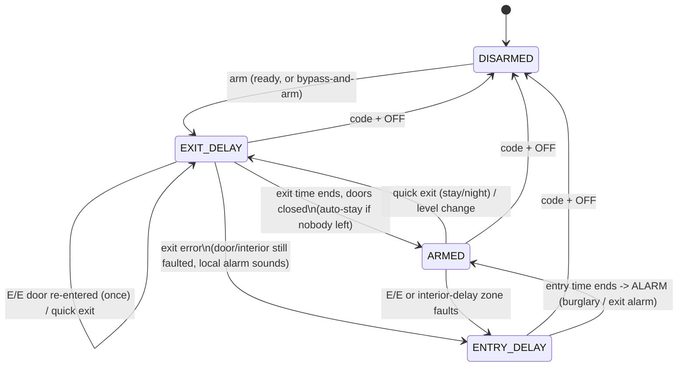

# 01 · Core alarm engine (`alarm_core`)

**Status:** Implemented v1 - arming, delays, alarms, life safety, users, troubles, installer mode, the configuration blob and the zone-source inputs are host-tested and have run on the 7" panel since 2026-09-19. Nothing is left for v1; engine options beyond it (BL-089) and the keypads' GOTO (BL-048) are under Tasks. · **Milestone:** M1, M4 · **Depends on:** none
**Code:** [`components/core/alarm_core`](../../../components/core/alarm_core) · **Tests:** [`components/core/alarm_core/test`](../../../components/core/alarm_core/test)

## Goal
One portable engine that decides everything an alarm panel decides: arming, delays, alarms,
sounding, reporting, troubles, users. It behaves like a modern keypad alarm panel and runs
unchanged on the ESP32-P4, the classic ESP32 and a PC.

## Reference behaviour
Behaviour follows what a classic keypad alarm panel does, plus the SIA CP-01
false-alarm-reduction standard. Everything below is written in this project's own words.

## Concepts

| Concept | In the engine |
|---|---|
| **Partition** | 1..`ALARM_MAX_PARTITIONS` (4). Its own arm state, alarms, memory, chime, bypasses |
| **Arm state** | `DISARMED`, `EXIT_DELAY`, `ARMED`, `ENTRY_DELAY` |
| **Arm level** | `AWAY`, `STAY`, `NIGHT`, plus flags `NO_ENTRY_DELAY` (Instant/Maximum) and `SILENT_EXIT` |
| **Alarms** | Orthogonal to arm state: a set of *sounding causes*, alarm memory, period alarms. The partition stays armed through an alarm; only disarm changes the arm state |
| **Zone** | 1..`ALARM_MAX_ZONES` (128 on P4, 64 on ESP32). Type (numbered as in the table below), partition, flags, device class |
| **User** | 1..`ALARM_MAX_USERS`. 01 installer, 02 system master, then partition master / standard / arm-only / guest / duress |
| **Trouble** | Zone troubles (loop, tamper, low battery, supervision, day fault), system troubles (AC, battery, comm, network, clock, co-processor, radio, bell, tamper, storage), device supervision |
| **Event** | Everything is logged (`on_event`); remote-worthy events are reported (`on_report`), burglary alarms only after the abort window |

### Partition arm states



Alarm conditions (burglary, fire, CO, 24 h, panic, tamper) add *sounding causes* in any state.
Fire, CO and 24 h zones alarm in every state, including `DISARMED`.

### Arming modes

Every mode starts with the exit time, as on a classic keypad panel: there is always an exit
delay, whatever the mode (SIA CP-01 has no exception for Stay). *Instant* and *Maximum* only take the **entry**
delay away: once armed, an entry door alarms at once. The perimeter is armed from the first
second of the exit time (CORE-EXIT-009).

| Mode | Level + flags | Exit time | Exit beeps | Entry delay | Perimeter | Interior |
|---|---|---|---|---|---|---|
| Away | `AWAY` | yes | yes (slow, fast in the last 10 s) | yes | yes | yes |
| Maximum | `AWAY` + `NO_ENTRY_DELAY` | yes | yes | no | yes | yes |
| Stay | `STAY` | yes | **no** (the arming beep only) | yes | yes | no |
| Instant | `STAY` + `NO_ENTRY_DELAY` | yes | **no** | no | yes | no |
| Night | `NIGHT` | yes | **no** | yes | yes | `NIGHT` zones |
| Night Instant | `NIGHT` + `NO_ENTRY_DELAY` | yes | **no** | no | yes | `NIGHT` zones |

Stay and Night exit time is quiet: three beeps at arming and then silence (slow exit beeping
only for Away and Maximum). `SILENT_EXIT` is therefore Away's only: it
mutes the beeps and doubles the exit time; Stay and Night drop the flag.

### One partition rule for codes and buttons

Who may touch a partition is decided in one place (`eng_user_in_partition()`), whether the user
typed a code or pressed a button: the installer and the system master reach every partition,
everyone else only the partitions in their mask. Button, keyfob and keyswitch zones carry a user
number, and that user's authority **and** partition mask are read again on every press, never
just when the installer bound the button - so taking a partition away from a user, or deleting
them, stops their fob the same second it stops their code (CORE-USR-015, CORE-PART-002).

### Locked while armed

From the exit time on, a partition's users can't be added, changed or deleted (not
while the partition is armed), chime can't be switched (disarmed only), zones can't be
bypassed, and installer mode and the walk test wait for every partition to be disarmed.
Disarming, panics, fire and CO always work. The touchscreen locks Settings as well
([07](../07-UI-LVGL-Pro/README.md) UI-022).

## Zone types

| # | Type | Disarmed | Exit time | Armed STAY | Armed NIGHT | Armed AWAY | Bypass |
|---|---|---|---|---|---|---|---|
| 00 | Not used | - | - | - | - | - | - |
| 01 | Entry/exit 1 | not ready, chime | door use tracked; re-entry restarts exit once | entry delay 1 (instant if no-entry-delay) | same | same | yes |
| 02 | Entry/exit 2 | not ready, chime | same | entry delay 2 | same | same | yes |
| 03 | Perimeter | not ready, chime | **instant** | instant | instant | instant | yes |
| 04 | Interior follower | not ready (away) | ignored | ignored | armed if `NIGHT` flag | follows entry time; instant if first | yes |
| 05 | Trouble day / alarm night | trouble (CHECK) | ignored | ignored | armed if `NIGHT` flag | instant | yes |
| 06 | 24 h silent | silent alarm, never shown locally | same | same | same | same | option |
| 07 | 24 h audible | audible alarm (bell + keypads) | same | same | same | same | option |
| 08 | 24 h auxiliary | keypad-only alarm | same | same | same | same | option |
| 09 | Fire | fire alarm (temporal-3); loop open = trouble | same | same | same | same | never |
| 10 | Interior with delay | not ready (away) | ignored | ignored | armed if `NIGHT` flag | starts entry delay 1 | yes |
| 12 | Monitor | event only, never blocks arming | same | same | same | same | no |
| 14 | Carbon monoxide | CO alarm (temporal-4) | same | same | same | same | never |
| 16 | Fire with verification | smoke reset, then a 2nd trip within 90 s (or still faulted after reset) alarms | same | same | same | same | never |
| 20 | Arm-stay button | arms STAY as the zone's user (authority and partition rules apply) | - | - | - | - | n/a |
| 21 | Arm-away button | arms AWAY as the zone's user (same rules) | - | - | - | - | n/a |
| 22 | Disarm button | disarms as the zone's user (same rules) | same | same | same | same | n/a |
| 23 | No response | chime only | - | - | - | - | n/a |
| 24 | Silent burglary | not ready | instant silent | instant silent | instant silent | instant silent | yes |
| 29 | Momentary exit | - | - | restarts exit time (no code) | restarts exit time | - | n/a |
| 77 | Keyswitch | arms AWAY as the zone's user (same rules) | disarms | disarms | disarms | disarms | n/a |

Readiness is evaluated **per level**: a zone only blocks the levels in which it would be armed.
A faulted motion sensor makes the panel "not ready" for Away but still allows Stay. Zones in loop trouble, tamper or supervision failure are not ready; low battery is.

## Defaults (SIA CP-01)

| Option | Default | Range (strict) | Notes |
|---|---|---|---|
| Exit delay (per partition) | 60 s | 45-255 s | Every mode; doubled by silent exit (Away only) |
| Entry delay 1 / 2 (per partition) | 30 s / 45 s | 30-240 s | CP-01 advises entry + abort window <= 60 s |
| Abort window | 30 s | 0-45 s | Burglary/tamper only. Fire/CO/24 h/panic report immediately |
| Cancel window | 300 s | >= 300 s | Disarm after a report sends `alarm_canceled` |
| Bell timeout | 240 s | 0 = until disarm | Fire/CO sound until silenced (`fire_bell_timeout=false`) |
| Swinger trips | 2 | 1-6 | Per zone per armed period; zone option to exempt |
| Cross-zone window | 300 s | - | Only for zones in a pair (either zone may name the other) |
| Fire verification | 90 s window, 6 s smoke reset | - | |
| Exit restart limit | 1 | - | Automatic restarts on re-entry |
| Recent closing | 120 s | - | |
| Auto-stay | on | - | Only for keypad arming |
| Exit sounds | on | - | Away and Maximum only; Stay and Night exit time is quiet |
| Quick arm (AWAY alone, # 2 / # 3) | off | - | Keypad arming without a code |
| Quick exit ([*], #9) | on | - | Exit restart without a code in Stay/Night |
| Remote arm without code | off | - | MQTT/Home Assistant |
| Power up in previous state | on | - | |
| Power-up settle time | 60 s | - | Zone alarms held off after boot |
| Lockout | 5 invalid codes -> 300 s | 0 = off | Per command source (keypad, MQTT client) |
| Walk test timeout | 3600 s | - | |
| Trouble beeps | all except AC loss, clock not set | bitmask | |
| Panic keys A / B / C | police / medical / fire | - | |
| Code length | 4-10 digits, per user | `code_min_len` 4-10 (default 4) for new codes | iPhone-style; classic panels use a fixed 4 |
| Factory codes | installer 69420, master 123456 | - | Panel reports them until changed |

`relaxed_limits = true` allows values outside the CP-01 ranges (development, sheds).

## Requirements and traceability

### Arming, readiness, bypass
| ID | Requirement | Test |
|---|---|---|
| CORE-ARM-001 | Boots disarmed and ready; emits and reports `system_start` | `test_arming.c: test_starts_disarmed_and_ready` |
| CORE-ARM-002 | Arming starts the exit delay, is reported with level and user, and gives an ack beep | `test_arm_away_starts_exit_delay` |
| CORE-ARM-003 | A faulted zone blocks arming (`not_ready` with the first zone, error beep, `arm_failed`) | `test_faulted_zone_blocks_arming` |
| CORE-ARM-004 | Readiness is per level; interior faults don't block Stay | `test_faulted_motion_blocks_away_not_stay` |
| CORE-ARM-005 | Zone trouble blocks arming; low battery does not | `test_zone_trouble_blocks_but_low_battery_does_not` |
| CORE-ARM-006 | Arming without a code only when quick arm is enabled; disarm always needs a code | `test_quick_arm_option` |
| CORE-ARM-007 | Disarm during exit time cancels arming with no alarm | `test_disarm_during_exit_delay` |
| CORE-ARM-008 | Stay ignores interior zones | `test_stay_bypasses_interior` |
| CORE-ARM-009 | Night arms perimeter plus `NIGHT` interior zones | `test_night_arms_night_zones` |
| CORE-ARM-010 | Level change while armed (Stay to Away) restarts exit time | `test_arm_away_from_armed_stay` |
| CORE-ARM-011 | No arming while sounding or during exit/entry time | `test_arm_rejected_while_sounding_or_delaying` |
| CORE-ARM-012 | Disarm without a code is rejected | `test_disarm_needs_code` |
| CORE-ARM-013 | The platform can hold arming (a sensor radio updating its own firmware, docs/features/36 §14): arm requests fail `held` and no partition reads ready; disarm, panics and alarms go on; not kept across a restart | `test_platform_holds_arming` |
| CORE-BYP-001 | Bypass makes a zone ready; bypasses clear on disarm | `test_bypass_then_arm_and_disarm_clears_bypass` |
| CORE-BYP-002 | Bypass-and-arm bypasses all not-ready zones | `test_arm_with_bypass_faulted_flag` |
| CORE-BYP-003 | Fire, CO and 24 h zones can't be bypassed by default | `test_fire_and_24h_zones_not_bypassable` |
| CORE-BYP-004 | A 24 h zone can be bypassable by zone option | `test_24h_zone_bypassable_by_option` |
| CORE-BYP-005 | Bypass only while disarmed | `test_bypass_only_while_disarmed` |
| CORE-BYP-006 | Quick bypass (code + BYPASS + #) | `test_quick_bypass` |
| CORE-BYP-007 | Unbypass; sensor state continues updating while bypassed, and an open zone becomes not ready immediately when unbypassed | `test_unbypass`; zone hub `test_rf_contact_keeps_reporting_through_bypass` |
| CORE-CHIME-001..003 | Chime toggles with a code, sounds for chime zones while disarmed only, and names the zone (voice chime) | `test_chime` |
| CORE-CHIME-004 | Chime is switched only while the partition is disarmed; from the exit time on it's `bad_state` | `test_chime_only_while_disarmed` |
| CORE-CHIME-005 | System option **chime needs a code** (default on; the keypad command is `code + 9`). Off: `chime` without a code switches it, from any source, and the event names no user; a code still works and still names the user, a wrong code is still refused, and CORE-CHIME-004 still holds | `test_chime_without_code_option` |
| CORE-CHIME-007 | A remote client (Home Assistant's paired link, MQTT) switches chime without a code even with **chime needs a code** on: the code guards the keypad, and a remote client proved who it is when it connected, as the Panel Manager's sign-in does. A code it sends still names the user and a wrong one is still refused; CORE-CHIME-004 still holds (BL-172) | `test_chime_from_remote_without_code` |
| CORE-CHIME-006 | A bypassed zone doesn't chime (bypassed is out of service until the next disarm); it chimes again once unbypassed | `test_bypassed_zone_does_not_chime` |

### Exit and entry
| ID | Requirement | Test |
|---|---|---|
| CORE-EXIT-001 | Slow exit beeps, fast in the last 10 s (Away) | `test_exit_entry.c: test_exit_sounds_slow_then_fast` |
| CORE-EXIT-002 | Silent exit mutes beeps and doubles exit time (Away) | `test_silent_exit_doubles_exit_time` |
| CORE-EXIT-003 | Re-entry through an E/E door restarts exit time once | `test_exit_restart_on_reentry_once` |
| CORE-EXIT-004 | Auto-stay when nobody opened and closed an exit door | `test_auto_stay_when_nobody_leaves` |
| CORE-EXIT-005 | No auto-stay for remote arming | `test_no_auto_stay_for_remote_arming` |
| CORE-EXIT-006 | No auto-stay for keyfob arming | `test_no_auto_stay_for_keyfob` |
| CORE-EXIT-007 | Exit error: local alarm plus entry time; disarm = canceled alarm, nothing reported | `test_exit_error_disarmed_is_canceled_alarm` |
| CORE-EXIT-008 | Exit error not disarmed = exit alarm, reported after the abort window | `test_exit_error_becomes_exit_alarm` |
| CORE-EXIT-009 | Perimeter is armed instantly during exit time | `test_perimeter_during_exit_delay_is_instant` |
| CORE-EXIT-010 | Quick exit in Stay | `test_quick_exit_in_stay` |
| CORE-EXIT-011 | No quick exit in Away | `test_quick_exit_not_in_away` |
| CORE-EXIT-012 | Quick exit without a code can be disabled | `test_quick_exit_option` |
| CORE-EXIT-013 | Momentary exit zone restarts exit time. It needs no code, so it always works; it is named after its zone's user only while that user may operate the partition, otherwise the restart is the system's | `test_momentary_exit_zone`, `test_partitions.c: test_momentary_exit_names_only_a_partition_user` |
| CORE-EXIT-014 | Recent closing reported with an alarm within 2 minutes of exit | `test_recent_closing_reported_with_alarm` |
| CORE-EXIT-015 | No recent closing after 2 minutes | `test_no_recent_closing_after_two_minutes` |
| CORE-EXIT-016 | Exit error also covers interior zones still faulted | `test_exit_error_on_interior_zone` |
| CORE-EXIT-017 | Exit beeps only for Away and Maximum; Stay, Night and their Instant forms (and a quick exit) have a quiet exit time after the arming beep | `test_exit_beeps_only_for_away` |
| CORE-EXIT-018 | Silent exit is Away's: Stay and Night drop the flag (exit time not doubled, not reported) | `test_silent_exit_is_away_only` |
| CORE-ENTRY-001 | E/E fault starts entry delay 1 with entry beeps; disarm in time = no alarm | `test_entry_delay_then_disarm` |
| CORE-ENTRY-002 | Entry/exit 2 uses entry delay 2 | `test_entry_delay_2_is_longer` |
| CORE-ENTRY-003 | Entry expiry = burglary alarm, reported after the abort window | `test_entry_expiry_alarms_and_reports_after_abort_window` |
| CORE-ENTRY-004 | Interior followers follow the entry time | `test_follower_follows_entry_delay` |
| CORE-ENTRY-005 | Followers faulted during entry time alarm at expiry | `test_followers_alarm_at_entry_expiry` |
| CORE-ENTRY-006 | Interior tripped first = instant alarm | `test_interior_first_is_instant` |
| CORE-ENTRY-007 | Interior-with-delay zone starts entry delay 1 | `test_interior_delay_zone_starts_entry` |
| CORE-ENTRY-008 | Maximum (Away + no entry delay) | `test_maximum_has_no_entry_delay` |
| CORE-ENTRY-009 | Instant (Stay + no entry delay): the exit time stays (the door may be used), then the door alarms at once | `test_instant_has_no_entry_delay` |
| CORE-ENTRY-010 | Rapid entry beeps when an alarm happened while armed | `test_entry_with_alarm_memory_beeps_rapidly` |

### Alarm handling
| ID | Requirement | Test |
|---|---|---|
| CORE-ALM-001 | Bell times out; strobe and `triggered` remain until disarm | `test_alarms.c: test_bell_timeout` |
| CORE-ALM-002 | Disarm inside the abort window: nothing reported, `alarm_aborted` logged, memory shows canceled | `test_abort_window_suppresses_report` |
| CORE-ALM-003 | Disarm inside the cancel window after a report sends `alarm_canceled` | `test_cancel_window_sends_cancel` |
| CORE-ALM-004 | No cancel report after the cancel window | `test_no_cancel_after_cancel_window` |
| CORE-ALM-005 | Alarm memory stays until a second code + OFF | `test_alarm_memory_needs_second_code_off` |
| CORE-ALM-006 | Swinger shutdown after N trips; reset by disarm | `test_swinger_shutdown` |
| CORE-ALM-007 | Swinger-exempt zones | `test_swinger_exempt_zone` |
| CORE-ALM-008 | Cross zoning: both zones inside the window; a pair is a pair whichever zone names the other (the zone editor sets one side); a zone whose partner can't trip now (bypassed, swinger shut-down, not armed in this level, partition disarmed) acts as a normal zone | `test_cross_zone_requires_partner`, `test_cross_zone_named_side_needs_partner`, `test_cross_zone_naming_side_confirmed_by_partner`, `test_cross_zone_partner_bypassed_acts_alone`, `test_cross_zone_partner_not_armed_acts_alone` |
| CORE-ALM-009 | Cross zoning window expiry | `test_cross_zone_window_expires` |
| CORE-ALM-010 | Silent burglary: no sound, hidden while armed, shown after disarm | `test_silent_burglary` |
| CORE-ALM-011 | Alarm restore reported only after the alarm was | `test_alarm_restore_reported_after_report` |
| CORE-ALM-012 | Strobe stays on until disarm | `test_strobe_until_disarm` |
| CORE-ALM-013 | Held reports are released in order | `test_reports_released_in_order` |
| CORE-ALM-014 | After the first report, later alarms report immediately | `test_subsequent_alarm_reported_immediately` |
| CORE-ALM-015 | Disarm clears `triggered` and silences | `test_disarm_clears_triggered` |

### Life safety, 24 h, panic, walk test
| ID | Requirement | Test |
|---|---|---|
| CORE-FIRE-001 | Fire alarms in any state, reports at once, temporal-3, no timeout | `test_life_safety.c: test_fire_alarm_while_disarmed` |
| CORE-FIRE-002 | OFF key (no code) silences fire; memory kept | `test_fire_silenced_by_off_key` |
| CORE-FIRE-003 | Clearing fire memory pulses the smoke reset output | `test_fire_memory_clear_resets_smoke` |
| CORE-FIRE-004 | Smoke still present after the reset alarms again | `test_fire_still_present_after_reset_realarms` |
| CORE-FIRE-005 | Fire verification: reset, then a second trip | `test_fire_verification_second_trip` |
| CORE-FIRE-006 | Verification window expires without alarm | `test_fire_verification_times_out` |
| CORE-FIRE-007 | Still in alarm after the reset = verified | `test_fire_verification_persistent_trip` |
| CORE-FIRE-008 | CO alarm, temporal-4 | `test_co_alarm` |
| CORE-FIRE-009 | Fire sounding has priority; silencing fire leaves burglary sounding | `test_fire_priority_over_burglary` |
| CORE-24H-001 | 24 h audible alarms while disarmed; code + OFF silences | `test_24h_audible_while_disarmed` |
| CORE-24H-002 | 24 h silent is reported but never shown or sounded | `test_24h_silent_is_hidden` |
| CORE-24H-003 | 24 h auxiliary sounds keypads only | `test_24h_aux_keypad_only` |
| CORE-PANIC-001 | Police panic: audible, reported | `test_panic_police` |
| CORE-PANIC-002 | Medical panic: keypad only | `test_panic_medical` |
| CORE-PANIC-003 | Fire panic: temporal-3 | `test_panic_fire` |
| CORE-PANIC-004 | Silent panic: reported only | `test_panic_silent` |
| CORE-TEST-001 | Walk test: the zones it covers (burglary, no-response, monitor, momentary exit, buttons, keyswitch; docs/features/40 WALK-007) beep and are marked, no alarms, nothing arms; siren test pulse at the start | `test_walk_test`, `test_buttons_are_marked_and_arm_nothing` |
| CORE-TEST-002 | Walk test keeps fire and CO live (a sensor's own test report marks them without an alarm), and 24-hour zones and panics unless the start includes them; code + OFF silences first | `test_walk_test_keeps_fire_live`, `test_24_hour_zones_only_with_the_option`, `test_fire_and_co_stay_live_but_their_test_marks_them` |
| CORE-TEST-003 | Walk test times out, after a double beep at 5 and at 1 minute left; Extend starts the limit again | `test_walk_test_times_out`, `test_end_warnings_and_the_time_limit`, `test_extend_starts_the_limit_again` |
| CORE-TEST-004 | Only the installer, the system master and a partition master start or extend a walk test; whoever may disarm the partition ends it, and an End without a code ends it as the panel (docs/features/40 WALK-001, WALK-025) | `test_walk_test_authority`, `test_who_starts_extends_and_ends`, `test_end_needs_no_code` |
| CORE-TEST-005 | Start, end and extend are separate operations of `ALARM_CMD_WALK_TEST` (a zeroed one toggles: the keypad's code + TEST); a start on a partition already testing, armed, sounding or in installer mode, and an end or extend with none running, are `bad_state` and change nothing | `test_start_end_and_extend_are_separate`, `test_start_needs_a_quiet_disarmed_partition` |
| CORE-TEST-006 | The walk test's record is the engine's, in the partition and zone status and so in the snapshot: each zone's mark (tested, cover, how, trips, first time), the counts, `walk_seq`, who started it, from where and when, and after the end who ended it and how. Only a zone's first test and first cover test are logged; `walk_test_end` carries tested and total; a start clears its own partition's marks, a zone whose type or partition changes loses its mark, and nothing is kept through a restart | `test_first_trip_marks_and_logs_repeats_only_beep`, `test_tamper_marks_the_cover`, `test_the_summary_stays_until_the_next_start`, `test_a_changed_zone_loses_its_mark`, `test_a_restart_ends_it` |

### Users and authority
| ID | Requirement | Test |
|---|---|---|
| CORE-USR-001 | Arm-only can arm, not disarm | `test_users.c: test_arm_only_cannot_disarm` |
| CORE-USR-002 | Guest disarms only what the guest armed | `test_guest_disarms_only_what_guest_armed` |
| CORE-USR-003 | The installer code (user 01) never arms or disarms, from any source - a keypad, a remote keypad, Home Assistant/MQTT, a Panel Manager sign-in, an automation the installer saved, a button or keyswitch zone - at any level, in exit time, armed, in entry time or during an alarm; nor does it restart exit time. The refusal is any unauthorized code's: `not_authorized`, the error sound, no event. On a disarmed partition the installer's code + OFF still ends a walk test, silences and clears memory, and it keeps chime, bypass, the walk test and installer mode; a code check never says it may disarm (deliberate choice 16) | `test_installer_never_arms`, `test_installer_never_disarms`, `test_installer_buttons_never_arm_or_disarm`, `test_installer_keeps_service_work`, `test_automation.c: test_automation_saved_by_installer_never_arms_or_disarms`, `test_partitions.c: test_master_and_installer_buttons_keep_their_reach` |
| CORE-USR-004 | Duress disarms normally plus a silent duress report | `test_duress` |
| CORE-USR-026 | Duress arms normally plus the same silent duress report (the code reports when it arms or disarms); other codes arm without one | `test_duress_on_arming` |
| CORE-USR-005 | Lockout per source after N invalid codes; panic still works | `test_lockout` |
| CORE-USR-006 | A valid code resets the failure count | `test_valid_code_resets_failures` |
| CORE-USR-007 | Master adds users | `test_master_adds_user` |
| CORE-USR-008 | Codes are unique | `test_code_must_be_unique` |
| CORE-USR-009 | Standard users can't manage users | `test_standard_user_cannot_add_users` |
| CORE-USR-010 | Invalid codes are rejected and logged | `test_arming.c: test_invalid_code_rejected` |
| CORE-USR-011 | Partition master limits (own partitions, low authorities, own code) | `test_partition_master_limits` |
| CORE-USR-012 | The installer programs every user: its own code, the system master's and the household's, including new users and partition masters (decided 2026-09-23, deliberate choice 14); still no second installer or system master, and nobody deletes 01, 02 or themselves | `test_installer_sets_master_code`, `test_user_update_rules` |
| CORE-USR-013 | Delete users (not 01/02) | `test_user_delete` |
| CORE-USR-014 | Authenticate API (installer mode entry) | `test_authenticate_api` |
| CORE-USR-015 | Arm-stay, arm-away, disarm and keyswitch zones act as their user, with that user's authority **and** partition mask, read again at every press: a user restricted to another partition can't arm or disarm with a button any more than with their code, an arm-only user's fob arms but never disarms, a guest's fob ends only what the guest started, and an emptied user slot's fob does nothing. Removing a partition from a user, or deleting them, revokes the button at once; the installer and system master keep every partition | `test_keyfob_arm_and_disarm`, `test_button_zone_authority_rules`, `test_partitions.c: test_button_zones_follow_partition_access`, `test_button_access_follows_user_changes`, `test_master_and_installer_buttons_keep_their_reach` |
| CORE-USR-016 | Keyswitch toggles Away / disarm | `test_keyswitch_toggles` |
| CORE-USR-017 | Each user's code can be 4-10 digits; other lengths are rejected | `test_codes_can_be_4_to_10_digits` |
| CORE-USR-018 | `code_min_len` applies to new codes; existing shorter codes keep working | `test_min_length_policy_for_new_codes` |
| CORE-USR-019 | Factory codes: installer 69420, master 123456; `alarm_engine_default_codes()` reports them until changed (status notified) | `test_default_codes` |
| CORE-USR-020 | The default-code check only looks at users 01 and 02 | `test_default_codes_absent` |
| CORE-USR-021 | `alarm_engine_user_update` renames a user or changes its authority and partitions; the code keeps working; reported as `user_updated` | `test_user_update_keeps_code` |
| CORE-USR-022 | User updates follow the programming rules (standard users can't, partition masters only for low authorities in their partitions, the installer and the system master for everyone they manage, slot 02 stays the system master, your own entry keeps its authority) | `test_user_update_rules` |
| CORE-USR-023 | Users are added, changed (code, name, authority) and deleted only while every partition they belong to, before and after the change, is disarmed and quiet; otherwise `bad_state`, after the code check | `test_no_user_changes_while_armed`, `test_partitions.c: test_user_changes_follow_their_partition` |
| CORE-USR-025 | One rule for who manages whom, `alarm_config_user_manages()`: the installer everyone, the system master everyone but the installer, a partition master itself and the standard, arm-only, guest and duress users (or empty slots) within its partitions, nobody else anyone. The engine, the touchscreen's Users page and the Panel Manager all ask it | `test_user_manages_rule` |
| CORE-USR-024 | A platform hash failure returns `unavailable` before comparison, wrong-code/lockout accounting or credential writes. The next attempt can succeed without restarting; failed new hashes leave existing credentials and configuration unchanged. Platforms with fallible hashing supply `hash_faults`, sampled around each hash on the engine task. | `test_hash_failure_does_not_lock_out_installer`, `test_disarm_after_hash_failure`, `test_failed_new_hash_keeps_old_user`, `test_failed_program_hash_keeps_old_code` |
| CORE-USR-027 | `alarm_engine_command_as()` runs a command as a user the platform has already identified (a Panel Manager sign-in), without a code, under CORE-USR-015's rule: the slot must hold a user and the user must have the command's partition - for every command, silence and panic too, since nobody stands at the keys - read again every time, then the command's own authority check as for that user's code (arm-only never disarms, a guest or the installer ends only what they armed, bypass needs a standard user or above, duress included, as for their code; a walk test starts or extends only for the installer, a system or a partition master and ends for whoever may disarm, as for their code, docs/features/40 WALK-001, WALK-025). User 0, an empty slot or a missing partition is `not_authorized` with the error sound. The command's code is ignored, nothing counts toward a lockout and a locked-out source still runs it; duress, alarm memory and states are `alarm_engine_command()`'s. Events name the user and the source; the Panel Manager's is remote id `ALARM_SRC_ID_PANEL_MANAGER` (31), whose events read "By Alex · Panel Manager" (docs/features/31) | `test_command_as_arms_and_disarms_without_code`, `test_command_as_follows_authority`, `test_command_as_partition_scope`, `test_command_as_keeps_duress_and_memory`, `test_command_as_refused_in_program_and_hold`, `test_command_as_duress_on_arming`, `test_command_as_restart_quick_bypass_and_walk_test`, `test_command_as_partition_master`, `test_signed_in_users_follow_the_same_rules` |
| CORE-USR-028 | `alarm_engine_user_set_as()`, `_update_as()` and `_delete_as()` add, change and delete users as a user the platform has already identified (a Panel Manager sign-in), without a code: the actor's slot must hold a user, read again every time (user 0, a number past the table, an empty slot or a user deleted since is `not_authorized`); from there exactly the coded rules with the actor's authority - whom they manage (CORE-USR-025: a master never the installer, a partition master only low authorities in its own partitions, never deleting itself), the code policy and `code_in_use` (CORE-USR-017, 018), the partitions disarmed (CORE-USR-023). Nothing counts toward a keypad lockout or resets one, and a locked-out source still runs it. Events name the actor and the source ("By Alex · Panel Manager") | `test_user_as_add_change_delete`, `test_user_as_needs_a_current_user`, `test_user_as_follows_authority`, `test_user_as_code_policy_and_state`, `test_user_as_leaves_lockout_alone` |
| CORE-USR-029 | Commands from the automation source (`ALARM_SRC_AUTOMATION`, "automation"; id = the automation's uid) are refused (`not_authorized`) before any code check - no state change, no event, nothing toward a lockout, as other `not_authorized` refusals the error sound only - except two, run through `alarm_engine_command_as()` as the person who saved the automation (docs/features/41 AUT-011, ADR-050): an arm at Away, Stay or Night with no arm flag or only `ALARM_ARM_BYPASS_FAULTED` (the automation's "Bypass open zones", 41 D29; only when that person may bypass and while `opt.auto_less_secure` allows it), and a disarm - the latter only while `opt.auto_less_secure` allows it (AUT-015) and never after an alarm in that partition's armed period, sounding or silent (any alarm, fire and CO included; a silent burglary or hold-up waits out its abort window unheard, and a disarm would drop its report or send a cancel; D22). A refusal after a silent alarm makes no error sound either. Everything else is refused: panic, silence, bypass, unbypass, quick bypass, chime, exit restart, walk test, code check, and any command through `alarm_engine_command()`, without the code-less arming the system and schedule sources have. Both re-check the person every time (the slot holds a user who has the partition, then `can_arm` / `can_disarm` as for that user's code). An arm of a partition that isn't disarmed, and a disarm of one that is, answer `bad_state` without an event: an automation never re-arms at another level and never silences, ends a walk test or acknowledges troubles. Installer mode, a walk test and a held arming refuse its arm as anyone's. Its events read "By automation" even when they name a user (docs/features/41 AUT-002, AUT-009) | `test_automation_refuses_all_but_arm_and_disarm`, `test_automation_arm_flags_refused`, `test_automation_arms_as_its_maker`, `test_automation_rechecks_its_maker`, `test_automation_disarm`, `test_automation_never_disarms_after_an_alarm`, `test_automation_arm_refused_as_for_anyone`, notify `test_golden_wording` |
| CORE-USR-030 | An `ARM_FAILED` from the automation or the schedule source is reported (nobody stands at the panel to see it), with the not-ready zone in the event's zone as for every source; from the other sources it stays logged only. No new event type (docs/features/41 AUT-009, AUT-014) | `test_arm_failed_reported_for_unattended_sources`, `test_automation_arm_refused_as_for_anyone` |
| CORE-USR-031 | An automation's arm with `ALARM_ARM_BYPASS_FAULTED` bypasses only the burglary zones that are just open (faulted): a zone in tamper, loop trouble or missing-sensor (supervision) trouble fails the arming `not_ready` naming it, and then no zone is bypassed. The other sources' `BYPASS_FAULTED` is unchanged (any bypassable not-ready zone). Fire, CO and 24-hour zones never block an arming and are never bypassed by it (docs/features/41 AUT-014, D29) | `test_automation_bypasses_open_zones`, `test_automation_never_bypasses_troubled_zone`, `test_other_sources_bypass_unchanged`, `test_life_safety_zones_never_block_arming` |
| CORE-USR-032 | The `ARMED` after an automation's bypass counts the zones it bypassed in its arg2's bits 3-7 (`ALARM_ARMED_BYPASSED(arg2)`, saturating at 31); bits 0-2 stay the arm flags, so readers that mask them are unchanged. Other arming keeps those bits 0 (docs/features/41 AUT-014: "1 zone bypassed") | `test_automation_bypasses_open_zones`, `test_armed_bypass_count_saturates`, `test_other_sources_bypass_unchanged` |
| CORE-USR-033 | A zone an automation bypassed is watched again (deliberate choice 15): once it has been closed - restored, no tamper, loop or supervision trouble - for 10 s on the engine's clock while its partition isn't disarmed (exit time included), its bypass ends with an `UNBYPASS` by the automation's source and the arming user, reported as a bypass is; opening or a trouble inside the 10 s starts the wait over. A person's bypass is never watched again, the disarm still ends every bypass, and the mark is runtime only: after a restart the zone stays bypassed until the disarm (the stored runtime state is unchanged) | `test_automation_bypass_watched_again`, `test_rewatch_ends_at_disarm_and_restart` |
| CORE-USR-034 | `ALARM_CMD_CODE_CHECK` (appended) checks a code as a disarm by it would - a wrong code counts toward the source's lockout, a locked-out source is refused, a user without the partition is `not_authorized` - and changes nothing: no state, no event of its own (a wrong code is the usual `INVALID_CODE`, and `LOCKOUT`, with the error sound), except that a duress code emits the silent, reported `DURESS` a disarm by it would. The result names the user and sets `may_disarm` (appended to `alarm_cmd_result_t`) when that user may disarm the partition: a guest only while it is armed by the guest, the installer never (CORE-USR-003). Never from the automation source (CORE-USR-029). For the put-off of an automation's arming (docs/features/41 AUT-013) | `test_code_check_answers_user`, `test_code_check_counts_toward_lockout`, `test_code_check_duress` |
| CORE-USR-035 | The partition snapshot names who armed it: `arm_source` (additive) is {`ALARM_SRC_AUTOMATION`, uid} when an automation armed it, beside `armed_by` = the person who saved it, and the source of any other arming; {system, 0} while disarmed. Consumers read it first and never show `armed_by` as the one who armed then (docs/features/41 D30, AUT-009). It survives a restart as its kind only: the stored runtime state's `arm_src` (kind + 1, 0 = not known) sits in the partition entry's former tail padding, so the blob keeps its size and `ALARM_RUNTIME_VERSION` 1 - an older firmware's state reads 0 (not known: {system, 0}, the armed state restores as before) and an older firmware ignores the byte; a value no kind has reads as not known. The uid isn't kept (id 0 after a restart) | `test_arm_source_in_snapshot`, `test_arm_source_survives_restart`, `test_runtime_state_layout_unchanged` |
| CORE-USR-036 | `alarm_engine_arming_put_off()` logs that someone put an automation's arming off (docs/features/41 AUT-013, D26): the appended `ALARM_EV_ARMING_PUT_OFF` (`arming_put_off`), user = whose code, source {automation, uid}, the partition, arg = `alarm_put_off_t` (1 an hour, 2 not tonight, 3 not today; `alarm_put_off_name` "hour", "night", "day"), arg2 = the whole minutes from the event's time to the new arm time (an hour only; rounded, 1-255, 0 = not known), read back on the whole minute by `alarm_put_off_until()`. Reported at once, never silent, nothing else changes; uid 0, user 0 or past the table, an unknown choice or a partition not enabled is `bad_arg` with no event | `test_arming_put_off_event`, `test_arming_put_off_refused`, `test_put_off_minutes` |

### Troubles and supervision
| ID | Requirement | Test |
|---|---|---|
| CORE-TRBL-001 | System trouble shown/reported; restore; display until code + OFF | `test_troubles.c: test_ac_loss` |
| CORE-TRBL-002 | Trouble beeps silenced by OFF; display stays | `test_comm_fail_beeps_until_silenced` |
| CORE-TRBL-003 | Zone loop trouble blocks arming; restored trouble cleared by code + OFF | `test_zone_loop_trouble` |
| CORE-TRBL-004 | Tamper while disarmed = trouble | `test_tamper_disarmed_is_trouble` |
| CORE-TRBL-005 | Tamper while armed = alarm | `test_tamper_armed_is_alarm` |
| CORE-TRBL-006 | Low battery doesn't block arming | `test_low_battery_does_not_block` |
| CORE-TRBL-007 | Zone supervision (missed check-in = CHECK) | `test_zone_supervision` |
| CORE-TRBL-008 | Device (keypad) supervision; external keypads supply their home partition, and restore retains the loss scope | `test_device_supervision`, `test_keypad_supervision_home_partition`, `test_disabled_device_scope_is_not_reused` |
| CORE-TRBL-009 | Trouble by day / alarm by night | `test_day_night_zone` |
| CORE-TRBL-010 | Monitor zones report only | `test_monitor_zone` |
| CORE-TRBL-011 | Exit beeps outrank trouble beeps | `test_trouble_beeps_below_exit` |
| CORE-TRBL-012 | No-response zones never alarm | `test_no_response_zone` |
| CORE-TRBL-013 | `ALARM_ZEV_UNREACHABLE` (a source can't reach the sensor, [22](../22-Zone-Sources/README.md) ZSRC-007) makes the zone CHECK at once: supervision trouble, reported, blocks arming, beeps; `ALARM_ZEV_REACHABLE` clears it and the restored trouble shows until code + OFF | `test_unreachable_sensor_is_check_at_once` |
| CORE-TRBL-014 | An unreachable sensor is a trouble, never an alarm (armed, burglary or fire); the zone keeps its last state and still reacts to its inputs, but only `REACHABLE` clears that CHECK (another input of the zone, like a separate battery sensor, doesn't); the supervision timer doesn't report it again and restarts when the sensor is back | `test_unreachable_is_trouble_not_alarm` |

### Keystrokes, power-up, partitions, configuration
| ID | Requirement | Test |
|---|---|---|
| CORE-KEY-001..014 | Classic key sequences (see [04](../04-Keypad-Behavior-and-Commands/README.md)) | `test_keyseq.c` (one test per ID) |
| CORE-PWR-001 | Arm state persisted on change (exit stored as armed) | `test_persistence.c: test_persist_on_arm` |
| CORE-PWR-002 | Power up armed without exit time; event numbering continues | `test_restore_armed_state` |
| CORE-PWR-003 | Option to power up disarmed | `test_restore_disabled_by_option` |
| CORE-PWR-004 | Bypass, memory, chime restored | `test_restore_bypass_memory_chime` |
| CORE-PWR-005 | Settle time after boot | `test_settle_period` |
| CORE-PWR-006 | Runtime state round trip | `test_runtime_state_round_trip` |
| CORE-PWR-007 | Unknown runtime version ignored | `test_unknown_runtime_version_ignored` |
| CORE-PART-001..007 | Independent partitions, per-user partition access for codes and for button/keyswitch zones alike (CORE-PART-002), per-partition counts, system troubles on all | `test_partitions.c` (the tests tagged with these IDs) |
| CORE-PART-008 | `alarm_engine_snapshot()` returns every enabled partition's status, troubles, factory-code flags and zone status in one struct, matching the individual queries | `test_snapshot_matches_queries` |
| CORE-CFG-001..011 | Defaults, CP-01 validation, zone/user validation, config change only when idle, names | `test_config.c` (one test per ID) |
| CORE-CFG-012 | The configuration blob (`alarm/alarm_codec.h`) round-trips every field | `test_codec.c: test_round_trip` |
| CORE-CFG-013 | A configuration using every slot fits `ALARM_CONFIG_BLOB_MAX`; a short buffer is refused | `test_worst_case_fits` |
| CORE-CFG-014 | Unknown items and groups are skipped (older firmware reads newer blobs); missing items keep their defaults (newer firmware reads older blobs) | `test_compatible_both_ways` |
| CORE-CFG-015 | Damaged, truncated, incompatible (`compat`), out-of-capacity, over-wide or invalid blobs are rejected as a whole | `test_rejects_bad_blobs` |
| CORE-CFG-016 | Frozen format-1 fixtures decode forever, and this firmware still writes exactly the bytes of the newest one for its configuration | `test_fixture_v1_still_decodes` (`codec_fixture_v1.h`, from before the chime option), `test_format_1_fixture` (`codec_fixture_v2.h`), `test_voice_fixture` (`codec_fixture_v6.h`) |
| CORE-CFG-017 | CRC-32 is the standard (zlib) one and chains | `test_crc32` |
| CORE-CFG-019 | `alarm_config_check()` answers with a code (`alarm_config_problem_t`, never renumbered) and the partition, zone, user or device it concerns, so a screen can say it in its language (docs/features/37); `alarm_config_validate()`'s English reason is the same check, unchanged | `test_config.c: test_check_codes` |
| CORE-CFG-020 | A zone's spoken name is stored as eight little-endian token IDs (field 0x0B, a nonzero prefix then zeros) and survives older blobs, restarts and a missing voice pack as a draft ([08 voice-first-build.md](../08-Audio-and-Annunciation/voice-first-build.md)) | `test_config.c: test_zone_words_shape`; `test_codec.c: test_voice_fixture` (`codec_fixture_v6.h`: exact bytes, little-endian IDs, an older reader sees v5), `test_voice_fields_rejected`, `test_worst_case_fits`; v1-v5 decode with no spoken names |
| CORE-CFG-021 | Non-reusing voice revisions (system field 0x1E, zone fields 0x0C-0x0E) keep an approval from outliving a rename, a partition move, a source change or a zone's removal and reuse | `test_config.c: test_voice_reconcile_rules` (no write grants, replaces or replays approval, recipe A->B->A included), `test_voice_approve_and_exhaustion`, `test_set_config_reconciles_voice` (`alarm_engine_set_config` runs `alarm_config_voice_reconcile` on every write; `alarm_engine_voice_approve`/`_withdraw` refuse a stale generation, binding or words), `test_voice_invalidate_zones_keeps_concurrent_edit` (a sensor change's invalidation on the running configuration keeps another writer's edit), `test_voice_restore`; `test_backup.c: test_restore_config_never_brings_approval_back` (older and interrupted restores); `test_zone_hub.c: test_same_sensors` (which bind is a new sensor); `test_voice_epoch.c` (a second same-zone rebind during an invalidation stays owed, a stale epoch never clears, settling until the binding is stored); `zone_service.c` `change()` and `alarm_service_voice_invalidate` (the ordering; firmware build only) |
| CORE-CFG-022 | `alarm_config_decode_lenient()` reads a configuration another panel made (a newer master's copy on an older keypad, [11](../11-Panel-Link-Master-Keypad/README.md) LINK-019): no validation, values it doesn't know kept as they came, an entry beyond this build's capacities skipped with its fields; a damaged, truncated or incompatible blob, an index of 0 or a value too wide for its field is still refused | `test_codec.c: test_lenient_decode` |
| CORE-CFG-018 | `alarm_zone_config_resets_state()` names exactly the zones whose troubles a configuration change makes the engine forget (new, removed, retyped or moved; not renamed), so the zone hub can tell it again ([22](../22-Zone-Sources/README.md)); a retyped zone keeps its sensor's open/closed state, a removed or new zone starts closed | `test_config.c: test_resets_state_rule` |

### Installer mode and platform events
| ID | Requirement | Test |
|---|---|---|
| CORE-PROG-001 | Only the installer code enters installer mode; wrong codes count toward lockout; logged and reported (`program_enter`); one session at a time (another source gets `bad_state`) | `test_program.c: test_installer_code_enters_installer_mode` |
| CORE-PROG-002 | Only while every partition is disarmed, silent and out of walk test | `test_installer_mode_only_when_idle` |
| CORE-PROG-003 | Nothing can be armed in installer mode (commands, keyfobs, walk test refused); fire, CO, 24-hour zones and panics stay live | `test_installer_mode_blocks_arming_only` |
| CORE-PROG-004 | Left with exit or after `ALARM_PROGRAM_TIMEOUT_S` (15 min) without keepalive or `set_config`; logged and reported (`program_exit`, arg 1 = timeout) | `test_installer_mode_exit_and_timeout` |
| CORE-PROG-005 | Power-up recovery: for `ALARM_RECOVERY_WINDOW_S` (120 s) after init, installer mode opens without a code (arg 1, user 0), and a new installer code can be set without the old one | `test_power_up_recovery` |
| CORE-PROG-006 | The recovery window closes, can be switched off (`power_up_program`), needs every partition disarmed, and closes when the option is turned off | `test_recovery_window_limits` |
| CORE-PROG-007 | In installer mode, from the same source, `alarm_engine_program_set_code` sets the installer and master codes only (code policy, uniqueness) | `test_program_set_code_rules` |
| CORE-PROG-008 | Platform events (`factory_reset`) are numbered, logged and reported like engine events; other types are refused | `test_platform_event` |
| CORE-PROG-009 | `firmware_update` platform events are logged and reported the same way: the panel's own stages 0-8 (installing, updated, rolled back, co-processor updated or failed, server changed, stopped, rolling back, restart put off; docs/features/13) with arg2 0, and a keypad's stages 9-13 on its master (docs/features/11) only from source {keypad, 1..`ALARM_MAX_DEVICES`}, with arg2 0 except on `keypad_failed`, where it is the why (never 0); a zone, unknown stages and other fields are refused | `test_platform_event`, `test_firmware_update_keypad_stages` |
| CORE-PROG-010 | `alarm_engine_platform_event_ex` adds a zone and a second argument to a platform event: the Z-Wave network's events (device added, added insecure, removed, left, network reset, radio restarted; docs/features/36 network.md §15) are numbered, logged and reported the same way, each type accepting only its own fields | `test_program.c: test_zwave_platform_events` |
| CORE-PROG-011 | `alarm_engine_program_enter_as()` opens installer mode for a user the platform has already identified (a Panel Manager sign-in), without a code: the slot must hold the installer, read again now (anyone else, user 0 or an empty slot is `not_authorized`); every partition idle and one source at a time as CORE-PROG-001/002 (not while someone is in installer mode at the panel), never the power-up recovery path, logged and reported as `program_enter` by that user and source; nothing counts toward a lockout. The Panel Manager applies programming, sets the installer and master codes and starts a factory reset this way | `test_program.c: test_program_enter_as_installer`, `test_program_enter_as_refusals`, `test_program_enter_as_conditions` |
| CORE-PROG-012 | `automation_failed` (docs/features/41 AUT-009) is a platform event, numbered, logged and reported now: partition 0, the triggering zone or 0 (at most `ALARM_MAX_ZONES`), arg the reason (`alarm_auto_fail_t`, 1..7), arg2 the action (`ALARM_AUTO_ACT_*`: Lock or Close with a device's reason, 0 for arming with `no_warning` only), src {automation, uid}; a reason of 0 or past the last, any other action or pair, or a zone out of range is refused and records nothing | `test_program.c: test_automation_failed_event` |

## Keypad sounds (engine output)
Continuous pattern per partition (`status.sounder`), highest priority first:
`fire` (temporal-3) > `carbon_monoxide` (temporal-4) > `alarm` (burglary/audible panic) >
`aux` (24 h aux, medical) > `entry_memory` / `entry` > `exit_fast` / `exit` (Away and Maximum
only) > `trouble` > `none`.
One-shot sounds (`on_sound`): `ack`, `error`, `chime` (with zone), `walk_test` (with zone), `walk_test_warning` (the double beep at 5 and 1 minute left).
Timing and waveforms: [08](../08-Audio-and-Annunciation/README.md).

Outputs (`on_output`): `BELL` per partition (`steady` / `temporal3` / `temporal4` / `test` pulse),
`STROBE` per partition (alarm until disarm), `SMOKE_RESET` system (fire memory clear, verification).

## Event catalog

| Event | When | Reported | Contact ID code (for comparison only) |
|---|---|---|---|
| `system_start` | Engine init | yes | 305 system reset |
| `armed` / `disarmed` | Arm / disarm (user, source, level) | yes | 401/441 close, 401 open |
| `auto_stay` | Away converted to Stay | yes | - |
| `arm_failed` | Arm rejected | no | - |
| `exit_restart` / `entry_delay` | Exit time restarted / entry started | no | - |
| `alarm` (cause) | Any alarm; burglary after abort window | yes | 110 fire, 120/122/123 panic, 130-134 burglary, 137 tamper, 162 CO |
| `alarm_restore` | Alarmed zone back to normal | if alarm reported | 3xx restore |
| `exit_error` | Exit error started (the `alarm` with cause `exit_error` is the report) | no | 374 exit error |
| `recent_closing` | Alarm within 2 min of exit | yes (with alarm) | 459 recent close |
| `alarm_aborted` | Disarmed inside abort window | no | - |
| `alarm_canceled` | Disarmed inside cancel window after a report | yes | 406 cancel |
| `alarm_silenced` / `bell_timeout` / `memory_cleared` | Housekeeping | no | - |
| `swinger_shutdown` | Zone shut down | yes | - |
| `bypass` / `unbypass` | Zone bypass changes | yes | 570 bypass |
| `trouble` / `trouble_restore` (family zone/system/device) | Trouble changes | yes | 301 AC, 302 battery, 350/354 comm, 373 fire trouble, 380/381/383/384 sensor |
| `troubles_acked` | Code + OFF acknowledged troubles | no | - |
| `duress` | Duress code used (silent) | yes | 121 duress |
| `invalid_code` / `lockout` | Bad code / lockout | lockout only | 461 wrong code |
| `chime_on` / `chime_off` | Chime toggled | no | - |
| `walk_test_start` / `walk_test_end` / `walk_test_zone` / `walk_test_extend` / `walk_test_warning` | Walk test (end: tested and total counts; warning: minutes left) | start/end | 607 walk test |
| `monitor_fault` / `monitor_restore` | Monitor zone | yes | - |
| `user_changed` / `user_deleted` / `config_changed` | Programming | yes | 627/628 program mode |
| `user_updated` | Name, authority or partitions changed; the code stays | yes | - |
| `program_enter` / `program_exit` | Installer mode (arg 1: power-up recovery / idle timeout) | yes | 627/628 program mode |
| `factory_reset` | Recorded by the platform just before erasing (arg bit 0: event log too) | yes | - |
| `firmware_update` | Recorded by the platform (arg `alarm_fw_stage_t`: `installing` 0, `updated`, `rolled_back`, `coprocessor_updated`, `coprocessor_failed`, `server_changed`, `stopped`, `rolling_back`, `restart_put_off` 8; a keypad's, on its master from {keypad, n}: `keypad_installing` 9, `keypad_updated` 10, `keypad_rolled_back` 11, `keypad_failed` 12 (arg2 its why), 13 reserved; JSON key `stage`, and for `keypad_failed` `why` and its name `reason`), [13](../13-OTA-Updates/README.md), [11](../11-Panel-Link-Master-Keypad/README.md) | yes | - |
| `zwave_device_added` / `zwave_device_added_insecure` | A Z-Wave device joined, encrypted or not (arg2: how, [36](../36-Z-Wave-Sensors-ZAC93/README.md)) | yes | - |
| `zwave_device_removed` | The installer removed a Z-Wave device (arg2: why) | yes | - |
| `zwave_device_left` | A Z-Wave device left the network by itself (arg2: why) | yes | - |
| `zwave_network_reset` | The Z-Wave network was reset: every device must be added again | yes | - |
| `zwave_radio_restarted` | The Z-Wave radio restarted by itself (arg: the last wake-up reason; arg2: how many restarts, 255 or more at 255, 0 in older records meaning one - logged the first time, then once an hour at most) | yes | - |
| `zwave_device_software` | A Z-Wave device's software update started, succeeded or failed (arg2: which); arg2 3-5 the Z-Wave radio's own (arg 0) | yes | - |
| `zwave_garage` | A garage door through its Z-Wave relay: asked to open or close (by whom), got there, or didn't (arg2) | yes | - |
| `zwave_jamming_reported` | A Z-Wave device reported radio jamming around it (arg: its node; once an hour at most) | yes | - |
| `zigbee_added` | A Zigbee device joined (arg: the device; arg2: how it joined, `alarm_zb_join_t`; [20](../20-ESP32-H2-Sensor-Radio/devices.md) §11) | yes | - |
| `zigbee_removed` / `zigbee_forgotten` | The installer removed a Zigbee device: it was asked to leave and left / removed without its answer | yes | - |
| `zigbee_left` | A Zigbee device left the network by itself | yes | - |
| `zigbee_replaced` | Another Zigbee device took over a device's zones (arg: the new one) | yes | - |
| `zigbee_join_refused` | A Zigbee device was turned away (zone 0, arg 0; arg2: why) | yes | - |
| `zigbee_channel` | The Zigbee network moved to another channel (arg2: 11..26) | yes | - |
| `zigbee_network_reset` | The Zigbee network was reset: every device must be added again | yes | - |
| `zigbee_radio_restarted` | The Zigbee radio restarted (zone 0, arg 0; arg2: why) | yes | - |
| `backup_made` | The installer downloaded a backup file (the secrets left the panel, encrypted; [14](../14-Configuration-and-Installer-Programming/README.md) CFG-005) | yes | - |
| `backup_restored` | A backup file is being restored; recorded just before its entries are written and the panel restarts (CFG-006) | yes | - |
| `clock_set` | The date and time were set by hand (touchscreen, Panel Manager or the service console); user = who set it, 0 the console ([35](../35-Battery-Backed-Clock/README.md) RTC-014) | yes | - |
| `automation_failed` | An automation's Lock or Close didn't happen, or its arming (no time to warn first); zone the triggering zone or 0, arg the reason, arg2 the action, source {automation, uid} ([41](../41-Automations/README.md) AUT-009, CORE-PROG-012) | yes | - |

`alarm_event_type_t` values are stored in the event log ([05](../05-Event-Log/README.md)): new
types are only ever appended.

Reports are delivered as our own MQTT JSON ([10](../10-MQTT-and-Home-Assistant/README.md)).
Contact ID is **not** transmitted; the column only shows coverage parity.

## API summary

```c
alarm_engine_init(&e, &cfg, &ports, restore_or_NULL, now_ms);
alarm_engine_zone_event(&e, zone, ALARM_ZEV_FAULT, now_ms);        // sensors
alarm_engine_command(&e, &cmd, &source, now_ms, &result);          // keypads, MQTT
alarm_engine_system_trouble(&e, ALARM_TRBL_AC_LOSS, true, now_ms); // platform health
alarm_engine_device_checkin(&e, keypad_no, now_ms);                // supervision
alarm_engine_tick(&e, now_ms);                                     // timers
alarm_engine_next_deadline(&e);                                    // when to tick next
alarm_engine_partition_status(&e, p, &st); alarm_engine_zone_status(&e, z, &zs);
alarm_engine_user_set(...); alarm_engine_user_delete(...); alarm_engine_authenticate(...);
alarm_engine_default_codes(&e);                                    // factory codes still in use?
alarm_engine_snapshot(&e, &snap);                                  // all of the above in one struct
alarm_snapshot_troubles(&snap, cfg, partitions, items, max);   // the Troubles list (UI-030), one walker for the touchscreen and the Panel Manager
alarm_engine_set_config(&e, &cfg, now_ms);                          // installer, idle only
alarm_engine_user_update(&e, &src, actor_code, user, auth, parts, name, now_ms); // code kept
alarm_engine_program_enter(&e, &src, installer_code_or_NULL, now_ms, &user);   // installer mode
alarm_engine_program_set_code(&e, &src, 1 /* or 2 */, new_code, now_ms);
alarm_engine_program_keepalive(&e, now_ms); alarm_engine_program_exit(&e, &src, now_ms);
alarm_engine_platform_event(&e, ALARM_EV_FACTORY_RESET, arg, &src, user, now_ms);
alarm_engine_platform_event_ex(&e, ALARM_EV_ZWAVE_REMOVED, zone, node, why, &src, user, now_ms);
alarm_engine_hold_arming(&e, true);                                // arming held (CORE-ARM-013)
alarm_config_encode(&cfg, buf, cap, &len); alarm_config_decode(buf, len, &cfg); // storage blob
```

Ports: `on_event`, `on_report`, `on_status`, `on_sound`, `on_output`, `on_persist`,
`on_config_changed`, `hash_code` (required), `get_epoch_ms`, `hash_faults` (required when
`hash_code` can fail, CORE-USR-024). Every entry point first advances timers in deadline order,
so a late tick never reorders behaviour. Memory: `sizeof(alarm_engine_t)` is about 22 KB with the P4 capacities
(128 zones, 64 users, 16 devices), the walk test's marks and summaries about 0.7 KB of it.

## Deliberate choices
1. **Public factory codes**: installer (01) **69420**, master (02) **123456**
   (classic panels ship short four-digit ones). Because this project is open source, the defaults are
   public, so the panel reports them (`alarm_engine_default_codes()`) until they're changed
   and the UI shows a reminder.
2. **Codes are 4-10 digits, chosen per user** (iPhone-style) instead of a fixed 4. Keypad
   commands therefore use dedicated keys (code + AWAY) instead of digits (code + 2); see
   [04](../04-Keypad-Behavior-and-Commands/README.md). Codes are stored as salted hashes
   (PBKDF2 on device); classic panels store them in plain text.
3. **Readiness per level**: interior faults don't block Stay.
4. **Arming clears the previous alarm memory.** Classic keypads keep showing it until
   code + OFF.
5. **Walk test keeps fire and CO live** instead of testing them silently; 24-hour zones and
   panic buttons stay live too unless the start's option *Include panic and 24-hour zones* is
   on (docs/features/40 WALK-007). A fire or CO sensor's own test report marks it tested
   without an alarm.
6. **Lockout default** is 5 bad codes / 5 minutes per source (configurable).
7. **Reporting is MQTT JSON**, not Contact ID/SIA.
8. **Silent alarms**: silent burglary appears in memory only after disarm; hold-up and silent
   panic never appear locally (event log only).
9. **Night level** uses a per-zone `NIGHT` flag (a zone list, as on classic panels).
10. **Installer mode keeps protecting**: a classic panel stops processing alarms while in programming mode;
    here fire, CO, 24-hour zones and panics stay live and only arming is refused.
11. **Power-up recovery lasts 2 minutes** (a classic panel allows about 50 s) and is
    reached from the touchscreen, because the boards sit behind a case and no flow may need a
    physical button. It needs every partition disarmed, is reported, and the installer option
    `power_up_program` turns it off.
12. **Chime can be switched without a code** when the installer turns `chime_needs_code` off
    (CORE-CHIME-005). A keypad asks for `code + 9`, and that is still the default here, but
    touchscreen panels don't: they change chime from a pull-down or from Settings with no code
    at all ([14](../14-Configuration-and-Installer-Programming/README.md)). With the option
    off, no source needs a code. With it on, only the keypads do: a remote client (Home Assistant's paired link, MQTT) switches chime without one
    (CORE-CHIME-007, decided 2026-10-06, BL-172), since it proved who it is when it
    connected and a switch in Home Assistant has nowhere to type a code. Chime still
    changes only while disarmed.
    The default stays "needs a code" on purpose (decided 2026-09-19): a code keeps a
    child from switching the door chime off unnoticed, and the option lets another household
    choose the one-touch behaviour instead.
13. **Quiet exit time for Stay and Night** follows classic panels, not the
    letter of SIA CP-01, which asks for exit beeping through the whole exit time unless the
    user arms silently; classic panels treat Stay and Night arming as silent arming. Away keeps
    the beeps (the installer's `exit_sounds` option).
14. **The installer manages every user** (decided 2026-09-23: "an installer should be able to
    change the user code or password for any user"). Some panels keep the installer to its own code
    and the master's, to keep the household's codes from the installer; others let the installer
    into user management, and this panel's owner is its installer. The
    system master still manages everyone but the installer (CORE-USR-012, -025).
15. **An automation's bypass is watched again** (CORE-USR-033, docs/features/41 D29): a zone an
    automation bypassed at arming because it was open is unbypassed once it has been closed for
    10 s, so a garage door or a window closed after an automatic arming is protected. A classic
    panel keeps a forced bypass until the disarm (and so does every bypass made any other way here);
    a force arm that returns the zone is the model.
16. **The installer code never arms or disarms** (CORE-USR-003; decided 2026-10-07: "the
    Installer code should never be used to Arm or Disarm the Alarm"). Classic panels let the installer
    code arm, and disarm what it armed itself; here the installer programs and the household
    arms, so the installer's code, sign-in, automations and buttons are refused like an
    arm-only code's disarm, from every source, and it can't restart exit time either. The
    installer keeps everything that gives no protection up: installer mode and programming,
    the walk test (code + OFF still ends one on a disarmed partition, WALK-025), chime, bypass
    while disarmed, and code + OFF on a disarmed partition to silence a fire, CO or 24-hour
    alarm and clear the memory.

## Test and acceptance
Host tests (Unity) in [`components/core/alarm_core/test`](../../../components/core/alarm_core/test),
one file per area, each test tagged with the IDs it proves: `test_arming.c` (readiness, levels,
bypass, chime), `test_exit_entry.c`, `test_alarms.c`, `test_life_safety.c` (fire, CO, 24 h,
panics, walk test), `test_users.c`, `test_troubles.c`, `test_keyseq.c`, `test_persistence.c`,
`test_partitions.c`, `test_config.c`, `test_program.c` (installer mode, platform events),
`test_automation.c` (the automation source, docs/features/41 phase C) and
`test_codec.c` with its frozen fixtures `codec_fixture_v1.h` and `codec_fixture_v2.h`. `sim.c`
is the engine harness they share with the zone hub's and the Z-Wave zones' tests. CI runs them
with sanitizers (`.github/workflows/host-tests.yml`). On a panel the engine is driven through
the touchscreen, the service console (`keys`, `zone <n> <event>`) and the zone hub; the
hardware checks of the screens, sounds and outputs it drives are in
[07](../07-UI-LVGL-Pro/README.md), [08](../08-Audio-and-Annunciation/README.md) and
[16](../16-Outputs-Siren-and-Relays/README.md).

## Open questions
- Should a restored alarm that was never reported (aborted) produce a restore report? Currently
  no (CORE-ALM-011).
- Night level with no night zones configured: allow (behaves like Stay) or warn? Today it is
  allowed, and the installer's partition options say "No zone is a night zone yet, so Night arms
  like Stay." (`ui_installer.c`).
- Default swinger limit for 24 h audible zones (currently exempt from swinger).

## Tasks
v1 is complete: every requirement above has its tagged host test. What follows is beyond v1.

### Engine options beyond v1 (BL-089)
- [ ] AC-loss report delay with randomisation ([17](../17-Power-and-Supervision/README.md)
  describes the same "later" item: hold the `ac_loss` report 10-60 min with jitter, the local
  display at once)
- [ ] Periodic trouble re-sound
- [ ] Night-time trouble beep suppression
- [ ] Keypad-panic / keystroke-violation lockout alarm
- [ ] Fire silence requiring a code (option)
- [ ] Common/lobby partition logic (a "common zone")

### On the keypads (M7)
- [x] Live acceptance on paired 7-inch/10-inch panels of cross-partition switching (KPD-006, BL-048): installer default,
  allow/lock, idle seconds (default 30), Never and no-code view selection. Activity renews inactivity;
  alarm commands retain authorization. See [11](../11-Panel-Link-Master-Keypad/README.md).

### Covered elsewhere or dropped
- Duplicate of [18](../18-Schedules-and-Auto-Arm/README.md) (`alarm_sched` with host tests;
  BL-046): scheduling - auto-arm with warning, auto-disarm, scheduled users.
- Duplicate of [16](../16-Outputs-Siren-and-Relays/README.md) (Programmable output rules;
  BL-037).
- Dropped 2026-09-28: periodic test report - as this list already said, a heartbeat covers it
  over MQTT (`…/heartbeat` every 60 s, MQTT-012 in [10](../10-MQTT-and-Home-Assistant/README.md);
  `net_mqtt.c` `HEARTBEAT_MS`).
