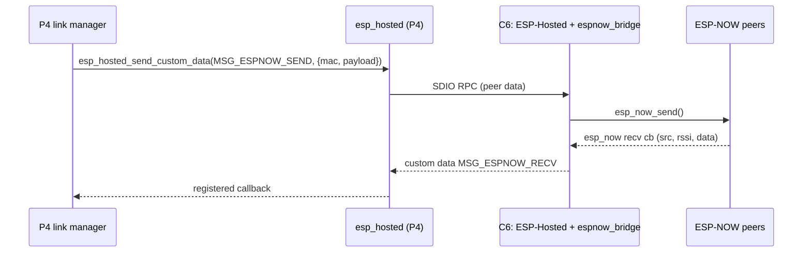

# 12 · ESP32-C6 co-processor firmware

**Status:** Our signed C6 build and ESP-NOW bridge run on both P4 panel sizes. SDIO updates,
full revision reporting, signature rejection before transfer, and panel-link commands over
ESP-NOW have passed on hardware. An interrupted SDIO transfer also preserves the working radio
across restart. Left: interrupted-update reporting in Panel Manager (BL-048), the link's recovery
at runtime (BL-097), and recovery documented with photos (BL-072) · **Milestone:**
M2 (use existing firmware), M6 (update path), M7 (ESP-NOW bridge) · **Depends on:** 06, 11, 13

**Code:** `components/services/panel_ota/src/cp_ota.c` (the updater; the `c6` console command
is in `ota_console.c`), `components/services/platform_esp/src/net_wifi.c` (bring-up, version,
the `coprocessor` trouble)

## Goal
Keep the CrowPanel's onboard ESP32-C6 (the P4's Wi-Fi/BLE radio) on firmware we control. Our
build adds an ESP-NOW bridge, so the P4 can use ESP-NOW for the keypad link, and the P4 updates
the C6 automatically.

## Facts (September 2026)
- **Verified on the reference board (V1.1, P4 v1.3, 2026-09-19):** the C6 ships with ESP-Hosted
  co-processor **2.12.3** (Elecrow's current release; no upgrade needed). Our ESP-Hosted 3.0.x
  host (3.0.9 since 2026-10-05) talks to it in compatibility mode ("major version mismatch" is only a hint to update it),
  reads its version (`c6 status`) and brings up Wi-Fi. **The C6 enable (GPIO32) must be configured
  `CONFIG_ESP_HOSTED_SDIO_RESET_ACTIVE_LOW=y` with ESP-Hosted 3.x**: 3.x pulses the pin to the
  "active" level and parks it at the other, and the C6 runs while GPIO32 is high. Elecrow's
  examples say ACTIVE_HIGH because ESP-Hosted 2.x ended its reset sequence at the "active" level.
  With ACTIVE_HIGH on 3.x the C6 stays in reset (`sdmmc_init_ocr ... 0x107`). From 3.0.8
  ESP-Hosted always resets it active-low and the option is gone (docs/features/06, findings 1).
- The factory P4 demo (`elecrow_p4_idf`, IDF 5.5.3) doesn't use the C6 at all.
- The C6 is an **ESP32-C6-MINI-1-N4** (4 MB flash) connected to the P4 over **SDIO** (4-bit on
  board rev V1.1). It runs **ESP-Hosted** co-processor ("slave") firmware. Elecrow's wiki says
  the factory firmware "cannot be directly reprogrammed via P4". Elecrow has since published an
  official upgrade: **C6 firmware V2.12.3 (2026-04-08)** plus a `host_performs_slave_ota`
  project that flashes it **from the P4 over SDIO** (repo folder
  `example/CrowPanel_Advance_ESP32-P4 Display_Firmware_Upgrade_Guide`).
- The factory C6 firmware doesn't support ESP-NOW and, per community reports, doesn't answer the
  version-query RPC; on the reference board it does (2.12.3 was read on 2026-09-19, see the
  first fact above and CP-004).
- **ESP-Hosted 3.0.9** is current (2026-10-05). 3.x MCU hosts are back-compatible with 0.0.6+/1.x/2.x
  co-processors; the recommended order is *upgrade the co-processor first*. Co-processor OTA
  is built in: host-driven over the existing transport (partition, LittleFS or HTTPS image source).
- ESP-Hosted forwards `esp_wifi` calls but **not `esp_now`**. It offers a **peer-data
  custom-RPC channel** (application-defined message IDs, 1-8166 byte payloads) in both
  directions. ESPHome (Sept 2026) implemented ESP-NOW for P4+C6 boards exactly this way,
  with a host shim and a matching co-processor overlay.
- A community project has done C6 OTA from the P4 on this exact board (Elecrow CrowPanel
  ESP32-P4 7.0") to install ESP-NOW-capable firmware.

## Requirements
| ID | Requirement | Verified by |
|---|---|---|
| CP-001 | M2: Wi-Fi works with the C6 as shipped, or after applying Elecrow's V2.12.3 upgrade | HIL: works with the shipped 2.12.3 (joined, time synced) |
| CP-002 | Our image `crowpanel_c6_cp` = ESP-Hosted 3.x co-processor (SDIO slave pins/width matching the V1.1 host config) + `espnow_bridge` | build + HIL |
| CP-003 | The bridge exposes: init (channel), add/remove peer, send (dst MAC, payload <= 1470), receive (src MAC, RSSI, payload), send status; message IDs and packed structs in one shared header, versioned | host tests of the codec, HIL |
| CP-004 | At boot the P4 reads the C6 firmware version. If it differs from the bundled image, the P4 performs co-processor OTA **only while all partitions are disarmed**, then resets the C6 | HIL: signed transfer and coordinated restart on both P4 panel sizes; bridge INFO reports the full revision |
| CP-005 | A failed C6 update leaves the previous C6 firmware booting (dual OTA slots on the C6); it is logged and shown as failed on the update page, and raises the `coprocessor` trouble only if the C6 then stops answering (decided 2026-09-28: a C6 still carrying the Wi-Fi is not a trouble) | fault-injection test |
| CP-006 | If the SDIO transport fails at runtime, the P4 resets the C6 (GPIO32), retries, and raises the `coprocessor` trouble after 3 failures | HIL |
| CP-007 | Documented manual recovery: flash the C6 through its UART0 download pins (GPIO9 boot strap) with a USB-UART adapter | doc |

## Design

- **Bridge messages** (`components/core/alarm_proto/include/alarm_proto/espnow_bridge_proto.h`,
  shared by both builds): version 1, message ID `0x52414E31`, 14-byte header with explicit
  little-endian fields. INIT, ADD, DEL, SEND, DONE, RECV and STATE carry channel, MAC,
  request ID and status/RSSI; SEND byte 11 selects bulk (0) or control (1) priority.
  Control and bulk have separate bounded queues on both processors. Encryption stays in
  our link layer, so no ESP-NOW LMKs are needed.
  INFO reports the bounded application revision separately from Hosted's library version.
- **Timeouts**: the C6 waits at most 200 ms for a send completion, then deinitialises ESP-NOW
  before accepting another send. The host worker discards queued frames older than 200 ms;
  blocking Hosted RPC never runs on the link task. The link protocol handles retries.
- **Resync**: the host repeats INIT every second; the C6 restores peers on demand after reset.
- **Image delivery**: the C6 image is published with each release, stored in the P4's `cp_fw`
  partition (written during the P4's own OTA or by the release package) and verified by SHA-256
  and signature before co-processor OTA ([13](../13-OTA-Updates/README.md)).
- **As built (M6):** `cp_fw` holds a plain C6 app image (today written over USB with parttool);
  the panel parses its header for version and size, `c6 update [force]` or the automatic path
  (once per image version) streams it with `esp_hosted_cp_ota_*`, logs
  `firmware_update/coprocessor_updated` and restarts. The P4 verifies the padded image's SHA-256
  and SBv2 signature against its trusted key before starting the transfer; unsigned images fail.
  `firmware/c6_cp` builds the signed application with pinned Hosted 3.0.9, Wi-Fi and SDIO,
  with Bluetooth disabled. Only the app is staged: the factory C6 partition table is preserved.

## First-time upgrade path (factory -> ours)
1. M2: done. The factory firmware is already V2.12.3 and works with ESP-Hosted 3.0.7.
2. M7: our `crowpanel_c6_cp` build goes into `cp_fw` and the M6 updater installs it. The shipped
   firmware reports its version, so no "unknown" case is needed on this board.

## Interrupted-transfer acceptance (CP-005)

On the 7-inch P4 master, development firmware `0.7.4-dev.14` stopped a signed C6
`3.0.10-ra3` transfer after 591,872 of 1,183,744 acknowledged bytes. The test deliberately
resends the running revision into the inactive slot and omits END and ACTIVATE. It exercises
a real partial SDIO write, not a rejected image or a simulated transport. This was software
fault injection followed by an orderly restart, not a physical power cut.

The updater reported failure, the event log retained the failure, and the C6 continued carrying
Wi-Fi without a co-processor trouble. An orderly P4 restart reset the C6 through Hosted;
the same working `3.0.10-ra3` radio returned, Wi-Fi rejoined and the physical keypad reconnected.
Both panel applications completed their coordinated `dev.14` update. No C6 bootloader,
partition table, signing key or eFuse was changed.

Reporting defect found: the Panel Manager API returns phase 5 and the correct Wi-Fi-module
failure reason, but classifies it as `failed: check`, so the page says "Couldn't check for
updates". The last-result record still describes the prior successful P4 install. The failure
event remains in history after reboot, but the immediate failure card clears at restart.

The development-only `c6 test-interrupt` command requests one signed transfer, stops it halfway
and consumes the injection before starting. It refuses an initially non-idle system and keeps
the ordinary signature, update-ownership and worker idle gates. It neither activates the C6
image nor automatically restarts the panel. A subsequent normal update is not fault-injected.
To repeat on an explicitly authorized bench: ensure all partitions are disarmed, capture
`c6 status`, invoke the test, capture failure/status/history, then perform an orderly restart
and verify the radio revision, Wi-Fi and keypad connection. Do not use reset-hold or alter
speaker/display preferences to run this test.

## Open questions
- Does the V1.1 board route the C6's UART0 and GPIO9 to reachable pads for recovery? (Check the
  V1.1 schematic; to be answered with the recovery documentation, BL-072.)
- BLE on the C6: not needed for v1. Disable to save RAM and airtime? (To settle with our own C6
  build, BL-048.)

## Tasks
- [x] M2: verify the shipped C6 firmware (2.12.3; reset polarity fix above)
- [x] Join a Wi-Fi network on the touchscreen and confirm SNTP (2026-09-19)
- Duplicate of docs/features/06 (Hardware acceptance: "Wi-Fi reconnects after an access point
  reboot", BL-032): was "Reconnect after an access point restart (HIL)"
- [x] `firmware/c6_cp` build (ESP-Hosted 3.x co-processor, V1.1 SDIO config), installed on both P4 panel sizes (CP-002)
  (BL-048)
- [x] `espnow_bridge` component + shared protocol header + host tests; commands over radio on hardware (CP-003) (BL-048)
- [x] P4-side co-processor OTA manager (version check, disarmed-only, once per version) (M6)
- [x] Signature / SHA-256 check before transfer; corrupted image rejected on hardware with the old C6 still running (M7)
  (BL-048)
- [x] CP-005 decided: a failed transfer with the old image still running is logged and shown
      as failed, not a trouble (`cp_ota.c` run_update); `coprocessor` is for a silent C6 (CP-006)
- [x] CP-005 hardware: half-transfer interruption, failure event, continued radio service and old
  C6 firmware booting after orderly restart; see acceptance above (BL-048).
- [ ] Correct CP-005 Panel Manager failure classification and last-result reporting: currently
  presented as a failed update check rather than a failed radio install (BL-048).
- [ ] CP-006: when the SDIO link fails after start-up, reset the C6 (GPIO32), retry, and raise
  the `coprocessor` trouble after 3 failures. Today only the start-up retries every 30 s
  (`net_wifi.c` net_task) (BL-097)
- [ ] Recovery documentation (CP-007): flashing the C6 through its UART0 download pins and the
  GPIO9 boot strap with a USB-UART adapter, with photos of the pads (BL-072)
