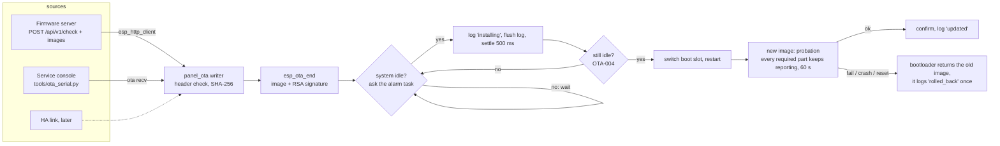

# 13 · OTA updates

**Status:** Implemented v1 - signed P4 updates from the console, the RoboAlarms update server
(BL-186: a domain, its channel and the key the installer accepted), remote development and the
browser (/30, /31), with each step of an update followed and Stop (BL-188); the C6 update path is
built, never run. Upload, idle restart, self-test and rollback verified on a panel 2026-09-19;
the reviewed handshake and self-test, with B002's fixes, verified on the bench 2026-09-28 (runs
10-14). The update server path, with progress and Stop, tried on a bench panel against two
local servers 2026-10-08 (left: BL-186, BL-188; findings BL-197 to BL-201).
Automatic updates are designed, not built ([automatic-updates.md](automatic-updates.md), BL-190).
Left: runs 8, 9, 15 and a real power cut (BL-023), release job (BL-050), SD card (BL-061), keypad
updates at the master's order (docs/features/11 "Updates through the link", BL-048).
· **Milestone:** M6 (P4 + C6), M8 (keypad updates) · **Depends on:** 05, 06, 10, 12, 14, 15

## Goal
Update every device in the system safely: the panel takes a signed image (from a release
server, the service console, later the Home Assistant link), verifies it, installs it only when
nothing is armed or sounding, and comes back on the previous firmware by itself when the new one
doesn't work. The C6 Wi-Fi co-processor is updated from the panel. Keypads follow in M8.

## Reference behaviour
Touchscreen alarm panels get their updates over the network and install them after someone
accepts them on the panel, never while armed. We copy that: nothing installs by
itself, and a restart waits until the system is disarmed and quiet. There is no dealer: the
update server is the RoboAlarms update server unless the installer chooses another domain.

## Requirements
| ID | Requirement | Verified by |
|---|---|---|
| OTA-001 | Images are signed (RSA-3072, ESP-IDF "signed apps without Secure Boot"). `esp_ota_end()` accepts only images signed with the key of the running firmware. The private key lives in `secrets/` (git-ignored) and never enters the repo. No eFuses are burnt | hardware (tampered image refused), build |
| OTA-002 | Releases are described by a JSON manifest: one artifact per device and P4 silicon revision; relative URLs resolve against the manifest's URL. The manifest isn't signed (the image is the trust anchor, OTA-001/014) | `test_fw.c` |
| OTA-003 | Download into the inactive slot in the background (`esp_http_client`, streaming, HTTPS with the certificate bundle or plain HTTP on the home network, redirects followed); size and SHA-256 from the manifest are checked | build; hardware once Wi-Fi is joined |
| OTA-004 | **Restart only when safe**: every enabled partition disarmed, no bell and no alarm sounder (trouble beeps are fine), no walk test, installer mode off. A person asks for the install (panel, Home Assistant or console). The question is put to the alarm task itself, and put again after the announcement and the log flush; the boot slot switches in the last moment before the restart, so arming or an alarm during those seconds only costs the attempt and an unplanned restart keeps the old firmware. The Wi-Fi module's update waits the same way: the C6 keeps its old image until the panel restarts, and that restart goes through the same gates and announcement (OTA-028), the update machinery held until then | `test_fw.c` (policy), hardware |
| OTA-005 | Rollback: the first start of a new image is on probation. Every required part of the panel - the engine, the event log, the screen, sensor input and touch - must **keep** reporting healthy (a heartbeat, not a one-off) for at least 60 s; then it is confirmed. A part that never reports or falls silent fails; one that comes up late gets until 180 s. Otherwise, or after a crash or reset during probation, the previous image returns. A master's keypads (`PANEL_OTA_OK_KEYPADS`, docs/features/11 LINK-041) are the exception: until 180 s a keypad not back yet, or a pause in its answers, is waited for, never a failure, and 10 s of answers prove them, so one that first answers by 170 s counts; none back by 180 s rolls back, and the version it returns to says so (NVS `ota`/`rbh`, `last.failed`). The times and the rule are in `alarm_proto/ota_selftest.h` | `test_fw.c` (the rule: `test_selftest_part_verdicts`, `test_selftest_steps`, `test_selftest_keypads_come_back`); hardware (reset during probation, sensor/touch fault injection) |
| OTA-006 | Arming state and configuration survive updates (the configuration blob is forward and backward readable, docs/features/14) | `CORE-CFG-012..017`, hardware |
| OTA-007 | C6 co-processor: an image in the `cp_fw` partition that differs from what the C6 runs is sent once when the system is idle (ESP-Hosted OTA over SDIO), then the panel restarts; a failed attempt isn't repeated automatically | build; `c6 status` on hardware (update itself not run: no newer image exists) |
| OTA-008 | Keypad updates follow docs/features/11 LINK-029..037: the master orders; a keypad that reaches the update server fetches its own image through its release run; only a keypad that can't gets it relayed over the link, from the master's running image or a copy in PSRAM; the keypad checks everything itself; `fw_cache` isn't used | M8 |
| OTA-009 | Keypads update after the master's own update is confirmed, one at a time, only while every partition is quiet on the master (`proto_fw_install_allowed`); the master puts off its own restart while a keypad installs or self-tests (docs/features/11 LINK-030, LINK-034) | M8 |
| OTA-010 | Status everywhere: Settings > About (Software update), the event log (`firmware_update` with a stage) and MQTT (`…/firmware` + Home Assistant `update` entity with install) | `test_fw.c`, `CORE-PROG-009`, preview `about`, `about_update_available`, `about_update_waiting`, `about_rolled_back` |
| OTA-011 | Offline update from an SD card image (same verification) | later |
| OTA-012 | Optional anti-rollback (`secure_version`) for security fixes | later (needs eFuses) |
| OTA-013 | Serial upload over the service console (`ota recv`, `tools/ota_serial.py`): line-framed base64 with CRC-32 per line, stop-and-wait with retry, SHA-256 of the whole image | `test_fw.c`, hardware |
| OTA-014 | Versions are semantic (`VERSION` file, `-Version` for test builds). An image must be newer than the running one; older or equal only when forced by a person (console `force`) | `test_fw.c`, hardware |
| OTA-015 | A failed release check is a **result**, not a state: the panel looks again by itself, 10 min after the first failure and doubling to at most 6 h (never longer than the scheduled interval). The failure stays on screen until a newer result replaces it. A check never runs over a download, a verified image waiting for an idle system, or a restart | `test_fw.c` |
| OTA-016 | The release manifest may list language packs (`languages`: locale, url, size, sha256, optional version); the panel fetches from it the packs it needs (docs/features/37 language-packs.md); the pack's own signature is the trust anchor, like the image's; the asset packs likewise (`assets`: kind, url, size, sha256, optional version; docs/features/39 asset-packs.md, OPT-007) | `test_fw.c` |
| OTA-017 | **The update server is a domain** (BL-186): `roboalarms.com` by default (`CONFIG_PANEL_OTA_DEFAULT_DOMAIN`), and the panel asks `https://firmware.<domain>`. A person types only the domain ("https://" and a trailing "/" are dropped); it shows as the domain everywhere, never the full address. A development address (`http://192.0.2.10:8080`) can be set at the service console only. The old manifest source (`ota`/`src`, OTA-002) is no longer read | `test_fwsrv.c` |
| OTA-018 | **A check asks the server** (`POST /api/v1/check`) with the channel, board id and revision, chip revision, signed project name, running version, add-on parts and languages, and reads its answer: the offered version, channel, critical flag, notes, image (url, size, SHA-256, signing key) and language packs, or why there is none (up to date, unknown device, needs a stepping stone, held back). Failures follow OTA-015. A check for a keypad carries `want`, an added key naming the version its master names, sent only when set: the keypad's PROBE and FETCH and a master's copy for it name the version ordered, and a capped keypad's own check names its master's version (docs/features/11 LINK-029). A server that ignores `want` offers its newest: the keypad compares versions, and an offer past its cap is no offer. Only a check with `want` reads the reasons `unknown_version` and `not_offered`, and on it a reason the panel doesn't know refuses (REFUSED 17), where without `want` it reads as up to date (docs/features/11 LINK-031, the why table; the server's side is BL-050) | `test_fwsrv.c` (with `want`: `test_check_request_want`, `test_check_answer_want_reasons`, `test_check_why`); hardware |
| OTA-019 | **Channel**: stable (default), beta, alpha or dev, chosen by the installer; a change checks at once. The panel reports the channel its running version is on now (`installed`; `installed_channel` in GET `updates`); the screens show the channel chosen, not that one (BL-196) | `test_fwsrv.c`; preview `fwsrv_channel`, `fwsrv_menu_beta` |
| OTA-020 | **Signing keys**: an update must be signed with the running image's key or with the one key the installer accepted for the current server (the trust record, NVS `ota`/`trust`). A new server is checked first (its keys, `GET /api/v1/keys`, and firmware for this panel); a key the panel doesn't trust needs the installer to see its fingerprint (the first 16 hex digits of its ESP-IDF digest, in groups of four) and confirm - a hold at the panel, a tick and their password in the Panel Manager. What is kept is exactly what was checked. Changing the server replaces the accepted key; going back to this build's server drops it. The panel never swaps a key by itself: a release signed with another key is refused until the installer checks the server again. ESP-IDF's own check stays (OTA-001); the accepted key is added behind it and fails closed | `test_fwsrv.c`; hardware (a second key refused before, accepted after; a tampered image refused) |
| OTA-021 | **Not with the factory installer code**: while the installer code is the factory one, a server whose key the panel doesn't trust yet is refused, at the panel and in the Panel Manager. Going back to a server with a trusted key stays allowed; the service console isn't held back (whoever has the cable can flash the panel) | `panel_pages.test.cjs`; preview `fwsrv_factory_code`, `fwsrv_refused_factory` |
| OTA-022 | **Who**: the installer alone sees and changes the update server and the channel (Installer > Updates; the Panel Manager's Updates page, for the installer only). Software update - what is offered, Check again, Install and Stop - is the installer's and the system master's. On the touchscreen everyone else sees only that an update exists or runs (About's tag and row: "Update", "Updating") and can't open it. The Panel Manager's Software updates page is the installer's and the system master's alone; others see only the restart there (the header says Restarting and the sign-in after it says why, OTA-029) | preview `fwsrv_menu`, `software_update_locked`, `about_update_running`, `about_update_running_master`; `panel_pages.test.cjs` |
| OTA-023 | A server change is logged (`firmware_update` stage `server_changed`) with who made it, reaches MQTT and the owner's notifications like other system events, and is followed by a check | `test_program.c`; hardware |
| OTA-024 | **Withdrawn and critical**: a running version its publisher withdrew says so at every check; an offered version marked critical (or one that leads to a critical fix) says it is an important fix. Nothing installs by itself on a panel that checks for itself (automatic updates: BL-190); a keypad follows the version its master runs by itself (docs/features/11 LINK-030, decided 2026-10-17) | `test_fwsrv.c`; preview `upd_withdrawn`, `upd_withdrawn_alone`, `upd_critical`, `upd_critical_done` |
| OTA-025 | Language packs come from the check answer and, for a language added later, from `GET /api/v1/languages`, checked by their own signature as before (OTA-016); both answers carry the asset packs too (`assets`, OPT-007), which the panel keeps with the languages | `test_fwsrv.c` |
| OTA-026 | **Progress** (BL-188): an update run reports its stage (downloading, verifying, waiting, installing, stopping, rolling back; the Wi-Fi module and a developer's file have no steps), its kind (also "from the alarm panel", `PANEL_OTA_KIND_LINK`, with steps and Stop; an ordered run waits with "Waiting for <master>", its master's name; both built, not yet tried on a panel), the version it installs and the one it replaces, bytes of size while downloading, and what holds it while it waits. The touchscreen, the Panel Manager and MQTT show it; live words change at most once a second and nothing moves but a stepped bar (UI-020). Status listeners also run during a download and before the restart, so Home Assistant sees the percent and the install | preview `upd_downloading`, `upd_checking`, `upd_waiting`, `upd_self_test`, `upd_wifi_module`, `upd_file`, `home_update_banner`; `manager_mockup.test.cjs`; hardware |
| OTA-027 | **Stop**: the installer or the system master can stop a release update before the panel switches to it. Stop is offered while it downloads, is verified and waits; once the restart begins (Installing) it is no longer offered and an open Stop question closes, but a Stop already sent still lands in the seconds the panel holds the restart, which it then gives up. It turns "stopping" at once and ends within seconds (up to a minute on a stalled connection); the download is thrown away and Install starts again. Allowed while armed (in the Panel Manager too). Logged as `stopped` with who stopped it. Never after the boot slot switches: then only the self-test decides | preview `upd_stop_question`, `upd_stopping`; hardware; `panel_pages.test.cjs` |
| OTA-028 | **The restart**: "installing" is logged, the panel holds 3 s (its log is written; a status-bar banner says it restarts) and asks the alarm task once more. Arming, an alarm or a stop in those seconds puts it off: `restart_put_off` is logged and it tries again 30 s after everything is quiet. Banners give way to alarms and arming | hardware; preview `upd_restarting`, `home_update_restarting`, `home_update_going_back` |
| OTA-029 | **The last result** (`last`: updated, rolled back, stopped or failed, with the versions, the time, the reason and who) is kept for as long as it helps: stopped and failed until the next Install or check; rolled back until an install replaces the failed version or a newer one is offered; updated for 24 hours (from the event log, so it survives the restart) | preview `upd_stopped`, `upd_failed`, `upd_updated`, `upd_rolled_back`; hardware |
| OTA-030 | **One run at a time**: Install starts only when nothing runs or self-tests; an Install that finds the update machinery briefly held (a language pack's check) waits up to 30 s, then fails "Another update is running" - never dropped silently. From Install to the end of the self-test the server and the channel can't change. An ordered run counts as a run; on a keypad paired with a master whose session has `PLINK_CAP_FW`, Install becomes "Updates come from <master>" (docs/features/11 LINK-029) | hardware; `panel_pages.test.cjs` |
| OTA-031 | A failed self-test logs `rolling_back` before the panel restarts with the previous version (armed or not, OTA-005), so the people watching see why it restarts | hardware |
| OTA-032 | A panel with keypads puts off its own restart while one installs or self-tests ("A keypad is checking its update", `panel_ota_set_restart_hold`; docs/features/11 LINK-030): every restart into a new image or after the Wi-Fi module's update waits and says why; a rollback after a failed self-test never waits (built, BL-048; not yet called by the link or tried on a panel) | unit; hardware |

## Design



### Components
| Where | What |
|---|---|
| `components/core/alarm_proto` `proto_fw.h`, `src/fw.c`, `src/fw_image.c`, `ota_retry.h`, `ota_profile.h`, `ota_selftest.h` | Portable, host-tested: semantic versions, manifest pick, install policy, base64 + upload line decoding, `…/firmware` state JSON and the HA `update` discovery document; the retry schedule after a failed check (`ota_retry.h`) and which signed project names may replace the running one (`ota_profile.h`), both moved here from `panel_ota` (docs/features/33); the self-test's times and rule (`ota_selftest.h`, OTA-005); for updates through the panel link (`fw_image.c`, docs/features/11) the why numbers, the cap, the header judge and an image's exact length in its slot |
| `components/core/alarm_proto` `proto_fwsrv.h`, `src/fwsrv.c` | Portable, host-tested: the update server's domain rule, the check request and answer, the keys list, the trust record's blob, the fingerprint, and the signature block's key digest (OTA-017..OTA-020, OTA-024, OTA-025) |
| `components/services/panel_ota` | ESP-IDF: writer (`panel_ota_begin/write/end/abort/apply`), the restart handshake with the alarm task, probation and rollback, the server check and download, a new server's check and its trust record, the update task, `ota_trust.c` (the accepted key behind ESP-IDF's signature check), `cp_ota.c` (C6), `ota_console.c` (`ota`, `c6`); for the panel link (docs/features/11) a keypad's orders and cap, and `ota_source.c`, a master's image sources for its keypads |
| `components/core/alarm_core` | `ALARM_EV_FIRMWARE_UPDATE` with `alarm_fw_stage_t` (`installing`, `updated`, `rolled_back`, `coprocessor_updated`, `coprocessor_failed`), recorded through `alarm_service_firmware_event()` |
| `components/services/net_mqtt` | `…/firmware` state (retained), `homeassistant/update/<node>/firmware/config`, `…/firmware/set` = `install` (only with commands on) |
| `components/ui/alarm_ui` `ui_update.c` | Settings > About > Software update (opens with the installer's or the system master's code): the status row, Install and its question, Check again, the run's view (level bar, steps, Stop and its question), the last result, and the status-bar banner while an update runs. Installer > Updates (the update server, its key and the channel) is in `ui_installer.c` |
| `firmware/crowpanel_p4`, `cmake/alarm_firmware.cmake`, `components/app/panel_app` | `VERSION` → `PROJECT_VER` (env `ALARM_FW_VERSION` overrides) and the signed project name per build profile in `alarm_firmware.cmake`; signing and rollback in `sdkconfig.defaults`; the required health mask in `app_main.c`, the heartbeats and the `health` task in `panel_app.c` |
| `tools/idf.ps1`, `tools/ota_serial.py` | Key creation, `-Version` test builds, serial upload |

### Signing (OTA-001)
- `CONFIG_SECURE_SIGNED_APPS_NO_SECURE_BOOT` + `CONFIG_SECURE_SIGNED_APPS_RSA_SCHEME` +
  `CONFIG_SECURE_SIGNED_ON_UPDATE_NO_SECURE_BOOT`: the build signs the app with
  `secrets/ota_signing_key.pem`; `esp_ota_end()` checks new images against the public key in
  the running app's signature block. The bootloader doesn't verify at boot (with RSA that needs
  hardware Secure Boot), so USB flashing still works: physical access is out of scope here
  ([15](../15-Security-and-Hardening/README.md)).
- `tools/idf.ps1` creates the key on the first build (`espsecure generate-signing-key --version 2
  --scheme rsa3072`). **Back it up.** Panels only accept updates signed with the key of the
  firmware they run: a lost key means reflashing each panel over USB. Every developer machine
  has its own key unless the same file is copied in, so images from two machines can't update
  each other's panels.
- RSA-3072 is the Secure Boot v2 scheme of the P4, so the same key can later be burnt into
  eFuses for real Secure Boot without changing the release flow.

### Versions (OTA-014)
`VERSION` at the repo root holds the release version (now `0.6.0`); `cmake/alarm_firmware.cmake`
sets `PROJECT_VER` from it. `pwsh tools/idf.ps1 -Version 0.6.1-test build` builds a test image in
`build_v1_0.6.1-test/` (same sdkconfig). Versions compare by semantic versioning
(`0.6.1-rc.1 < 0.6.1 < 0.6.2`); a git hash is not a version.

### Install flow (OTA-004, OTA-005)
1. The writer holds back the first 288 bytes until the image header, segment header and app
   description can be checked: magic, chip, P4 silicon revision range, project name
   (the running firmware's own, `alarm_crowpanel_p4[-dev|-release]`, or a development panel's
   explicit step to release: `ota_profile_accepts()`, docs/features/30), version rule. Then
   everything streams into the other slot with `OTA_WITH_SEQUENTIAL_WRITES` (sectors erased as
   they fill).
2. `panel_ota_end()`: exact length, SHA-256 (when given), then `esp_ota_end()` (whole image and
   signature). The image is "ready"; the boot slot is **not** switched yet.
3. `panel_ota_apply()`: phase *waiting*; the update task asks every second whether the system is
   idle and shows why it waits. The question goes to the **alarm task** (`alarm_service_call`),
   so the answer and the engine's state belong together; the callback only takes a snapshot and
   applies `proto_fw_install_allowed()`, so a life-safety event is never waiting on an update.
4. When idle: phase *restarting*, `firmware_update/installing` logged, the event log flushed
   (up to 3 s), 500 ms for MQTT and the screen to show it. **All of that happens while the old
   image is still the one that boots.** Then the same question again - and only if it is still
   yes does `esp_ota_set_boot_partition()` run, with `esp_restart()` the next statement.
   If someone armed, an alarm started or the install was cancelled in the meantime, the attempt
   is given up: the verified image stays ready, the phase goes back to *waiting* with the
   reason, and the next attempt is 30 s later (so a house being armed and disarmed can't churn
   the event log). A power cut anywhere before the slot switch keeps the old firmware.
5. New image, first start (`ESP_OTA_IMG_PENDING_VERIFY`): probation. Every bit in the mask the
   firmware's `app_main.c` sets (`.health_mask`) and `panel_app` passes to `panel_ota_start()`
   must **keep** calling `panel_ota_healthy()` - at least every `PANEL_OTA_HEALTH_PERIOD_MS`
   (5 s), from the task that does the work, on real progress that needs no person (the touch
   driver reports a successful poll of the controller, not a finger). A bit counts when its last
   report is under 15 s old and its reports span at least 30 s. After 60 s with all of them:
   `esp_ota_mark_app_valid_cancel_rollback()` and `firmware_update/updated`. A bit that never
   reported or has fallen silent: `esp_ota_mark_app_invalid_rollback_and_reboot()` straight
   away. A bit that is reporting but started late keeps probation open until 180 s, then the
   same rollback. A master's keypads are the exception (`PANEL_OTA_OK_KEYPADS`, required once its
   link registers `panel_ota_set_keypads_check`; docs/features/11 LINK-041): they come back only
   after this restart, so until 180 s a keypad not back yet, or quiet for a while, keeps probation
   open instead of failing it, and 10 s of answers (`PANEL_OTA_KEYPADS_SPAN_MS`) prove them. Still
   unanswered at 180 s: the same rollback, and the failing image first writes the parts it missed
   to NVS `ota`/`rbh`, so the version it returns to can say "no keypad answered" (`last.failed`).
   The times (`PANEL_OTA_CONFIRM_MS`, `_MAX_MS`, the heartbeat contract,
   `PANEL_OTA_KEYPADS_SPAN_MS`) and the rule (`panel_ota_part_judge`, `panel_ota_selftest_step`)
   are in `alarm_proto/ota_selftest.h`, host-tested in `test_fw.c`.
6. A reset or crash during probation: the bootloader marks the image aborted and starts the
   previous one. That one finds the invalid slot (`esp_ota_get_last_invalid_partition`), shows
   "Version X failed its self-test: back on Y" in About and logs `firmware_update/rolled_back`
   once (NVS `ota/rb` remembers which image it reported).
7. While a new image is on probation, `esp_ota_begin()` refuses another update.

### What must be healthy, and the headless profile (OTA-005)
`panel_ota_start(required)` takes the mask, and the mask **is** the hardware profile's contract.
The CrowPanel passes engine, event log, screen, sensor input and touch: a panel that shows a
picture but can't be touched, or whose zone source processing never started, is not a panel, and
an update that broke either of those must not be kept. The bits are appended, never renumbered
(`panel_ota.h`).

`PANEL_OTA_OK_SENSORS` says the zone source processing runs, not that any sensor exists, so a
panel with no zones configured still reports it. Leaving a bit out of the mask is a deliberate
statement that this build protects and is operated some other way - and whatever that other way
is must itself be in the mask. There is no headless profile today.

Every beat comes from the task that does the work, at a point that only runs when real work
happened, and **never from a person**: the panel is verified at three in the morning with nobody
in the room.

| Part | Beats from | On |
|---|---|---|
| `PANEL_OTA_OK_ENGINE` | the alarm task | a call the health task posts (`alarm_service_post`); only a task that is running its own queue can answer it |
| `PANEL_OTA_OK_LOG` | the event log's writer task | each completed pass (`panel_log_passes`), at most a second apart even with nothing to write |
| `PANEL_OTA_OK_SENSORS` | the zone hub's task | each completed tick of the sources (`zone_service_passes`), at most 4 s apart |
| `PANEL_OTA_OK_UI` | the LVGL task | an `lv_timer` callback, i.e. a completed `lv_timer_handler()` pass |
| `PANEL_OTA_OK_TOUCH` | the GT911 poll on the LVGL task | a read the controller answered - `polls` minus I2C `errors` moving, finger or no finger |
| `PANEL_OTA_OK_LINK` | a panel link keypad's link task (docs/features/11) | at most once a second while the master's status is under 15 s old, or the keypad isn't paired |
| `PANEL_OTA_OK_KEYPADS` | the update task, about once a second, from the question a master's link registers (`panel_ota_set_keypads_check`; docs/features/11 LINK-041) | on probation only while the question says yes: a keypad that was online in the minute before "installing" (NVS `link/kup`) has a session again and sends heartbeats, or there is no such keypad; outside probation always |

A panel in the panel link's keypad role (docs/features/11 LINK-020) runs no engine, log or zone
sources: its mask is screen, touch and the link (`panel_app_config_t.keypad_health_mask`), and its
"is the system idle?" is answered from its master's status (`panel_ota_set_idle_gate`): only while
the link is up and that status, under 15 s old, passes `proto_fw_install_allowed()`.

The parts that publish a counter rather than beating themselves are read by the `health` task in
`components/app/panel_app/src/panel_app.c` every 2 s, which turns "the counter moved" into the
beat. That task blocks on nothing, so one part that wedges never silences the others.

The same heartbeats are watched **outside** probation: when a required part stops reporting for
15 s the update task logs it and `panel_ota_health_stale()` says which. The platform turns that
into what the owner sees - `zone_service` raises the "sensors may not be heard" trouble when
sensor input is the part that stopped (the same one a lost source link raises, ZSRC-015), and
`health` on the service console names any of the seven (a keypad's panel link and a master's
keypads too). The screen, touch and the engine have no
system trouble of their own; see "Open questions".

### When a release check fails (OTA-015)
A failed check leaves phase *failed* with its reason on screen - that is the last result, not a
state the scheduler has to climb out of. The scheduler starts a check whenever nothing is being
written, waiting for an idle system or restarting, so it retries 10 min after the first failure
and doubles to at most 6 h (and never waits longer than `CONFIG_PANEL_OTA_CHECK_HOURS` itself).
A success resets the ladder; so does setting a new update source, which also checks at once.
"Busy" and "no network yet" are not failures: they only push the next look out by 10 min.
`panel_ota_retry_delay_ms()` (`components/core/alarm_proto/include/alarm_proto/ota_retry.h`)
holds the schedule and is free of ESP-IDF so `components/core/alarm_proto/test/test_fw.c` can
check it.

### Update server (OTA-017..OTA-025)
The update server is a domain: `roboalarms.com` (`CONFIG_PANEL_OTA_DEFAULT_DOMAIN`) until the
installer chooses another, and the panel asks `https://firmware.<domain>`.
It checks 3 min after start and then every
`CONFIG_PANEL_OTA_CHECK_HOURS` (24) with `POST /api/v1/check` (OTA-018): its channel (NVS
`ota`/`chan`), its board (`CONFIG_PANEL_OTA_DEVICE`, `crowpanel_dhe04107d` for the 7" panel, or
`board_info()->id` when that is empty), the P4 silicon revision, the signed project name, the
running version, add-on parts and languages. The answer names the offered version and its image
(address, size, SHA-256, the key it is signed with) and language packs, or why there is none.
Download, language-pack and notes addresses must be absolute `http(s)` addresses with a host and
no spaces or control characters, and `https` when the server is; another host (a CDN) is fine.
The answer's addresses are never trusted for the image itself: its size and SHA-256 are checked,
then its signature.

**Changing the server** (OTA-020, OTA-021): a new domain is checked first - its keys (`GET
/api/v1/keys`) and firmware for this panel - and nothing is kept until that check is done. The
installer then sees the domain and its signing key (name and fingerprint); a key the panel doesn't
trust yet needs a hold at the panel or a tick and their password in the Panel Manager, and is
refused while the installer code is the factory one. The update task stores exactly what was
checked: the domain and the accepted key, in NVS `ota`/`trust` (a CRC-checked blob; a damaged one
reads as the default server with no accepted key), holding the update machinery while it writes.
Going back to this build's server drops the accepted key. The service console (`ota server check
<domain>`, then `ota server use`) isn't held back by the factory code, and takes a development
address too (`http://192.0.2.10:8080`).

**The accepted key** (OTA-020): `ota_trust.c` wraps ESP-IDF's signature check
(`-Wl,--wrap=esp_secure_boot_verify_sbv2_signature_block`). ESP-IDF's own check runs first and its
"yes" stands; after its "no" only signature block 0 is tried, and only if its key's digest is the
accepted one (a RAM copy loaded at start, before the language packs), with ESP-IDF's RSA-PSS
verification. Anything else - no accepted key, a damaged record, any error - is ESP-IDF's
refusal. The wrap covers every `esp_ota_end`, `esp_ota_set_boot_partition` and language-pack
signature check. Whether the server's key is "trusted already" rests on what the server says
signed its image; that only decides which warning the installer sees, because the wrap decides
what installs.

Two side effects of a change of key:
- **Rollback.** After an update signed with the new key, the previous version is signed with a
  key the running one no longer accepts, so ESP-IDF's rollback check refuses it. A failed
  self-test then restarts the image unconfirmed; the bootloader, which checks no signature at
  boot, marks it aborted and starts the previous version - the switch back a power cut would make.
  Not yet tried on a panel (BL-186).
- **Language packs** signed with the old key read as damaged until the new server's packs are
  fetched; English never depends on a pack.

**Making a release:** bump `VERSION`; `pwsh tools/idf.ps1 -Profile release build` and
`pwsh tools/idf.ps1 -Profile release -ChipRev v3 build` with the release key; check each build
with `tools/check_release_profile.py` (docs/features/30); publish
`build_v1_release/alarm_crowpanel_p4-release.bin`, `build_v3_release/alarm_crowpanel_p4-release.bin`
and `<build>/lang/*.robolang` on the update server; no release job automates these steps yet
(BL-050). A panel takes only its own signed project name (or a development panel's explicit step
to release), so a panel on a legacy build needs the one-time USB bootstrap first
(docs/features/30). The old release manifest (OTA-002, OTA-016, `proto_fw.h`) is still parsed by
the host tests but no longer read by the panel.

### Serial upload (OTA-013)
```
C:\Espressif\tools\python\v6.1\venv\Scripts\python.exe tools/ota_serial.py -p COM4 <image.bin> [--force] [--watch 90]
```
About 6.7 min at 115200 baud for a 2 MB image (≈ 5.2 KB/s). The console's UART receive buffer is
raised to 8 KB for the upload and log output drops to warnings while it runs. Lines:
`<seq> <crc32 hex8> <base64 of ≤ 1024 bytes>`; the panel answers `OTA OK <seq>` or
`OTA RETRY <expected>` (a lost answer is harmless: an already written line is acknowledged
again). `END` → `OTA DONE <version>` / `OTA FAIL <reason>`; then the panel restarts when idle.
`--tamper` flips one byte (test of OTA-001: the panel must answer `OTA FAIL`).

### Remote development and the browser (docs/features/30, /31)
**Development transport (M17):** [docs/features/30](../30-Remote-Development/README.md) adds
enrolled mTLS uploads through this same writer, signed board/profile validation, and
authenticated reconnect confirmation during network-dev probation. Normal health probation and
both safe-restart gates remain. Release updates remain available without developer access or a
PC; explicit release firmware rejects dev/legacy images even with version forcing. Remote
network installs cancel if safety state changes instead of waiting indefinitely. Verified on the
local P4 (2026-09-21): real upload, reboot and confirmation, and an unattended rollback after
withholding confirmation. See docs/features/30 for protocol and remaining HIL.

**Browser transport (M18):** [Feature 31](../31-Browser-Panel-Manager/README.md) adds direct
HTTPS signed-file upload, staging and expected-image reconnect through the same OTA writer.
Upload requires Installer-enabled Developer mode and an authenticated administrator.
Normal/release firmware retains runtime-gated developer resources and enrollment across OTA;
network images still must match the running board/profile. The browser does not require a
desktop bridge. Verified on the local P4 (2026-09-22): dark and normal upload, startup probation
and rollback checks.

### Co-processor (OTA-007)
The C6 runs ESP-Hosted co-processor firmware (factory: **2.12.3**; our signed build adds
the ESP-NOW bridge). `cp_fw` (1.5 MB) holds the signed C6 application from `firmware/c6_cp`.
For bench staging, resolve `cp_fw`'s offset and size from the P4's built partition table,
verify the image fits, and write only that data partition. Modern esptool needs its
cross-chip-header override when staging a C6 image on a P4; never use that override to
write the C6 application into a P4 application slot. The C6's factory bootloader and
partition table are not replaced by SDIO OTA.
At start the panel reads its header (magic, chip id C6, app description, size with checksum,
hash and signature block). Before transfer it verifies the padded image's SHA-256 and RSA
signature against the trusted key. `c6 status` shows both versions; `c6 update [force]` or the automatic
path (`CONFIG_PANEL_OTA_CP_AUTO`, once per image version, NVS `ota/cp_try`) streams it with
`esp_hosted_cp_ota_begin/write/end/activate` in 1 KB chunks, logs `coprocessor_updated`, and
restarts the panel (ESP-Hosted resets the C6 at start). Failure: `coprocessor_failed`; the C6
  keeps its old image. Activation is deferred until final P4 shutdown so the C6 cannot reboot
  while the P4 is still announcing the restart. Release-manifest packaging remains separate
([12](../12-C6-Coprocessor-Firmware/README.md), M7).

## Interfaces and data
- Console: `ota [status | server [check <domain>|use] | channel [name] | check | install [force]
  | apply | cancel | recv <size> <sha256> [force]]`, `c6 [status | update [force]]`.
- MQTT: `…/firmware` (retained) `{"installed_version","latest_version","title","release_url",
  "in_progress","update_percentage"}`, `release_url` left out when there is none (B019);
  `…/firmware/set` payload `install`. Discovery object
  `update/…/firmware` (device class `firmware`, entity category `config`), retracted with the
  rest ([10](../10-MQTT-and-Home-Assistant/README.md)).
- Event: `firmware_update` with `"stage"` in the JSON (docs/features/05, /10).
- Health: `panel_ota_healthy(bit)` from each subsystem's own task, at least every 5 s;
  `panel_ota_health_stale()` gives the required bits that have gone quiet, at any time.
- NVS namespace `ota`: `trust` (the server and its accepted key), `chan` (the channel), `try`,
  `upd` and `rbv` (an update's run, its result and a rollback seen, OTA-029; the old `rb` is
  converted), `rbh` (the parts a failed self-test missed, written only on a master that asked its
  keypads, read back as `last.failed`; docs/features/11 LINK-041), `cp_try`. The old `src`
  (manifest URL) is no longer read.
- UI backend ([07](../07-UI-LVGL-Pro/README.md)): `fw_status` (stage, kind, bytes, last result), `fw_check`,
  `fw_install(user)`, `fw_stop(user)`; and the installer's `fw_server`, `fw_server_check`,
  `fw_server_check_get`, `fw_server_check_forget`, `fw_server_commit(key, user)` and
  `fw_set_channel(name, user)`. Who (OTA-022, [14](../14-Configuration-and-Installer-Programming/README.md)):
  anyone sees that an update exists or runs; the installer or the system master opens Software update
  (check, install, Stop); only the installer, in installer mode, reaches the server and the channel.

## Test and acceptance
Host: `components/core/alarm_proto/test/test_fw.c` (OTA-002, -004, -005's rule, -010, -013, -014,
-015, the signed-profile rule DEV-004/015 of docs/features/30, and docs/features/11 LINK-041's
wait for the keypads), `test_program.c` (CORE-PROG-009, OTA-023).
`test_fwsrv.c` (OTA-017..OTA-020, OTA-024, OTA-025). Panel Manager: `panel_pages.test.cjs` (the Software updates
page, OTA-021, OTA-022, OTA-027, OTA-030), `manager_mockup.test.cjs` (every page renders).
Preview (`pwsh tools/ui_preview.ps1`): `about`, `about_end`, `about_update_available`, `about_update_waiting`,
`about_rolled_back`, `software_update_locked`; the server: `fwsrv_menu`, `fwsrv_server`, `fwsrv_type`,
`fwsrv_checking`, `fwsrv_warning`, `fwsrv_server_other`, `fwsrv_channel`, `fwsrv_held` and the refusals
(`fwsrv_refused_factory`, `fwsrv_not_a_server`, `fwsrv_no_firmware`, `fwsrv_unreachable`); the run:
`upd_install_question` to `upd_file`, `home_update_banner`, `home_update_restarting`, `home_update_going_back`,
`home_update_armed`, `about_update_running`, `about_update_running_master`.

The restart handshake and the heartbeats themselves are firmware, not host-testable (the
self-test's rule is, in `ota_selftest.h`): they need the bench runs listed below.

### Hardware verification (CrowPanel V1.1, P4 v1.3, 2026-09-19)
| # | Test | Result |
|---|---|---|
| 1 | Serial upload 0.6.0 -> 0.6.1-test (2,052 lines, 0 retries) | `OTA DONE`; signature checked against the running app's key (RSA-PSS); `installing` logged; restart into ota_1; probation; confirmed after 60 s (`updated` logged) |
| 2 | Older image (0.6.0 onto 0.6.1-test) without `force` | refused after the first line: "0.6.0 is not newer than 0.6.1-test" (OTA-014) |
| 3 | One byte flipped mid-image (`--tamper`) | `OTA FAIL Signature or image check failed` (image checksum); still on 0.6.1-test |
| 3b | Valid image signed with another RSA-3072 key | "image valid, signature bad", refused (OTA-001) |
| 4 | Upload while armed Stay | verified, then "waiting to restart (The system is armed)"; restarted 1 s after `keys 123456O` (OTA-004) |
| 5 | Reset (RTS) 15 s into the new image's probation | bootloader started the old image; it logged `rolled_back` once and `ota` shows "Rolled back: the update to 0.6.1-test failed its self-test" (OTA-005) |
| 6 | `c6 status` | co-processor 2.12.3; `cp_fw` empty (no transfer run: no newer C6 image exists) |
| 7 | Display during uploads | first run: the picture dropped out during flash writes (a strobe, see [06](../06-CrowPanel-P4-Platform/README.md) findings); fixed, then 0 late frames during a whole upload |
| - | HTTP(S) download | not run: the panel hasn't joined Wi-Fi yet (Wi-Fi is joined on the touchscreen) |

A serial upload of the 2 MB image takes about **6.7 min** (≈ 5.2 KB/s: each 1 KB line waits for
its answer). Faster options for later: bigger lines, or switching the UART to 921600 baud for the
transfer.

### Still to run on the bench (after the review rewrite, BL-023)
An isolated panel, nothing armed that matters, the sounder unplugged if you like the quiet. The
runs also cover [B002](../../bugs/B002-ota-self-test-heartbeat-race.md)'s fixes (8367725): the
self-test compared a once-read clock with heartbeats other tasks keep stamping (a heartbeat 1 ms
"ahead" counted as missing and could roll a good image back), a restart could race a new upload
into the same slot, a cancelled remote install left `armed=1`, and a refused cross-profile image
stayed "ready" for `ota apply`; `panel_ota_discard()` and `panel_ota_cancel_remote()` are the new
calls. The handshake (OTA-004), self-test (OTA-005) and retry schedule (OTA-015) were rewritten
after the external review (6745fa5).
| # | Test | What must happen |
|---|---|---|
| 8 | `ota apply`, then `keys 123456A` during the `installing` announcement (the ~3.5 s of log flush and settle) | the restart is **given up**: `ota` shows "waiting to restart (The system is armed)", the image is still ready, the panel did not reboot. Disarm: it restarts about 30 s later |
| 9 | The same, with a zone opened into an alarm instead of an arm | same, reason "An alarm is sounding" |
| 10 | The same, with `ota cancel` during the announcement | phase goes back to idle, the image stays ready for a later `ota apply` |
| 11 | Cut power repeatedly during an `ota apply` | the panel comes back on the **old** image every time, unless the cut lands in the few ms between the slot switch and the reboot, which then boots the new image into a normal probation |
| 12 | Boot with the zone service prevented from starting | probation fails within 60 s with "sensor input not running" and the previous image returns |
| 13 | Boot with the touch controller disconnected | probation fails with "touch not running"; the screen alone is not enough |
| 14 | Let the panel run, then stop the zone service task | `ota` and the log say sensor input is not running, with no update anywhere in sight |
| 15 | Point `ota source` at a dead host, leave the panel for a day | the log shows checks 10, 20, 40 … min apart and the panel finds a release as soon as the host answers again, without anyone touching it |

**Results (2026-09-28, a bench board: P4 v1.3, dev profile, 0.6.x test images).**
Logs in the git-ignored `build/bench-2026-09-28/`.

| # | Result |
|---|---|
| 8, 9 | **Not run:** they need a user code on the bench panel (to arm, and to end run 9's alarm); owed |
| 10 | **Passed.** A serial upload's automatic restart: `ota` showed "restarting", `ota cancel` 70 ms later; "restart given up (Cancelled); the verified image stays ready"; no reboot; `ota` idle with "Ready: 0.6.1-test"; every part reporting |
| 11 | **Passed, with an RTS reset (EN low) standing in for a power cut**, three times: 300 ms into the announcement - back on the old image; 1.5 s - the announcement had ended and the new image was in its first boot, which the bootloader rolled back ("failed its self-test: back on 0.6.0"); 0.8 s - landed between the slot switch and the reboot, so the new image came up in a normal self-test and was confirmed. A real power cut is still owed |
| 12 | **Passed** with a bench fault image (zone sources never started): "not running: sensor input" at 30 s, "self-test failed: sensor input not running (health 0x17, need 0x1f): rolling back" at 60 s, back on the previous image |
| 13 | **Passed** with a bench fault image (every touch read fails, as unplugged; the screen still draws): "self-test failed: touch not running (health 0xf, need 0x1f)", rolled back |
| 14 | **Passed** with a bench fault image (the zone service's task stops 3 min in): its self-test passed; at the stop the log said "not running: sensor input", `health` "NOT RUNNING … sensor input", the `sensor_radio` trouble was raised and reported, `ota` stayed idle |
| 15 | **Backoff passed (2026-09-28):** with a dead source (an address nothing answers on) each check failed "The update server can't be reached" after about 15 s and was rescheduled 10, 20, 40 and then 80 min later (failures at 0:16, 10:31, 30:46 and 71:01 min), as OTA-015 says; the source was then cleared (`ota source none`). Still owed: the recovery once a server answers again, untouched |

The bench also found and fixed B016: a network update failed while the screen viewer streamed
(two sockets and B002's LRU purge).

**Bench fault images** (`cmake/alarm_firmware.cmake`): `ALARM_BENCH_FAULT` in the environment
(`no_zone_service`, `no_touch`, `zones_stop`) breaks one part on purpose; the build refuses it
unless the version says so, e.g. `$env:ALARM_BENCH_FAULT='no_touch'; pwsh tools/idf.ps1 -Profile
dev -Version 0.6.3-fault.notouch build`, and refuses a `-fault` version without it. Never install
one on a panel that protects a house.

## Open questions
- **How should "the screen stopped drawing" or "touch stopped answering" reach the owner?**
  Sensor input has a trouble (`sensor_radio`, ZSRC-015). The other three have none that fits,
  and appending one touches the stored event-log and MQTT name contracts. A row on the About
  screen is the other option, or both. Decided 2026-09-28: the screen or touch going
  quiet raises a new trouble, `panel_fault` (appended to the stored list), so it reaches the owner
  over MQTT and notifications; the engine going quiet restarts the panel through the task
  watchdog (BL-068) and the reset reason is logged (BL-099) (BL-103).
- Hosting: decided 2026-09-28 as GitHub Releases; replaced 2026-10-04 by the RoboAlarms
  update server, a domain the installer can change (BL-186, BL-050).
- Automatic install window (e.g. 03:00 when disarmed)? Decided 2026-09-28: no - a person asks.
  Reopened 2026-10-07: automatic updates are designed in
  [automatic-updates.md](automatic-updates.md), with questions for the maintainers (BL-190).
- Signing in CI (protected secret) vs. signing releases offline on your PC. Decided 2026-09-28:
  offline, on a PC; the signing key never leaves it.

## Tasks
- [x] Signing key creation, signed builds, versions from `VERSION` (M6)
- [x] Manifest parsing + version rule + install policy, host-tested (M6)
- [x] P4 OTA writer, release download, install when idle, probation + rollback (M6)
- [x] Serial upload (`ota recv`, `tools/ota_serial.py`) (M6)
- [x] C6 co-processor OTA from `cp_fw` (M6; `components/services/panel_ota/src/cp_ota.c`)
- [x] Signed C6 transfer from `cp_fw` and coordinated restart verified on both P4 panel sizes (OTA-007,
      CP-004) (BL-048)
- [x] MQTT update entity, About page, event log (M6)
- [x] Restart handshake with the alarm task, retry schedule, heartbeat self-test (review fixes,
      6745fa5, 8367725)
- [x] The heartbeat callers: the alarm task, the log's writer, the zone hub's task, the LVGL
      task and the GT911 poll, with the `health` task and console command
- [x] Bench runs 10, 12, 13, 14 and 11 with RTS resets, with B002's fixes (results above) (BL-023)
- [x] Bench run 15's backoff: a dead update source retried 10, 20, 40, 80 min apart (BL-023)
- [ ] Bench runs 8 and 9 (need a user code on the bench panel), run 11 with a real power cut, run 15's recovery (a reachable source after the dead one, untouched) (BL-023)
- [x] Sensor input that stops running is a system trouble the owner sees (ZSRC-015's, raised by
      `zone_service`)
- [ ] The screen or touch going quiet raises the new `panel_fault` trouble (appended to
      `alarm_sys_trouble_t` and its name in `components/core/alarm_core/src/strings.c`, a stored
      contract), and the engine going quiet restarts the panel (decided 2026-09-28) (BL-103,
      BL-068)
- [ ] HTTP(S) download tested against the update server (needs the server and the panel on
      Wi-Fi) (BL-050)
- [ ] Release job: build v1 and v3 with `-Profile release`, check them with
      `tools/check_release_profile.py`, upload them to the update server (BL-050)
- [x] The update server: domain, check, channel, trust record and the accepted key (BL-186,
      41b7579, 5363447)
- [x] Each step of an update followed, with Stop, in the panel and the Panel Manager (BL-188,
      3a13059, bc7b2ca)
- [x] The update server's whole path on a panel against a local server, and a failed self-test
      after a change of key switching back by its restart (BL-186, a bench panel 2026-10-08)
- [ ] A server change with the installer signed in to the Panel Manager: the factory code's 409,
      a development address's 400, the master's and installer's views (BL-186)
- [ ] Keypad updates at the master's order: docs/features/11 "Updates through the link" (M8) (BL-048)
- [ ] SD card update (OTA-011) (BL-061)
- [ ] Anti-rollback with `secure_version` for security fixes, once eFuses are used (OTA-012)
      (BL-049)
