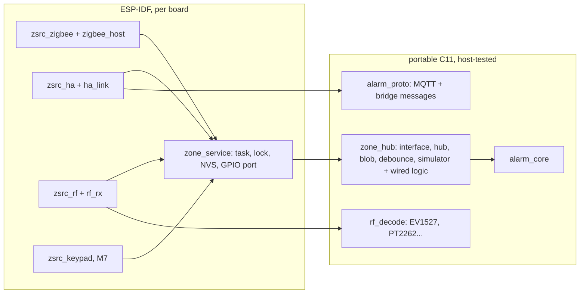
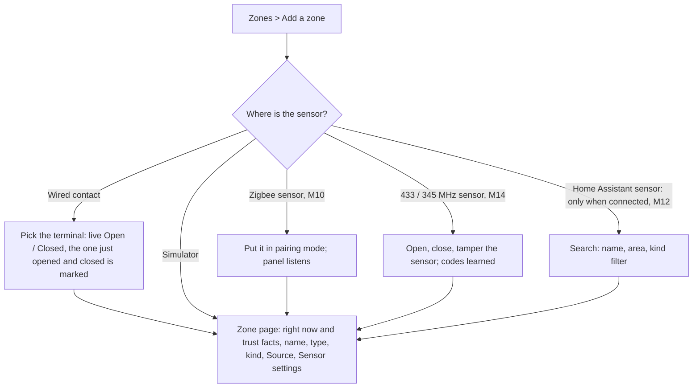

# 22 · Zone sources: any sensor, one zone model

**Status:** Implemented v1 - the `zone_hub` framework, the simulator and wired sources and the
zone editor's source picker, host-tested and on the panel since 2026-09-19; the HA, 433 MHz,
Zigbee and Z-Wave sources plug into it (docs/features/23, 25, 20, 36). Left: a wired
contact on a panel (BL-029), HA zones on hardware (BL-027), the life-safety override
(BL-062), EOL (BL-063).
· **Milestone:** M11 (framework, wired, simulator), then one source per milestone (see the
roadmap) · **Depends on:** 01, 02, 14, 20, 23, 25

## Goal
Let any sensor the owner already has, or can buy cheaply, become a zone, without the core
knowing where it came from. A zone keeps one behaviour (type, delays, chime, bypass, alarm
rules: docs/features/01); what feeds it is a pluggable **zone source**:

| Source | What it brings | Where it runs |
|---|---|---|
| **Zigbee** (first class) | Off-the-shelf door, motion, water and smoke sensors paired straight to the panel through an ESP32-H2; works with no Wi-Fi and no Home Assistant | P4; CYD with the H2 as network co-processor (docs/features/20) |
| **Wired** (M11) | Dry contacts on the panel's GPIO header (J7 on the CrowPanel), EOL later | every board |
| **Home Assistant** | Any `binary_sensor` HA knows (the integration's options offer no other domain): Z-Wave, Zigbee on ZHA or Zigbee2MQTT, Matter, Wi-Fi gadgets, cameras' motion... | P4 only (docs/features/23) |
| **315/345/433 MHz RF** (433 MHz built, M14: EV1527 / PT2262, HT6P20B, HT12E, KeeLoq, arctech) | Cheap EV1527 sensors, and the sensors of older keypad alarm panels | every board with a receiver (docs/features/25) |
| **Z-Wave** (own track, docs/features/36) | Off-the-shelf Z-Wave sensors paired straight to the panel through a Zooz ZAC93 on a UART, encrypted per device with S2; works with no Wi-Fi and no Home Assistant | P4 (the library is built; zones from Z6, on the panel at Z9) |
| **Keypad inputs** | A remote keypad's own inputs, like a zone expander | M7 (docs/features/11) |
| **Simulator** (M11) | Service console and test harness | every board |

## Why: hardware freedom
Mainstream panels decide which sensors you may use:
- Some accept only their own maker's sensors; older sensors need an extra module that listens
  to **one** of several legacy frequencies, and even then key fobs and two-way devices are
  not supported.
- Others speak their own radio plus **one** legacy daughter card chosen when you buy it:
  319.5 MHz, 345 MHz or 433 MHz.
- None lets a generic Zigbee sensor, a $5 433 MHz contact or a Home Assistant entity be a zone.

This panel treats the radio as a plug-in: several sources can be active at the same time,
new ones are added as code (not new panels), and each source says honestly how trustworthy it
is (below), so the owner can choose knowingly.

## Reference behaviour
A classic panel programs each zone's *input type* (wired, RF supervised, RF unsupervised,
button) and enrolls RF sensors by serial number and loop. A supervised RF sensor that stops
checking in shows **CHECK**; a receiver that stops working, or RF jamming, is a system trouble.
Wired zones have a response time (10 ms, 350 ms, 700 ms, 1.2 s). We keep exactly these meanings
for every source.

## Trust: what each source can promise

| | Zigbee (native) | Wired | Home Assistant | EV1527 433 MHz | Legacy 345 MHz | Z-Wave S2 (native) | Z-Wave without security |
|---|---|---|---|---|---|---|---|
| Supervised (we notice a dead sensor) | yes: IAS check-ins, parent timeout | a normally closed loop shows a cut wire as open; EOL later | partly: HA reports `unavailable`, and the link itself is supervised | no (most send nothing periodic) | yes: periodic heartbeat bit | yes: wake-up check-ins, pings | yes |
| Authenticated, not spoofable | yes: network key, install codes | physical | yes: paired integration over mutual TLS (docs/features/23); as good as HA's own radio behind it | **no**: fixed code, replayable | **no**: fixed code | yes: S2 keys, PIN or SmartStart | **no** |
| Tamper | IAS tamper bit | EOL (later) | if HA has a tamper entity | some models send a tamper code | tamper bit | Notification cover events | same |
| Low battery | IAS battery bit, battery % | n/a | battery entity | some models send a code | battery bit | Battery CC, Power Management | same |
| Works without Wi-Fi / HA | yes | yes | **no** | yes | yes | yes | yes |
| Jamming detection | energy scan on the channel | n/a | n/a | receiver RSSI (CC1101) | receiver RSSI (CC1101) | background RSSI, failed transmissions | same |

Each source declares these as capability bits (`ZSRC_CAP_*`); the zone editor turns them into
words ("Works without Wi-Fi. A cut wire shows as open.", "Its radio signal can be copied.").
Nothing is hidden and nothing is forbidden outright, except where the installer decides
(ZSRC-008).

## Requirements
| ID | Requirement | Verified by |
|---|---|---|
| ZSRC-001 | The core stays source-agnostic: the engine only gets `alarm_engine_zone_event(zone, event)` through the alarm task (ZONE-002); bindings live outside `alarm_config_t`; sources report by address and never see zones or the engine | code review; `test_zone_hub.c` (the hub drives the real engine) |
| ZSRC-002 | A zone source is an interface (`zone_source_ops_t` + context) registered with the hub; several run at once, one per kind; each is compiled in or out by Kconfig (`CONFIG_ALARM_ZSRC_SIM`, `_WIRED`, `_HA`, `_ZIGBEE`, `_RF`) | `test_registry`, `test_learn_candidates_ticks`, both firmware builds |
| ZSRC-003 | One zone has at most one binding (its sensor, plus optional separate tamper and battery inputs); one sensor feeds at most one zone (ZONE-003) | `test_one_binding_per_zone_one_zone_per_sensor`, `test_rebind_same_sensor_keeps_state` |
| ZSRC-004 | Bindings are stored in a versioned, self-describing blob in NVS (`zones`/`bind`), like the configuration blob: unknown sources, fields, groups and entries are kept and written back, never lost on a firmware rollback; a frozen format-1 fixture decodes forever | `test_blob_round_trip`, `test_blob_format_1_fixture` (`zone_bind_fixture_v1.h`), `test_blob_keeps_unknown_items`, `test_blob_rejects_damage`, `test_blob_worst_case_fits` |
| ZSRC-005 | "Where is the sensor?" lists only sources that are compiled in **and** usable now (`usable()`), real sensors first and the simulator last; Home Assistant only while the integration is paired and connected (M12) | `test_registry`, preview (`71`) |
| ZSRC-006 | Each source's states map to zone events: binary (by value or the words on/off, open/closed...), above or below a threshold with hysteresis, a list of states; inverted (a normally open contact); separate tamper and battery inputs; defaults from the sensor kind (a temperature sensor is "below 5 °C"); an unchanged report from the zone's own sensor counts as a check-in at most once a minute (a linked battery entity never does: it must not keep `supervision_s` alive); changing what a state means turns the last report into the right event at once, and **exactly once** - a source that answers the new mapping from inside `watch()` must not be inverted a second time | `test_binary_mapping`, `test_threshold_mapping`, `test_state_list_mapping`, `test_linked_inputs_and_checkins`, `test_rebind_new_mapping_remaps_state`, `test_rebind_polarity_with_a_source_that_reports_at_once`, `test_defaults_and_trust` |
| ZSRC-007 | A sensor the source can't reach (Zigbee device gone, HA `unavailable`, missed heartbeat) becomes the zone's supervision trouble (**CHECK**, `ALARM_ZEV_UNREACHABLE`) after a grace time (the binding's, else the source's, else 60 s), which blocks arming until bypassed (CORE-TRBL-013); the zone is CHECK while any of its inputs is; a source that loses its whole link (H2 not answering, bridge offline) is a device or system trouble, never zone CHECKs (ZONE-008) | `test_grace_then_check`, `test_check_per_zone`, `test_link_down_is_not_check`, `test_troubles.c` CORE-TRBL-013/014 |
| ZSRC-008 | Life-safety zone types (fire, CO, 24-hour panic) accept only sources whose trust allows them by default (`ZSRC_CAP_LIFE_SAFETY`: Zigbee, wired, supervised RF, the simulator, and per device Z-Wave S2 sensors that check in, docs/features/36); for others the zone page warns; the installer override comes with the first such source (Home Assistant, M12) | `test_defaults_and_trust`, preview |
| ZSRC-009 | The zone editor shows the source, its address in words, the zone's state right now, signal / battery where known, and the trust facts of the table above | preview (`50`, `73`, `77`) |
| ZSRC-010 | A source that isn't there (compiled out, removed, or written by a newer firmware) keeps its zones and bindings; the zones show CHECK after the grace until rebound or deleted, and the zone page says why; when the source comes back its sensors are watched again. If the stored bindings can't be read at all, every configured zone shows CHECK (`zone_hub_lost`) instead of looking ready while nothing can fault it | `test_missing_source_is_check_and_kept`, `test_lost_bindings_are_check`, preview |
| ZSRC-011 | Walk test and the zone test page work the same for every source | the engine sees only zone events (walk test: CORE tests); HIL per source |
| ZSRC-012 | Bindings change only while every partition is disarmed (the zone editor is in installer mode; the service console checks too), and each change is stored at once. Arming can't slip between the check and the change: the alarm task reserves the change while every partition is disarmed, an arm before the change starts goes ahead and refuses it (BUSY, the binding as it was), and arming is held only while the in-memory change is made. A source that changes bindings from inside its own hook (a Zigbee device replacement) reserves before taking its locks and claims once for every zone it moves, the put-back of a refused one included; armed meanwhile, the replacement fails and the old device keeps its zones. One change at a time: another waits briefly, then is told busy. A change refused after its zone's spoken-name approval was invalidated leaves the old sensor bound but its spoken name unapproved: approve it again, as after any sensor change | code review (`zone_service.c` change(): its own order isn't run on the host), host test `zone_bind_gate` (the gate with the real engine, hub and 433 MHz source, following change()'s order), host test `zbz_panel` (the Zigbee replacement under the gate, with the real engine), preview |
| ZSRC-013 | When a configuration change makes the engine forget zones (new, removed, retyped, moved: `alarm_zone_config_resets_state`, CORE-CFG-018), the hub tells it again what their sensors say, CHECK included; untouched zones hear nothing | `test_resync_after_config_change` |
| ZSRC-014 | On the first start with zone sources, every configured zone is bound to the simulator (how zones were driven before), so an existing panel keeps working unchanged | code review (`zone_service.c` `migrate`), preview |
| ZSRC-015 | A source's whole link is supervised by the hub itself: down for longer than the source's grace while zones depend on it, it becomes **one** supervision trouble for the source (`zone_hub_port_t.source_trouble`), never a CHECK per zone; a source registered before it can be used (Home Assistant before it connects) counts as down from then, so a panel that restarts while its bridge is away doesn't look ready; with the link back, nothing the source said before the break is trusted - every one of its sensors has its grace to report again, those that don't show their zone's CHECK, and the source's trouble stays until each has either reported or shown CHECK. A source no zone uses is never a trouble | `test_source_link_trouble`, `test_link_back_needs_fresh_state`, `test_link_down_is_not_check` |

Wired inputs add ZONE-004 (response time, `test_debounce_response_time`, `test_wired_terminals`)
and the learn mode (`test_wired_learning`).

## Design

### The interface (C's version of a C# `interface IZoneSource`)
The repo already uses this pattern (`ui_backend_t`, `alarm_ports_t`, `elog_flash_t`): a struct
of function pointers plus a context pointer. A source implements it; the hub holds one instance
per registered source; nothing else knows the concrete type. As built
(`components/core/zone_hub/include/zone_hub/zone_source.h`):

```c
typedef enum { ZSRC_NONE = 0, ZSRC_SIM = 1, ZSRC_WIRED, ZSRC_ZIGBEE, ZSRC_HA, ZSRC_RF,
               ZSRC_KEYPAD, ZSRC_ZWAVE } zsrc_kind_t;  /* stored: append only */

#define ZSRC_CAP_LEARN / _SEARCH / _SUPERVISED / _AUTH / _TAMPER / _BATTERY / _OFFLINE_OK
#define ZSRC_CAP_LIFE_SAFETY   /* trusted for fire, CO and 24-hour panic zones (ZSRC-008) */
#define ZSRC_CAP_TEST          /* a test tool, not a sensor (the simulator) */

typedef struct {               /* where a sensor is, in the source's own terms */
    uint8_t kind, input;       /* input / loop / endpoint on the device */
    uint64_t id;               /* simulator input, GPIO, Zigbee IEEE address, RF serial... */
    char ref[ZSRC_REF_LEN];    /* 96: a Home Assistant entity_id; "" for the others */
} zsrc_address_t;

typedef struct {               /* how states become zone events (every zero is a default) */
    uint8_t mode;              /* BINARY, ABOVE, BELOW, STATES */
    bool invert;               /* normally open contact */
    int32_t threshold_x100, hysteresis_x100;
    char states[ZSRC_STATES_LEN];                    /* "open,unlocked" */
    uint16_t grace_s;          /* unreachable this long -> CHECK; 0 = the source's default */
    uint16_t response_ms;      /* wired response time; 0 = 350 ms */
    uint16_t hold_s;           /* RF: active this long after the last code; 0 = 30 s */
} zsrc_mapping_t;

typedef enum { ZSRC_ROLE_MAIN, ZSRC_ROLE_TAMPER, ZSRC_ROLE_BATTERY } zsrc_role_t;

typedef struct {               /* how a source reports: the platform's sink, then the hub */
    void (*input)(ctx, const zsrc_address_t *, const char *state, int32_t value_x100, now);
    void (*event)(ctx, const zsrc_address_t *, alarm_zone_event_t, now);  /* IAS bits, sim */
    void (*reachable)(ctx, const zsrc_address_t *, bool, now);
    void (*link)(ctx, uint8_t kind, bool up, now);                        /* ZONE-008 */
} zsrc_sink_t;

typedef struct zone_source_ops {
    uint8_t kind; uint32_t caps; const char *name; uint16_t grace_s;
    bool (*usable)(ctx);                                   /* ZSRC-005 */
    bool (*valid)(ctx, const zsrc_address_t *);            /* before a zone is bound */
    bool (*watch)(ctx, const zsrc_address_t *, const zsrc_mapping_t *, now); /* + new mapping */
    void (*unwatch)(ctx, const zsrc_address_t *);
    bool (*learn)(ctx, bool on, now);                      /* open and close a door, pair */
    size_t (*candidates)(ctx, query, filter, zsrc_candidate_t *out, size_t max);
    /* zsrc_candidate_t.changed: heard while learning; .best: the source is sure this is the
     * one being tested (the 433 MHz source, RF-011) - the picker offers it with one button */
    void (*describe)(ctx, const zsrc_address_t *, char *out, size_t len); /* "GPIO 4 on..." */
    void (*tick)(ctx, now); uint64_t (*next_tick)(ctx, now);              /* polling */
    /* optional, for sources whose sensors differ (Z-Wave, docs/features/36 zones.md §6):  */
    uint32_t (*caps_of)(ctx, const zsrc_address_t *);  /* this sensor's caps; NULL: caps */
    uint32_t (*grace_of)(ctx, const zsrc_address_t *); /* its grace when the binding names
                                   none; 0: grace_s; ZSRC_GRACE_NEVER: never CHECK for silence */
    uint16_t link_grace_s;     /* link down this long: one trouble (ZSRC-015); 0: grace_s */
    /* optional: the zone's token after watch() (inputs of one zone share it; 433 MHz: another
     * zone's code restores an input, its own zone's don't - RF01); and how many more sensors
     * the source can watch now (a binding needing more is refused once started - RF31) */
    void (*group)(ctx, const zsrc_address_t *, uint32_t group);
    size_t (*room)(ctx);
} zone_source_ops_t;
```

Differences from the first sketch, and why:
- Sources report through a **sink** and never see zones: the hub maps addresses to zones, so a
  source can't feed the engine directly, and the platform adds its lock in one place.
- `bind`/`unbind` became **`watch`/`unwatch`** ("start needing this sensor"), plus `valid` so a
  binding is checked before anything changes.
- Linked tamper and battery inputs are separate **roles** of a binding (one address and mapping
  each) instead of two more addresses inside every mapping: a Zigbee or RF sensor reports its
  tamper and battery bits as events on its own address, only Home Assistant needs extra
  entities, and a binding stays small.
- The wired source's logic (pins, debounce, learning, candidates) is **portable** and
  host-tested; the panel only supplies `gpio_config`/`gpio_get_level` (`zsrc_gpio_port_t`).

### The hub (`components/core/zone_hub`, portable C11, host-tested)
`zone_hub_t` owns the binding table (`ZONE_HUB_MAX_INPUTS` = zones + 16 inputs), the mapping,
grace timers and the store of blob items this firmware doesn't understand. It posts zone
events through its port and is ticked at `zone_hub_next_deadline()`.
- **Mapping**: a report is mapped (thresholds keep their hysteresis across `invert`), and only
  a change reaches the engine; an unchanged report counts as a check-in at most once a minute;
  words a mapping doesn't know (`unknown`) change nothing. Events a source already understands
  (the simulator, IAS bits) pass through.
- **CHECK**: `reachable(false)` starts the grace; when it runs out the hub posts
  `ALARM_ZEV_UNREACHABLE`, once per zone, while any input of the zone is unreachable. The
  engine keeps that CHECK until `ALARM_ZEV_REACHABLE` (another input of the zone reporting, a
  separate battery entity, doesn't clear it: CORE-TRBL-014). Any report from the sensor clears
  it. While a source's link is down its sensors' grace doesn't run; the link loss is the
  source's own device trouble.
- **Rebinding** releases what a replaced sensor told the engine (RESTORE, TAMPER_RESTORE...),
  so a zone never keeps a stale fault; the same address keeps its state (a new response time
  doesn't blip the zone), and a new *meaning* (normally open instead of normally closed, another
  threshold) is applied to the last report at once, without waiting for the sensor to move.
  Each input keeps the sensor's **own** sense of its last state (`raw`) beside the mapped one,
  so the new meaning is applied exactly once: a source like Home Assistant answers `watch()`
  straight away, with the new mapping already in place, and re-inverting that answer would
  leave the zone in the opposite state (ZSRC-006).
- **The source's own link** (ZSRC-015): `zone_hub_link` starts a clock. Down for longer than
  the source's grace, while zones depend on it, the hub tells the platform once through
  `port.source_trouble` - one trouble for the source, never a CHECK per zone (ZONE-008). A
  source whose own rule has already waited (a Zigbee channel jammed for ZB-006's 30 s) reports
  through the sink's optional `link_now` (`zone_hub_link_now`) and the trouble is due at once;
  the next `zone_hub_link` up ends that - and
  a source registered while it says it can't be used yet counts as down from registration. When
  the link comes back every sensor of that source is treated as unheard: it has its grace to
  report again, and the ones that don't show their zone's CHECK. The source's trouble goes only
  once each of its sensors has either reported or shown CHECK, so from the moment the link
  breaks until the panel really knows again, something is always saying so.

  On the panel, `zone_service` turns that into **one** system trouble, `ALARM_TRBL_SENSOR_RADIO`
  - the existing value whose words are "Sensor radio problem · wireless sensors may not be
  heard", which is exactly what has happened. The same trouble covers the zone hub's own task
  no longer running (docs/features/13 P4-018), so the owner sees one message for "the panel's
  sensors may not be heard" however it came about. This is an **interim mapping**: the design
  below wants a supervised *device* per source link, which needs installer-configurable devices
  the panel does not have yet, and a `sensor_link` value of its own would be an append to the
  stored event-log and MQTT name contracts. Until one of those happens, the wording is close
  enough to be actionable and nothing stored changes.

  `zone_service_ha_link_state()` is **edge-triggered**: `ha_link` reports a connection going
  down from every exit path, and a connection that *pairs* mid-session reaches that exit without
  ever having reported itself up, so a bare "down" can arrive with no "up" before it. Passing
  that on would restart the hub's supervision clock for a link already known to be down and
  leave a permanent trouble after any mid-session pairing. Only a real change is forwarded.
- **Resync** (ZSRC-013) after a configuration change: the engine forgets the conditions of new,
  removed, retyped and moved zones (`alarm_zone_config_resets_state`, shared by the engine and
  the platform), and the hub repeats what it knows for exactly those zones.

### The binding blob (NVS `zones`/`bind`)
Same scheme as the configuration blob (ADR-013): header `ZBND` | format | compat | header length
| payload length | CRC-32, then items `field u8 | group u8 | len u8 | value`. Group `0x01`,
field `0x00` selects an input (`zone u16 | role u8`); fields `0x01` kind, `0x02` input, `0x03`
id (u64), `0x04` ref, `0x05` mode, `0x06` invert, `0x07` threshold (i32), `0x08` hysteresis,
`0x09` states, `0x0A` grace, `0x0B` response time, `0x0C` hold (RF). Fields at zero (their default) are left out:
eight simulator zones take about 190 bytes. Written in zone and role order, so the bytes don't
depend on history (frozen fixture `components/core/zone_hub/test/zone_bind_fixture_v1.h`). Unknown fields of a
known input are written back right after it; unknown groups, and whole entries with an unknown
role or a zone beyond this build, are written back after the known inputs in the order they
were read. Rebinding or unbinding a zone drops its newer items (the installer replaced it).
`ZONE_HUB_KEEP_BYTES` (1 KB) holds them; what doesn't fit is counted in `keep_lost` while the
known bindings still load, and the panel leaves the stored blob alone until a binding changes.

### On the panel (`components/services/platform_esp/src/zone_service.c`)
- The hub runs on its own task (`zones`, priority just below the alarm task) behind a recursive
  lock: the console reports from its task, the wired source from inside the hub's tick, the UI
  and the console bind from theirs. Zone events go to the alarm task's queue
  (`alarm_service_zone_event`); the alarm task never waits for this lock. The hub (about 33 KB)
  lives in PSRAM.
- `alarm_service` tells listeners which zones a configuration change reset
  (`alarm_listener_t.on_zones_reset`); the zone task then resyncs them.
- **First start** (no `zones`/`bind` yet): every configured zone is bound to the simulator input
  of the same number and stored (ZSRC-014). An unreadable blob raises the storage trouble, is
  kept untouched until a binding changes, and every configured zone shows CHECK until the
  installer picks its sensor again (ZSRC-010), so the panel never looks ready with zones that
  can't fault.
- Zone events and troubles wait for room in the alarm task's queue instead of being dropped: a
  lost RESTORE would leave the engine believing a zone is open forever. The binding blob is
  encoded under the hub's lock and written to NVS without it.
- Bindings change only while every partition is disarmed (`ZONE_HUB_ERR_BUSY`), and each
  change is written to NVS at once (ZSRC-012).
- **Wired terminals** come from the board (`BOARD_WIRED_TERMINALS`: J7 GPIO 2, 3, 4, 5 and
  49-52 on the CrowPanel, eight of them). A pin is configured (input, pull-up) only once a zone
  is bound to it, or while the installer picks a terminal; it is sampled every 10 ms and
  debounced with the zone's response time. J7's GPIO 53/54 (the wireless-module socket on V1.1)
  and GPIO 25 (the P4's USB D+) are left out on purpose, because picking a terminal configures
  the pin; add them in `board_pins.h` if nothing else uses them. With no wired zone the task
  sleeps.

### Console (service UART)
- `zones`: every zone with its sensor ("simulator", "Wired input, GPIO 4 on the J7 header
  (normally closed, 350 ms)", "no sensor"), and CHECK or link notes.
- `zone <n> <event>`: the simulator, for zones bound to it (as before: `zone 3 open`); new events
  `unreachable` and `reachable`. For other zones it says where their sensor is.
- `zone <n> source | bind sim | bind wired <gpio> [nc|no] [10|350|700|1200] | bind ha
  <entity_id> | unbind`. `bind ha` takes a sensor Home Assistant shares with the panel, found as
  the picker's search finds it and mapped by the zone's device class as the picker maps it: a
  bench run binds Home Assistant sensors without the installer's code typed at the panel.
- `sources`: the sources in this build and what they promise; `terminals`: every wired terminal
  with its level and the zone using it.

### Components (split so each board gets only what it can carry)



| Component | Kconfig | P4 master | CYD master | CYD keypad |
|---|---|---|---|---|
| `zone_hub` (hub, simulator, wired logic) | always on a master | yes | yes | no (the master owns zones) |
| simulator source | `ALARM_ZSRC_SIM` (`platform_esp`) | yes | yes | no |
| wired source (`zone_service` GPIO port) | `ALARM_ZSRC_WIRED` (`platform_esp`) | yes | yes | yes, as keypad inputs (M7) |
| `zsrc_zigbee` + `zigbee_host` | `ALARM_ZSRC_ZIGBEE` | yes (H2 on a UART) | yes, H2 as network co-processor | no |
| `zsrc_ha` + `ha_link` | `ALARM_ZSRC_HA` (needs `SPIRAM`, `ALARM_FEATURE_HA`) | yes | no | no |
| `zsrc_rf` + `rf_rx` + `rf_decode` | `ALARM_ZSRC_RF` | with a receiver fitted | with a receiver fitted | optional (keypad as RF expander) |
| `zsrc_zwave` + `zwave_zones` + `zwave_host` + `zwave_proto` | `ALARM_ZSRC_ZWAVE` (docs/features/36, from Z8; on in the P4's manifest since Z9) | with a ZAC93 fitted | no | no |

The UI finds sources at run time (`ui_backend_t.zone_sources()`), so a stripped build simply
shows fewer choices (ADR-012). See "Build profiles" in docs/features/00.

### Engine additions (core rules apply)
- `ALARM_ZEV_UNREACHABLE` / `ALARM_ZEV_REACHABLE` (appended to `alarm_zone_event_t`): the zone
  gets its supervision trouble at once instead of waiting for `supervision_s`, and keeps it
  until REACHABLE (CORE-TRBL-013/014). `supervision_s` stays for sensors that check in on their
  own clock; the hub's grace is only about reachability.
- `alarm_zone_config_resets_state()` (CORE-CFG-018); a removed or new zone starts closed.
- Each source link will be a supervised **device** (`alarm_device_config_t`: "Zigbee radio",
  "Home Assistant bridge", "433 MHz receiver") so its loss is a device trouble (ZONE-008). The
  hub already decides *when* that trouble should be on and off (ZSRC-015) and says so through
  `zone_hub_port_t.source_trouble`. That route is still open: a device only exists when the
  installer has configured one (`enabled`, `supervision_s`), and the panel has no way to
  configure devices yet - firmware inventing one would be writing the installer's configuration
  behind their back. Until then `zone_service` raises the `sensor_radio` system trouble, which
  needs nothing stored to change.

### Adding a zone (installer mode, touchscreen)



- The zone is created only once its sensor is picked; a zone's **Source** row reopens the same
  choice. For a wired contact **Sensor settings** has **Contact** (normally closed, recommended: a
  cut wire shows as open; normally open: a cut wire goes unnoticed) and **Response time** (10
  ms, 350 ms, 700 ms, 1.2 s); the zone page's Sensor settings row says what they are set to.
- The zone page's top row shows the zone's state (what the engine shows once the zone is saved,
  before that what the sensor says), with the source and its trust facts in words as its detail;
  warnings are amber. Sensor settings has **Supervision** (the sensor misses a check-in) and
  **Unreachable after** (its source loses it) side by side under "When it goes quiet".
- The terminal picker changes its words at most once a second, and learning debounces free
  terminals too, so a loose wire can't make the screen flicker (UI-020).
- The source list names Home Assistant only when the integration is on **and** the bridge is
  connected (ZSRC-005); this picker and a zone's "Source" row are the only screens outside
  Settings > Integrations that name it (UI-018).
- Search (HA, later a Zigbee device list): a text field on the on-screen keyboard, kind filters
  (Doors and windows, Motion, Water, Smoke and CO, Temperature, All), results with name, area,
  entity id and live state. Entities of this panel itself are never offered (no loops).
- Defaults from the device class (`zsrc_suggest_zone_type`, `zsrc_mapping_defaults`): door or
  window -> perimeter, motion -> interior follower, water and temperature -> 24-hour aux
  ("below 5 °C" freeze), smoke and heat -> fire, CO -> CO, panic button and gas -> 24-hour
  audible. A new zone made from a picked sensor starts with them (the zone editor;
  a sensor that doesn't say what it is - a wired terminal, the simulator - stays a door).

## Interfaces and data
- NVS `zones`/`bind`: the binding blob above.
- `ui_backend_t`: `zone_sources` (kind, caps, usable), `zone_learn`, `zone_candidates`,
  `zone_bind`, `zone_unbind`, `zone_info` (binding, source present, caps, unreachable, CHECK,
  last state and value, address in words).
- `alarm_listener_t.on_zones_reset` (alarm task -> zone service).
- Console: `zones`, `zone <n> ...`, `sources`, `terminals` (above).

## Test and acceptance
- Host: `test_zone_hub.c` (ZSRC-/ZONE- tags): registry, bindings, every mapping mode,
  linked inputs and check-ins, grace and CHECK per zone, links and the supervision of a whole
  source (trouble after its grace, no CHECK flood, fresh state required after a reconnection),
  missing sources, resync with the real engine, the blob (round trip, frozen fixture, kept
  items, damage, worst case), the simulator end to end, the Home Assistant source both on its
  own and wired to the hub (a new mapping applied exactly once to the state it answers with),
  the wired source on fake pins (response time, glitches, normally open, learning with a
  chattering wire), the debouncer. `test_troubles.c` CORE-TRBL-013/014, `test_config.c`
  CORE-CFG-018. The other sources have their own files in `components/core/zone_hub/test/`:
  `test_rf.c` (docs/features/25), `test_zigbee.c` (docs/features/20) and `test_zsrc_zwave.c`
  (docs/features/36).
- Preview: the zone list with sources (`49`), a simulator zone (`50`), "Where is the sensor?"
  (`71`), the terminal picker with the terminal just opened (`72`), a new wired zone following
  its contact (`73`), the Home Assistant catalog, search and a bound entity (`74`-`76`), a
  sensor that stopped answering (`77`); the walk-through checks each.
- On the panel, done 2026-09-19 (commit `5b65371`): the first start bound the zones to the
  simulator (`zones`), the bindings survive a restart, `zone 3 open` still works and
  `terminals` lists the terminals. Still to do (BL-029): a contact on J7 GPIO 2 to GND (`zone 9
  bind wired 2`, `terminals`), the response time with a bouncing switch. The new pages add no
  animation; the terminal picker's words change at most once a second and only when a contact
  settles. Check the refresh with `display watch 60` while the picker is open (instrumented:
  nobody needs to look at the screen, UI-020).

## Open questions
- Should one zone ever combine two sources (e.g. a Zigbee contact **and** an HA camera
  person-detection, alarm only when both)? Classic panels don't; cross-zoning covers part of it.
  **Decided for M11: no** (ZSRC-003); cross-zone pairs cover it.
- Keep `alarm_zone_config_t.supervision_s` for sources that check in on their own clock, and
  use `grace_s` only for reachability? **Decided: yes** (both exist, see the engine additions).
- End-of-line resistors for wired zones need ADC pins and a resistor choice (docs/features/02
  ZONE-005): which EOL style, and which J7 pins can read analog? Decided: a
  single 2 kΩ end-of-line resistor; the pins come from the board description
  when it is built (BL-063).
- A source's link going down: a supervised device per link (needs installer-configurable
  devices) or a new `sensor_link` trouble value (an append to the stored event-log and MQTT name
  contracts)? Decided: neither - `sensor_radio` stays the trouble for a
  source's link (no new stored value), and the zone page and `sources` say which source (BL-055).
- Should the simulator stay in release builds? It is how the existing zones are driven today,
  so it stays on (`CONFIG_ALARM_ZSRC_SIM`). The release profile
  (`firmware/crowpanel_p4/sdkconfig.defaults.release`) keeps it but has no service console to
  drive it. Decided: release builds leave the simulator out and start
  without demo zones; dev and legacy builds keep it (BL-106).

## Tasks
- [x] `zone_hub` component: interface, registry, mapping, grace, binding blob + host tests (M11)
- [x] Engine: `ALARM_ZEV_UNREACHABLE/REACHABLE` + tests; `alarm_zone_config_resets_state` (M11)
- [x] Simulator source behind the interface (the console's `zone <n> <event>`), wired source
      with response time and learning, `zone_service` (task, NVS, first-start migration),
      console commands (M11)
- [x] Zone editor: source picker, terminal picker, Source / Contact / Response time / Right now
      rows, trust facts (M11); search screen with HA (M13)
- [x] `zone_service`: the hub's `source_trouble` (ZSRC-015) becomes the interim `sensor_radio`
      system trouble; a "down" with no matching "up" is tolerated
- [x] Say which source's link is in trouble on the zone page and in the console's `sources`, and
      on the Panel Manager's Sensor sources page (firmware builds; not run on a panel) (BL-055,
      1191034)
- [x] Decide between a supervised device per source link and a `sensor_link` trouble value:
      neither, `sensor_radio` names the source (BL-055)
- [x] On the panel: flash, check the migration and `zone 3 open` (5b65371)
- [ ] On the panel: wire a test contact on J7 and add it on the touchscreen, with `display watch
      60` while the terminal picker is open (BL-029)
- [ ] Installer override for life-safety zones on untrusted sources: the zone page already warns
      (`ui_sources.c`, `zsrc_trusted_for`), but untrusted sources exist now (Home Assistant,
      433 MHz) and the installer still can't override (ZSRC-008) (BL-062)
- [ ] EOL supervision on wired inputs (docs/features/02 ZONE-005) (BL-063)
- [x] `zsrc_ha`, the Home Assistant source (M13, docs/features/23): catalog, watched entities,
      grace and CHECK, the picker's search, fed by `ha_link` (`zsrc_ha.c`, `test_ha_*`)
- [ ] Home Assistant entities as zones on a panel with a paired Home Assistant: following,
      CHECK after the grace, an entry delay from one passed on a panel bound with
      the console's `zone bind ha` (2026-10-06, docs/features/23 validation.md part 2); left: a
      binding at the touchscreen's picker (BL-027)
- [x] `zsrc_zigbee`, the portable half (M10, docs/features/20): `zsrc_zigbee.c`, `test_zigbee.c`
- Duplicate of docs/features/20 (`zigbee_host` on the P4 with the H2 RCP; real pairing
  acceptance): Zigbee's hardware half, BL-036.
- [x] `zsrc_rf`, 433 MHz (M14, docs/features/25): five protocol families, host-tested
      (`zsrc_rf.c`, `test_rf.c`)
- Duplicate of docs/features/25 ("First bench", with the fixtures and the low-battery code,
  BL-022; "More RF families", BL-039): the rest of the RF source.
