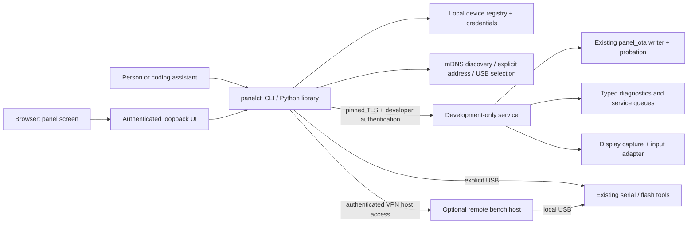

# Original research and longer-term remote development design

This is the original planning record, preserved for context and future RF/bench-host work.
Statements and checkboxes below describe the proposal, not current implementation status.
The authoritative implementation, protocol, operating instructions, evidence and limits are
in [README.md](README.md). V1 uses bounded HTTPS polling instead of WebSockets, USB enrollment,
one enrolled workstation per panel, and explicit private-subnet scanning where mDNS cannot route.

**Status:** Implemented v1 - see [README.md](README.md); this plan of 2026-09-21 is kept for its
research and the later RF and bench-host ideas, and what remains is in README.md "Tasks"
(mostly BL-035). Implementation and testing/flashing on the local device went ahead
overnight (2026-09-21). The requirements below are the plan; what has been verified is in
README.md. **Milestone:** M17 · **Depends on:** 06, 07, 09, 13, 15, 21;
coordinate shared discovery/identity work with 23. Does not require Home Assistant or M7.

## Goal

Develop on panels mounted on the wall: select one by IP address, saved name, attached USB or
network discovery; build for its hardware; install signed firmware; reconnect, inspect logs
and health; see and operate its actual screen. Support several different boards and displays,
including a panel reachable only over Wi-Fi. The same tool must be usable by a person and by
either coding assistant, with identity and resumable results saved outside assistant memory.

**Primary scenario (2026-09-21):** software is developed at one site; electrical
engineering happens at another, already joined by a site-to-site VPN. The engineer there has
the forthcoming 433 MHz hardware and can wire/change/probe it; the software site does not
have that hardware or the same bench tools. Remote flashing and troubleshooting must
enable this collaboration, not merely save a walk to a local wall panel. docs/features/25 is the
first hardware-development use case. Receiver and optional
bench-computer details were explicitly deferred; do not block planning or assume either device's specifications.

This was a request for planning, not implementation or a flash. Support explicit routed IP/DNS
across the existing VPN in the first milestone. The panel needs no VPN client or cloud account.
Direct Wi-Fi operation remains required for devices without any attached computer. An optional
on-site computer connected by USB can provide independent boot logs and flash recovery; its
selection and setup are deferred, not prerequisites for the direct network feature.

## Reference behaviour

This is developer tooling rather than a homeowner feature; there is no behaviour to copy.
The production virtual keypad remains docs/features/11. This feature mirrors the actual device UI
for development and is excluded from release firmware.

## Findings and recommendation

The inspected baseline is `63f4dcd`; the working tree was clean at the start of planning.

| Already present | Consequence for this feature |
|---|---|
| `components/services/panel_ota`: transport-independent begin/write/end/abort/apply, RSA-3072 verification, version/chip checks, safe restart and health probation | Add an authenticated upload transport to the existing writer; keep one update policy |
| Two 4,718,592-byte app slots, `otadata`, and a 64 KiB coredump reservation | No partition change needed for app OTA; a coredump reservation alone does not prove crash capture is configured |
| Serial uploader and service console; Windows and POSIX IDF wrappers | Wrap existing functionality; preserve an explicit USB path |
| HA link: mDNS, per-panel TLS identity and pairing concepts | Reuse reviewed primitives where suitable, but keep developer credentials and permissions separate from HA |
| `ha_link.c` currently initializes and frees mDNS itself | Introduce shared discovery lifecycle ownership before adding another service; disabling HA must not stop developer discovery |
| LVGL 9.5.0, display/touch ports, real UI in the host simulator | Put capture and remote input behind display/input adapters, not CrowPanel pin definitions |
| B001: internal heap starvation previously disrupted code verification | Bound TLS sessions, buffers and queues; fail optional development work before jeopardizing alarm authentication |
| Release/hardened profiles are documented but not implemented in the wrappers | A flag alone is insufficient: implement profile isolation and verifiable release exclusion first |
| OTA probation currently checks engine, log, UI, sensors and touch, not network reachability | A Wi-Fi-only development target needs an additional bounded reconnect/confirmation check |

**Recommended:** a separately compiled `dev_remote` service, using authenticated HTTPS for
uploads/status and secure WebSocket for logs and screen/input, plus a Python `panelctl` CLI
and a browser UI served by that tool on the PC's loopback interface. Build and sign on the PC;
the device streams into its inactive app slot. A native desktop package can wrap the same
tool later if useful; an Electron app is not required for the first version.

| Approach | Assessment |
|---|---|
| Direct authenticated push to existing OTA writer | Preferred: PC only makes outbound connections; no temporary download server, inbound PC firewall rule or release publication for every edit |
| Existing manifest/HTTP(S) pull updater | Keep for product releases; possible manual bridge for an initial dev image, but not enough for discovery, logs or screen control |
| Extend the HA API with developer powers | Avoid coupling development to HA enablement, its single connection, trust store or product permissions |
| Serial-over-TCP or unrestricted remote console | Avoid exporting every local maintenance command; use an explicit typed RPC allowlist |
| VNC/RFB on the MCU | Possible later adapter, but still needs capture, input, authentication and performance work; start with the small protocol our browser/CLI needs |
| Network JTAG/OpenOCD | Separate bench capability requiring a physical debug connection or gateway; Wi-Fi OTA does not provide breakpoints or recovery from every hang |
| Optional on-site USB bench host, accessed over the VPN | Complement for hardware engineering: run existing tools locally there, retrieve boot logs and recover when panel networking fails; hardware/setup details deferred |

The ESP-IDF APIs support dual-slot app updates and rollback [S1], HTTPS and secure WebSocket
servers [S2, S3], and mDNS [S4]. LVGL supplies snapshot and input-driver APIs [S5, S6]. The
selection above is a project design judgment; these sources do not establish performance on
this board. Capture throughput and TLS memory use must be measured before promising frame rates.

## Requirements

The "Verified by" column is the original plan. What has been verified, and how, is in
[README.md](README.md) "Verification and remaining acceptance". Tests that name these IDs:
`tools/tests/test_panelctl.py` (DEV-003/004/006/007/014),
`components/core/alarm_proto/test/test_fw.c` (DEV-004/015), `host/ui_preview/main.c` (DEV-010).
Superseded 2026-09-22 by ADR-033 and docs/features/31: DEV-001's absence of the developer
service, routes and discovery from release, with no runtime setting able to enable them (fault
injection is still excluded), and DEV-015's "removing developer access" half. Release keeps
developer access behind the Installer's switches and enrollment survives updates; DEV-015's
refusal of development images still holds.

| ID | Requirement | Verified by |
|---|---|---|
| DEV-001 | Developer service, routes, discovery, UI and fault injection are absent from release/hardened artifacts; runtime settings cannot enable them | profile matrix, link map and runtime negative tests |
| DEV-002 | Build capability and per-device enrollment are both required; TLS peer identity and explicit developer authorization protect every operation | auth/enrollment/revocation tests |
| DEV-003 | Address, name, USB and discovery resolve to a stable verified identity; ambiguous selection never writes, resets or auto-selects the first result | CLI tests, two-panel acceptance |
| DEV-004 | Device capability descriptor selects compatible board, silicon, role and image; both tool and panel reject incompatible or oversized images | manifest/header tests |
| DEV-005 | Network upload reuses the signed OTA writer, single-writer exclusion and alarm-task restart checks; no signature or idle bypass | host and fault-injection tests |
| DEV-006 | Disconnect, retry, power loss and reboot have bounded outcomes; completed operations are queryable without repeating mutations | transport and hardware interruption tests |
| DEV-007 | Network development updates retain the old app until existing health probation AND authenticated reconnect confirmation pass | candidate-network-failure hardware tests |
| DEV-008 | Logs, health, memory, display metrics and update results are accessible remotely with bounded buffers and secret scrubbing | flood/resource tests |
| DEV-009 | Remote view shows the actual composed panel UI; pointer down/move/up supports tapping and scrolling through the normal LVGL input path | simulator and dark hardware checks |
| DEV-010 | One input controller at a time; disconnect/timeout/local takeover releases input; user-code rules and lockouts still apply | interaction and authority tests |
| DEV-011 | Capture and networking never block alarm, touch or display DMA/ISR work; optional activity backs off on resource pressure | B001 regression, display stress, soak |
| DEV-012 | Protocol advertises dimensions, orientation, formats and optional capabilities; no requirement for a P4, MIPI, PSRAM or SD card | second-adapter fixture and later board acceptance |
| DEV-013 | Local credentials, identities and private diagnostics stay in ignored files or OS credential storage; logs never contain codes/private keys | tooling and scrubbing tests |
| DEV-014 | The workstation browser bridge accepts only its local authenticated session and rejects hostile origins/hosts | loopback auth, CSRF and WebSocket tests |
| DEV-015 | Release OTA refuses development images across every transport, even with version override; removing developer access is explicit and verifiable | signed-profile and migration tests |
| DEV-016 | Enrollment and routine operation never require case buttons or repeated physical approval; development trust can be revoked | USB bootstrap, touch enrollment and reboot tests |
| DEV-017 | First milestone works across a routed site-to-site VPN without multicast forwarding, using saved targets/IP/DNS; timeouts and reconnects tolerate measured WAN delay/loss | two-site acceptance |
| DEV-018 | Optional remote bench transport runs serial/flash tools on an authenticated on-site host independently of panel networking, with exclusive device ownership and recorded results | USB boot-log capture and recovery with panel Wi-Fi unavailable |
| DEV-019 | Hardware modules expose bounded, versioned diagnostics and timestamped captures; recordings can be replayed into host-side decoders without transmitting RF | RF capture fixtures and remote-bench acceptance |

## Design



### Two-site engineering workflow

The primary acceptance scenario is work on hardware at the second site over the existing
VPN. Give that panel an alias such as `bench-2`, backed by a pinned identity and routed
address. It may later have an optional authenticated bench-host identity and local USB mapping.
Do not silently switch to a reset-producing recovery transport after a failed network request.

The engineer there performs wiring changes and electrical measurements; the developer or
assistant builds,
flashes and analyzes software results. Keep a per-device ignored bench record containing board
and module revisions, approved wiring/pin map, power/logic levels, test sensor/protocol, current
firmware hash and the latest physical change. Label wiring facts as reported by the engineer,
not software-detected. A stable device identity does not prove unchanged external wiring.
Hardware-specific diagnostics use reviewed pin mappings and peripheral ownership checks,
not arbitrary pin writes that could conflict with the display, storage, sound or Wi-Fi.

For initial 433 MHz work, provide receive-only diagnostics before a polished sensor learn UI:

- Driver startup/fault state, configured pin/bus mapping and receiver settings; chip identity
  or register readback only where supported. Simple one-pin receivers may have no readable
  identity or RSSI; absence of these capabilities must be explicit.
- Edge/pulse counts and durations, capture overflow/dropped samples, noise/repeat counts,
  decoder candidates and rejection reasons. Separate observations from inferred sensor events.
- Bounded capture sessions with device timestamps, clock resolution, polarity, configuration,
  firmware/module revision and loss markers. Capture timing on the MCU or a supported attached
  instrument, not through network polling. ESP-IDF's RMT receive interface is a candidate for
  local pulse capture [S10]; receiver and pin suitability still require bench verification.
- Export captures for host decoder fixtures: the engineer triggers a known contact, the developer
  develops against that recording locally, then validates on the physical receiver. Offline
  replay feeds test decoders/simulators, never the live alarm or an RF transmitter.
- A compact evidence bundle of build identity, logs, diagnostics and labeled captures. RF
  identifiers are private by default; sanitize fixtures before committing them.

The same diagnostic contract should accommodate future SPI/I2C/UART modules and sensors.
Voltage, signal integrity and RF waveform conclusions still need suitable instruments and
the engineer's measurements; console data alone cannot establish them. Sharing captured evidence
lets software work continue between live bench sessions without requiring duplicate hardware.

### Optional independent bench recovery (details deferred)

If an on-site computer becomes available, authenticated SSH over the VPN can run supported
repository scripts locally there. Transfer a verified signed artifact and record its hash;
capture serial output and flash results on that host. It needs the correct tools and board
recipe, not the private firmware signing key. This can make remote USB work possible before
the new firmware service/viewer exists, but no machine is configured or assumed by this plan.

Prefer executing esptool on the bench host over exposing raw serial across the WAN. Espressif
documents RFC2217 support for UART bridges but reset latency needs care; native USB-OTG and
USB-Serial-JTAG are unsupported through remote-port URLs [S8]. Local execution preserves USB
device metadata and keeps reset/baud timing at the bench. Any optional serial proxy must stay
inside authenticated access, not become an unauthenticated Telnet service on the panel.

The host owns an exclusive device lease, coordinates console-versus-flash access, and saves
pre-reset/boot logs and operation outcomes locally through VPN outages. Reconnecting queries
the existing operation instead of starting another flash. USB reconnects revalidate device
mapping. Prove the actual board's automatic boot/reset behaviour before promising recovery.
Optional physical JTAG/debug or power control needs separate hardware verification. Halting
the MCU halts alarm processing, so live breakpoint work belongs on a dedicated bench device.

### Build and release boundary

- Add explicit `dev`, `release` and future `hardened` profiles to **both** IDF wrappers, with
  isolated sdkconfig and build directories per board, silicon, profile and test version.
  Preserve existing wrapper usage where practical; ordinary builds keep remote access off.
  An explicit dev overlay enables `CONFIG_ALARM_DEV_REMOTE`; it defaults to `n`.
- Release/hardened configure steps fail if remote development or any fault-injection flag is
  set (including existing crypto and HA trust-store diagnostics). Conditional dependencies
  must omit the developer service and UI, not merely stop them at runtime. CI checks final
  sdkconfig, linked objects/handlers and the packaged artifact. Fail conflicting cached configs.
- Embed board ID, role, image/profile schema, build identity and required layout compatibility
  **inside the signed application**. The sidecar manifest is useful for tooling but cannot be
  the security authority. After signature verification and before selection, release firmware
  rejects dev/unknown-profile images from serial, pull or push alike. `--allow-older` affects
  version policy only. Existing header checks are not a profile policy.
- Keep the existing signing key for current devices; never silently replace it or burn eFuses.
  New production fleets should use a separate release key and signing pipeline. Moving an
  existing fleet to another key requires a separately designed migration; it is not a flag.
- Development-to-release installation is an explicit operation because network tooling will
  disappear. Candidate release firmware must clear developer enrollment on successful
  probation, not before rollback is safe. Verify release health through its product interface
  or USB; never exempt release from health checks or include a hidden dev endpoint to confirm it.
  A Wi-Fi-only target must have a tested product verification/recovery path before this transition.
- Release-to-development requires an explicit local provisioning workflow (normally USB), not
  a dormant remote switch. Plan a one-time compatibility rollout: current firmware has no
  signed profile marker/policy, so document which legacy images can bootstrap the feature and
  ensure new release policy cannot be evaded with an older unmarked image plus `force`.

### Enrollment, trust and operation authority

First choice: enroll while USB is available before mounting. Generate a workstation client
key and a device server key independently; exchange only public identities through the
selected serial device, pin the server identity, and authorize that client's certificate/key
for the development service. Keep the firmware signing key separate from connection keys.
Use TLS client authentication and an explicit authorized-client lookup, with revocation checked
for established sessions as well as new connections. No shared factory password or `--insecure`.

A panel already running dev firmware can offer a short, rate-limited enrollment window from
an authenticated touchscreen settings page. Reuse the reviewed transcript-bound pairing
approach from docs/features/23 with a separate developer purpose/trust store, followed by pinned
mutual authentication. Pairing-only connections expose no diagnostics, screenshots or writes.
Enrollment authentication must work with the pinned IDF server APIs; proving exact per-client
revocation and certificate verification is an early implementation gate, not an assumed property
of providing a CA certificate. Pairing must not require HA to be enabled.

Enrollment persists across ordinary dev updates and reboots, so a developer does not have to
walk to the wall for every flash. A development build does not automatically expose an
unenrolled service. A dev-only Settings page shows paired computers, active controller and
revoke/disable controls with steady indicators. No anonymous recovery AP.

Developer trust grants diagnostics/firmware maintenance; it is not an alarm disarm code.
Screen control intentionally shares the physical screen. Acquiring control clears privileged
UI sessions so it cannot inherit an installer's unlocked page; code entry uses the normal
authority and lockout rules. Local takeover terminates remote control and closes privileged
sessions. Sensitive enrollment/credential/QR views must be blocked or redacted in capture;
never reconstruct hidden/silent events from the underlying engine for a remote viewer.

Flashing still requires the current instruction of whoever runs the tool and an idle/disarmed target. A request
such as "flash the workshop panel" authorizes that named operation; do not add a redundant
confirmation when target identity and intent are clear. Discovery itself does not authorize
flashing all devices. C6/H2 updates, irreversible security provisioning, factory erase and
partition/bootloader changes are excluded from ordinary network flash.

### Discovery and multiple devices

Advertise a separate `_roboalarms-dev._tcp` service only when development access is enabled.
TXT data is minimal: protocol version, opaque device ID, model and profile; no credentials,
codes, zone names or household details. mDNS is a locator, never proof of identity. Keep
docs/features/23's `_roboalarms._tcp` service and protocol unchanged; share mDNS lifecycle safely.

`panelctl discover` lists network candidates and serial-port metadata without resetting boards
or opening every port. Explicit `--usb` is sufficient only when it identifies one enrolled,
compatible device unambiguously; otherwise request a port/device selection. Old devices that
cannot report an identity use the existing local hardware notes and explicit port/revision.
Read-only probing must account for adapters that toggle reset when a serial port opens.

The ignored registry maps a user alias to device ID, pinned key, board/role/revision, preferred
transport, last address, USB identity and credential reference. Revalidate through authenticated
`info` before each write. An IP reused by another device or a changed certificate fails closed;
never silently replace trust. Addresses are hints, including after DHCP changes/reboots.
No implicit fleet operation; each target gets its own build artifact and result.

Use mDNS on selected active LAN interfaces first, then an explicit IP/DNS/VPN route. If the
user requests scanning because multicast is unavailable, allow a bounded scan of a selected
local subnet for this service, with rate/time limits. Do not sweep arbitrary VPN/public ranges.
Wi-Fi client isolation, firewall rules and routed VLANs may block discovery or access; report
those separately from "no panel". A USB-only target stays usable through existing tools.

For the existing site-to-site VPN, a saved routed IP or ordinary DNS name is the default;
reserve the address at DHCP where practical. mDNS is link-local [S9] and must not be assumed
to traverse the tunnel. Optionally an authenticated bench host can discover its local LAN
and return candidates, then the client verifies each panel's identity. No multicast reflector
or VPN reconfiguration is a prerequisite. Check routes, firewall permissions, MTU and usable
throughput during setup; do not infer panel reachability merely from an established VPN.

### Upload, reboot and recovery

1. Authenticate the selected device; collect capabilities, current app hash/profile, slot size,
   health and alarm state. Build/sign the matching image, record source revision plus dirty-tree
   status, and verify the artifact before upload. Preview UI changes in the simulator first.
2. Create a bounded update operation tied to device ID, image SHA-256, size, client and request
   ID. Claim the existing OTA writer, so serial, release download and network cannot race.
   Stage only the application; no whole-flash binary or arbitrary partition writes.
3. Stream fixed-size chunks with checked offsets, length limits and timeouts; acknowledge only
   bytes actually accepted by the writer. Exact duplicate chunks can be acknowledged without
   rewriting; conflicting/out-of-order chunks fail. Initially, a lost upload aborts and a
   subsequent attempt starts cleanly. Persistent cross-reboot resume is deferred.
4. Check length/hash, image signature and signed hardware/profile metadata. Stage and install
   are distinct operations. Immediately before boot selection retain OTA-004's alarm-task
   checks, including the second check after log flush/announcement. A safety refusal returns a
   reason; default developer installs do not wait indefinitely and unexpectedly reboot later.
5. Persist the bounded transaction record and candidate-confirmation challenge before selecting
   the boot slot. Only a successfully verified/authorized operation can be armed for reboot.
   Retain backwards-readable Wi-Fi, trust and configuration data for the previous firmware.
6. Extend probation for network-dev installs: existing healthy heartbeats remain mandatory and
   the updating client must reconnect using pinned authentication, read the expected app hash
   and boot ID, and return that operation's fresh challenge. Persist/reload this state so the
   CLI can resume after it restarts. Old/replayed confirmations cannot validate another boot.
   Keep the existing minimum 60-second health test; initially use its 180-second ceiling for
   reconnect as well, then validate on real Wi-Fi. Do not let the current 60-second success
   path mark the app valid before this additional condition passes.
7. If candidate reachability or health fails, roll back and report the previous image when it
   returns. The client remains running through confirmation and reports success only after
   `ESP_OTA_IMG_VALID`. Client loss or an AP outage may cause a conservative rollback; expose
   the reason rather than calling the candidate successful. No unconditional retry/reboot loop.

The reconnect requirement applies to **dev-to-dev network** updates, not ordinary product
updates that must succeed without a PC. Changing network configuration needs a similar
staged/revert-on-no-confirm policy; leave remote Wi-Fi configuration out of the initial RPCs.

Rollback is not an independent recovery processor. Broken bootloader/partition data, both
slots damaged, no power, incompatible persistent-state migration, or a hang that never resets
may still need physical access. Prove watchdog/reset behaviour and rollback on a bench before
declaring a panel ready for Wi-Fi-only development. If guaranteed remote recovery is later
required, plan an independently reachable gateway with serial/reset access, not a promise
that software on the failed MCU can always rescue itself. Built-in JTAG uses a physical
debug connection [S7]. C6 updates are especially risky because they can remove this transport.

### Remote screen and diagnostics

Use one versioned display adapter interface: enumerate surfaces, report logical dimensions,
rotation/pixel format, capture a complete frame or bounded tiles, inject input and report
capabilities. The first adapter is LVGL; future adapters can implement another UI stack.
Devices with limited memory may support screenshots at a lower rate or diagnostics only.
Unsupported functionality is explicit and never silently treated as working.

Start with on-demand screenshots and bounded low-rate viewing (1-2 fps as a starting cap,
not a measured promise). Prefer copying completed rendered pixels through a safe task-level
hook; evaluate LVGL snapshots as a portable fallback. Snapshotting only the active screen
can omit top/system layers, so prove keyboards, dialogs, overlays and orientation match the
physical composition. No driver callback replacement, network call, compression or allocation
in a DSI ISR; never hold the LVGL lock while sending to a client.

On the current 1024 x 600 RGB565 panel a full frame is 1,228,800 bytes (about 1.17 MiB), or
about 19.7 Mbit/s at two raw frames per second before overhead. This calculation is a sizing
warning, not a throughput measurement. Use bounded PSRAM staging on P4, dirty tiles or measured
compression where useful, latest-frame delivery with frame IDs and full-frame resync after
loss. Drop superseded complete frames; never lose deltas without requesting a new baseline.
Suspend capture during OTA if needed; status/abort traffic has priority. An SDL/Win32 simulator
adapter exercises the same protocol before the physical display port is modified.

Input packets carry surface ID, geometry generation, sequence and pointer down/move/up/cancel
in logical coordinates. Validate bounds; queue for the owning LVGL task through a virtual
input device, with correct scaling, rotation and drag timing. One controller holds a bounded
renewable lease; viewing alone cannot click. Local touch takes priority. Timeout, disconnect,
lost focus, stale geometry, revocation and device reboot release all pressed keys/pointers;
old clicks are never replayed after reconnect. Do not drive protected callbacks directly.

The browser shows the device name/identity, build, connection state and a clearly stale last
frame when disconnected, with input disabled. A dark test keeps the physical backlight off
even while viewing remotely; remote input cannot override that build setting. Preserve the
flicker guard, cache-safe DSI and existing refresh monitoring. Test display changes with dark
builds and metrics; never ask someone to watch for flicker.

Diagnostics start with typed read-only equivalents of `status`, `health`, `memory`, `display`,
network summary and OTA status. Add a bounded redacted log ring with sequence/gap reporting,
reset reason and firmware/ELF identity. Crash-dump retrieval is a later capability after
capture configuration and secret exposure are reviewed; dumps may contain credentials.
No arbitrary memory/NVS reads, remote shell, eval, general file browser or blind console tunnel.
Bench stress/fault injection remains separately compiled, explicitly invoked and safety-gated.

### Tooling and interfaces (the original proposal; the commands as built are in README.md "Quick start")

```text
panelctl discover --json
panelctl info --host 192.0.2.20
panelctl enroll --port COMx --name workshop
panelctl flash --device workshop --build
panelctl flash --host 192.0.2.20 --build
panelctl flash --usb --build
panelctl logs --device workshop --follow
panelctl screen --device workshop
panelctl screenshot --device workshop --output build/workshop.png
panelctl update-status --device workshop --operation <id>
```

`192.0.2.20` is a documentation address. `flash` normally uses app OTA, including serial OTA
when appropriate. ROM/USB full flashing is an explicit provisioning/recovery mode; retain
first-board factory backup and port/revision checks. `--build` invokes the platform wrapper
with the verified target/profile, rather than guessing from a filename. Rebuilding the same
semantic version needs an explicit version override policy (`--allow-older`); use app SHA-256
to distinguish builds. Do not silently change `VERSION` for each development upload.

Tentative API namespace `/dev/v1`: authenticated `info`, diagnostic snapshot, update
create/chunk/finalize/install/cancel/status/confirm, and a WebSocket for log/frame/input
messages. Specify limits, error codes, leases, idempotency and binary framing in a separate
protocol document during Phase 1. Stable machine-readable JSON results and nonzero exit codes
must distinguish wrong identity, incompatibility, unsafe/busy, auth failure, rollback and an
unknown outcome. Loss of a response requires querying the operation, not blindly resending it.

Candidate code ownership: `components/services/dev_remote` for ESP transport/service; a portable
`components/dev_proto` for parsing, policy and transfer/input state; `tools/panelctl/` for the
Python client, registry and local UI; board/UI adapters outside the portable protocol. Avoid
HA imports/dependencies in the tool. Share audited crypto/identity/discovery helpers only
where extraction does not destabilize the existing integration.

Keep registry and credentials under ignored `secrets/panelctl/` initially, with an example
schema in tracked docs; use OS credential storage for private client keys where feasible.
The browser receives a short-lived local session, never the device client key. Bind the UI
server to loopback only, validate Host/Origin, use session/CSRF protections and authenticate
WebSocket upgrades. Do not enable permissive CORS. Pin Python dependencies when introduced.
Saved operation summaries contain device ID, artifact hash, source state, validation and
result, but no secrets; shared handoffs refer to evidence paths instead of household IPs.

## Test and acceptance

- Portable tests: strict lengths/offsets, bounded parsing, repeated requests, stale boot/input
  challenges, incompatible image/profile, capability negotiation and state-machine timeouts.
- Tool tests with fake devices: two panels, DHCP/IP reuse, changed cert, wrong board, USB
  ambiguity, interrupted upload/CLI restart, lost finalize/install response and rollback.
- Security: unpaired/revoked clients, wrong cert, expired pairing, auth before upload/WebSocket,
  unsafe operations, cross-origin loopback requests, secret scrubbing and credential isolation
  from HA. Treat TLS and signed firmware as distinct protections.
- Build matrix: P4 v1/v3 dev-off, dev-on and release; intentionally contaminated release config
  must fail. Inspect artifact profile/slot fit and link maps; runtime dev ports and mDNS must
  be absent on release. Prove same-key dev images are refused by release policy on all paths.
- Simulator: same-screen composition, modal/code screens, local takeover, drag/scroll, scaling,
  reconnect/stale input, masking and no inherited privileged sessions. Keep existing preview
  and generated-file checks passing.
- Bench: explicitly authorized, disarmed update, bad signature/hash/wrong revision, transfer power
  cut, candidate crash/no Wi-Fi/no dev service, missing confirmation, client restart, AP loss,
  old image recovery and successful probation. Seed and verify a known-good rollback image
  before relying on remote-only operation. Re-run OTA-004/005's outstanding bench cases.
- Load: OTA + screen + HA/MQTT + sound/zone activity, slow reader/log flood, repeated TLS
  reconnects and heap exhaustion. Validate crypto availability (B001), stack headroom, heap
  integrity, zero display late frames/guard trips and healthy sensor/engine heartbeats.
- Record `display watch`, health and memory for capture/input port work. Require a 24-hour dev-session soak before the wall-mounted acceptance.
- Finally two real devices, including the Wi-Fi-only target, and a second display adapter or
  hardware profile. Simulated dimensions validate the contract, not physical board support.
- Two-site bench: direct access with multicast unavailable, VPN interruption during transfer
  and probation, delayed/lost replies, and recovery after the route returns. A VPN outage must
  not cause duplicate installs or stale input. Validate bounded raw RF capture under log/screen
  load; transport loss must be distinguishable from missing RF samples. If a bench host is added,
  prove boot-log/USB recovery with panel networking disabled and no accidental second-device reset.

## Phases and tasks (the original plan; its open work is BL-035)

This is the original plan, frozen, and its boxes were never ticked. What was delivered and what
remains are in [README.md](README.md), "Verification and remaining acceptance" and "Tasks"; the
open work is there, tagged with its [backlog](../../BACKLOG.md) rows (BL-035, BL-018, BL-019,
BL-050 and a proposed "remote development, later" row).

1. **Profiles and protocol foundation.** (Phases 1-3: delivered in V1, see README.md
   "Verification and remaining acceptance"; boxes kept as the original plan. Their leftover
   acceptance - the second site over the VPN, network faults, touch takeover - is BL-035.)
   - [ ] Implement isolated profiles and release checks in both wrappers; specify signed image
     metadata/legacy migration and registry/descriptor/protocol schemas.
   - [ ] Define shared discovery lifecycle and independent developer trust; prototype IDF TLS
     enrollment/revocation and measure internal RAM before committing to connection limits.
2. **Useful network development MVP.** (Delivered in V1, see Phase 1.)
   - [ ] Build CLI identity selection, discovery, USB enrollment and read-only diagnostics.
   - [ ] Add signed app upload, operation tracking, safe install, reconnect probation and logs.
   - [ ] Make routed-IP/VPN access a first acceptance case; define versioned hardware diagnostics
     and capture export for docs/features/25. Actual RF driver work remains in that feature.
   - [ ] Prove failure/rollback cases on the bench; document wall-mount readiness and bootstrap.
3. **Remote screen.** (Delivered in V1, see Phase 1.)
   - [ ] Implement simulator capture/input, local browser UI and authentication.
   - [ ] Add bounded LVGL hardware capture/input, masking, takeover and dark-display acceptance.
4. **Multiple hardware targets and completion.** (Soak and two-device acceptance: BL-035;
   second board and crash dumps: BL-091; release exclusion:
   superseded by ADR-033; operator docs: README.md "Quick start".)
   - [ ] Add capability-based build recipes/adapters, two-device acceptance and smaller-display
     fixtures; certify each additional real board separately.
   - [ ] Run resource/24-hour soak and release-exclusion tests; update operator docs and the
     shared local-device template. Add crash-dump retrieval only after its privacy review.

Optional parallel workstream, when bench details are available: authenticated remote-host
execution of existing USB tools, device leases and boot-log collection. This is an independent
recovery path and can be useful before the device-side service; it does not delay Wi-Fi support.

**First concrete implementation step:** profile isolation/release guards in `tools/idf.ps1`
and `tools/idf.sh`, plus the signed metadata and dev protocol specification. Do this before
exposing a network listener. Deliver network flashing/logs before the screen viewer.

## Open questions and limits

- What will the second board be? Keep the contract generic now; its RAM/display driver decides
  capture limits and it needs its own build recipe. No need to block the first P4 milestone.
  Still open (README.md "Tasks", Later): the project's next board, the 4" E32R40T
  (docs/features/19, on hold), has no PSRAM and no developer link (`CONFIG_ALARM_DEV_REMOTE` off).
- Off-site access is required and the site-to-site VPN already exists. Receiver identification,
  pin mapping and optional bench-host availability are explicitly deferred; obtain
  them when starting hardware-specific work, not as a condition of completing this plan.
  Partly decided 2026-09-22..24 in docs/features/25: the receiver is a CC1101 or a fixed 433 MHz
  module, its pin and place settable (`rf module`, `rf pin`, `rf place j7`). The bench host is
  still deferred.
- Pick initial peer/socket/queue budgets and capture format from measurements. Prefer one
  active workstation with a bounded control/upload connection and a separate optional stream.
  Decided 2026-09-21 in README.md "Trust and protocol": one enrolled workstation, one HTTP
  worker, two TLS sockets, 4 KiB upload chunks and half-resolution RGB565 frames by polling
  (JPEG and H.264 came with docs/features/31).
- The exact signed metadata placement, unknown-legacy-image policy and certificate enrollment
  hooks need implementation spikes. They are acceptance gates, not finished designs.
  Decided 2026-09-21 in README.md "Build and release boundary" and "Trust and protocol": the
  signed project name in the app descriptor carries board and profile (`ota_profile_accepts()`
  in `alarm_proto/ota_profile.h`), release refuses unmarked legacy images even when forced, and
  enrollment exchanges public certificates over the service console (`dev begin` / `chunk` /
  `commit`).
- An existing panel must first receive firmware containing this feature and be enrolled. USB
  before mounting is simplest; an already accessible existing signed pull-update route could
  install a compatible bootstrap, but still requires authorized trust enrollment.
  Decided 2026-09-21 in README.md "Build and release boundary": a one-time USB bootstrap; since
  docs/features/31 a workstation can also be enrolled from the Panel Manager.

## Research sources

Primary documentation consulted 2026-09-21. ESP-IDF stable pages resolved to v6.1; LVGL is
pinned locally to 9.5.0. Recheck exact APIs against installed headers during implementation.

- **S1:** [ESP-IDF v6.1 P4 OTA](https://docs.espressif.com/projects/esp-idf/en/v6.1/esp32p4/api-reference/system/ota.html): app slots, validation, probation and rollback; bootloader/data updates have different recovery risks.
- **S2:** [ESP-IDF HTTPS server](https://docs.espressif.com/projects/esp-idf/en/stable/esp32p4/api-reference/protocols/esp_https_server.html): TLS server, client certificate configuration, secure WebSocket example and per-connection RAM cost.
- **S3:** [ESP-IDF HTTP server](https://docs.espressif.com/projects/esp-idf/en/stable/esp32p4/api-reference/protocols/esp_http_server.html): WebSocket authentication hooks and bounded/asynchronous service integration.
- **S4:** [Espressif mDNS service](https://docs.espressif.com/projects/esp-protocols/mdns/docs/latest/en/index.html): service advertisement, queries and TXT records.
- **S5:** [LVGL 9.5 snapshots](https://lvgl.io/docs/open/9.5/main-modules/draw/snapshot): widget snapshots and reusable buffers; not a turnkey full-display remote desktop.
- **S6:** [LVGL 9.5 input devices](https://lvgl.io/docs/open/9.5/main-modules/indev/overview): pointer drivers, buffered input and task/thread constraints.
- **S7:** [Espressif P4 built-in JTAG](https://docs.espressif.com/projects/esp-idf/en/stable/esp32p4/api-guides/jtag-debugging/configure-builtin-jtag.html): physical USB debug connection.
- **S8:** [esptool remote serial ports](https://docs.espressif.com/projects/esptool/en/latest/esp32/remote-serial-ports.html): RFC2217, reset latency and native-USB limitations; basis for preferring tool execution on an optional bench host.
- **S9:** [RFC 6762: Multicast DNS](https://www.rfc-editor.org/rfc/rfc6762): link-local discovery; routed VPN access must also work without it.
- **S10:** [ESP-IDF P4 RMT](https://docs.espressif.com/projects/esp-idf/en/stable/esp32p4/api-reference/peripherals/rmt.html): local signal-level/duration capture; a candidate for receiver diagnostics, not proof of a particular module's compatibility.

## Planning validation and handoff

The notes below are from 2026-09-21, before and at the start of implementation. They are
superseded: V1 was implemented and tested on the local panel that day, as README.md records,
and committed on 2026-09-22 (`0e5a1ab`).

**Implementation started:** preserve all existing planning edits; implement profiles and
release exclusion, serial enrollment, authenticated network tooling/OTA/diagnostics and screen
capture/input, then simulator/build/security checks and dark-first hardware acceptance. The
local reference panel is disarmed and healthy at baseline. Flash authorization is current for
this feature; check idle state again before each installation. No C6/H2, eFuse or partition
changes; no commit/push authorization. Remote receiver/bench-host hardware is still deferred.

Reviewed code, current Git state, shared OTA/security/architecture/link/HA docs, local panel
notes and B001. Checked official documentation above. This change is documentation only;
no firmware builds, automated runtime tests, network scans, enrollment or hardware operations
were performed. Nothing was flashed, committed, pushed or released. Implementation remains
entirely outstanding; Phase 1 is next.

A subsequent clarification makes the two-site hardware/software collaboration the
primary acceptance case, with docs/features/25's 433 MHz receiver first. Added routed-VPN requirements,
hardware capture/replay diagnostics and an optional independent USB bench path. Hardware details
were explicitly deferred. Documentation only; no remote machine, VPN, panel or receiver accessed.
