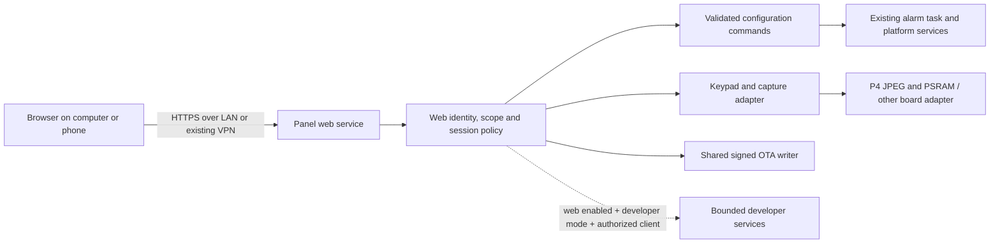

# Historical design and future roadmap

This is the pre-acceptance design record. Its proposed identity, delegation, trust lifecycle
and fleet features are not all implemented (the WebSocket is: the remote keypad uses one since
the 2026-09-23 rework). The adjacent README is authoritative for installed behavior, validation
and remaining work; what is left of this design is in its Tasks (BL-035, BL-064, BL-076;
BL-080; BL-091).

## Design to open

The offline design preview this section describes (`web/panel-manager/index.html`, `app.js`,
`style.css`, `preview.cjs`: a self-contained web design with no packages, CDN, fonts,
telemetry or device connections) was removed on 2026-09-25. The production pages and
`mock-panel.cjs` replaced it; what follows records what that design explored.

The design uses a dark navigation rail, pale surfaces, steady green status and large readable
controls. Desktop and narrow/mobile layouts share the same hierarchy. Overview leads into
remote assistance; configuration and maintenance are grouped separately. All readings carry
sample labeling. The illustrated keypad is not the existing LVGL framebuffer or a new keypad
implementation. In the product, this area will display the actual panel capture.

Clickable flows include household selection, assistance approval, local takeover, connection
loss, privacy interruption, zone search/details, grouped integration setup and credential review,
representative configuration editors, update review and Installer-controlled runtime services.
The editors use fictional values and do not represent a completed field-by-field implementation.
The prototype is neither an authentication implementation nor a hardware acceptance test.

## Recommended architecture

### Optional feature parity (clarified 2026-09-22)

Compiling out an integration must remove its implementation, API handlers and browser entry.
The firmware exports a capability manifest derived from the actual included modules; web
navigation, configuration pages and actions use that manifest, not a hardcoded provider list.
An unavailable feature's direct URL/API must reject access too. Where practical, the asset
build omits the feature's browser module to save flash. A compiled-in integration switched off
at runtime remains visible as disabled so it can be configured/enabled; this differs from
being absent from the firmware. Apply the same rule to hardware-specific options.

**Verified current gap:** `firmware/crowpanel_p4/main/CMakeLists.txt` still unconditionally
requires `ha_link`, `net_mqtt` and `net_notify`; the prototype's `serviceInfo` provider catalog
is hardcoded. Separate component directories do not yet provide complete compile-time
exclusion or capability-driven browser behavior. Implement the missing conditional dependencies,
initialization/backend guards, manifest and web registry together, with HA-on/off builds and
browser/API tests. The roadmap's proposed feature flags are not proof these gates exist.
[Closed in v1, 2026-09-22: the `ALARM_FEATURE_HA`, `ALARM_FEATURE_MQTT` and
`ALARM_FEATURE_NOTIFY` options (`components/services/alarm_features`) gate each service, its
routes and its cards, and a feature-off image was tried; README "Architecture and bounds" and
"Test and acceptance".]

The delivered product's web assets, HTTPS/API service, configuration and capture run from/on
the alarm panel; JavaScript renders in the user's browser. No companion host or cloud service
is required. The current localhost prototype is still PC-hosted and disconnected from the panel.
[It was removed on 2026-09-25; see "Design to open".]

**One normal firmware with installer-controlled web and developer capabilities.** Keep the
product configuration API and engineering operations logically separate, but ship both in
normal firmware for supported boards. The Installer screen enables/disables each service;
developer mode is not restricted to a special image. Authentication, authorization and signed
updates remain mandatory while enabled. Do not obtain this behavior by simply removing mTLS
or privacy checks from the current developer listener: its lifecycle must be refactored and
tested before inclusion in normal firmware.

- Serve bundled, precompressed HTML/CSS/JS from signed app flash. The UI executes on the
  browser; the MCU serves bytes, validates commands and provides state/capture. No Node,
  Python, external web host, SD card or Home Assistant is required in the delivered product.
- Keep a small public login shell. Everything identifying a household, event history,
  configuration or frame requires authentication. An installer enables Web server in the local Installer screen; an authorized owner provisions
  browser identities; no factory web credentials and no unauthenticated installer
  recovery route. Commission grandmother's panel before installation.
- Same-origin HTTPS API and secure WebSocket are supported by ESP-IDF. Begin with bounded
  JSON requests and asynchronous frame fetches; a WebSocket can carry state changes and
  prioritized pointer traffic once connection/resource accounting is proven. Do not make a
  slow image or upload block alarm work or all command handling in the single HTTP worker.
- Product route namespace `/api/v1`, separate from `/dev/v1`. Reuse reviewed OTA, configuration
  and alarm-service code beneath the authorization layer. No unrestricted console/shell,
  NVS writes, raw memory or arbitrary peripheral access from product routes.
- Browser upload accepts a signed prebuilt file, streams bounded chunks to inactive OTA,
  and verifies the target before staging/install. Building firmware still needs ESP-IDF on
  a workstation/CI. Python becomes optional automation/recovery tooling, not a viewer or
  administration dependency. Browser USB/Web Serial is optional later; browser coverage and
  permissions make it unsuitable as the only recovery path.
- The browser cannot perform arbitrary TCP/mDNS subnet discovery. Use saved per-panel HTTPS
  addresses, bookmarks and VPN DNS; a printed/onscreen URL/QR helps initial setup. No implicit
  LAN scan from a webpage. `panelctl discover` can remain an optional engineering tool.
- Each panel serves itself. A household selector navigates to a separately authenticated
  origin; it does not silently forward credentials or bypass cross-origin controls. The
  prototype selector uses fictional local state. A central fleet dashboard/relay is future
  scope, not a prerequisite or a claimed capability.
- Existing site-to-site VPN is the intended off-site route. No router change, public listener
  exposure, relay, cloud account or VPN setup is included in this iteration. If Grandma has
  no VPN route, establish that separately; a browser UI cannot create network reachability.

## Identity, trust and family assistance

The existing Python client pins certificates and carries an mTLS identity. JavaScript cannot
reproduce that pinning before the page/TLS connection itself is trusted. Browser TLS trust is
an implementation gate, not something solved with a “continue anyway” instruction.

For this family's managed VPN, use a stable DNS name and a per-device certificate issued by
a household CA trusted once on the helper's computer. Provision the CA trust with verified
out-of-band fingerprints; keep the CA signing key off the panel. Manual client trust setup
is a one-time administration step, not a continuously running program. A real-domain,
publicly trusted certificate with DNS validation is an alternative, using an administrator
to renew/provision it; do not put DNS-provider credentials on every panel. Renewal, hostname
changes, expiration, clock bootstrap and trust recovery must be documented/tested. Raw-IP
HTTPS requires a matching trusted IP SAN; DNS is preferable. No insecure HTTP fallback.

Use named web identities and strong web passwords, paired by an authenticated owner at the
touchscreen, with server-side bounded sessions. Six-digit alarm codes are not sufficient as
the sole network login. Evaluate the existing PSA password primitives with a separately
budgeted web KDF; do not add a synchronous expensive KDF to the alarm task. Passkeys are a
desirable later option, but require a stable trusted HTTPS origin, RP ID, authenticator
compatibility, recovery design and a real server-side WebAuthn verifier. They are not simply
a browser toggle. Enrollment/recovery never relies on a hidden physical button.

Sessions use opaque random identifiers in `Secure; HttpOnly; SameSite=Strict` host-only
cookies (`__Host-` prefix), bounded idle/absolute lifetimes, rotation after login/elevation,
Origin/Host and CSRF validation, and server-side revocation. WebSocket handshakes enforce
origin/session checks too. Require recent reauthentication for grants, code replacement,
credentials, developer enablement and firmware installation. Login throttling must resist
distributed attempts without letting network abuse lock the homeowner out of the local
keypad; cryptographic faults are not wrong-code attempts (B001). Never persist session
tokens or secrets in browser localStorage, service-worker caches or logs.

Web identity and alarm authority remain distinct. Grants are narrow, bounded by the grantor's
authority, partition scope and the existing Feature 14 matrix. Only an authenticated
authorized owner can delegate helper access; installer access does not gain household-user
management. A restricted helper is optional, not the limit of browser administration. An administrator with
the existing master and installer authority must be able to configure the entire panel through
this interface. No setting is excluded solely because access is remote. A helper role is not a second master code. Reading or controlling a screen never
inherits a local authenticated master/installer session.

| Identity / grant | Proposed permitted work | Exclusions by default |
|---|---|---|
| Owner | Household administration within Feature 14; approve/revoke named helpers | Installer-only programming without installer authority |
| Family helper | Public status/diagnostics; optional screen assistance and selected integration setup | Alarm commands, user codes, silent events, installer/developer access |
| Alarm user | Commands and partitions permitted by existing user authority | Unrelated household settings, web access administration |
| Installer | Existing shared/installer settings with required installer session and idle gates | Household user management beyond existing explicit recovery rules |
| Developer | Authorized client while installer-enabled Developer mode is on, in normal firmware | Automatic master authority or unauthenticated access |

Default interactive assistance: the person at home approves the named helper on the screen,
with duration/scope clearly stated. An owner may deliberately create a standing grant for
unattended assistance; log its creation and make revocation accessible both locally and
remotely. Configured standing grants survive routine reboot; authenticated sessions still expire and are revoked on reboot.
A steady “Alex is helping” panel notice has an End assistance control. Physical touch takes
priority; network loss, expiry, logout, revocation, page departure and reboot release input.
Only one controlling session per panel; view-only observers are separately bounded.

Remote Keypad uses the available width for the actual screen, connection state and control
ownership. The coaching section was explicitly rejected as noise: do not reintroduce
scripted walk-throughs, a teaching sidebar or generic phone-help instructions. Ordinary remote
screen operation remains useful during a phone call without those additions.

Secret/code/QR/private event views stay excluded from mirroring. Credential configuration
uses dedicated forms with write-only fields: show configured/not-configured, support explicit
replacement/clear, omit old values, mask reviews, bound input lengths and erase drafts after
save/logout/expiry. Omission means unchanged; empty never silently means erase. A separately
authorized form solves pasting a long token without exposing it on the shared panel screen.
The capture adapter must keep permission and render/DMA completion gates. Recheck permission
before handing a queued encoded frame to a client; discard stale private generations.
[Reversed on 2026-09-22: every screen may be viewed and operated remotely, no
private pages; codes are still asked. README "Operator entry points", docs/features/30.]

## Full resolution and memory

The current CrowPanel has 32 MB PSRAM (Feature 06). Full RGB565 at 1024 × 600 is 1,228,800
bytes (1.17 MiB). ESP-IDF's P4 JPEG encoder accepts RGB565; choose high-quality YUV444 as the
first small-text candidate and measure its output/latency. Hardware acceleration supports
this direction; it does not establish end-to-end browser frame rate or VPN bandwidth.

Initial **proposed**, unmeasured resource budget for a single shared capture worker:

| Allocation | Planned upper bound / behavior |
|---|---|
| Stable raw frame | 1.17 MiB P4 PSRAM, allocate with peripheral-required alignment |
| Two compressed-frame buffers | 2 × 768 KiB PSRAM; bounded, shared between readers |
| Optional second raw snapshot | Additional 1.17 MiB only if measured concurrency justifies it |
| Metadata / serialized replies | At most 256 KiB PSRAM; bounded request/frame queues |
| Total web capture reservation | Ceiling 6 MiB including alignment/scratch; explicit failure path |
| Static browser assets | Target ≤200 KiB gzip, embedded in signed app; measure OTA slot margin |
| Connections | Start with one active viewer and one administration connection; budget globally with HA/dev TLS |

Memory size and display/PSRAM bandwidth are different constraints. Keep task stacks,
descriptors, ISR-critical state and cryptographic headroom in internal RAM as required.
Resource exhaustion rejects or reduces remote work; it never consumes the alarm's reserve.
Allocate capture buffers explicitly in PSRAM without silent fallback into internal RAM.
Keep compressed frames across requests, not per-frame heap allocation. JPEG output can
exceed the budget for difficult images: reduce quality under policy or skip with a clear
reason; never overrun or repeatedly grow buffers. Coordinate any hardware JPEG decoder use
because the peripheral cannot encode and decode simultaneously. Existing screen-saver decode
uses software TJPGD, but adapters must not assume that forever.

Copy a completed permitted frame to a stable snapshot, release UI ownership, then encode
asynchronously. Do not encode directly from a framebuffer LVGL/DMA can modify. Measure copy
hold time, cache coherency and DMA alignment; if it harms refresh, change capture scheduling
instead of disabling the cache-safe ISR or flicker guard. No new image work in the ISR.

Start at 1 fps full resolution; test 2–5 fps during interaction and reduced traffic when idle.
These are tuning targets, not accepted performance. Generation/ETag avoids retransmitting an
unchanged frame. Maintain separate connection heartbeat/freshness and image-change time: an
unchanged but confirmed screen is not disconnected. Keep only the newest pending frame,
prioritize input/state, stop input on stale connectivity and never replay queued touches after
reconnect. During OTA, reduce/pause capture under measured load without obscuring update status.
On-demand lossless snapshots remain useful for exact rendering evidence.

Capabilities advertise logical size, orientation, frame formats, maximum capture rate,
input support and available configuration domains. The browser does not hardcode 1024 × 600
or P4. Smaller boards can use raw/PNG/lower-resolution frames, or a semantic virtual keypad
if capture is unavailable; clearly label a virtual keypad as different from the physical
screen. Unsupported RF/radio controls stay unavailable rather than pretend to operate.

## Configuration coverage and semantics

“All options” means parity with every *implemented* local setting, under the same authority
and idle rules. A generated/maintained coverage inventory must map every local field/action
to a domain, validation, capability, permission, persistence behavior and browser UI. The
following is the starting inventory; unavailable future hardware/features are not counted
as delivered web functionality.

| Browser area | Coverage / existing feature | Required handling |
|---|---|---|
| Overview / keypad | Status, partitions, permitted alarm commands, chime, screen (01–04, 07) | Normal alarm authority/lockout; session does not authorize disarm |
| Zones & sensors | Zone behavior, names, partitions, bindings, terminals, supervision (02, 22, 25) | Installer session, idle state, board capabilities; explicit bypass/test actions |
| People & access | Household users, codes, web identities, grants, revocation (03, 14, 15) | Existing master/installer distinctions, no code retrieval |
| Integrations | HA pairing, MQTT, ntfy, Pushover, update source (10, 13, 23, 26–28) | Write-only credentials; revoke/pair/test are distinct actions |
| Display & sound | Brightness, saver, volume, clicks, chime (07, 08) | Existing arming gate and chime authority; no flashes or surprise sound tests |
| Network / time | SSID, Wi-Fi secrets, DHCP/static fields, DNS/gateway, checks, zone/NTP (09) | Reconnect confirmation and timed last-working-config recovery |
| Alarm behavior | Delays, reporting, partitions, quick arm, siren, power/supervision (01, 14, 16, 17) | Installer-only settings, preserve fire/CO/24-hour behavior |
| Storage / backups | SD info, safe remove/format, exports, restore, reset (14, 29) | Secret-free default export; atomic restore; explicit destructive confirmation |
| Health / activity | Versions, heap, display, crypto, connection, authorized events (05, 06, 21) | Freshness and measured minima; hide silent events from helpers |
| Updates | Signed product image, source, stage/install/probation/rollback (13) | Version/board/profile + idle rules; no partition/eFuse/C6 shortcut |
| Developer | Runtime engineering session, trace capture, dev images (30) | Compile-time presence AND authorization AND enabled session |

Domain edits carry a configuration revision (`If-Match` or equivalent), allowlisted typed
fields and a request/operation ID. Validate the complete candidate and permissions, check idle
again at execution, then send a command to the alarm/platform task. Conflicts return a review
of current values instead of overwriting a local edit. No direct writes to the engine from
the HTTPS worker. A response distinguishes accepted/applied/durably saved; failures must not
claim success or automatically retry a consequential mutation. Arming midway cancels a pending
configuration action. Successful changes record actor, source, redacted changed field names
and durable status. Cross-domain restore needs a separately designed transaction/recovery
strategy; existing NVS per-key writes do not magically provide multi-service atomicity.

Network changes and image installation are staged operations with explicit confirmation and
last-working recovery. Do not modify credentials/schema incompatibly with OTA rollback.
Integrations should retain a working configuration until validation/apply succeeds. A test
notification states recipient and is explicit; no notification is sent merely by entering a
token. Browser loss leaves local protection functional, with no stale control ownership.

## Installer-controlled web server and developer mode

**Current target: normal firmware includes both capabilities.** The latest decision
supersedes Feature 31's first proposal to exclude developer code from release images. Product
and engineering handlers remain separate modules with different authority. Supported boards
ship both; resource-limited boards advertise their capabilities explicitly. Compile-time board
availability is not the user-facing enable/disable mechanism.

Add **Installer → Remote access** on the physical touchscreen and its authenticated browser
counterpart. These are installer settings, require installer authorization and the normal
idle/programming gates, and are persisted with audited actor/source. Neither mode authenticates
the client by itself. No hardware button is required.

| Web server | Developer mode | Behavior |
|---|---|---|
| Off | Off | No product web listener, developer endpoint or related discovery; local keypad operates normally |
| On | Off | Full authorized browser configuration, remote keypad, diagnostics and signed product updates |
| On | On | Above plus authenticated engineering tools and developer diagnostics |
| Off | On | Invalid; turning web off explicitly turns developer mode off too |

Both settings default **off** in a fresh installation; the prototype starts web on only so it
can demonstrate the site. Once enabled, mode settings survive normal reboot/update until the
installer disables them. Authentication sessions and input ownership do not survive reboot.
Remove the earlier arbitrary 30-minute developer-mode expiry; ordinary session idle/absolute
limits remain. Display the enabled engineering state and allow the installer to turn it off.

Disabling developer mode stops new engineering operations, revokes engineering sessions, closes
developer sockets and discovery, and frees optional workers/buffers. Disabling Web server also
does this, invalidates browser sessions and closes the web listener. A current flash writer
must reach its defined safe cancellation/completion boundary before reporting fully disabled;
do not interrupt a flash write blindly. Never expose a hidden reboot-time or recovery web
endpoint when disabled. Invalid/unreadable mode storage must fail closed without overwriting
the existing configuration.

Before disabling the web server from the browser, explain that the connection will close and
re-enabling needs the physical Installer screen. Its local enable flow must work while all
network listeners are stopped. The prototype's "Simulate local installer" button represents
that local action, not a real browser backdoor. Do not change VPN/router settings to recover it.

Normal/developer firmware builds no longer decide whether these services are available in the
new product. Existing Feature 30 project-name/signature/profile rules need an explicit tested
migration, preserving board/silicon identity and signing keys. Do not simply remove signed
profile checks or unlock existing deployed release images. SEC-007 and the release checker
will be revised to verify disabled-by-default runtime access and negative listener/API tests,
rather than absence of all developer code. Hardening/eFuses, partitions and co-processor
updates remain separate. Current compiled/deployed V1 exclusions remain until this cohesive
replacement is implemented and accepted. [Done in v1, 2026-09-22: both ship in normal firmware
behind the Installer switches; README "Objective and delivered scope".]

## Requirements and acceptance gates

| ID | Requirement | Planned evidence |
|---|---|---|
| WEB-001 | Native HTTPS UI without companion process/CDN | Browser on independent PC/phone; WAN unavailable |
| WEB-002 | Trusted identity and bounded named sessions | Pair/login/expiry/revoke/reboot; TLS renewal/recovery |
| WEB-003 | Enforced Feature 14 authority and delegation scope | Server negative tests for every route, method and partition |
| WEB-004 | Full implemented configuration parity | Field/action inventory against local UI and platform APIs |
| WEB-005 | Stable private-safe full-resolution capture | Pixel/privacy transitions, dropped-frame/no-stale-frame checks |
| WEB-006 | Exclusive consented assistance and local takeover | Physical-touch test, expiry/drop/replay/revoke/slow client |
| WEB-007 | No display or alarm regression under load | Dark build; display/heap/crypto/heartbeat metrics with OTA and HA |
| WEB-008 | Secrets are write-only and absent from artifacts | UI/reply/log/screenshot/cache/report inspection with sentinel values |
| WEB-009 | Bounded PSRAM and internal reserves | Measured peak/minimum, allocation failure, slow/oversized requests |
| WEB-010 | Safe versioned config and durable reporting | Stale revision, arming races, NVS failure and power interruption |
| WEB-011 | Normal firmware contains installer-gated web/developer modes; full configuration needs only web mode | All mode combinations, defaults, persistence, local enable, shutdown/revocation, unauthorized requests and no disabled listener |
| WEB-012 | Signed OTA and network recovery through browser | Wrong board/profile/key, interruption, withheld confirmation rollback |
| WEB-013 | Responsive, accessible, motion-safe UI | Desktop/mobile, keyboard/focus/contrast, no blinking or auto sound |
| WEB-014 | Board-independent capabilities | Second-size adapter fixture then another physical board |
| WEB-015 | Compile-time feature exclusion removes implementation, routes and browser entries | HA enabled/omitted builds; capability manifest and direct-route negatives; repeat for other optional modules |

## Implementation sequence

[Delivered in another shape as v1 (2026-09-22) and the rework of 2026-09-23; see the README.
What remains - the helper grants of steps 1 and 3 and the family commissioning of step 6 - is
in the README's Tasks (BL-035, BL-076; BL-080).]

1. **Product authorization foundation:** inventory all local configuration commands; implement
   a portable grant/session policy with authority/partition/idle negative tests. Define versioned
   DTOs and redaction/durable status. Resolve/verify browser TLS trust before accepting real
   credentials. Define installer-owned mode persistence and listener lifecycle alongside product/developer authorization.
2. **Read-only panel-hosted UI:** embed small assets, add login/enrollment/revoke and safe state,
   health/public events. Test browser across the actual VPN without the Python bridge. Keep
   Feature 30 available on a panel as a recovery/automation path.
3. **Full-resolution assistance:** PSRAM/JPEG adapter, consent/standing grant, visible local
   notice, physical-touch priority, privacy gates, bounded image transport. Dark-build load
   acceptance before normal backlight. Test simultaneous HA, capture and OTA.
4. **Configuration in slices:** integration credentials and display/time first, then network,
   household users, source/zone programming and advanced installer options. Each domain needs
   server permission/validation/persistence evidence; do not ship UI-only authorization.
5. **Updates and developer lifecycle:** browser file install/reconnect rollback, runtime dev
   mode, persisted installer toggles, resource teardown and tested migration into normal firmware. Update release checker.
6. **Family commissioning:** enroll a separate helper, test revocation/remote keypad operation, real
   off-site link loss, long soak and recovery; document what still requires an on-site person.

**Next concrete coding step:** create the portable authorization/command coverage inventory
and proposed `panel_web` session/grant component with tests, using `ui_backend_t`,
`alarm_service_*` and Feature 14 as authority sources. Do not attach this prototype directly
to the current `/dev/v1` listener: that would neither supply product authorization nor remove
the mTLS/browser-trust mismatch. No device flash, credential changes, commit or push occurred
in this design iteration. [Historical: v1 decides access with a per-path table in `panel_web.c`
under the Feature 14 rules instead; README "Browser = panel".]

## Sources and feasibility checks

Reviewed 2026-09-21/22, using the installed IDF 6.1 docs and official web references:

- [ESP-IDF HTTPS server](https://docs.espressif.com/projects/esp-idf/en/stable/esp32p4/api-reference/protocols/esp_https_server.html): local source `C:/esp/v6.1/esp-idf/docs/en/api-reference/protocols/esp_https_server.rst`
  confirms HTTP handlers over TLS and the `protocols/https_server/wss_server` example. This
  supports panel-hosted assets/API transport, not an off-the-shelf authorization system.
- [P4 JPEG driver](https://docs.espressif.com/projects/esp-idf/en/v6.1/esp32p4/api-reference/peripherals/jpeg.html):
  RGB565 input, quality/sampling, hardware operations, alignment and shared encoder/decoder.
  Encoder benchmark numbers are isolated codec measurements, not our remote-view acceptance.
- [P4 memory allocation](https://docs.espressif.com/projects/esp-idf/en/v5.5/esp32p4/api-reference/system/mem_alloc.html):
  DMA/PSRAM capability and alignment considerations; check exact 6.1 peripheral requirements
  when implementing. Board capacity is verified in our Feature 06 hardware inventory.
- [MDN cookie security](https://developer.mozilla.org/en-US/docs/Web/HTTP/Reference/Headers/Set-Cookie):
  Secure/HttpOnly/SameSite and host-bound session constraints.
- [MDN WebAuthn](https://developer.mozilla.org/en-US/docs/Web/API/Web_Authentication_API):
  origin-bound public-key authentication requires server verification and trusted context.
- [MDN Web Serial](https://developer.mozilla.org/en-US/docs/Web/API/Web_Serial_API): limited
  browser availability and secure-context/permission requirements; optional recovery, not baseline.

## Validation record

Prototype syntax and actual-browser flow checks are recorded in `components/services/panel_web/web/README.md`.
Firmware capture encoding, authentication, configuration writes, TLS provisioning, physical
takeover and off-site operation are **not** implemented or tested by this prototype. The local
panel still runs the previously verified Feature 30 V1 firmware and its Python bridge.
[Superseded: the prototype and those notes were removed on 2026-09-25 (`bfa64b8`; git keeps
them); the Panel Manager itself has run on a panel since 2026-09-22, README "Test and acceptance".]
