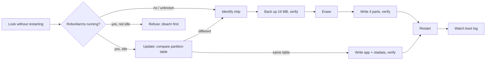

# 34 · Flasher and bench tool (desktop)

**Status:** Implemented v1 - the Flasher (`tools/flasher`: guided setup with wiring before the
panel is plugged in, Connected parts, factory reset, language packs) and the firmware's `rf pin` and
J7 places: host-tested, walked against `--mock`; it has installed a second panel. Custom pins on
J7 (FLS-029) and the Zigbee module's radio software (FLS-030): host-tested and walked against
`--mock`; the Zigbee module's check and install proven on a real module through the Flasher's
engine (B027), the rest not yet on hardware (BL-165). The CrowPanel 10.1" (board V1.2) is offered
beside the 7": the person says which when the chip can't (BL-209), walked against `--mock`, and
installed on a 10.1" by the Flasher. Voice packs (FLS-031): a bundle carries them, Install and Update
write them; host-tested, and the Flasher put one on the 10.1". Firmware from the firmware server
(FLS-032 to FLS-034): the Flasher carries none; it downloads each board's newest release on its
channel with the languages, voices and asset packs that go with it, checked against the release key
built into it; host-tested, walked against `--mock` and a local firmware server, and the Flasher
downloaded from the live firmware server installed the 10.1" from scratch with it (Reset to
factory defaults). Left: its wiring checks (BL-081), the redesign on a panel (BL-033), the socket
drawn for wired parts (BL-117),
distribution (BL-041), phases C and 3 (BL-051), user trials (BL-078) ·
**Milestone:** M19 · **Depends on:** 06, 13, 25, 30, 33

## Goal
One desktop app, "RoboAlarms Flasher", that someone who is not a developer can run on Windows,
macOS or Linux to put the panel's firmware on a board and then check the hardware attached to
it. It lists the USB serial devices that are plugged in, works out which board is on the
selected one, picks the right image for it (and the right P4 silicon build), lets the person
override that choice, backs up the factory flash before the first install, flashes, waits
for the panel to start, and then opens a console and a test screen for the attached hardware.

The first user is a hardware tester at another site: **a CrowPanel Advanced 7" (V1.1, P4 silicon v1.x)
with the 433 MHz receiver from the D-FLIFE kit (Amazon B0BZRRBBNK, an
RX470-4 / WL101-341 module, docs/features/25)**, on a **Windows** PC, with someone from the project there in
person. Phase 1 is sized for that visit; macOS and Linux follow from the same code.

His receiver is wired to the **J7 expansion header, DATA on IO3 (GPIO 3)**,
not to the wireless-socket pad the firmware expected (GPIO 10), so Phase 1 also has a firmware
part: the receiver's data pin became a setting, `rf pin` (see "Firmware: the receiver on J7").

No ESP-IDF, Python or command line on his computer: a single file he double-clicks.

## Reference behaviour
Installers of keypad alarm panels program and update them with the maker's PC tool over a
dedicated link; homeowners never do. We copy the idea of one installer tool that identifies
the panel before writing to it, and deviate by making it simple enough for a homeowner, since
this panel is flashed by its owner.

## Requirements

| ID | Requirement | Verified by |
|---|---|---|
| FLS-001 | Lists every serial port within 2 s of a plug or unplug: name, description, USB VID:PID, manufacturer, serial number. Known ESP32 USB bridges (CH340/CH343, CP210x, FTDI, Espressif USB-JTAG) are marked; ports that are not USB (Bluetooth, built-in COM1) sit under "Show all ports". One likely board selects itself. On Windows, while no likely board is listed, a known bridge present without a COM port is reported as a missing driver (problem code 28) or a driver that failed to start (any other code), without opening a port | unit (port classifier; `test_flasher_driver.py`), manual |
| FLS-002 | Opening a port to identify or watch a panel never resets it: DTR and RTS are released before the port opens (`panel_console.py` does this today). Measured on macOS and Linux before the app claims it there | unit (open parameters), bench |
| FLS-003 | **Look without restarting:** on the selected port only, and only when its bridge is a known ESP bridge, sends `dev describe` and reads board, firmware version, profile, P4 silicon revision, `idle` and `probation`. Nothing answering means "no RoboAlarms firmware with a console" (factory demo, other firmware, a release build) | unit (recorded replies) |
| FLS-004 | **Identify the chip** through the ROM bootloader (esptool): chip, silicon revision, flash size, MAC. This restarts the board, so it asks first when FLS-003 found a running panel, and is refused while that panel is not idle (armed, installer mode, update or probation running) or answers without saying whether it is. The same check, on a look taken just before, comes before every reset the tool makes (Console Restart, the receiver's settings, the parts setup); a board that has shown a RoboAlarms console since it was plugged in, or that the tool installed, is refused when it doesn't answer | unit (fake chip backend), bench |
| FLS-005 | **Selects the image:** the board id reported by running firmware ("sure"), else the one catalogue board whose chip, silicon range and flash size match ("likely"); none selects nothing. Several ("ambiguous": the CrowPanel 7" and 10.1" have the same chip, flash and CH340K) select nothing until the person names the board (`select_board`: that board's image for the chip's silicon, the running profile first); "Which board is this?" lists the boards, the one chosen in Panel and parts already checked, and the builds list stays one link further. USB VID:PID alone never selects. The reason is shown next to the choice | unit (matching table), `test_flasher_detect.py` (`test_the_7_and_10_inch_are_chosen_by_the_person`, `test_the_person_names_the_board`) |
| FLS-006 | **Manual override:** every image in the bundle can be picked. Images for another chip family, or needing more flash than the chip has, are listed but disabled with the reason; a silicon revision outside the image's own range (its header's min/max) needs an explicit confirmation | unit |
| FLS-007 | **Install** (a board without RoboAlarms firmware): back up the whole flash (on by default here; skipping needs a confirmation), check the backup's size and checksum before anything is erased, erase the whole chip (the vendor demo's settings area otherwise stops the first boot, CONTRIBUTING.md "Set up a panel"), write the four parts, verify each, restart, and watch the boot log up to 30 s for the board line and the console prompt | unit (job order), bench |
| FLS-008 | **Update, keeping settings** (RoboAlarms firmware running and idle): compare the partition table on the chip with the image's; different means Install only, with a clear "codes, users, zones and Wi-Fi will be lost"; same writes the app and `otadata` (the bootloader only when it differs), verifies, restarts, checks the boot. An older version than the panel runs asks first | unit, bench |
| FLS-009 | **Backups:** `Documents/RoboAlarms/Backups/<board>-<MAC>-<date>.bin` with a JSON sidecar (chip, silicon, MAC, flash size, date, SHA-256). Restore refuses another chip or flash size and asks first when the MAC differs | unit, bench |
| FLS-010 | **Never** burns eFuses, enables secure boot or flash encryption, or touches the C6: the tool calls esptool through an allow-list (chip id, flash id, read, erase, write, MD5, reset), and a test fails if anything else is reachable. The Zigbee module's ESP32-H2 is written only over its own USB port, out of its socket, and only with the bundle's radio software or its own backup (FLS-030); the C6 never | unit (static check) |
| FLS-011 | One program per port: the console closes before a job and reopens after; "port in use" names the usual suspects (Arduino IDE, PuTTY, `idf.py monitor`, another Flasher) | unit, manual |
| FLS-012 | Every failure says what happened and what to do next. A write interrupted by an unplug says the board is not harmed and can simply be retried (the ROM bootloader always answers) | manual (mock scenarios) |
| FLS-013 | **Console:** live log without a reset, a command box with history, quick commands (`status`, `health`, `rf`, `power`, `c6 status`, `display`), Save log, and an explicit Restart panel button (a reset outside a job, refused as in FLS-004). The tool never types keypad codes | manual |
| FLS-014 | **433 MHz receiver test:** a wiring card drawn from the board's pin map (the J7 header and the wireless-socket pads; VCC to **3V3, never 5 V**, GND, DATA, antenna); **which pin DATA is on**, picked on that picture or found with **Find receiver** (`rf find`), saved with `rf pin`; `rf status` every 2 s while the page is open ("Receiver module on GPIO N, N edges/s, line N % high"); **Listen** (`rf raw on`) groups decoded transmissions by device (protocol, id, code, count, last seen); **Capture** (`rf capture 3000`) saves the pulses to a file for decoder fixtures; raw logging is turned off when the page closes. Hints follow docs/features/25 "First bench" | unit (line parser), bench |
| FLS-015 | **Firmware bundle:** one file (zip: `manifest.json` + the parts + SHA-256 of each), checked when opened, made by one command from the build folders. It records the public key that signed the apps and warns when that is not the owner's key (a panel only takes network updates signed with the key of the firmware it runs). It may also carry the Zigbee module's radio software (`firmware/radios/h2_rcp`, the ESP32-H2), in a list of its own that older Flashers ignore: unsigned (the H2 has no secure boot), each part checked by SHA-256, recorded with its version, its OpenThread RCP version and its source commit (the last commit that changed `firmware/radios/h2_rcp`); it is never offered as a panel image. A radio whose parts or offsets this Flasher doesn't know (a newer Flasher's layout) is skipped and the rest of the bundle used. The Flasher carries no bundle: it takes a release's from the firmware server (FLS-032), and a file is opened by hand in Advanced tools > Software | unit |
| FLS-016 | Runs without Python installed on Windows 10/11 (first), macOS 12+ (Apple Silicon and Intel) and Linux x86-64 | manual per OS |
| FLS-017 | Nothing in the app flashes or blinks (Display safety applies to our own screens too): steady progress bars and words, no pulsing. Follows the OS light/dark setting; usable at 125-150 % scaling | manual, screenshots |
| FLS-018 | The UI's local server listens on 127.0.0.1 only, on a random port, with a per-run token and a Host check (the same pattern as `panelctl screen`) | unit |
| FLS-020 | **Receiver choice and its wiring**: the 433 MHz page sets which receiver the panel listens with - found by itself, a CC1101, or a receiver module (`rf module auto|cc1101|ook`, then a restart) - and draws that receiver's wiring from `boards.json`: the CC1101's eight wires to the wireless-socket pads with their GPIOs, or the module's VCC/GND/DATA with the J7 pin picker. Every pin drawn is the firmware's own (the test reads `board_desc.c` through `board_pins.h`). Heard sensors show every protocol and the flags the firmware adds (battery low, common factory address) | `test_flasher_panel.py` (`RfModuleTests`, protocol and flag parsing, the module status line), `test_flasher_safety.py` (`test_the_receiver_wiring_is_the_firmwares`) |
| FLS-021 | **Boards not offered:** a board the catalogue knows but does not install (`"offered": false` with the reason: the unfinished 4" E32R40T) is never chosen - a chip or firmware that looks like it is told why - its images are refused before the port is touched, and `make_bundle` will not bundle it | `test_flasher_detect.py` (`test_the_unfinished_4_inch_is_named_but_never_chosen`), `test_flasher_bundle.py`, `test_flasher_safety.py` (`test_the_unfinished_4_inch_is_not_offered`) |
| FLS-022 | **Clock module tab** (docs/features/35 RTC-011): what `rtc` says about the battery-backed clock module (state, the panel's clock against this computer's in seconds, what set it last, its temperature), "Set the panel's clock from this computer" sent on this computer's second tick (`rtc set`), refused in words without a module or with older firmware, and the module's wiring from `boards.json` (`"rtc"`: VCC to 3V3, GND, SDA, SCL, the coin-cell charging warning), whose pins are the firmware's own; `rtc` is a quick command in the Console tab | `test_flasher_panel.py` (`ClockTests`), `test_flasher_safety.py` (`test_the_clock_module_wiring_is_the_firmwares`), Browser pane against `--mock` |
| FLS-023 | **Guided setup** (BL-117): three parts in the step list - **Plan** (Panel and parts), **Wire** (Get ready, Full wiring, Check before power; no panel needed, skipped with nothing extra to connect) and **Install** (Connect, Check the panel, Install, or Update or Reset for a panel running RoboAlarms, Test and finish) - with one named primary button per screen and errors kept on their step; unplugging the panel during Check or Install goes back to Connect with the parts kept. **Advanced tools**, reached from the switch at the top right (the step list and the last step no longer repeat it), hold panels and ports, the console, hardware, the Zigbee module (FLS-030), backups, software and logs. The website's and docs' look (their tokens, Segoe UI, teal), light/dark after the computer's setting with a toggle, no motion | Browser pane against `--mock` (every step, both themes, no console errors) |
| FLS-024 | **Connected parts**: asked as what, never where, in the guided setup (BL-117): the Flasher places the parts itself (`parts.recommended()`, the page's `recommend()`: every mix of parts fits), and choosing places is advanced (a fold-out on Panel and parts, and Advanced tools > Hardware). The parts: the 433 MHz receiver (none, module on the socket or any J7 terminal, CC1101 on the socket or J7, not sure), the clock module (I2C connector or J7 IO27/IO28), the Zigbee module (takes the socket) and the Z-Wave radio (a ZAC93 on the socket's serial line or J7 IO27/IO28: never with the Zigbee module on the socket or the clock on J7; its place is taken away first and chosen last, and after the restart the Flasher waits for the radio to start and says whether it answers; docs/features/36 hardware.md §4), each with its wiring drawn from `boards.json` (J7 and J13 as printed, wires that never cross a pin they don't end on, every wire on a pin of its own), a pin check (the rules of `parts.py`) that counts the wired zones left and blocks Done with the reason. Applied after an install or update - each setting stored, one restart, read back - or from Advanced tools > Hardware (`parts_apply`) | `tools/tests/test_flasher_parts.py`, `test_flasher_safety.py` (`test_the_other_places_are_the_firmwares`) |
| FLS-027 | **Wiring before the panel is plugged in** (BL-117; for someone with no electronics background): Get ready lists what is needed (the jumper-wire count, leads, antennas, coin cell), how to recognise the places the parts use, the words used, how to fit a jumper wire and the 5V-row meter tip, then the panel off and unplugged; Full wiring draws every part at once, numbered in assembly order (J7, then the I2C connector, then the radio socket) on its board and beside every J7 pin, with a filter by part (the other J7 parts faded, other connectors' cards hidden), the Zigbee module drawn going into the socket (its datasheet, docs/research/AddOnWiringResearch.md), and a tick list of every wire; nothing changes on hover (fading follows a click only) except a magnifying glass that follows the pointer along J7's rows of pins, never over the wires or the parts' numbers ; the numbers beside the pins, like the parts' boards, pick that part; Check before power draws every part's connector as Full wiring does, with the same filter (its own choice, opening on every part), and offers six checks to tick, none required, "No wire is on a pin printed 5V" first and marked as the one that can destroy the part and the panel's chip; a wiring sheet to print or save | `test_flasher_parts.py` (`test_the_flashers_own_places_fit_every_mix_of_parts`, `test_the_recommended_places`), Browser pane against `--mock` (every step, both themes, no console errors) |
| FLS-025 | **Reset to factory defaults** (a complete reflash): for a panel running RoboAlarms, the install job over it - the whole chip erased, the firmware written, verified and started - after the erase is ticked on the page and confirmed once; a copy first is offered (off). A board without RoboAlarms firmware is always installed this way | `tools/tests/test_flasher_parts.py` (`ResetTests`), Browser pane against `--mock` |
| FLS-026 | **Ports and power follow the board's maker** : the Connect step gives `boards.json`'s `connect` advice in words and in its drawing - for the CrowPanels (the 7" and the 10.1" have the same ports and POWER switch), Elecrow's: POWER on, this computer on the port marked UART0, a phone charger on the port marked USB2.0 (the screen draws 8-10 W, more than a computer's USB port gives), a panel's own power supply kept connected (safe: each 5 V input has its own diode, V1.1 schematic). Plain words, no technical details on this screen; the J7 cautions (5V never, the 5V row found with a meter, no supply through J7) are in Get ready and the wiring's notes. "Nothing showing up?" starts with the POWER switch and the UART0 port; Install repeats the power; a first start that browns out or never says it runs is reported as too little power, with the board's fix. Nothing tells the person to unplug a supply | `test_flasher_safety.py` (`test_the_power_advice_is_the_makers`), `test_flasher_jobs.py` (`test_a_panel_short_of_power_is_told_how_to_power_it`), Browser pane against `--mock` |
| FLS-028 | **The panel's language** (docs/features/37 [language-packs.md](../37-Globalization/language-packs.md), I18N-045): a bundle carries the build's signed language packs (`lang/*.robolang`, checked against the images' key and version), and the firmware server the release's (FLS-032); a new install or a reset asks "Panel language" (English, or a pack - a draft only for a development or legacy image) and writes the pack into the `assets` partition's pack store after the firmware (`packstore.py`: the blob, its MD5, then the table, flagged the panel's starting language); an update brings every installed language to the bundle's version, flags kept | `test_flasher_packstore.py`, `test_flasher_languages.py`, `test_flasher_bundle.py`, bench (BL-121) |
| FLS-029 | **Custom pins** (Advanced tools > Hardware > Custom pins): someone's own plug-in board says which board GPIO each IO pin of its modules is wired to - a CC1101 (SCK, MOSI, MISO, CS, GDO0) or a receiver module (DATA), the clock module (SDA, SCL, or the I2C connector) and the ZAC93 (the panel's TX and RX, an optional reset line); the Zigbee module only in its socket. The layout is the whole tab (`"layout": "custom"`, no mixing with named places). The rules (`parts_check`, shared with `problems()` and the job checks): every pin chosen, each GPIO once, only the board's reachable pins (`boards.json` `custom`, J7's ten IO pins: the firmware's REACHABLE list), the clock's place chosen, one 433 MHz radio, never "Not sure". The hardware wins: a zone's wired terminal never blocks a pin, and the zones on the chosen pins are only named in the confirmation (`parts_zones`, from `zones` and `terminals`). Applying it: the probe `rf place` first (no "custom: " line: "This panel's RoboAlarms is too old for custom pins", nothing changed), then everything taken away (`zwave place off`, `rf module off`, `rf pin default`, `rf place default`, `rtc place default`), then `rf place custom ...`, `rtc place custom ...`, `zwave place custom ...`, one restart and the read-back (the "custom ..." lines, a refused layout's "custom place not used: " reasons as notes). Install and Update carry it in the job's parts; a Reset keeps a layout the panel reported. Named places are unchanged. The page: a "Suggested places | Custom pins" switch on Hardware (it opens on Custom pins for a panel that reports a custom layout); a card per module with a table of its pin as printed, the direction from the module's side and a board-pin picker (the pins come from `boards.json`), every picker starting at "Choose a pin…" (the Z-Wave RESET adds "Not connected") and a pin another module uses disabled and named; the J7 summary with numbered badges; the engine's `parts_check` words in the problems card, filled in place so a pin list opened meanwhile stays open, and device updates held back only while a list is open; "Reset the pins" (with Undo, back to the pins the panel uses now, a finished apply's included) on a panel that reports a layout; two required ticks (the board's revision from `boards.json`, "This is a V1.1 board" or "This is a V1.2 board" with what differs on the other; apply first, then plug the board in); the button is "Apply and restart the panel" (zones named in the confirmation), "Update to <version> with these pins…" or "Install RoboAlarms with these pins…" (today's Update or Install page, the pins riding in the job's parts); a radio that doesn't answer gets the TX/RX or SI/SO hint and an offer to turn it off. Get ready and the printed wiring sheet carry the custom pin table, the lead for a clock on the I2C connector (its plug from `boards.json`: PH2.0 on the 7", HY2.0 on the 10.1") and the multimeter tip when something is on J7 | `tools/tests/test_flasher_custom.py`, `test_flasher_safety.py` (`test_the_custom_pins_are_the_firmwares`, every board); Browser pane against `--mock` |
| FLS-030 | **The Zigbee module's radio software** (the ESP32-H2 board, `firmware/radios/h2_rcp`): written over the module's own USB-C port (USB Serial/JTAG, 303A:1001) and only **out of its socket** - the socket has no BOOT or EN line, and esptool on a seated module restarted the panel (BL-099). Each port has a role decided by the engine (`device_dict`: `role` panel / zigbee_module / unknown, `maybe`, `needs_alone`): a panel's USB bridge or a RoboAlarms console that answered is a panel; a 303A:1001 port is the module only once its chip reads as an ESP32-H2. The Flasher never opens, probes or restarts a 303A:1001 port by itself (not on plug-in, not from the Console's restart): only the person's identify, read and radio actions do, each once they tick "The module is on its own, not in a panel". `radio_read` says what it runs (its partition table at 0x8000 and its app's description): ours (older, the same), Espressif's factory OpenThread example, other, or empty. The `radio` job refuses a port where a panel answers and any chip but an ESP32-H2 within the radio's silicon range before erasing anything, keeps a copy of the whole flash only when asked (unticked at first), erases the chip, writes the three parts (0x0, 0x8000, 0x10000), checks each by MD5 and restarts it; its outcome is the job's result (the port may come back as another one). `zigbee_status` reads a panel's `zigbee status` line, waiting up to 20 s while its radio starts; older firmware without it says so. The page: Advanced tools > Zigbee module works on the module's own port and needs no panel (the required tick, what it runs, the install button or "it already has it", the job, "Unplug its cable and put it aside", its copies in Backups); Panels and ports lists the module as "Zigbee module (ESP32-H2)" with a link to it, never as the panel, and Connect never selects or probes a 303A:1001 port; Software counts the radio software in the file's line; guided setup opens "Prepare the Zigbee module" from Get ready when the module is ticked (off the steps, like Print the wiring); Test and finish reads `zigbee_status` (ready, or where to look; older firmware says nothing alarming) | `tools/tests/test_flasher_radio.py`; Browser pane against `--mock` |
| FLS-031 | **The voice pack** (docs/features/08 [voice-first-build.md](../08-Audio-and-Annunciation/voice-first-build.md) D08, BL-204): a bundle carries signed `.robovoice` files (`bundle --voice <file>`, repeatable; each signed with the images' key, no draft beside a release image, one per locale and voice; `packstore.read_voice` checks the envelope and the RVOC header: format 1, a schema this Flasher knows, a nonzero revision, known flags, printable locale and voice). The firmware server offers each language's voice with it (FLS-032). Install and a reset write one as the store's kind-2 entry `primary` after the other packs: the panel language's own voice and never another language's (ADR-053: a language and its voice are one unit; English, built in, gets US English), none when the firmware has none for it; never a draft for a release image; one that does not fit is skipped and said, the firmware stays installed. Update gives the panel its language's voice (ADR-053, replacing the "replace with newer" rule of 2026-10-10): the language is the one the pack store marks as the panel's, else that of the voice it has when that language is installed (or English), else English - the Flasher can't read the language kept in the panel's settings; that language's voice is installed when the panel has none, another language's or another voice, or an older revision, and the same revision (a revision is an identity: the panel refuses other audio under it), a newer one, and the panel's voice when the firmware has none for the language (a draft under a release image counts as none) are left as they are. Software counts the voices in the file's line; the review's "What happens" names the voice step | `tools/tests/test_flasher_voice.py` (on the frozen `voice_pack_fixture_v2.h`); the 10.1" (2026-10-10) |
| FLS-032 | **Firmware from the firmware server** (the official update server's public API; BL-041): the Flasher carries no firmware. At start it asks the server (`https://firmware.roboalarms.com`, else `--server` or `ROBOALARMS_FIRMWARE_SERVER`; HTTPS only, plain HTTP only for a server on this computer) for its boards (`/api/v1/boards`); once a panel is identified or the person names its board, it looks up that board's newest release on the channel (`/api/v1/releases`, FLS-033). A release signed with a key not built into the Flasher is refused before anything is downloaded (decided 2026-10-12); otherwise its bundle (this board's images only) and the languages, voices and asset packs made for its version (`/api/v1/languages`) are downloaded, each checked by size and SHA-256, every app and pack by its signature against the built-in key, every pack by its version. A release with rules (board revisions, parts it needs or can't have) the chosen parts don't meet is refused with the reason before the job; one with no rules is preferred. Downloads are kept in the app-data folder's `cache` by SHA-256 (fetched once, resumed where they stopped, the least recently used pruned past 768 MB), and the server's last answers are remembered, so what was downloaded is used when the server can't be reached. A new install or a reset writes the firmware, English with its US English voice unless another language is chosen (then that language and its own voice, ADR-053), and every asset pack - the screensaver's picture, the letters, the certificates (FLS-028, FLS-031); an update brings each to the release's version. A firmware file opened by hand (Advanced tools > Software, `--bundle`, `--build`) is used instead, checked as before, until "Use the firmware server" | `tools/tests/test_flasher_server.py` (`ClientTests`, `SourceTests`, `ControllerTests`); Browser pane against `--mock` and a local firmware server |
| FLS-033 | **Which version:** every panel gets the steadiest release there is for its board: Stable, else Beta, else Alpha (decided 2026-10-12), a new panel and one running a development build alike. The Flasher waits for each channel's answer in that order before it takes the next. A board with only a development build (Dev) is never given it by itself: the Flasher offers it once in a pop-up that says it comes with test zones and developer tools, and installs it only when the person chooses it. The version list at the bottom left of the guided setup lists the board's release on each channel in that order, a channel without its own release greyed out; a pick there is that board's, and Advanced tools > Software's Version list (Automatic, or one channel) sets every board. A pick lasts until the Flasher closes: the next start is automatic again. Changing the version never installs the build of the channel left while the new one downloads. Software lists each board's release as it goes: looked up, downloading (a steady bar), ready, none, or what went wrong with Try again | `test_flasher_server.py` (`test_stable_else_beta_else_alpha_dev_only_offered`, `test_the_order_waits_for_each_answer`, `test_a_channel_shows_which_channel_its_release_is_on`, `test_the_persons_pick_is_for_this_run_only`, `test_a_channel_sees_itself_and_the_steadier_ones`, `test_every_panel_gets_the_steadiest_release`, `test_going_back_never_installs_the_other_channels_build`, `test_a_development_build_only_when_the_person_chooses_it`); the mock in the Browser pane |
| FLS-034 | **Board descriptions and a newer Flasher** (from the firmware server): at start the Flasher asks `/api/v1/flasher`. Board descriptions newer than its own `boards.json` - a signed asset pack of kind 0x80 (docs/features/39 asset-packs.md), signed with a key built into the Flasher, in a format it reads, its version the server's - replace them while it runs, so a new board or board revision needs no new Flasher; one that doesn't check out is left unused and said in the log. A newer Flasher for this computer is only pointed at: "Flasher X.Y.Z is available" at the top opens its download page in the browser. The Flasher never downloads or replaces itself, and run from the source it says nothing | `test_flasher_server.py` (`test_board_descriptions_from_the_server`, `test_a_newer_flasher_is_only_pointed_at`), `test_asset_pack.py` (`test_the_flashers_board_descriptions`) |
| FLS-019 | Each session writes a log file (every command sent, every esptool step, detection evidence) under the user's app-data folder; "Open logs" shows it | manual |

## Design

### ADR-039 (accepted 2026-09-24, in docs/features/00): a Python app with an HTML face
The flasher is a Python program built into one file per OS with PyInstaller. Its engine uses
**esptool as a library** (the reference implementation, and already how every image here is
flashed) and **pyserial** (already used by `panel_console.py`, `ota_serial.py`, `panelctl`).
Its interface is HTML/CSS/JS served by the engine on 127.0.0.1 and shown in the app's own
window through **pywebview** (Edge WebView2 on Windows, WebKit on macOS and Linux); when no web
view is available it opens the default browser on the same address.

Why: one language with the repo's other tools (the no-reset port handling, `dev describe`,
the image-header reader in `panelctl` carry over); the Panel Manager's look (`panel.css`
tokens, the RoboAlarms logo, `docs/BRAND.md`) carries over; the same page runs against a mock
engine in any browser for development and screenshots. Not chosen: a browser-only Web Serial
flasher (esptool-js) - the page cannot list the connected devices until the person picks one
in the browser's own chooser, and it works only in Chrome and Edge; Qt (PySide6) - a second UI
toolkit and a larger download; Electron or Tauri - a new toolchain and a second serial stack.

### Where it lives
The package is `roboflash`:
```
tools/flasher/
  README.md            how to run, build and make a bundle; a one-page guide for the person flashing
  requirements.txt     esptool 5.x, pyserial, pywebview (esptool and pywebview by version range,
                       pyserial pinned)
  build.ps1 / build.sh one-file app with PyInstaller (no firmware inside)
  run.py               the entry point (`run.py --help`); make_icon.py: the program's icon
  roboflash/
    __main__.py, app.py  window or --browser, --mock, --server, --build/--bundle; commands bundle,
                       check-bundle, ports, probe, identify
    boards.json        the board catalogue (below); a board's zigbee.radio: the module's chip and parts
    ports.py           list and classify ports, hot-plug diff
    serialio.py        open a port without a reset; why a port would not open (FLS-002, FLS-011)
    probe.py           passive console probe (FLS-002/003)
    chip.py            the esptool allow-list: identify, read, erase, write, verify, reset, progress, cancel
    boards.py          catalogue + matching (FLS-005/006)
    imagefile.py       app image header (min/max silicon, project, version) and signing key
    bundle.py          open and verify a bundle; Radio: the Zigbee module's software it may carry
    make_bundle.py     build folders -> bundle (FLS-015); --radio adds an h2_rcp build
    fwserver.py        the firmware server: its API, downloads kept by SHA-256, channels, the
                       trusted keys, board descriptions, the newer-Flasher notice (FLS-032..034)
    jobs.py            install / update / backup / restore / radio state machines and their gates;
                       what the Zigbee module runs (read_radio, FLS-030)
    controller.py      the state and the page's actions (ports, devices and their roles, jobs,
                       consoles, monitors, the module's read and the panel's `zigbee status`)
    console.py         console session (no reset), line stream, command queue
    rf_test.py         `rf status` and raw-decode line parsing, per-device table
    clock_test.py      the clock page's `rtc` lines (FLS-022)
    parts.py           Connected parts and custom pins: rules, console commands, what a panel
                       reports, the zones on a layout's pins (FLS-024, FLS-029)
    paths.py           where backups, captures, logs, downloads and settings go
    server.py          HTTP + server-sent events, token, static files
    mock.py            scripted devices for the UI and screenshots (Zigbee modules on 303A:1001:
                       MockWorld(radio="factory" | "older" | "s3" | "all")); fakechip.py, testkit.py:
                       a chip in memory, synthetic images (and the module's software) and a pretend
                       firmware server (FakeServer; mock_server for --mock) for the tests
    web/               index.html, app.css, app.js, theme.js, logo
tools/tests/test_flasher_*.py   host tests (unittest, run by CI with the other tool tests)
```
The engine modules import neither pywebview nor the network (but `fwserver.py`, through urllib,
and its tests use a pretend server); esptool only in `chip.py`, so the tests run with a fake chip
backend.

### Board catalogue
`tools/flasher/roboflash/boards.json`, one entry per `firmware/<board>`: display name, chip, flash
size, the USB bridge it uses (a hint, never proof), how to enter download mode if auto-reset
fails, and notes. `tools/tests/test_flasher_safety.py`
(`test_every_firmware_board_is_in_the_catalogue`) checks that every firmware project has an
entry (the plan put that check in `tools/check_boards.py`).
Today: `crowpanel_p4` (ESP32-P4, 16 MB, CH340K; images v1 and v3 by silicon) and `e32r40t`
(ESP32, 4 MB, CH340C; a match is only "likely" because many ESP32 screens look the same; not
offered while the board is on hold, FLS-021). The file has a `version`: newer descriptions from the
firmware server replace it while the Flasher runs (FLS-034).

### Detection
| Evidence | Confidence | What the screen says |
|---|---|---|
| Running firmware answers `dev describe` with its board | Sure | "CrowPanel 7" - reported by its firmware (0.6.0 dev, silicon v1.3)" |
| ROM probe: chip + silicon + flash size match one catalogue board | Likely | "Looks like a CrowPanel 7" (ESP32-P4, silicon v1.3, 16 MB)" |
| ROM probe matches several boards | Ambiguous | the matching boards, none preselected |
| Chip found, no image for it | No match | "An ESP32-S3: there is no RoboAlarms firmware for it yet" |
| Nothing answers | Unknown | cable, driver, port-in-use and download-mode tips; manual choice allowed |

Which silicon build (P4 v1 or v3) comes from each image's own header (min/max chip revision),
not from a table in the tool, so a future variant needs no code change.

### Jobs

Speeds: 460800 baud for writes (what `idf.py` uses), 921600 for the backup read (README step
2); a bridge that refuses a speed stays at 115200. A backup read that fails at 921600 connects to
the chip again and reads at 460800 (Flasher 0.1.2; 0.1.1 changed speed on the broken stream, which
failed too). A 10.1" panel's link (CH340K, COM8) still lost bytes at 460800 after about 4 MB
on 2026-10-12, so its backups don't finish yet: reading in pieces and re-reading only a failed
piece is the next step. A 16 MB backup takes a few minutes, the install about a minute.

### Screens
One window. Left: the devices, live. Right, for the selected device: **Device** (what is known,
with the evidence), **Firmware** (the chosen image, its confidence, "Change"), **Action** (one
primary button: "Install RoboAlarms 0.6.0" or "Update to 0.6.0 - keeps settings"; Back up
only and Restore under "More"), then **Progress** (named steps with steady bars). After a job,
or for any running panel: **Panel** tab (console) and **Hardware** tab (the 433 MHz test first;
wired terminals later). Plain words throughout ("the panel", "restart"), no jargon on the
primary path; the details (VID:PID, offsets, esptool output) are one click away.

### UX redesign (built; FLS-023, FLS-024, FLS-025)
Aim: *the Flasher is the first thing people use to get the alarm going; make it easy for
someone without hardware experience, with advanced options for pin layouts and the devices
connected; it must not look thrown together; follow the styles and colours of the docs and the
website.* Research, findings and sources: [docs/research/FlasherUXResearch.md](../../research/FlasherUXResearch.md).
Clickable prototype (one file, no engine): [prototype/guided-setup.html](prototype/guided-setup.html).

The "Screens" layout above (a port list beside Flash/Console/433 MHz/Clock tabs) was Phase 1;
the redesign replaced its face (`web/index.html`, `app.css`, `app.js`, `theme.js`), not the
engine or ADR-039:
- **Guided setup** by default, five steps with a step list: Connect, Check the panel,
  Connected parts, Install (Update for a panel running RoboAlarms), Test and finish. One
  decision and one named primary button per screen; ports, chips and USB IDs under
  "Technical details".
- **Advanced tools** one click away: panels and ports, console, hardware diagnostics, backups,
  software (open a file, choose the build by hand, install fresh), logs - today's functions,
  grouped.
- **Connected parts**: what is wired (433 MHz receiver module / CC1101 / not sure, the clock
  module), its wiring drawn from the pin map, pins limited to those the firmware accepts with
  the reason for the rest, applied with one restart after the install, tested on the last step.
- **The website's and docs' identity**: their tokens (teal `#007b7d` / `#94eff0`), Segoe UI
  system type, 7 px buttons, 4 px tags, 12 px hairline cards; the Phase 1 page used the Panel
  Manager's older `#067060`/navy palette (replaced in Phase A, `web/app.css`; checked).
  No motion (FLS-017), OS light/dark plus a toggle.
- Errors stay on their step with what to do; code signing before public release.
- **Ports and power** (FLS-026): the Connect step draws both cables - this computer on UART0,
  a phone charger on USB2.0 - and lists Elecrow's advice from `boards.json` (`connect`). Until
  the panel is known it uses the one board whose USB bridge the port has (a hint for words
  only, never for the firmware), else it names the board ("How to connect a CrowPanel 7"").
- **Wiring** (from `docs/research/AddOnWiringResearch.md`): the parts step offers the
  receiver module, the CC1101, the clock and the ESP32-H2 Zigbee module with every place the
  firmware supports - no release tags (nothing has been released yet); suggested layouts from `boards.json` (`layouts`); a live pin check
  (the Zigbee module takes the socket, "Not sure" can't be used with it) that counts the wired
  zones left; J7 and J13 drawn from their printed labels; "find the 5V row with a meter" until
  the J7 orientation is confirmed. The zigbee card says the panel uses the module for Zigbee
  sensors and that its radio software comes first (FLS-030). The step also offers the Z-Wave radio, a
  ZAC93 (FLS-024, docs/features/36 hardware.md §4).

**How it is built.** The engine gained `parts.py` (the rules, the console commands, what a
running panel reports) and `Controller.parts_read` / `parts_apply`: an install or update given
`parts` sets them up once the panel runs (commands such as `rf module cc1101`, `rf pin
default`, `rf place j7`, `rtc place j7`; one restart; `rf` and `rtc` read back and compared),
and Advanced tools > Hardware applies them to a running panel. Refusals come back in the
panel's words ("Zone 3 uses GPIO 52 as a wired terminal..."). The firmware side is docs/features/25
RF-019/RF-020, docs/features/35 RTC-013 and docs/features/33 BRD-014/015. The reset (FLS-025) is the
install job over RoboAlarms with `reset`: the whole chip is erased; the page asks for the erase
to be ticked and confirmed once. CSP stays strict: no inline styles or scripts (wire colours and
swatches are classes, drawings are built through the DOM, the theme is set by `theme.js`).

### Which image the first tester gets
Recommended: **the v1 `dev` image** (0.6.0, hardware-checked on the
same board revision), signed with the maintainers' key. It keeps the service console the Hardware
tab needs (release builds have none), answers `dev describe` for detection, and its owner can
later update it over the network or the Panel Manager. The factory codes (installer 69420,
master 123456) apply until they change them in the first-boot setup on the touchscreen.

### Firmware: the receiver on J7 (docs/features/25)
**What his photo shows:** the back of the panel in his case, with two boards of
his own:
- An adjustable buck converter (toroid, regulator, trimmer). Its red and black wires go to the
  left end of J7, presumably to feed the panel from the alarm's supply into the 5 V pins.
- The kit's green superheterodyne receiver with its spring antenna, on a small adapter board
  (an electrolytic, a resistor, a small ceramic: it looks like an RC filter on the receiver's
  supply). Red and black go to the left end of J7. White goes to the **sixth column**: going by
  the J7 silkscreen he sent, that is **IO3 (GPIO 3)** on the 3V3 row or **IO52 (GPIO 52)** on the
  5V row. The photo does not show which row.

The receiver type was already supported (ADR-044: the `ook` module mode); the pin was not. The
data line was `CONFIG_ALARM_RF_GDO0_GPIO`, fixed at build time (the 7"'s default is 10, the
socket's pad IO10, called IO4 before `11ab0c7`). **Built (docs/features/25 RF-008,
docs/features/33 BRD-013):**
- **`rf pin <gpio>` / `rf pin default`** stored in NVS (`rf`/`pin`, next to `module` and
  `freq`), used from the next start; `rf pin` alone says where it listens. Kconfig stays the
  default: one image for every panel, and an existing panel is unchanged.
- **Only a place the board offers:** its own data pin or a wired terminal
  (`board_rf_data_on()`, portable), and only when the board validator passes the result and no
  zone uses that terminal. `panel_app` reads the stored pin before starting the zone sources
  and takes the terminal out of the list, so the zone editor never offers it.
- **In the Flasher:** the 433 MHz page draws J7 as printed on the board; clicking IO3 asks the
  person to confirm the receiver's VCC is on 3V3, sends `rf pin 3` and restarts the panel.
- **Not built:** `rf find` (the pin is known). The pin choice on the touchscreen: decided,
  not built - pins stay off end-user screens (the console and the Flasher set it).

**Check before his panel is powered with the new firmware:**
- **Receiver VCC must be 3V3.** If the red wire is on a 5 V pin, DATA swings to 5 V into a P4
  pin that is not 5 V tolerant. Move it to a 3V3 pin (the module runs from 2.2-5 V), or measure
  DATA with a meter while a remote is pressed: it must stay at 3.3 V or below.
- **His converter and the computer together: safe for the computer; J7's 5V is the wrong
  place** (read from the V1.1 schematic; not measured). Each 5 V input has its own
  Schottky diode (DSS34) before they join (VCC5V): D10 on the UART0 port (VBUS1), D007 on the
  USB2.0 port (VBUS2), D2 on UART3-IN (+5V_IN). Nothing flows back into a computer, and
  Elecrow's advice is to add a second supply while flashing (the screen draws 8-10 W), so the
  Flasher no longer says to unplug anything (FLS-026). J7's 5V pins, though, are VDD5V: the
  board's 5 V **after** the POWER switch (Q5), an output. A converter wired there can't be
  switched off with POWER, and with a battery fitted and nothing on the three inputs it drives
  the battery directly through Q3 (gate VCC5V_IN, pulled low by R18 when no input has power),
  past the TP4059 charger (which is fed from VCC5V_IN). **Move his converter's output to
  UART3-IN** (+5V and GND, XH2.54 4-pin; 5 V ±5 %, 2 A max). Check where its red wire goes.
- **Receiver next to the converter:** a switching regulator can raise the noise the receiver
  hears. `rf status` (edges/s, line % high) shows it; if range is poor, move the antenna away
  from the toroid.

## Interfaces and data

### Bundle `manifest.json`
```json
{
  "format": 1,
  "created": "2026-09-23T21:00:00Z",
  "source": { "commit": "1633c0b", "dirty": false },
  "signing_key_sha256": "<SHA-256 of the public key that signed every app>",
  "languages": [{"locale": "es-US", "name": "Español", "version": "0.6.0", "draft": true,
                 "path": "lang/es-US.robolang", "sha256": "...", "size": 147456}],
  "assets": [{"kind": 3, "name": "letters", "version": "0.6.0", "draft": false,
              "path": "assets/letters.roboasset", "sha256": "...", "size": 131072}],
  "images": [{
    "board": "crowpanel_p4", "variant": "v1",
    "project": "alarm_crowpanel_p4-dev", "profile": "dev", "version": "0.6.0",
    "elf_sha256": "...", "chip": "esp32p4", "chip_rev_min": 100, "chip_rev_max": 199,
    "flash_size": "16MB", "flash_mode": "dio", "flash_freq": "80m",
    "partition_table_sha256": "...",
    "files": [
      { "role": "bootloader",      "offset": "0x2000",  "path": "crowpanel_p4-v1/bootloader.bin",      "sha256": "..." },
      { "role": "partition-table", "offset": "0xc000",  "path": "crowpanel_p4-v1/partition-table.bin", "sha256": "..." },
      { "role": "otadata",         "offset": "0x2d000", "path": "crowpanel_p4-v1/ota_data_initial.bin","sha256": "..." },
      { "role": "app",             "offset": "0x30000", "path": "crowpanel_p4-v1/app.bin",             "sha256": "..." }
    ]
  }]
}
```
`make_bundle.py` fills it from each build folder's `flasher_args.json` (offsets, chip, flash
settings), its `sdkconfig` (flash size, profile) and the app header (project, version, ELF
hash, min/max silicon); the chip revision numbers above are illustrative. Output:
`build/flasher/roboalarms-<version>-<boards>.roboflash`. `languages` (optional; an older Flasher
ignores it) lists the packs taken from the first build folder's `lang/` (FLS-028). `assets` (optional, the same) lists the asset packs taken from its `assets/*.roboasset` (kinds 3-5: letters, saver picture, certificates; OPT-007): each must be signed with the images' key and made for their version, or the bundle is refused. Install writes them after the firmware and the language (none flagged default; a draft refuses a release image; one that does not fit is skipped and said, the firmware stays installed); Update replaces each installed one whose version differs, installs one the panel lacks and leaves any other kind alone. Tests: `test_flasher_assets.py`. `voices` (optional, the same) lists the voice packs given with `--voice`, each with its locale, voice, revision and draft flag (FLS-031). The Flasher carries none: it
takes a release's bundle from the firmware server (FLS-032), or one opened through Open / drag and
drop or given with `--bundle`.

### Local API (engine to page)
From `roboflash/server.py` `_actions`:
`GET /api/state`, `GET /api/events` (server-sent: ports, job progress, console lines, RF
table), `POST /api/bundle` (upload, the file as the body) and `POST /api/<action>` with JSON:
`probe`, `identify` (`alone` for a 303A:1001 port), `select_image`, `job` (install, update,
backup, restore, radio, with the kind in the body; `alone` and `backup` for radio), `cancel`, `console_open`/`close`/`send`/`restart`/`save`,
`rf_start`/`stop`/`listen`/`clear`/`capture`/`pin`/`module`, `clock_status`/`set`,
`parts_read`/`apply`, `radio_identify`, `radio_read`, `zigbee_status` (FLS-030), `open_folder`,
`firmware_channel`/`refresh`/`get`/`use_server`, `open_flasher_download` (FLS-032 to FLS-034; the
`firmware` event says where each board's release stands). Token in the URL fragment, sent as a header (FLS-018).

## Test and acceptance
- **Host tests** (`tools/tests/test_flasher_*.py`, CI): port classification from recorded
  pyserial data; `dev describe` and `rf` parsing from recorded replies; the matching table
  (sure / likely / ambiguous / none, v1 against v3 silicon, the CrowPanel 7" and 10.1" ambiguous, the
  not-offered E32R40T named but never chosen (FLS-021)); bundle build and verification from a
  fake build folder, including a tampered file; job order and
  gates with a fake chip (armed refused, backup failure means no erase, unplug mid-write,
  partition table changed forces Install, downgrade asks); token and Host checks; the esptool
  allow-list (FLS-010). The files: `test_flasher_bundle.py`, `test_flasher_detect.py`,
  `test_flasher_jobs.py`, `test_flasher_panel.py` (the probe, the console, the 433 MHz and
  clock pages, the server), `test_flasher_parts.py` (Connected parts and the reset,
  FLS-024/025), `test_flasher_radio.py` (the Zigbee module, FLS-030), `test_flasher_server.py` (the firmware server
  over a local HTTP server and a pretend one, real signatures, FLS-032 to FLS-034) and
  `test_flasher_safety.py` (the allow-list, the catalogue and the pins against the firmware).
- **UI:** `--mock` scenarios checked in a browser. As built, the pretend desk (`mock.py`
  `MockWorld`) has a factory P4, a P4 on an older RoboAlarms, an armed P4, an ESP32-S3 with no
  image, a built-in COM port and a Bluetooth one; port busy and unplug during write are covered
  by the host tests (not `--mock` scenarios, so FLS-012's on-screen check is by host test only);
  the E32R40T is not offered (FLS-021). The guides' screenshots in
  RoboAlarms/documentation (`public/images/flasher`) serve instead of a `screens/` folder here.
- **Bench rules:** the E32R40T (a development board: install, update and restore
  when told to flash; the Flasher refuses it while it is not offered, FLS-021). A
  P4 that protects a house: only "look without restarting", never a reset or a
  job, unless told to.
- **Acceptance at the tester's:** the Windows app on their PC with no Python; finds their
  CrowPanel on its own; backs up 16 MB; installs v1 dev 0.6.0; the panel starts its touchscreen
  setup; the Hardware tab shows "Receiver module on GPIO 3" (his DATA is on J7 IO3, `rf pin 3`;
  GPIO 10 is the socket's default); a press of one of the kit's transmitters (or a sensor)
  appears under Listen; they then learn it as a zone on the touchscreen (Zones > Add a zone >
  433 MHz sensor).

## Open questions
- **The radio socket's pad names:** the V1.0 board photo and the schematic show the
  pads printed IO6-IO10 (the chip's GPIOs). `boards.json`, the Flasher's pages and
  docs/features/25's tables use those names (`11ab0c7`); before, they
  used IO0/IO1/IO2/IO5/IO4, the ESP32-H2 module's pin names, and the 433 MHz page offered "Put
  it back on wireless-module socket pad IO4" (on J7, IO4 is GPIO 4). Still to check: the V1.1
  board's silkscreen (BL-033).
- **His receiver's VCC:** DATA is on IO3 (answered). Still to check: the red VCC wire is on a
  **3V3** pin, not 5V (the Flasher asks before it moves the pin), and where the converter's red
  goes (BL-081).
- **USB VBUS isolation** (answered from the V1.1 schematic): isolated, a DSS34 diode
  on each 5 V input, so nothing is unplugged for flashing (FLS-026). Still to check on his panel:
  whether the converter feeds J7's 5V pins (then move it to UART3-IN) and whether a battery is
  fitted (BL-081).
- **Image for the first tester:** decided by the install (Tasks, Phase 1, "esptool
  on a real chip"): the bundle's v1 dev image, as recommended above (a release build has no
  console, so no Hardware tab).
- **Where the firmware comes from:** the firmware server (decided 2026-10-12, FLS-032); the
  program carries none, and a file opened by hand still works.
- **macOS and Linux may pulse DTR/RTS when a port opens** (driver behaviour); measure before
  calling the probe "without restarting" there (FLS-002; BL-041).
- **Code signing:** not for now. Windows shows SmartScreen once ("More info", "Run anyway");
  macOS needs "Open Anyway" once. Paid certificates only if the tool is shared widely. The
  route is SignPath's free open-source signing the work BL-041.
- **Later:** a board-agnostic `about` console command so the E32R40T and future boards are
  "sure" without a reset (today `dev describe` exists on the P4 only, and its `board` is fixed
  in `dev_adapter.c` rather than read from `board_info()`) (BL-051); serial OTA
  (`ota_serial.py`, keeps rollback) as a second update path (BL-051); wired terminals and
  outputs (once docs/features/16 has drivers) on the Hardware tab (BL-051; outputs BL-037);
  remote help (BL-051).

## Tasks

### Phase 1: the first tester's visit (Windows, CrowPanel 7" v1, 433 MHz receiver on J7)
- [x] Firmware (docs/features/25 RF-008): `rf pin` in NVS, the terminal out of the zone sources'
      list, `board_rf_data_on()` with host tests; P4 v1/v3 dev and E32R40T builds (no `rf find`)
- [x] `tools/flasher` (package `roboflash`, requirements, README) and `boards.json`, the catalogue
      checked against `firmware/*` and the boards' terminals
- [x] Bundle: `make_bundle.py`, reader and verifier, image header, signing-key check; tests
- [x] Ports, passive probe, chip identification, matching and override rules; tests
- [x] Jobs: backup, install, update, restore with their gates over a fake chip; the esptool 5.4
      backend with progress and cancel; tests (including the allow-list)
- [x] Local server, events, token, Host check; `--mock` pretend boards
- [x] Screens: devices, detection and override, action and progress, console, 433 MHz
- [x] Windows one-file build (`build.ps1`, runs the tests first), 20.7 MB with no firmware inside
      (26.1 MB while it carried some); its window opens and draws the page
- [x] Probe-only on a P4 from the packaged program: identified "sure", the v1 image chosen
- [x] esptool on a real chip: the Flasher installed the second panel; ELF = the bundle's v1
      image, idle, healthy, the RF source usable on IO3 (`rf pin 3`, RF-008)
- [x] Guide for the person flashing (`tools/flasher/README.md`)
- [ ] At the second panel: the receiver's red VCC wire on a 3V3 pin, the converter's output
      moved from J7's 5V pins to UART3-IN, and whether a battery is fitted (Design, "Check
      before his panel is powered"; hardware, not checkable from code). Overdue: that panel has
      run the new firmware with `rf pin 3` since 2026-09-24 (BL-081)

### Receiver choice, CC1101 wiring, the 4" set aside (FLS-020, FLS-021)
The 4" E32R40T is on hold: the catalogue names it with `"offered": false` and the Flasher never
installs it.
- [x] `rf module` from the 433 MHz page; the CC1101 wiring table; `boards.json` CC1101 pins
      (P4 socket IO6-IO10 = GPIO 6-10, `11ab0c7`; E32R40T SPI3 18/23/19, CS 21, data 35)
- [x] The status parser takes the firmware's two-word `receiver=receiver module`
- [x] The E32R40T not offered; the 433 MHz page walked against `--mock`

### UX redesign (research doc "Plan")
- [x] Research: comparable tools and guidance; `docs/research/FlasherUXResearch.md`
- [x] Clickable prototype in the website/docs identity: `prototype/guided-setup.html`
- [x] Add-on wiring research folded into the parts step (layouts, pin check, J7/J13 drawings)
- [x] Decision to build: J7 working rather than planned, no release tags, a complete reflash as
      "Reset to factory defaults"; parts applied after the install, "Check this panel" consent kept
- [x] Decisions: the website and guides' palette; SignPath's free signing once the repository
      is public (checksummed unsigned builds until then); drawn pictures, not photos
- [x] The radio socket's pads named IO6-IO10 as the V1.0 photo and schematic print them
      (`boards.json` `rf.default_where`, `rf.cc1101.wires`; docs/features/25; `11ab0c7`)
- [ ] Checks on the V1.1 board: the labels printed beside the radio socket's pads
      (expected IO6-IO10) and which J7 row is 5V; if they differ, correct `boards.json`
      (`default_where`, `cc1101.wires`, the J7 rows), docs/features/25's tables and the
      drawings, and drop the "find the 5V row with a meter" step once J7 is known (BL-033)
- [ ] Try it with 3-5 people who have never flashed a board, one at a time, with the tasks and
      pass mark of docs/research/FlasherUXResearch.md "How to check it works" - the prototype or
      `--mock` first, then the built page (starting with the first tester) (BL-078)
- [x] Phase A: website/docs tokens in `app.css`, the guided shell and steps, Advanced tools,
      inline errors, per-device plan and time estimates
- [x] Phase B: connected parts (wiring pictures, pin picker, one apply after install); J7 places
      in the firmware (RF-019, RTC-013, BRD-014/015), `rf module off` (RF-020); reset (FLS-025)
- [x] Ports and power (FLS-026): Elecrow's advice in the Connect step, "Nothing showing up?",
      Install and the first-start warning, in plain words; the unplug advice removed
- [x] `.exe` rebuilt for sharing with the redesign and the v1 and v3 dev firmware (`18b70a5`)
- [x] Bug fixes: the signature reader checks the last 4 KiB's block CRCs as espsecure does; a
      damaged bundle is refused in words and passed over at start; `start_job` checks a request
      before the console goes; the Backups page keeps the last result; page wording fixes
- [ ] On a bench: a CC1101 on J7 (`rf` read-back passes at 4 MHz on 10-15 cm leads), a DS3231
      on J7 IO27/IO28 (`rtc` finds it on I2C controller 1; a DS3231 on the I2C connector has run
      on a panel since 2026-09-25, docs/features/35, J7 not yet), the Flasher's apply and reset
      on a real panel (BL-033)
- [ ] The one-file program run on a PC without Python (FLS-016): the Windows `.exe` first
      (built and started here; not yet recorded on a PC without Python), then the macOS and
      Linux builds (BL-041)
- [ ] Phase C: bundles carry the board description (docs/research/FlasherUXResearch.md "Plan")
      (BL-051)
- Duplicate of the Phase 2 box below (`about` on every board): Phase C's `about` / `hw
  describe` on every board.
- Duplicate of the Phase 2 and Phase 3 boxes below: Phase D's code signing, CH340 driver
  detection and release downloads.

### Wiring before the panel is plugged in (BL-117)
The wiring used to show only while the panel was plugged in and powered; the design below draws it
first. Mockup: [prototype/wiring-mockup.html](prototype/wiring-mockup.html); the aim is to fully
guide someone with no electronics background to get the panel wired up and ready to be flashed.
- **Three parts, eight steps.** Plan: 1 Panel and parts. Wire: 2 Get ready, 3 Full wiring, 4 Check
  before power. Install: 5 Connect, 6 Check the panel, 7 Install, 8 Test and finish. Plan and
  Wire need no panel; with nothing extra to connect, Plan goes straight to Connect.
- **Panel and parts** asks what, never where: the panel first (the offered boards, the CrowPanel
  7" and 10.1" drawn to size; a panel that already said what it is is shown, not asked; the 4" is
  on hold and not listed, FLS-021), then the parts, with "count the pins" to tell a
  receiver module from a CC1101.
- **The Flasher picks the places.** One recommendation fits any mix: J7 for the receiver module
  and the clock, the radio socket for one radio while it is free, then J7, the clock on J13 when
  the Z-Wave radio takes the clock's J7 pair (IO27/IO28 on the 7", IO53/IO54 on the 10.1"); all 24 combinations checked conflict-free with no pin used
  twice. Each wire gets its own pin. Choosing places yourself is advanced (progressive
  disclosure, [NN/g](https://www.nngroup.com/articles/progressive-disclosure/)): folded at the
  bottom of Panel and parts, and Advanced tools > Hardware.
- **Get ready:** what you need (jumper-wire count, leads, antennas, coin cell), how to recognise
  each place the parts use, the words you'll see, how to fit a jumper wire, the 5V-row meter tip
  (until BL-033), then switch off, unplug, get rid of static.
- **Full wiring:** parts numbered in assembly order (J7, then J13, then the radio socket) on their
  boards and beside every J7 pin; a filter (All parts, then the numbered short names, dividers
  between connectors) keeps only that part's connector cards with the other J7 parts faded; the
  Zigbee module drawn going into the socket (its 3V3/GND side into the holes printed 3V3/GND,
  from its datasheet and docs/research/AddOnWiringResearch.md; the socket's labels as each board
  prints them, `boards.json` `socket_printed`); a tick list of every wire by part.
  Nothing in the drawings changes on hover (it flickered): parts fade only when one is picked,
  with the filter or a click on its board or its number beside a pin. A magnifying glass (2.4
  times) follows the pointer along J7's rows of pins on Full wiring and Check before power, and
  hides over the wires and the numbers, which stay clickable.
- **Check before power:** every part's connector drawn as on Full wiring (J7, the I2C connector,
  the radio socket) with the same filter and board clicks (its own choice, opening on every part;
  a board clicked again shows every part), and six checks to tick if they help; Next never waits
  for them.
- **Check the panel:** a chip that fits more than one board asks "Which board is this?" with the
  boards (step 1's choice checked); a board that differs from step 1's says the wiring steps now
  show its pins and to check the wiring again before installing.
- Unplugging the panel after Connect keeps the step and the parts; the same panel is checked when
  it comes back. A print sheet carries what you need, the full wiring, each part's tick list and
  the checks.
- [x] The mockup agreed; the step list's "Advanced tools" link removed (the switch at the top
      right has it) (BL-117, `b2262d1`)
- [x] Built in `web/app.js` / `app.css`: the steps above, Advanced tools > Hardware on the same
      cards, `parts.recommended()` with its tests (BL-117, `de68cf5`, `8edea0b`)
- [ ] The radio socket drawn for wired parts (CC1101, Z-Wave radio) like the Zigbee module's,
      once the V1.1 board's socket labels are read (BL-117, after BL-033)

### Phase 2
- [ ] CI builds for Windows, macOS (arm64 + x86-64) and Linux (AppImage); DTR/RTS behaviour
      measured on macOS and Linux (FLS-002) (BL-041)
- [ ] `about` / `hw describe` console command on every board (Phase C: the parts, their places
      and the allowed pins from the board description); `dev describe`'s board from
      `board_info()` - today it is fixed as `"crowpanel_p4"` in
      `firmware/crowpanel_p4/main/dev_adapter.c` (checked 2026-09-28) (BL-051)
- [x] Windows: a CH340 with no COM port reported as a missing or failed driver (BL-065, 5153415)
- [ ] Find receiver (`rf find`, FLS-014: watch every free pin for the module's static and name
      it) on the console and the 433 MHz page; no pin choice on the touchscreen (decided
      2026-09-28) (BL-086)
- [ ] The backup read in pieces (say 256 KB), each checked, a failed piece read again after
      connecting anew: a 10.1" panel's link lost bytes at 460800 after about 4 MB, so its
      backups never finish (2026-10-12, Flasher 0.1.2) (BL-211)
- [ ] A job that fails before erasing restarts the panel into its firmware: after a failed backup
      the chip stays in its loader and the screen stays off (BL-211)
- [ ] With two panels plugged in, the guided setup keeps the parts it read from the first (its
      Z-Wave and clock) after the person picks the other one; and a RoboAlarms panel that
      doesn't answer the check is said to run "its maker's software" (BL-211)
- [ ] The parts step after the fresh install got no answer to `zwave place off` within 4 s (the
      probe just before it answered; the panel had started 14 s earlier): find why - its first
      start, or the link that loses bytes. Again with 0.8.22 and no parts chosen: release
      firmware leaves out the service console (docs/features/15 SEC-007), so likely nothing can
      answer it over USB; skip the step when there is nothing to set, and find another way to
      set parts on a release image (BL-211)

### Phase 3
- [x] The firmware, its languages, voices and asset packs, and newer board descriptions from the
      firmware server, none built in; release channels; the newer-Flasher notice (FLS-032 to
      FLS-034, BL-041)
- [ ] Code signing and notarization if shared publicly; each Flasher and each change of
      `boards.json` uploaded to the firmware server for FLS-034 (BL-041)
- [ ] Serial OTA update path (`ota_serial.py`, keeps rollback); wired terminals and outputs on
      the Hardware tab (outputs once docs/features/16 has drivers, BL-037); remote help (BL-051)
