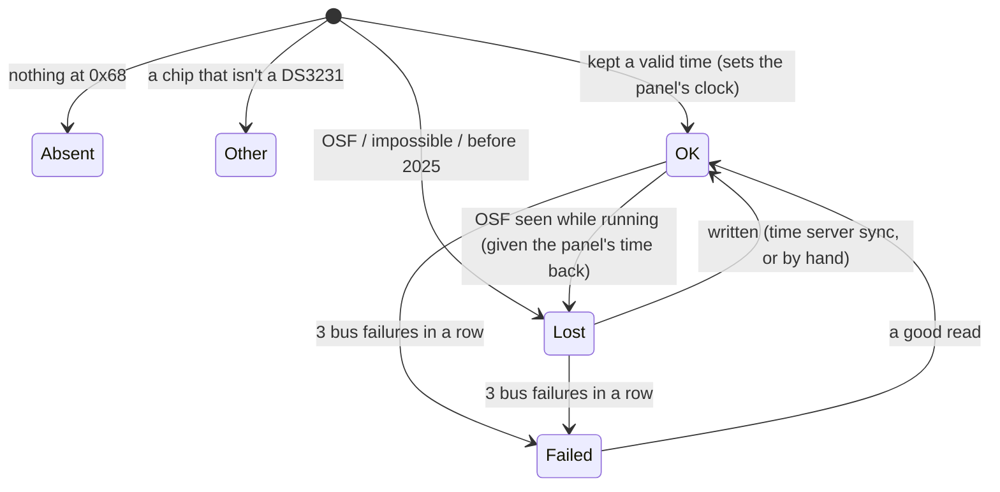

# 35 · Battery-backed clock (DS3231 module)

**Status:** Implemented v1 - an optional DS3231 on the I2C connector (or on J7 after
`rtc place j7`) is found by itself, sets the time at start-up and keeps in step with the internet;
the time is set by hand at the panel, the Panel Manager or the Flasher, logged as "Clock set"
with the user, and offered in the setup when nothing else will set it. Host-tested; bench steps 1-2
passed with a module on a panel (2026-09-25). The clock on your own pins (RTC-016, ADR-048) is
built, not yet on a panel (BL-165). Left: the rest of the bench (BL-030), J7 on a panel
(BL-033), release builds (BL-050). · **Milestone:** M20 · **Depends on:** 09,
06, 31, 33, 34

## Goal
An alarm panel must know the time after a power cut, before - and without - the internet: the
event log is evidence, schedules (docs/features/18) need the hour, and TLS needs a date. Until now the
panel had no battery-backed clock: every start-up began in 1970 with the "clock not set" trouble,
and the time came only from a time server over Wi-Fi.

Asked for (2026-09-24): *support a DS3231 so the clock keeps time when all other power
fails; the clock should set itself automatically; follow best practice for keeping the time
updated; the user sets the time at the panel and in the Panel Manager when the module is
installed; the Flasher supports the module; not every panel will have one.*

So: an **optional** DS3231 module on the board's I2C connector. Found at start-up by itself, with
nothing to configure. With it the panel knows the time from its first event, keeps it in step
with the internet when there is one, follows the module's crystal (+-2 ppm) when there isn't, and
lets a master or the installer set the time by hand. Without it, nothing changes.

**The hardware is never named to the people using the panel** (review feedback, 2026-09-24: *"Saying Clock
Module on the WebUI makes no sense. It should just be a date and time setter above the time zone.
A end user would not know about the module"*). The touchscreen and the Panel Manager show only
what a person can do - set the date and time - and only where the panel can keep it. The module's
state, wiring and troubles are for the installer's tools: the console (`rtc`) and the Flasher.

## Reference behaviour
A keypad alarm panel has its own clock with the backup battery and sets the time at the keypad
with the master code; an internet communicator may keep it in step. We copy: the time by
hand at the keypad, a master or the installer only, and the internet as the better source when
there is one. We deviate: the clock is an optional module (the CrowPanel has no battery-backed
clock of its own), so setting the time by hand is offered **only while a module answers** -
without one it would be gone at the next power cut, and the internet sets it anyway.

## Requirements
| ID | Requirement | Verified by |
|---|---|---|
| RTC-001 | **Optional**: a panel without a module behaves exactly as before - one probe at start-up, no task, no setter on the screen or in the Panel Manager. The touchscreen and the Panel Manager never name the hardware, with or without it | `test_rtc_clock.c` (`test_without_a_module_nothing_changes`), preview walk ("Date and time by hand": no setter without one, no "module" on the screen), `panel_pages.test.cjs` |
| RTC-002 | **Found by itself** at start-up on the board's add-on I2C connector (`board_info()->i2c`, `board_i2c_ext()`) at 0x68, and told from other chips at that address (a DS1307, an MPU-6050) by the bits the datasheet says always read 0 and a possible temperature; another chip is never written | `test_identification`, `test_another_chip_is_never_written` |
| RTC-003 | **Time at start-up**: a module that kept a valid time sets the panel's clock before the event log and the engine start (the middle of the second it showed), so the first event carries the time and "clock not set" is never raised | `test_a_module_that_kept_the_time_sets_the_clock`; review of `panel_app.c` order; bench |
| RTC-004 | **A lost time is not believed**: the oscillator-stop flag, an impossible date or garbled digits, or a time before 2025 leave the clock "not set" until the internet or a person sets it (the page's note: "Set the time, or connect Wi-Fi..."); `rtc` and the Flasher say the coin cell may be flat. A module that loses the time while the panel runs is given the panel's time back | `test_a_module_that_lost_the_time_is_not_believed`, `test_garbled_time_registers_are_refused`, `test_losing_and_regaining_the_time_while_running`, preview (the setter is offered) |
| RTC-005 | **The internet wins**: every time-server sync writes the module, at the system clock's next whole second; while the internet is trusted (a day after a sync) a module a second or more off is written again, never followed | `test_the_internet_writes_the_module` |
| RTC-006 | **Without the internet the module wins**: every hour (and a minute after start-up or a write) the module is read on its second tick; the panel's clock is slewed to it (`adjtime`, never stepped) when they differ by 250 ms to 60 s; a bigger difference means the module jumped, and it is put back from the panel's clock and logged | `test_without_the_internet_the_module_is_followed` |
| RTC-007 | **Kept as a clock on a coin cell**: UTC, 24-hour mode, the century bit (2000-2199); the oscillator runs on battery (EOSC 0), no square wave on battery, the 32 kHz output off, alarm interrupts off (the power-on and some libraries' values drain or stop the cell); a clock another device left in 12-hour mode reads correctly | `test_the_time_registers`, `test_twelve_hour_mode_reads_right`, `test_the_set_up_for_a_coin_cell`, `test_the_calendar_against_known_moments`, `test_every_day_the_module_can_hold_round_trips` |
| RTC-008 | **The time by hand**, only while a module answers, 2025-2099, by a master or the installer (the time zone's rule, docs/features/14), **above the time zone and without naming the hardware**: at the panel the clock's row on Settings > Time and language opens Set the date and time (year, month, day, hour, minute in local time, the day kept within the month, a line saying what the clock will say); in the Panel Manager Date and time > Set the date and time (this computer's time, or a date and time in this computer's time zone; UTC on the wire; refused while armed, the browser's rule). The panel's clock changes at once, the module at its next second; "clock not set" clears | `test_setting_the_time_by_hand`; preview `128_time_settable`, `129_clock_set` (and its checks: October 31 back to September gives the 30th, the panel's clock set to the chosen day, no "module" on the screen); `panel_pages.test.cjs` (above the time zone, no hardware named, a master may, a standard user may not, a panel that can't keep it refuses, before 2025 refused) |
| RTC-009 | **A module in trouble**: three failed reads in a row = "not answering" (`rtc`, the Flasher; the setter is no longer offered and the time comes from the internet); it comes back by itself at the next good read. Every bus transaction is bounded (50 ms): the module can never hold the touch controller's bus for longer | `test_a_module_that_stops_answering`, preview (no setter while it isn't answering) |
| RTC-010 | **Console `rtc`**: the state in words, the facts as key=value (module, source, internet trusted, lost at start, temperature, last offset, writes, slews, jumps, the panel's epoch), the panel's clock; `rtc set <epoch s>`, `rtc check` | Flasher `ClockTests` (the firmware's lines), bench |
| RTC-011 | **Flasher** (docs/features/34 FLS-022): a Clock module tab - the state, the panel's clock against this computer's, the last source, the temperature; "Set the panel's clock from this computer" on this computer's second tick (`rtc set`), refused in words without a module; the wiring from `boards.json` (VCC to 3V3, GND, SDA, SCL; SQW/32K unconnected; the coin-cell charging warning), checked against the firmware's own pins | `test_flasher_panel.py` (`ClockTests`), `test_flasher_safety.py` (`test_the_clock_module_wiring_is_the_firmwares`), Browser pane against `--mock` |
| RTC-012 | **Feature option** `CONFIG_ALARM_FEATURE_RTC` (on for the CrowPanel; off for the E32R40T, whose I2C header pins are wired zone terminals); off, the service is stubs and `rtc` says "not in this firmware" | `tools/check_boards.py` (every manifest states it), E32R40T build |
| RTC-013 | **The clock module at another place** (2026-09-24): `rtc place <place>|default` (NVS `clock`/`place`, from the next start). The CrowPanel offers `j7`: IO27 (SDA) and IO28 (SCL) with the P4's second I2C controller, away from the touch screen's bus (docs/research/AddOnWiringResearch.md); V1.1 boards only. The app opens that bus (`panel_app.c` `own_i2c_bus`); `rtc` prints `place=` and the words name where it looked | `components/core/board_info/test` (BRD-015), `components/boards/board_crowpanel_p4/test`, `tools/tests/test_flasher_parts.py`; bench: not yet (BL-033) |
| RTC-014 | **The time set by hand is logged** (decided 2026-09-28): every time the clock is set by hand (touchscreen, Panel Manager, console `rtc set`) the event `clock_set` is recorded, appended as a new type, with the user who set it (0 for the console: the system); it is numbered, logged, reported on MQTT and shown in Activity as "Clock set" / "By Alex" | `test_program.c` (`test_clock_set_event`: name, user, fields), `test_notify.c` (the words) |
| RTC-015 | **The setup offers the date and time** (decided 2026-09-28): right after the time zone, the first-boot setup shows a "Date and time" step only when a clock module answers and can keep a time, the clock is not set, and the internet has not set it (nothing else will). It reuses the steppers and setter of Settings > Date and time (RTC-008); "Set and continue" sets the clock (logged as RTC-014, by the person in the setup) and goes on, "Skip for now" goes on without; a refusal beeps, toasts and stays. Otherwise the setup is unchanged. The step shares the time zone's dot; the hardware is never named (RTC-001, UI-042) | preview walk "Setup: the date and time" (`setup_clock`; the step is absent with a module that kept the time and with none) |
| RTC-016 | **The clock module on your own pins** (2026-10-04, ADR-048): `rtc place custom sda=<g> scl=<g>` (keys in any order, each once), from the next start, on the P4's second I2C controller (NVS `clock`/`place` = `custom`, `u8` keys `c_sda` `c_scl`; the place erased first and written last). Accepted only on pins a person can reach (J7's IO pins), not the same twice, none the board's or held by another part's stored place (named or custom); a zone's wired terminal may be taken (that zone shows Check, ZSRC-010). Replies start "place custom from the next restart (`restart`)" or "not custom: ". `rtc`, `rtc status` and `rtc place` print "custom sda=.. scl=.." before the `rtc module=` facts line, the facts say `place=custom`, and the `rtc place` listing has a "custom: ..." line. The board's own connector stays `rtc place default`. Failing closed: a stored layout refused at start opens no bus at all (the board's connector is not tried) and `rtc` says "custom place not used: <why>" | `components/core/board_info/test` (BRD-021, BRD-022), `components/core/zone_hub/test` (`test_terminal_no_longer_offered_is_check`); console replies by firmware review; bench: not yet |

## Design

### Where it plugs in
The CrowPanel's **I2C connector** (PH2.0, 4 pins: 3V3, GND, SDA IO45, SCL IO46; vendor wiki) is
I2C0, shared with the GT911 touch controller (0x5D/0x14) and the battery gauge (0x2F). The DS3231
is 0x68 (its module's AT24C32 EEPROM at 0x57 is left alone). `board_info_t` gained `i2c` (the
connector's lines, BOARD_NO_PIN when a board has none; the validator treats them as bus lines),
and `board_api.h` gained `board_i2c_ext()`, which creates the bus on first use - before the
display, because the clock is read before the event log (the touch driver then reuses it).

**Wiring:** VCC to **3V3** (never 5 V: the module's 4.7 kΩ pull-ups would put 5 V on the touch
screen's bus), GND, SDA, SCL; SQW and 32K unconnected. **Coin cell:** a CR2032 lasts years (the
DS3231 draws ~3 µA on battery). The common ZS-042 board charges the cell through a diode and a
200 Ω resistor from VCC - meant for a rechargeable LIR2032; with a CR2032 remove the diode or the
resistor (at 3.3 V the charge is small, but a primary cell must not be charged at all).

### Components
```
components/core/rtc_clock        ds3231.h: registers, BCD, calendar, identification, set-up values
                                 clock_keeper.h: which clock is believed; what to do next (portable)
components/drivers/rtc_ds3231    probe 0x68, read/write registers (bounded, 100 kHz)
components/services/panel_clock  start-up read, the `clock` task, by-hand setting, `rtc` console
components/boards/*              board_info.i2c, board_i2c_ext()
components/core/ui_backend       ui_clock_info_t, clock_info / clock_set
components/services/ui_port_esp  those two, from panel_clock
components/ui/alarm_ui           Time and language: the clock's row, Set the date and time (PAGE_SET_CLOCK)
components/services/panel_web    GET time: now_ms + clock; POST time: epoch_ms; status: clock
  .../panel_web/web            Date and time: the setter above the time zone; the overview tile
tools/flasher                    the Clock module tab, clock_test.py, boards.json "rtc"
```

### The rules (clock_keeper)

- **Which clock wins:** the time server (trusted for a day after a sync) > the module (+-2 ppm,
  ~0.2 s a day) > the panel's own crystal (tens of ppm). With the internet, the module is written
  after each sync and when a check finds it a second off. Without it, the panel follows the
  module by slewing; a module more than a minute off has jumped (the panel's own clock only
  drifts), so the module is put back.
- **Reading on the tick:** a single read can't tell where in the second the module is; the
  start-up read assumes the middle (±0.5 s), and the first check a minute later polls the seconds
  register every 2 ms until it changes (±~3 ms).
- **Writing on the tick:** writing the seconds register restarts the module's second, so the
  write goes out right after the system clock's next whole second (retried if the task was held
  up by more than 30 ms), then OSF is cleared.
- **By hand:** local time from the page (the panel's time zone at the touchscreen, the
  computer's in the browser) becomes UTC ms; the panel's clock steps at once, the module follows.
  A later time-server sync overrides it (the page says so).
- **"Clock not set" trouble:** raised by `net_wifi_start()` only when the clock still reads before
  2025 - a module that kept the time was read before that - and cleared by the first sync, the
  module's time appearing later, or a time set by hand (`net_wifi_clock_set()`).
- **What set the clock last** (`clock_source_t`: not set, module, time server, by hand) is the
  detail of the touchscreen's clock row (Time and language) and the Panel Manager's overview
  tile, in words that don't name the hardware ("Kept while the panel was off"), and `rtc`'s
  `source=`.

### Interfaces and data
- **Panel Manager API** (`panel_web.c`, access table unchanged: `time` GET anyone, POST shared):
  `GET /api/v1/time` adds `now_ms` (0 = not set) and, when the firmware has clock support,
  `clock: {module: none|ok|lost|failed|other, source: none|module|internet|manual, settable,
  lost_at_start, temp_c?}`; `status` carries the same `clock`. The page uses only `settable` and
  `now_ms` (and the tile `source`); the rest is for scripts and diagnostics. `POST /api/v1/time {epoch_ms}` sets
  the time by hand (409 with the reason in words when refused); without `epoch_ms` it is the time
  zone and time server as before.
- **Console:** `rtc` prints three lines; the first two are a contract with the Flasher
  (`tools/flasher/roboflash/clock_test.py`):
  `Clock module: keeping time, 24.25 C` /
  `rtc module=ok source=internet trusted=1 lost_at_start=0 temp_c4=97 offset_ms=-12 writes=3 write_failures=0 slews=1 jumps=0 epoch=1790260205 place=default` /
  `panel clock 2026-09-24 14:30:05 UTC (time server)`.
- **Storage:** none. The module holds the time; nothing is written to NVS or flash.

## Test and acceptance
- **PC (done 2026-09-24):** `rtc_clock` (`components/core/rtc_clock/test/test_rtc_clock.c`);
  `board_info` (`test_board_info.c`, `test_the_i2c_connector`); UI preview shots 128-129
  (`time_settable`, `clock_set`) and the walk's checks (no setter without a module or with one
  not answering, no "module" on the screen); `panel_pages.test.cjs` clock test; Flasher
  `ClockTests` (`tools/tests/test_flasher_panel.py`) and the wiring safety test
  (`test_flasher_safety.py`); the J7 place (RTC-013) in `test_board_info.c`, `test_board_desc.c`
  and `test_flasher_parts.py`; the simulator's "Clock module (DS3231)" buttons; Browser pane: the
  Panel Manager against `MOCK_CLOCK=ok` (this computer's time, a typed date, 2024 refused, the
  overview tile, no sideways scroll at phone width; after review feedback: the setter above
  the time zone, no "module" on the page) and the Flasher's tab against `--mock`.
- **Bench** (steps 1-2 passed 2026-09-25 on a CrowPanel, P4 v1.3: `module=ok`, `lost_at_start=0`,
  `source=internet`, `writes=1`, `offset_ms=-3`, 26.5 C; touch reads 944/944 on the shared bus;
  steps 3-8 not done yet, BL-030): with a DS3231 on the I2C connector of a disarmed panel -
  1. `rtc`: `module=ok` (or `lost` on a new module); `status` shows the time.
  2. Wi-Fi on: after the sync `rtc` shows `writes=1`, `source=internet`.
  3. Unplug everything (mains, battery, USB) for a minute, Wi-Fi router off, power up: the panel
     shows the right time at once, the first events carry it, no "clock not set" trouble.
  4. A day without Wi-Fi: `rtc` offset within ±250 ms, `slews` counting.
  5. Set the time by hand at the panel and in the Panel Manager; `rtc` shows `source=manual`.
  6. Pull SDA while running: "Not answering" within 3 minutes; put it back: "Keeping time".
  7. Remove the coin cell with power off, power up: `module=lost`, the Flasher's coin-cell words,
     and the touchscreen's clock row still opens "Set the date and time".
  8. `display watch 60` and touch use while the hourly check runs (it polls the bus for up to a
     second): no late frames, no missed touches.

## Open questions
- **Log the time set by hand as an event?** It is logged at the console (who and what) but not in
  the event log: an alarm event type is an external contract (`alarm_event_type_t`, MQTT names),
  so it needed a decision. Decided 2026-09-28: yes, "Clock set" with the user,
  appended as a new type (RTC-014).
- **An "RTC battery low" trouble?** The DS3231 can't measure its cell; only a lost time at start-up
  says it failed, which the page shows. Decided 2026-09-28: no trouble.
- **The setup wizard:** with a module that lost the time and no Wi-Fi, the setup could offer the
  date and time after the time zone. Decided 2026-09-28: yes (RTC-015).
- **The 4" E32R40T:** its I2C header's pins are zone terminals today; a clock module there would
  cost two terminals (docs/features/19, on hold, BL-079).
- **Aging offset:** left as the factory set it. A day's drift measured against the time server
  could trim it; not worth it at ±2 ppm. Decided 2026-09-28: left as the factory set it.

## Tasks
- [x] `rtc_clock` (codec, calendar, identification, keeper) and its tests (50e9299)
- [x] Board contract: `board_info.i2c`, `board_i2c_ext()`; both boards; validator + test
- [x] `rtc_ds3231` driver; `panel_clock` service, start-up order, `rtc` console; `net_wifi` hooks
- [x] Feature option `CONFIG_ALARM_FEATURE_RTC` in both manifests and `check_boards.py`
- [x] Touch UI: Set the date and time above the time zone, its page, units; no hardware named
- [x] PC: `host_panel` clock module, simulator buttons, preview shots 128-129
- [x] Panel Manager: API, the setter above the time zone (no hardware named), overview tile, mock, test
- [x] Flasher: Clock module tab, parser, controller, mock, wiring in `boards.json`, tests
- [x] The clock module on J7 (RTC-013): `rtc place`, the app's own I2C bus, the places in the
  board description (11ab0c7)
- [x] P4 v1 dev firmware build
- [x] P4 v3 build (`.github/workflows/firmware.yml` builds `--chip-rev v3` with the clock on,
  c28af20)
- [x] The E32R40T build with the feature off (`firmware/e32r40t/sdkconfig.defaults` leaves
  `CONFIG_ALARM_FEATURE_RTC` unset; `panel_clock` as stubs; CI skips the held board, BL-079, bfa64b8)
- [ ] Release builds (`-Profile release`, v1 and v3) with the clock included, built and checked
  with `tools/check_release_profile.py` (BL-050)
- [ ] Bench acceptance steps 3-8 above (a power cut, a day without Wi-Fi, the time by hand, a pulled
  SDA line, a flat coin cell, `display watch 60` during the hourly check), with a real module on the
  I2C connector; steps 1-2 passed 2026-09-25 (BL-030)
- [ ] The clock module on J7 (`rtc place j7`) on a V1.1 panel: `rtc` finds it there after a
  restart and it keeps the time (BL-033)
- [x] The time set by hand logged as a "Clock set" event with the user (RTC-014), and the date
  and time offered in the setup when the module lost it and there is no internet (RTC-015)
  (BL-105, 5153415)
