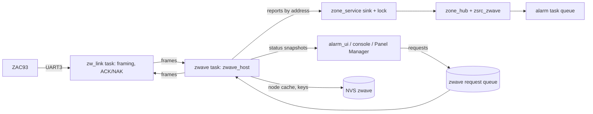

# 36 · Z-Wave sensors through a Zooz ZAC93

**Status:** In progress - Z1-Z8 and Z10 (phase 2) are built and host-tested, plus Z11's radio
power and update; every P4 build has Z-Wave (the radio off until a place is chosen) and a ZAC93
passed the no-sensor bench on a panel. The 2026-10-03 audit's fixes are built and host-tested
(BL-152, a836424), and the host follows Z-Wave JS wherever the stored format, the alarm or the RAM
allows (ZD-4). The radio on your own pins (ZW-046, ADR-048) is built, not yet on a panel
(BL-165). Left: the reset line and real devices on a panel (BL-019..BL-021, BL-153), Z-Wave
JS's features not built yet (BL-162), the rest of phase 3 (BL-042). ·
**Milestones:** its own track, **Z1-Z11** ("Milestones" below), kept apart from the main
roadmap · **Depends on:**
nothing until Z6; then 22 (zone sources), 07 (UI), 33 (boards, features), 14 (access), 20/25/35
(the add-on places), 31 (Panel Manager, Z10)

## Goal
Pair off-the-shelf **Z-Wave** door/window contacts, motion, water, smoke/CO listeners, tilt,
glass-break and temperature sensors **directly to the panel**, through one Zooz ZAC93 module
wired to the CrowPanel's UART, so they become ordinary zones: supervised, with tamper and low
battery, encrypted with Security 2, working with no Wi-Fi and no Home Assistant. Z-Wave runs
below 1 GHz (908 MHz in North America), so it passes walls better than 2.4 GHz Zigbee, and the
800 series adds Long Range (Zooz: up to a mile in open space).

The panel runs **its own Z-Wave host stack** (portable C, host-tested), not Z-Wave JS: the
panel must work alone, on a microcontroller, with nothing between the radio and the alarm
engine. Z-Wave JS was studied (commit `fac3872`, 2026-09-24) to learn what a host must do; the
documents in this folder hold everything needed from it.

## Scope: one board

Decided: "we are restricting ourselves to a single board". Read two ways, both hold:
- **One Z-Wave module, one firmware family:** the Zooz ZAC93 with Silicon Labs' 800-series
  static-controller Serial API (SDK 7.22.1+ recommended). Z-Wave JS carries years of
  workarounds for 300/500/700-series sticks, bridge firmware, other vendors' proprietary
  commands, NVM format conversions and secondary controllers; none of that is needed.
- **One host board:** the CrowPanel Advanced 7" (ESP32-P4, board V1.1). The 4" E32R40T is on
  hold and already short of RAM (docs/features/19); nothing here is planned for it.

Also out of scope (Z-Wave JS does them; the panel does not need them): joining another network,
secondary/inclusion controllers, controller replication, bridge and virtual nodes, multicast
and S2 multicast sending, over-the-air updates of *devices* (since added, only when the
installer asks: ZW-033), the device configuration database with parameter editors, Z/IP,
Zniffer, actuators (sirens, locks - later with docs/features/16 and /24; lights, dimmers and
relays are switched from their page since ZW-034), direct associations between devices,
Transport Service (until a device needs it), polling of pull-mode devices.

## The documents

| File | What it holds |
|---|---|
| [hardware.md](hardware.md) | the ZAC93, its header and firmware versions, where it wires on the CrowPanel, the reset line, power, antenna, bench checklist |
| [serial-api.md](serial-api.md) | the UART protocol byte by byte: framing, ACK/NAK/CAN, retries and timeouts, the start-up sequence, every Serial API command used, recovery, the bootloader |
| [security.md](security.md) | Security 2 (key exchange, key derivation, nonces, encapsulation, what to believe) and optional S0, with known-answer vectors checked against Z-Wave JS |
| [command-classes.md](command-classes.md) | every command class the panel speaks, with layouts, the notification event table, and what the panel answers when asked |
| [network.md](network.md) | the panel as the network's only controller: storage, adding (classic and SmartStart), the interview, sleeping devices, supervision, jamming, removing and replacing, routes, region, reset, Long Range, radio updates, logged events |
| [zones.md](zones.md) | devices as zones: addresses, the input slots, reports to zone events, tamper/battery, trust per device, the quirks table |
| [screens.md](screens.md) | every screen and its words, with mock-ups in `screens/`, the Panel Manager pages and the UI backend |
| `vectors/s2_reference.py` | recomputes security.md's vectors from that page alone (passes, 2026-09-25) |
| `screens/make_mockups.py` | draws the mock-ups |

## Reference behaviour
Keypad alarm panels that carry Z-Wave use it as their **home-automation** radio (locks, lights,
thermostats); their security sensors use the maker's own radio and legacy receivers. This panel
deliberately lets Z-Wave sensors be **zones**, the same stance it takes for Zigbee and Home
Assistant (docs/features/22 "Why: hardware freedom"), and states each device's trust in words.
What it keeps from a classic keypad alarm panel: sensors are enrolled by the installer; a
supervised sensor that stops checking in shows **CHECK**; a receiver that fails or is jammed is a
system trouble; tamper and low battery are zone troubles.

## What Z-Wave adds next to the other sources

| | Z-Wave S2 (this feature) | Zigbee (docs/features/20) | 433 MHz (docs/features/25) | Home Assistant |
|---|---|---|---|---|
| Hardware | ZAC93 on a UART | ESP32-H2 in the socket | CC1101 / receiver module | none (needs HA) |
| Encrypted, not replayable | yes (S2), per device | yes | no | via HA |
| Supervised | wake-up check-ins, pings | check-ins | no | partly |
| Range | 800-series mesh; Long Range star up to a mile (phase 3) | 2.4 GHz mesh | line of sight | HA's |
| Works without Wi-Fi/HA | yes | yes | yes | no |
| State | built; radio bench on a panel, no real sensor yet (Z9) | software half built | built | built |

## Requirements

| ID | Requirement | Verified by |
|---|---|---|
| ZW-001 | One ZAC93 (800-series Serial API, static or bridge controller) on UART3 at 115200 8N1; the panel finds it at start-up and refuses anything else (end-node firmware, other chips) with a reason on the Z-Wave page | host tests (fake module), HIL |
| ZW-002 | The panel is the primary controller, SUC and SIS of its own network and the only controller in it: no learn mode, no controller inclusion, no secondary controllers, no associations of its own | host tests, code review |
| ZW-003 | Serial link per serial-api.md §1: checksum, ACK within the module's timeout, NAK on damage, 150 ms byte timeout, one outstanding command, retransmission after NAK/CAN/timeout (3 transmissions), callback IDs 1-255 | `test_zw_frame`, `test_zw_transport` |
| ZW-004 | Start-up sequence per serial-api.md §5, repeated after an unexpected restart of the module; recovery per §7 (soft reset, reset line, link down with one `sensor_radio` trouble, retries every 30 s then 5 min) | host tests with recorded exchanges, HIL |
| ZW-005 | Adding a device only in installer mode with every partition disarmed, one device per 60 s window, with the protocol steps, timeouts and refusals of network.md §4 | host tests, preview |
| ZW-006 | S2 key exchange per security.md §5 with installer consent, PIN entry for authenticated classes, the TA/TAI timers, every failure leaving the device insecure and saying so; no silent downgrade; downgrade detection | host tests (simulated device with real crypto), HIL with a Zooz ZSE41 |
| ZW-007 | S2 runtime per security.md §6-7: SPAN establishment and resync, 5-nonce tolerance, crossed-frame acceptance, sequence-number duplicates dropped, nonce reports answered without floods | `test_zw_s2_*` |
| ZW-008 | Crypto per security.md §2-3 on a port of three primitives (AES block, X25519, random); every vector in security.md §11 and the NIST/RFC primitive vectors reproduced | `test_zw_crypto` (`ZW-SEC-NNN` tags) |
| ZW-009 | A device's reports count only at its highest granted security class, as Z-Wave JS judges it (security.md §8); frames from unknown nodes and foreign home IDs are dropped | host tests |
| ZW-010 | Interview per network.md §5, resumable across restarts and sleep, lifeline to the panel (§6), push/pull detection; pull-mode or lifeline-less devices offer no zone inputs | host tests |
| ZW-011 | Sleeping devices: wake-up interval set from the installer's check-in choice within the device's limits; queued commands at wake-up; No More Information 250 ms after the last one (never while its interview asks it something; a re-read waiting for its wake-up asks nothing) | host tests |
| ZW-012 | Supervision per network.md §8: sleeping devices unreachable after `T + 10 min` of silence with a binding grace of `T + 10 min`; listening devices pinged after 15 min of silence, unreachable after 2 failed pings; interval 0 = not supervised | host tests, HIL |
| ZW-013 | Reports map to zone events per zones.md §3 (notifications with idle rules, binary sensor, multilevel temperature, battery, alarm sensor, Basic only when nothing better); tamper, low battery and life-safety trouble reach every watched input of the device; momentary inputs hold 30 s; Supervision Gets are answered at once with the request's encapsulation | `test_zsrc_zwave` |
| ZW-014 | Addresses per zones.md §1 (kind 7, home ID + generation + node ID, endpoint + slot): a reused node ID or a new network never feeds an old binding; replacing a failed device keeps its bindings | host tests |
| ZW-015 | Trust per device (`caps_of`, zones.md §6): S2 + checking in = authenticated and life-safety; S0 = authenticated; none = neither; interval 0 = not supervised; the zone page says so in words | host tests, preview |
| ZW-016 | Removing (exclusion) works for own and foreign devices; removed devices' zones keep their bindings and show CHECK "sensor removed"; Device Reset Locally handled; remove-failed refuses a device that answers, and removes only what the module itself removed (no ghost) | host tests, HIL |
| ZW-017 | Keys generated from the panel's RNG at network start, never displayed or reported, kept in NVS across updates; node cache as a self-describing blob with a frozen fixture; home-ID mismatch cases of network.md §2 handled without reusing keys wrongly | host tests (`zw_nodes_fixture_v1.h`), code review |
| ZW-018 | Region from the module's list, installer only, with the warning when devices exist; reset of the network (installer, confirmed twice) generates new keys and clears the cache | host tests, preview |
| ZW-019 | The screens of screens.md: nothing blinks, live words change at most once a second, no physical button on the panel needed, no jargon outside the details page and the Panel Manager, installer-only actions gated (docs/features/14) | preview, `display watch 60` during an inclusion |
| ZW-020 | Console commands of "Console" below, including a frame trace (development builds only) | HIL |
| ZW-021 | PC simulator: a simulated ZAC93 with simulated devices (secure and insecure, sleeping and listening), driven from the simulator's buttons, running the real host stack and zone source | simulator |
| ZW-022 | New event types appended, their sentences in `notify` (network.md §15) | host tests |
| ZW-023 | Every parser bounds-checked; random input never crashes (fuzz tests under the sanitizers in CI) | `test_zw_fuzz` |
| ZW-024 | Phase 2: SmartStart with QR/DSK (network.md §4.2), identify, route repair, remove/replace failed, jamming detection (§9), Time answers, Central Scene and Alarm Sensor, the quirks' Configuration parameters | host tests, HIL; SmartStart: `test_zw_qr`, `test_zw_smartstart`, `test_zwz_panel`, `-ZWave` preview 182-186; replace `test_zw_replace`, routes `test_zw_routes`, jamming `test_zw_jam`, answers owed now `test_zw_s2`, identify/Time/jamming/routes/replace in `test_zwz_panel`, preview 187-193; Central Scene `test_zsrc_zwave`; a device's jamming report `test_zwz_panel`, preview 190; the Panel Manager's add/remove and Radio page `panel_pages.test.cjs` |
| ZW-025 | Phase 3: Long Range (§13), S0 behind an installer switch (security.md §10), radio firmware update with the arming interlock and NVM backup (§14), power settings | host tests, HIL; power: `test_zw_power`, `test_zw_api` (`test_setup_power`), `test_zwz_panel` (`test_power_cap`, the stored formats); the radio's firmware: `test_zw_gbl`, `test_zw_otw`, `test_zwz_panel` (`test_radio_update`), `test_arming` (`test_platform_holds_arming`, CORE-ARM-013), `-ZWave` preview 194-196, `panel_pages.test.cjs` |
| ZW-026 | Entry Control v1 codecs bound payloads and capability masks, validate cache limits, pad outgoing ASCII to 16-byte blocks, and match only valid Get/Report pairs; never log or retain credential data | `test_zw_entry`, `test_zw_fuzz` |
| ZW-027 | A keypad controls only its explicitly assigned partition, from its current network/generation/node/endpoint at its assigned authenticated S2 class. PIN commands use the existing engine authority; emergency buttons require opt-in. Suppress recent duplicate commands including refused PINs, allow retry when nothing executed, retain no PINs | `test_zw_keypad` (portable adapter; wired into the firmware by ZW-031, `zw_keyctl`; physical acceptance pending) |
| ZW-028 | Existing engine events/state drive device-owned Indicator feedback independently of panel audio/voice generation. Persist explicit output destinations, enforce secure current node identity and partition scope, coalesce stale state, bound retries, preserve silent alarms, and avoid routine repeat announcements. The installer sets a keypad's output on its page ("Sounds and lights": off or a partition) through the same persisted assignment and checks, sees why it can't be set, and is told its buttons don't control the panel | `test_zw_feedback`, secure-radio and device-page scenarios in `test_zwz_panel`, preview 160-162; physical sound acceptance pending |
| ZW-029 | Recovery of a device that never finished joining, was reset or is dead: both removals always offered and explained (exclusion needs the device; removal as failed pings, checks the module's failed list, and forgets only what the module removed); outcomes said apart (removed, stopped, nothing answered, timed out, still answers, refused, failed); a page shows and stops only the removal or addition it started; an empty node information never skips Security 2 and unknown security is "not confirmed", never "not encrypted"; a stalled interview is "setup stopped" (never "asleep" unless the device sleeps) with a retry; "Stop and finish later" is not "Added"; power never guessed from the radio; PINs 00000-65535 only | `test_zwz_panel`, `test_zw_inclusion`, preview 154-159, 163-164; physical acceptance pending (docs/bugs/B015) |
| ZW-030 | Credentials never leave the panel in the clear: Entry Control, User Code, User Credential, Door Lock Logging, S0 and Transport Service payloads are blanked (also inside Multi Channel, Supervision, CRC-16 and Multi Command) in the developer link's frame trace, the `zwave trace` log and `tools/zwtrace_scrub.py`; a damaged frame is blanked after its function byte | `test_zw_redact` (20 000 random frames), `test_zwtrace_scrub` |
| ZW-031 | Keypad control enabled: the installer lets an assigned keypad's buttons arm and disarm one partition (confirmed, on its page or `zwave keypad-control`), stored (`zwave/keypad_ctl`, frozen fixture) and bound to the device, generation, end point and exact S2 class it was assigned at; its commands leave the zone lock and go to the alarm task as its own keypad source (per-keypad lockout, duress, authority, readiness), its PIN erased after; emergency buttons only when turned on | `test_zw_keyctl`, `test_keypad_control_end_to_end`, preview 166-168; physical acceptance pending |
| ZW-032 | A radio that stops answering while nothing is sent is found: after 60 s of silence the panel asks the module for its identity; no answer or another network starts recovery, and the zone source's trouble shows within about 3 minutes (link grace 90 s) | `test_pulled_radio_found_when_idle`, `test_zsrc_zwave` |
| ZW-033 | A device's own software (never the ZAC93's): its versions read at the interview and shown; "Check for an update" asks the Z-Wave JS firmware update service (v4 API, a named User-Agent) only when the installer asks; offered only for exactly its manufacturer, product type and product ID, stable, newer by the service's word and by the numbers, the panel's region or none, one https file for target 0 with a SHA-256; installed only after the installer confirms, in installer mode with everything disarmed and a battery at 30 % or more; the file checked against the digest and read (Gecko, binary, Intel HEX; others refused); sent over Firmware Update Meta Data, a sleeper's at its wake-up and held awake; progress, Stop, every outcome in words, logged (`zwave_device_software`), the device read again after its restart | `test_zw_fwu`, `test_zw_fwupd`, `test_zw_fwcat`, `test_zw_fwjob`, firmware tests in `test_zwz_panel`, preview 169-174; no real device updated yet |
| ZW-034 | What a device switches: Binary Switch and Multilevel Switch at the device or its end points (a multi-relay through its end points only, never its mirroring root), found when its setup is done and asked where it is; switched from its page (a switch or relay on/off, a dimmer's level); a command is done only when the device reports the level asked for (a Get after 1.5 s when it doesn't say), else "didn't confirm" with the level it last said; one command at a time an output; a command older than 5 s when it arrives never runs; a press at the device lands in the same state | `test_zw_switch`, `test_zw_outputs`, `test_switch_and_dimmer` in `test_zwz_panel`, preview 175-177; physical acceptance pending |
| ZW-035 | A garage door from a relay and the zone of a tilt sensor, set in installer mode and stored (`zwave/garage`, CRC, by the relay's device and generation - a relay removed or its node ID reused drops it): open and close ask the sensor first - already there presses nothing, a position not known (no report, unreachable, CHECK) presses nothing and says why; a press is on then off 1 s later, confirmed and retried (a relay that won't let go is reported, and never pressed again while on; one found on with no press under way - a restart mid-press - is released), then the door watched up to its travel time (reached, or "its sensor didn't see it get there"); where the door is, is only ever the sensor's word (a press shows as "pressed, waiting for its sensor", never "opening"); a second press during a move is held back and said so, one after it got there goes at once; stop is not offered; opening needs installer mode (a user's code), closing does not; the relay is never switched on its own; logged (`zwave_garage`: asked by whom, reached or not) | `test_zw_outputs`, `test_multi_relay_garage` in `test_zwz_panel`, preview 178-180; physical acceptance pending (no real door operated) |
| ZW-036 | Home Assistant through the panel's MQTT discovery (docs/features/10 MQTT-018..020): one entity an output (switch, light, a garage door as a cover), ids from the network, device, generation and end point (stable across restarts, new for a reused node ID, never announced twice), retained state and per-device availability, retracted when the device goes or discovery is turned off (the list survives a restart); commands parsed strictly, a retained one never runs, one delayed past 5 s never switches; a garage closes from Home Assistant but never opens (not advertised). Works without Home Assistant or the internet: the device pages switch everything locally | `test_zwdev`, the Home Assistant checks in `test_zwz_panel`; broker test pending |
| ZW-037 | SendData attempts (serial-api.md 6.12). A command to a listening or FLiRS device that gets NoAck is sent up to 3 times in all, each time with fresh S2 encapsulation. A sleeper's command goes back to its wake-up queue, and Nonce Reports keep their single attempt. A transmission that fails with 0 ticks (jammed) waits 1 s and is tried again up to 5 times, without counting as an attempt. After 5 jammed attempts, the module is soft-reset once per jam episode and the command is sent once more | `test_three_noacks_fail`, `test_resend_new_nonce_and_sequence`, `test_sleeper_noack_not_sent_again`, `test_nonce_report_not_sent_again` and the jammed tests in `test_zw_s2`; `test_jammed_five_times_reset_then_sent`, `test_still_jammed_after_reset_fails`, `test_delivery_ends_jam_episode` in `test_zw_startup`; bench pending (BL-153) |
| ZW-038 | A Z-Wave keypad whose arming or emergency buttons are on is supervised. While it is unreachable, the engine's keypad (device) supervision trouble is active for its device number (ZWKC_DEVICE). When it is heard again the trouble restores, and both are in Activity (CORE-TRBL-008's trouble). A keypad that only shows sounds and lights is not supervised | `test_keypad_supervised_unreachable`, `test_keypad_supervision_survives_radio_restart`, `test_keypad_unassigned_not_supervised`, `test_keypad_supervision_restored_when_off_or_removed` in `test_zwz_panel`; `test_device_unreachable_with_supervision` in `test_troubles`; bench pending (BL-153) |
| ZW-039 | Z-Wave storage. The storage trouble stays active while any Z-Wave store fails, and clears once everything is stored; another owner's recovery never clears it. Stored blobs are read as far as known, whatever their length. The store sequence (take, store, redo, retry every 30 s) is host-tested. Add, SmartStart and Replace are refused while NVS has less room than the reserve the alarm's configuration needs (docs/features/20 devices.md's rule) | `test_zwz_store`, `test_storage_trouble_owners`, `test_storage_trouble_foreign_clear` in `test_troubles`, `test_nvs_reserve_add_and_replace`, `test_nvs_reserve_smartstart` in `test_zwz_panel`, the storage checks in `panel_pages.test.cjs` |
| ZW-040 | Signal per device. The panel keeps each node's last received RSSI and its last TX report (ack RSSI, repeaters), and shows Good / Fair / Weak under "Last heard" on the device page and in a Panel Manager column. The signal is unknown until measured | `test_signal_from_received_frames` in `test_zwz_panel`, the Signal column check in `panel_pages.test.cjs`, the -ZWave preview's device page; real signal pending (BL-153) |
| ZW-041 | A radio that restarts by itself is logged the first time, then at most once an hour with a count. Network events are never lost silently: when more arrive in one step than the queue holds, they are summarised or counted, and `zwave status` shows the count | `test_restart_loop_logged_once_an_hour`, `test_many_devices_left_at_once`, `test_radio_restart_ends_the_windows` in `test_zwz_panel`, `test_zwave_restart_count` in `test_program` |
| ZW-042 | A broadcast or multicast command from a device the panel knows passes the same security check as a singlecast one, as Z-Wave JS: a Get-type one is discarded and counted; from a device without keys the rest is handled as singlecast (a Wake Up Notification sends its held commands and resumes a stopped setup); from an S2 device, in the clear, it is dropped as a wrong level. An unknown node's is dropped and counted (security.md §8) | `test_broadcast_wake_up_resumes_interview`, `test_broadcast_wake_up_sends_held_commands`, `test_s2_broadcast_wake_up_discarded`, `test_broadcast_wake_up_unknown_node_dropped`, `test_multicast_wake_up_dropped` in `test_zw_interview`, `test_gets_table_whole` in `test_zw_s2`, `test_keyless_broadcast_report_reaches_zone` in `test_zwave_zones` |
| ZW-043 | Smoke and CO alarms that a device reports through the version-1 alarm bytes reach their zones. The quirk table's alarm map (seeded from Z-Wave JS's device configs for the ZCOMBO / ZSMOKE family) turns them into notification events and offers their inputs, and a version 2+ device's V1 bytes that name a notification type and event it lists as supported are read as that event (Z-Wave JS GH#1034). Alarm Sensor water (05) and general (00) feed the water and general inputs | `test_v1_alarm_map_zcombo`, `test_v1_alarm_map_zsmoke`, `test_v1_alarm_supported_types`, `test_v1_alarm_dropped_without_a_map`, `test_alarm_sensor_water_and_general` in `test_zsrc_zwave`, `test_v1_smoke_alarm_by_quirk` in `test_zwave_zones`; no real ZCOMBO / ZSMOKE yet |
| ZW-044 | The S2 security classes have one set of names on the touchscreen and in the Panel Manager: "Access control", "With its PIN", "Without a PIN" and "Not encrypted"; "Secure" is only the device list's short form. The Panel Manager tells apart every security state the touchscreen does | the security words check in `panel_pages.test.cjs`, the -ZWave preview's device pages, `ui_words_test` |
| ZW-045 | Changing the Z-Wave region. A change within one band (United States and United States Long Range, Europe and Europe Long Range) only restarts the radio and says the devices keep working. A change that drops devices (another band, or the Long Range devices when leaving a Long Range region) says how many stop working and that their zones show CHECK, and takes the installer code like the network reset | `test_zw_region` (`test_families`, `test_every_pair`, `test_usual_changes`), the region checks in `test_zwz_panel`, the -ZWave preview's region screens; bench pending (BL-153) |
| ZW-046 | The ZAC93 on your own pins (2026-10-04, ADR-048): `zwave place custom tx=<g> rx=<g> [reset=<g>]`, tx and rx the panel's side, keys in any order, each once, from the next start (NVS `zwave`/`place` = `custom`, `u8` keys `c_tx` `c_rx` `c_reset`; the place erased first and written last). Without `reset=` there is no reset line, and a stored `zwave reset-pin` is cleared; while custom, `zwave reset-pin` is refused ("not GPIO <g>: the radio is on your own pins: ..."), and leaving custom clears the reset pin. Accepted only on pins a person can reach (J7's IO pins), none twice, none the board's or held by another part's stored place (named or custom, `rf pin`); a zone's wired terminal may be taken (that zone shows Check, ZSRC-010). Replies start "place custom from the next restart (`restart`)" or "not custom: ". Running, `zwave status` and `zwave place` say "place custom: your own pins - UART<n> TX GPIO .., RX GPIO .., reset line GPIO .." (or "none"); both print "custom tx=.. rx=..[ reset=..]" whenever a layout is stored, and the `zwave place` listing has a "custom: ..." line. Failing closed: a stored layout refused at start leaves the radio off (no pin touched) and `zwave status` says "custom place not used: <why>". A stored `rf pin` and `zwave reset-pin` on one GPIO keep their start-up result (the receiver has it, the radio runs without its reset line), with a warning in the log and in `rf` and `zwave status` | `components/core/board_info/test` (BRD-021, BRD-022), `components/core/zone_hub/test` (`test_terminal_no_longer_offered_is_check`); console replies by firmware review; bench: not yet |

## Design

### Keypad control foundation (enabled in firmware by ZW-031)

`zwave_zones/zw_keypad.h` is a separate command adapter. The network owner supplies the
installer assignment and trusted current node identity; only S2 Authenticated or Access Control
at the exact assigned class may issue commands. Away, Home/Stay and Disarm All target the
assigned partition only. The ordinary alarm engine checks the PIN, partition authority,
readiness, arm-only restrictions, duress and lockout; cached keys and Enter do nothing.
Fire, police and medical events require explicit assignment policy and carry no PIN.

The synchronous command port returns a definitive engine result, including refusals. A busy
port must guarantee nothing executed. The last 16 results suppress application sequence
retries for 60 seconds without retaining PINs; this local retry policy supplements S2 replay
protection and expires so a device counter restart cannot block that number indefinitely.
Feedback must use the actual engine outcome and current state, never a radio ACK alone.

Before enabling this in firmware: persist installer assignments, route through the alarm task
without holding the zone lock, discover capabilities/lifelines, implement current state and
error feedback, and remove credentials from every trace/diagnostic path (including rejected
unencrypted traffic). The adapter erases its local command; the platform must erase its own
copies. No device qualification or live control is implied by these host tests.

As built (ZW-031): `zw_keyctl` holds eight assignments (NVS `zwave/keypad_ctl`, format 1 with a
CRC; each keypad its own engine source, device number 9-16). The bridge offers an assigned
keypad's Entry Control to the owner before answering it (`zwz_set_claim`); zwave_service copies
it into a two-entry mailbox under the zone lock, and after unlocking runs it through
`alarm_service_command`, then erases the copy. A command the alarm task never ran counts as not
run, so the keypad may retry. Frame traces blank the PIN before anything is stored (ZW-030).

### What devices switch, a garage door, and Home Assistant (ZW-034 to ZW-036)

`zwave_proto/zw_cc_switch` codes Binary and Multilevel Switch; `zwave_zones/zw_outputs` keeps
the outputs (from the node cache, at the end of a device's setup and after a restart), their
confirmed levels and the command under way, and the garage doors with their interlocks.
`zwz_panel` routes a switch's Reports to it before anything else (the bridge's claim), sends
through Multi Channel for an end point, asks the listening devices again when the network is
found ours, and gives the pages `ui_zw_device_page_t.outputs` and the requests
`UI_ZW_REQ_OUTPUT`, `_GARAGE`, `_GARAGE_MOVE`. The garage's door position is the zone hub's
word for the tilt sensor's zone (`zone_position`: known, reachable, not CHECK), never a guess.

For Home Assistant, `zwz_panel_ha_devices` lists the outputs as `alarm_proto`'s
`proto_zw_device_t` and `zwz_panel_ha_command` takes their commands; `net_mqtt` announces,
publishes and retracts them through a port `panel_app` fills from `zwave_service` (the commands
run in the zwave task like the pages' requests). The native link (docs/features/23) carries the
same list and commands (`zwave_devices`, `zwave_set`; with the link paired, MQTT discovery is
off): the panel's side is done and host-tested, the integration's (`ha-addon`) too
(docs/features/23), not yet on a panel with a radio.

### A device's software update (ZW-033)

Separate from the ZAC93's own firmware (network.md §14, phase 3). `zw_fwcat` builds the request
and reads the Z-Wave JS service's answer strictly; `zw_fwjob` is the installer's job (check,
download, digest, file format, start) that the firmware (`zwave_service/src/zw_fwsvc.c`: a worker
task with its stack in PSRAM does the HTTPS, the zwave task never waits on it) and the simulator
share; `zw_fwupd` is the transfer (MD Get, Request Get, the device's Gets answered one fragment at
a time, its Status Report, activation when it asks); `zwz_panel_fw_start` checks who may and the
battery, keeps the rest of the network busy-locked and holds a sleeper awake
(`zw_net_hold_awake`). An update offered with more than the device's own firmware (other
targets) is named but not installed: the panel never installs part of an update. The service
needs no key; its README asks for a User-Agent naming the client and fair use, which a check
only on request keeps well within.

### Device-owned keypad feedback (ZW-028)

`zwave_zones/zw_feedback` maps the engine snapshot and refusal events to Indicator commands:
mode, entry/exit countdown, effective audible alarm, and rejected/not-ready arming. It does
not render speech or use the panel's announcement feature. Silent panic/duress and silent
exit stay silent; alarm memory alone never starts a siren. Refusal prompts expire after five
seconds and are discarded when newer events supersede them. Latest state takes priority.

`zwave_service` subscribes to the existing alarm listener. A one-item overwrite mailbox keeps
the newest compact state; a separate bounded event queue holds transient refusals. Callbacks
never wait for the radio or take the zone lock. The Z-Wave owner sends securely, tracks
completion, backs off failures and rechecks identity before every send. Initial assignment
and recovery resynchronize once; ordinary snapshots do not repeat mode announcements.
Countdowns use remaining time when actually submitted; durations over 255 seconds refresh
before that device timer runs out. Exact device audio and light behavior needs physical tests.

The service console provides `zwave keypad-feedback` to list eight output slots,
`zwave keypad-feedback <slot> <node> <partition>` to assign, and
`zwave keypad-feedback <slot> off` to remove. Changes require every partition disarmed and
quiet, and no send in flight for that slot. Only explicitly implemented model profiles with
completed interviews, secure Indicator v3 and authenticated S2 qualify. The interview now
queries Indicator versions, including CCs advertised only inside Security 2.

NVS `zwave/keypad_fb`: `KF | format 1 | slot count 8 | 8 x (home u32, node u16,
generation u16, partition u8, reserved 0) | CRC16`, little-endian. Writes succeed before the
assignment becomes live; invalid storage disables outputs. Network/node replacement cannot
inherit an assignment. This grants no incoming keypad command authority; the installer UI (a
keypad's page, ZW-028) and incoming control (ZW-031) were built as separate work. No model
compatibility claim is implied.

### Components (docs/features/33 tiers)

| Component | Tier | Contents |
|---|---|---|
| `components/core/zwave_proto` | core (portable C11) | frame parser/builder (serial-api.md §1), Serial API codecs (§6), CC codecs (command-classes.md), QR and DSK helpers; no state, no heap |
| `components/core/zwave_host` | core | the host: transport state machine, request scheduler (priorities: nonce and supervision replies > module commands > node commands > interview > background), start-up, network operations (add, S2/S0 bootstrap, remove, replace, remove-failed, routes, region, reset), interview, wake-up queues, health (pings, supervision clocks), jam detector, the S2/S0 security manager over a **crypto port**, node cache and its blob codec; events to its owner through callbacks. Tests include a **fake ZAC93** that speaks the Serial API and hosts simulated devices with their own S2 side |
| `components/core/zone_hub/src/zsrc_zwave.c`, `zw_quirks.c` | core | the zone source (zones.md) and its quirks table; no dependency on the Z-Wave library (decoded facts and reports in), so zone_hub carries no Z-Wave code into a firmware without the option |
| `components/core/zwave_zones` | core | the bridge (Z6): `zw_net`'s events and received commands, decoded with `zw_cc`, into `zsrc_zwave`'s calls; and (Z8) `zwz_panel`, the panel's whole Z-Wave apart from the RTOS - the network, the bridge, what the Z-Wave pages show and ask for, the log queue, what is stored and when; shared by the PC simulator and `zwave_service` |
| `components/services/zwave_service` | services | the `zw_link` and `zwave` tasks, UART3 and the reset GPIO, NVS (`zwave` namespace), the crypto port on PSA (mbedTLS 4, ADR-002), console commands, the zone-service glue (the sink with its lock), the UI backend calls, Panel Manager endpoints (with `panel_web`), log events |
| `components/ui/alarm_ui/src/ui_zwave.c` (+ `ui_sources.c`) | ui | the pages of screens.md |
| `components/core/board_info`, `board_crowpanel_p4` | core / boards | `zwave_places[]`, validation (hardware.md §4) |
| `host/ui_sim`, `host/ui_preview` | host | the simulated radio and devices, the walk-through shots |
| `tools/flasher` | tools | "Z-Wave radio" under Connected parts: wiring drawing, `zwave place`, a check via `zwave status` |

Crypto port: `aes128_encrypt_block(key, in, out)`, `x25519(out, scalar, point)`,
`random(buf, len)` (`zw_crypto_port_t` in `zwave_host/zw_crypto.h`, each with a context and a
success flag). Firmware: PSA (`PSA_ALG_ECB_NO_PADDING`, `psa_raw_key_agreement` with
`PSA_ALG_ECDH` on a Montgomery-255 key, `psa_generate_random`). Host tests and the PC
simulator (`host/ui_preview/host_panel.c`): `zwave_host/test/zw_host_crypto.c`, an AES-128 and
an X25519 written from FIPS-197 and RFC 7748 and proven by their vectors (nothing vendored, so
nothing for `NOTICE`), with a seeded random source. CMAC, CCM, OFB, CBC-MAC, CKDF and CTR_DRBG
are portable code in `zwave_host`, so they are proved on the PC. The firmware proves its crypto
port at start (`zw_crypto_port_check()`: FIPS-197, RFC 7748, the random source) and keeps the
radio off if it fails.

### Tasks and data flow

- **`zw_link`** (high priority, small internal stack): owns the UART; assembles frames, ACKs or
  NAKs at once, hands complete frames to `zwave`, writes what `zwave` sends. It never waits for
  protocol work, so the module's ACK timeout is always met.
- **`zwave`** (below the zone task's priority, 8 KB **internal** stack because it writes NVS -
  docs/bugs/B001, a PSRAM stack must never write flash): the whole host. It reports sensor events
  through the zone service's sink (which takes the hub's lock) and never touches the engine; it
  makes every call into `zwz_panel` with that lock held, one page or console request at a time
  (a 2 s wait), NVS and the log after unlocking. A failed NVS write is retried every 30 s and
  raises the storage trouble once.
- Requests from other tasks go through a queue; results come back as status snapshots the UI
  reads on its 1 s timer. Only one network operation at a time.
- **Memory:** device table (64 x about 400 bytes), SPAN table, queues and frame buffers in PSRAM
  (`EXT_RAM_BSS_ATTR`); the two stacks internal (8 + 4 KB). Measured when the library was done
  (2026-09-26, `zwave_host` README "Sizes on the P4"): `zw_net_t` - the whole library's state:
  node cache, security manager, wake-up queues, host, interview - is **81.5 KB** of static PSRAM
  (the first estimate said under 64 KB; the P4 has megabytes of PSRAM, so it stays static). With the option on, the P4 v1 dev image
  grew 132.7 KB of flash (54.3 % of its slot; v3 55.6 %), 1.7 KB of internal RAM and 163 KB of
  PSRAM (`zwz_panel` 84 KB, `zsrc_zw` 23 KB, the cache's encoding buffer 51 KB); with it off the
  image is the same size (51.5 %), +1.7 KB of event names and sentences.
  Code at -Os: the interview about 11 KB, `zw_net` 13 KB, security manager and inclusion about
  16 KB; the whole estimate of 60-100 KB still holds (the P4 image is at 51.5 % of its slot).

### Configuration
- Kconfig (`zwave_service`): `ALARM_ZSRC_ZWAVE` (default n; the P4's manifest turns it on since
  Z9, every profile), `ALARM_ZWAVE_S0` (n), `ALARM_ZWAVE_LR` (n until phase 3). Every board's
  `sdkconfig.defaults` states them (docs/features/33 manifest rule).
- NVS `zwave`: `keys`, `gen` (the inclusion counter, written before `nodes`), `nodes`, `prov`,
  `cfg` (region wish, default check-in, jam threshold, S0 allowed, the power caps), `chk` (devices' own
  check-ins), `place` (`off` / `socket` / `j7`), `rstpin`; and `keypad_fb`, `keypad_ctl` and
  `garage` (their sections above).

### Console (as built, Z8)
`zwave status` · `zwave place off|socket|j7` · `zwave reset-pin <gpio>|off` ·
`zwave restart` (soft reset) · `zwave reset` (reset line) · `zwave add` / `zwave remove` /
`zwave stop` · `zwave allow [access auth unauth]` · `zwave pin <5 digits>` · `zwave nodes` ·
`zwave node <n>` (all facts, counters, security, frames dropped) · `zwave ping <n>` ·
`zwave interview <n>` · `zwave setup <n>` (continue a stopped interview where it stopped) ·
`zwave remove-failed <n>` (the device page's "reset, broken or gone") ·
`zwave keypad-feedback [<slot> <node> <partition> | <slot> off]` ·
`zwave keypad-control [<slot> <node> <partition> [fire,police,medical] | <slot> off]` (ZW-031) ·
`zwave firmware [<n> check|install | stop]` (ZW-033) ·
`zwave output <n> [<end point> on|off|<0-100>]` (ZW-034) ·
`zwave garage <n> <end point> open|close|clear|set <zone> [<travel s>]` (ZW-035) ·
`zwave smartstart [list | add <QR digits or 40-digit key> [<name>] | on|off|forget <i>]`
(ZW-024; the list never prints a PIN) ·
`zwave checkin <n> 1h|4h|12h` · `zwave region [<name>]` ·
`zwave jam [<dBm>]` (the background noise per channel, jammed or not; with a number, the
threshold, stored) · `zwave power [<dBm> | lr 10|14|20]` (ZW-025: the radio's power and what it
came with; a change never above that, the radio restarts to apply it) · `zwave radio-update
[check|install]` (ZW-025: the radio's own firmware from the update service; without a word, the
last check and the update's progress) · `zwave trace on|off` (development builds only: frames in hex on the
log) · `zwave reset-network confirm`. Commands that change the network refuse unless every
partition is disarmed, like `zone <n> bind`; the keys never appear here.

### Phases

The other documents mark features "phase 1/2/3". Phase 1 is milestones **Z1-Z9** (a Zooz
ZSE41 on a door is a secure, supervised zone with tamper and battery, through restarts and a
pulled module), phase 2 is **Z10** (SmartStart, the Panel Manager page, repairs, jamming,
legacy devices), phase 3 is **Z11** (Long Range, S0, radio updates, backup).

## Interfaces and data
- `zsrc_kind_t`: `ZSRC_ZWAVE = 7` (appended). Address layout zones.md §1; slot numbers zones.md
  §2 (append only; stored in bindings).
- `zone_source_ops_t.caps_of` (optional, additive; zones.md §6). Binding defaults: `grace_s` =
  the device's check-in + 600 s (listening devices 1800 s); `hold_s` 30 s for momentary inputs.
- `board_info_t.zwave_places[]` (`id`, `tx`, `rx`, `where`); the reset pin taken from the
  terminals like `board_rf_data_on()`.
- `alarm_event_type_t`: the appended values of network.md §15 and their `notify` sentences.
- `ui_backend_t`: the `zw_*` calls of screens.md §12.
- NVS `zwave` namespace above; node cache blob network.md §2 (`ZWND`, format 1, fixture).
- MQTT and Home Assistant: Z-Wave zones are zones; the devices the panel switches have their own
  entities (ZW-036, docs/features/10 MQTT-018..020).

## Test and acceptance
- **Host** (all portable code, sanitizers in CI): frames and checksums; every Serial API codec
  round trip and every malformed input; the transport with a fake module that NAKs, CANs, stays
  silent and restarts; the recorded start-up exchange; inclusion's happy path and every failure;
  S2 end to end against a simulated device doing real crypto (wrong PIN, timeouts, KEX Fail,
  CSA request, downgrade); SPAN resync after a panel restart, lost frames, crossed frames,
  duplicates; the security-level rule dropping an unencrypted "door closed"; the interview of a
  sleeping device across wake-ups; lifeline choice; push/pull; the wake-up queue and its 250 ms;
  Supervision replies; pings and unreachable timing on a fake clock; the jam detector with stale
  samples; exclusion of own and foreign devices; remove-failed and replace; the node-cache blob
  (round trip, frozen fixture, unknown fields kept, damage refused); home-ID mismatch cases;
  `zsrc_zwave` mapping row by row; the crypto vectors; QR parsing (valid, bad checksum,
  critical unknown TLV); fuzzing of the parser and codecs.
- **The fake ZAC93** (`components/core/zwave_host/test/fake_zac93.c`, shared by the host tests
  and the PC simulator, like `sim.c` for the engine): it parses the panel's frames and answers as
  the module would - ACK/NAK/CAN on demand, the start-up commands with a configurable identity
  (firmware, SDK, region, home ID, node list), SoftReset with `SerialAPIStarted`, AddNode/RemoveNode
  status sequences, SendData callbacks with TX reports (including `NoAck` for asleep devices and
  `Fail`/0 ticks for a jammed channel), background RSSI. It hosts **simulated devices**: each has
  a node ID, NIF, identity, listening or sleeping (wake-up interval, awake windows), notification
  types and events, battery, a lifeline, Supervision, and a real joining-side S2 implementation
  (security.md §5 "The joining side") with its own key pair and a printed DSK. Faults to inject:
  silence, corrupted bytes, a restart, a lost ACK, a lost report, crossed S2 frames, a device
  that ignores Supervision, one that never sends idle.
- **Simulator** (`tools/ui_sim.ps1 -ZWave`): a "Z-Wave" group - add a secure door sensor (the
  PIN shown beside the screen), add an insecure motion sensor, open/close, tamper, low battery,
  fall asleep and miss check-ins, pull the radio, jam the channel.
- **Preview**: the shots of screens.md §13, checked by the walk-through.
- **Bench** (HIL, in this order; nothing before the maintainers say so; BL-019): hardware.md §7;
  then a Zooz ZSE41: add with S2 and its PIN, make it a zone, open/close/tamper, low battery
  (bench supply), restart the panel (state comes back at the next wake-up, no false CHECK within
  `T + 10 min`), pull the module (one `sensor_radio` trouble, no zone CHECKs), put it back
  (recovery), remove it (zone CHECK), exclude a device from another network; a listening
  device's pings; range through walls; Wi-Fi and Home Assistant off; `display watch 60` during
  an inclusion and during traffic. The radio's own update and power change and the device
  software updates have not been tried on real hardware (the bench ZAC93 runs 1.10 / SDK 7.18.3;
  its update waits for an explicit go-ahead).

## Open questions
1. **Default place**: the wireless-module socket's UART (while no ESP32-H2) or J7 IO27/IO28
   (then the clock module goes to J13)? Leaning: socket, J7 when the H2 arrives. Decided
   2026-09-26 at Z8 (hardware.md §4, `zwave place`): no default - the radio is off, touching no
   pin, until the installer or the Flasher chooses `socket` or `j7`; the socket is recommended
   while no ESP32-H2 is fitted.
2. **Transport Service**: needed by any sensor we will use? Leaning: no for phase 1; add it if
   a device's Security 2 Commands Supported Report or NIF ever needs segmenting.
3. **Smoke/CO "test" events**: a fault (the zone alarms) or only "tested"? Leaning: not a fault
   (someone pressed the detector's test button; its own sounder already answers), but a
   check-in and a line on the device page; during walk test it should show as a fault, which
   needs the hub to know walk test is on. Decided 2026-09-28 as built: not a fault, a check-in
   and a line on the device page (zones.md §3); the walk-test part waits for walk test to
   reach the sources.
4. **Manufacturer Specific answer**: `FFFF` until the project has a manufacturer ID? Leaning:
   yes; it only matters for certification. Decided 2026-09-28 as built: `FFFF`
   (command-classes.md §5).
5. **The module's LED** (blinks on traffic): cover it or leave it? Leaning: the build guide says
   to mount it out of sight.
6. **Default check-in 1 h or 4 h**: faster detection or longer battery? Leaning: 1 h for
   security sensors; measure the battery cost on a ZSE41. Decided 2026-09-28 as built: 1 h
   (network.md §7); the battery cost is measured with the first real sensor (BL-019).
7. **S0 at all?** Leaning: phase 3, off by default; most sensors sold since 2017 have S2.
   Decided 2026-09-28: phase 3, off by default (BL-042).
8. **Z-Wave sirens and locks** (Zooz ZSE19/ZSE50 sirens, door locks): the stack can send
   commands; the outputs (docs/features/16) and Devices screen (docs/features/24) are separate work.
9. **Life safety on Z-Wave**: S2 + checking in counts as life-safety capable, like Zigbee. Keep?
   Leaning: yes, with the installer override of ZSRC-008 when it exists. Decided 2026-09-28:
   yes (the override, BL-062).
10. **Keys at rest**: NVS is not encrypted (flash encryption stays off, the project's rule); the keys are
    as exposed as the Wi-Fi password to someone with the board in hand. docs/features/15 hardening.
11. **A supervised device per source link** instead of `sensor_radio` (docs/features/22's open
    item): decided 2026-09-28 there - no new trouble; `sensor_radio` names the source (BL-055).
12. **Owners who already run Z-Wave JS in Home Assistant**: their existing devices stay in that
    network (a device belongs to one controller) and reach the panel through the Home Assistant
    source; the ZAC93 on the panel is a second, separate network. The docs for users must say
    so plainly (BL-071).
13. **Its own repository?** The library (Z1-Z5) depends on nothing in this repo, so it could live
    in one of its own (like `../ha-addon`) and come in as a component. Leaning: keep it here as
    separate components - CI, the simulator and the fake module are already here, and moving it
    out later costs nothing. Decided 2026-09-28: it stays here, as separate components.
14. **A `zwave` branch for Z1-Z8?** Leaning: not needed, since Z1-Z5 only add folders and Z8
    ships the option off; but whether `main` should stay untouched until Z9 is for the maintainers to decide.
    Decided 2026-09-26 in git: Z1-Z8 were committed to `main` directly (`8e82d7f`, `297d699`,
    `edecfc3`), no branch.

## Milestones (own track)

Z-Wave is a large project, so it runs on its **own track, Z1-Z11**, not in the main roadmap
(M0-M20), kept apart from the main project (ZD-2). It is built as a
**self-contained library first**: Z1-Z5 add only new folders (`components/core/zwave_proto`,
`components/core/zwave_host`) whose tests the host build finds by itself (ADR-038), and prove
the whole protocol on the PC against a fake ZAC93. The main project is touched only from Z6 on,
at the **integration points** listed per milestone, each one additive. Nothing reaches a panel
before Z9, and then only when the maintainers say so.

### Separation rules
- **Z1-Z5 change no existing file** except `components/README.md` (one index row per new
  component, which `check_architecture.py` requires). The two
  library components depend on nothing in this repo (no `alarm_core`, no `zone_hub`, no board
  code): portable C11, their own crypto port, their own tests and fake module. They could move to
  a repository of their own later without changes (open question 13).
- **The main roadmap and the other features' documents don't carry this work** until its
  integration milestones: the index has one row pointing here. The rows other documents needed
  are listed under each milestone's "Integration" (docs/features/22's source and trust rows at
  Z6, docs/features/33's option row and docs/features/20's socket note at Z8, the main roadmap
  entry at Z9).
- **Off by default in the firmware** until Z9: with `ALARM_ZSRC_ZWAVE=n` the panel image is the
  same size; +1.7 KB of names and sentences, no Z-Wave code (checked at Z8). Since Z9 the P4's
  manifest turns it on; the radio still touches no pin until a place is chosen.
- Commits happen only when asked, as for everything else. Z1-Z8 went to `main` with no
  `zwave` branch (open question 14).

### The milestones

Sizes are the plan's estimate of 2026-09-25 (this repo's portable C compiles to about 5-8 bytes
of flash per line: `alarm_core` 27 KB from 3,900 lines). "Lines" is firmware code; tests come on
top.

| | Milestone | Lines | Tests | Main project touched | You can see |
|---|---|---|---|---|---|
| **Z1** | Foundations: frames and crypto | ~1,000 | ~800 | the components index | host tests: every security.md §11 vector |
| **Z2** | Talking to the module (on the PC) | ~2,500 | ~1,500 | nothing | the start-up exchange against the fake ZAC93, fault injection |
| **Z3** | Command classes and the device record | ~1,800 | ~1,500 | nothing | codec and blob tests |
| **Z4** | Adding devices securely | ~1,500 | ~2,000 | nothing | S2 inclusion of a simulated sensor, wrong PIN, resync |
| **Z5** | Keeping track of devices | ~1,750 | ~2,000 | nothing | a "virtual house" test: six simulated devices through restarts and a pulled module |
| **Z6** | Devices as zones + PC simulator | ~1,000 | ~800 | `zone_hub` (additive), `host/ui_sim` | the simulator: a Z-Wave door sensor as a zone |
| **Z7** | The screens | ~1,500 + XML | preview | `alarm_ui`, 7" layout, `ui_backend` | the screens in the simulator and preview shots |
| **Z8** | Panel firmware, radio off | ~1,000 | builds | boards, `panel_app`, event types, Kconfig | P4 builds with Z-Wave off (same size) and on (size) |
| **Z9** | Bench, then the panel | - | HIL | the P4 manifest, Flasher, roadmap | a real ZSE41 on a door |
| **Z10** | SmartStart and the Panel Manager (phase 2) | ~2,500 | ~1,500 | `panel_web`, Panel Manager pages | QR codes scanned with a phone; repairs; jamming |
| **Z11** | Long Range and the rest (phase 3) | ~2,000 | ~1,000 | Flasher (radio update) | a Long Range sensor in a detached garage |

Z1-Z9: about 12,000 lines of firmware code and 9,000-10,000 of tests; about 100-130 KB of flash
(library ~60 KB, zone source ~7 KB, service ~8 KB, screens 25-40 KB) - the P4 image from 51.5 %
to about 54 % of its slot. RAM: ~40 KB PSRAM, ~15 KB internal (two task stacks, the UART
buffer). The crypto primitives cost no flash: the firmware's mbedTLS already has AES, CMAC,
CCM and X25519.

#### Z1 · Foundations: frames and crypto
- [x] `zwave_proto`: frame parser/builder, checksum, byte timeout, CRC-16, DSK/PIN text (library
      committed in 8e82d7f; CI green from aef6f30, pushed with 958e0b7)
- [x] `zwave_host`: the crypto port and portable CMAC, CCM, OFB, CBC-MAC, CKDF, CTR_DRBG, SPAN
      nonce helpers and S0 keys (security.md §2-3, §6, §10)
- [x] the PC's AES-128 and X25519 (`zwave_host/test/zw_host_crypto.c`), written from FIPS-197 and
      RFC 7748 instead of vendored (nothing for `NOTICE`)
- [x] tests: every security.md §11 vector plus the NIST/RFC primitive vectors (`ZW-SEC-001..013`,
      checked against OpenSSL first); parser fuzz (`zw_fuzz`) under the sanitizers in CI
- **Done when** the host suite passes in CI with the new tests. ZW-003 (framing), ZW-008.
  Done 2026-09-25 on the PC.

#### Z2 · Talking to the module (on the PC)
- [x] Serial API codecs for every phase-1 command (`zwave_proto/zw_api.h`; module-side parsers
      ignore trailing bytes)
- [x] transport state machine: ACK/NAK/CAN, retransmission, callback IDs, timeouts, SendData
      abort, the lost-ACK rule (`zwave_host/zw_transport.h`)
- [x] request scheduler with priorities (nonce and Supervision replies first) and a dispatch
      gate for start-up and recovery
- [x] start-up sequence, module checks and recovery, leaving the bootloader (`zw_host.h`)
- [x] the **fake ZAC93**, module side: configurable identity, canned start-up answers, SoftReset,
      fault injection (`zwave_host/test/fake_zac93.c`)
- **Done when** the recorded start-up exchange and every fault test pass. ZW-001, 003, 004.
  Done 2026-09-25 on the PC.

#### Z3 · Command classes and the device record
- [x] CC codecs, encapsulation wrap/unwrap, answer matching, what the panel answers
      (`zwave_proto/zw_cc.h`, tests `zw_cc` and fuzz over every CC parser and the unwrap)
- [x] node cache blob (network.md §2): codec, frozen fixture `zw_nodes_fixture_v1.h`, unknown
      fields and items beyond its limits kept raw (a rollback never loses a
      generation), damage refused; the "At every start" reconciliation
- [x] fuzz of every codec (`zw_fuzz`; the blob decoder in `zw_nodes`)
- **Done when** all codec and blob tests pass. ZW-017 (blob), ZW-023. Done 2026-09-25 on the PC.

#### Z4 · Adding devices securely
- [x] add-a-device state machine with every refusal and timeout (`zw_incl.h`; the installer-mode /
      disarmed check of ZW-005 is the caller's, passed in as "allowed")
- [x] S2 bootstrap, SPAN runtime and encapsulation, the security-level rule, Commands Supported
      answers (`zw_s2.h`, `zw_s2_cc.h`; `zw_net.h` wires host, security and inclusion together)
- [x] fake ZAC93: simulated devices with a joining-side S2, key pair and printed DSK
      (`test/fake_zdev.c`)
- **Done when** a simulated sensor joins with S2 Unauthenticated, Authenticated (PIN) and
  Access Control; the wrong PIN, each timer, KEX Fail, a CSA request and a downgrade end as
  documented; SPAN resync after a restart, 5 lost frames, crossed frames and duplicates behave;
  an unencrypted "door closed" from a secure sensor is dropped. ZW-005, 006, 007, 009.
  Done 2026-09-25 on the PC.

#### Z5 · Keeping track of devices
- [x] interview, lifeline, push/pull (`zw_iv.h`; what a node offers the zone source comes out as
      `zw_iv_inputs()`: offered / not ready / no lifeline / pull / not usable)
- [x] sleeping devices: wake-up interval, queue, No More Information (`zw_health.h`)
- [x] supervision: unreachable clocks, pings (`zw_health.h`, wired in `zw_net`)
- [x] exclusion, Device Reset Locally, region, network reset, home-ID reconciliation
      (`zw_remove.h`, `zw_net.h`; asking twice before a reset is the caller's)
- [x] the "virtual house" test: six simulated devices (sleeping and listening, secure and not)
      through restarts, a pulled module and a removal, on a fake clock (`test_zw_house.c`)
- **Done when** the virtual house passes. The library is complete for phase 1.
  ZW-002, 010, 011, 012, 016, 017, 018. Done 2026-09-26 on the PC.

#### Z6 · Devices as zones + PC simulator (first integration)
- [x] `zsrc_zwave` + `zw_quirks.c` with the starter rows, on a neutral decoded interface (no
      dependency on the Z-Wave library); test `zsrc_zwave`
- [x] `zone_hub`: `ZSRC_ZWAVE = 7`, the optional `caps_of`, binding defaults through a second
      optional op, `grace_of` (additive; the binding blob unchanged)
- [x] the bridge `components/core/zwave_zones`: `zw_net` into `zsrc_zwave`, one glue for the
      simulator and `zwave_service`; test `zwave_zones` (a secure door joins, binds, reports)
- [x] the PC simulator's "Z-Wave" button group running the library against the fake ZAC93
      (`pwsh tools/ui_sim.ps1 -ZWave`, off by default); `zwave_smoke.exe` proves the flows
      against engine state
- **Integration:** `components/core/zone_hub` (additive), `host/ui_sim`, `host/ui_preview`'s
  world; docs/features/22 gets the Z-Wave source row and trust-table row (zones.md §6).
- **Done when** `test_zsrc_zwave` passes row by row, and in the simulator a secure door sensor
  becomes a zone: open, close, tamper, low battery, missed check-ins → CHECK, pulled radio → one
  `sensor_radio` trouble. ZW-013, 014, 015, 021. Done 2026-09-26 on the PC.

#### Z7 · The screens
- [x] `ui_zwave.c` (only with `ALARM_UI_ZWAVE`), the source picker entry, the zone page row, the
      device page (screens.md); a new zone starts with its kind's suggested type
- [x] `ui_backend_t` `zw_*` calls, answered by `zwz_panel` in the firmware and the simulator
- [x] the 7" layout XML, `lvpro_gen.py`, the contract check; the 4" stays on hold
- [x] preview shots appended after `131`, the walk-through checks
- **Integration:** `components/ui/alarm_ui`, `components/ui/alarm_ui/layouts/1024x600/alarm_ui`, `components/core/ui_backend`,
  docs/features/07's shot list.
- **Done when** the preview passes and the shots are reviewed against screens.md; nothing blinks,
  live words change at most once a second. ZW-019. Done 2026-09-26 on the PC.

#### Z8 · Panel firmware, radio off
- [x] `components/services/zwave_service`: `zw_link` and `zwave` tasks, UART3, reset pin, NVS,
      the PSA crypto port, console (README "Console"), zone-service glue
- [x] `board_info.zwave_places` (BRD-016, BRD-017; `socket`: GPIO 53/54; `j7`: IO27/IO28, the clock
      module's place, so they can't share), the P4 description, validation tests (hardware.md §4)
- [x] `ALARM_ZSRC_ZWAVE` (default **n**), six event types appended after
      `ALARM_EV_FIRMWARE_UPDATE` with their `notify` words (CORE-PROG-010)
- **Integration:** `components/core/board_info`, `board_crowpanel_p4`, `panel_app`, `alarm_core`
  event types (append only), `notify`, the P4 manifest line `CONFIG_ALARM_ZSRC_ZWAVE=n`;
  docs/features/33's option row, docs/features/20's socket note; the decision below moved into
  docs/features/00's ADR log.
- **Done when** P4 v1 and v3 build with the option off (image the same size) and on (size check,
  about 54 %), firmware CI passes. Nothing flashed. ZW-020, 022. Done 2026-09-26.

#### Z9 · Bench, then the panel
- [x] no-sensor bench: status, crypto self-test (passed on a physical ZAC93, e865b5b), startup,
      software restart and add/remove windows (firmware 1.10, SDK 7.18.3; update advised)
- [ ] the reset line: `zwave reset` must bring a new SerialAPIStarted, but the stricter check
      sees none after the pulse, although the request returns OK (the earlier PASS was stale
      status). Confirm the module's hardware version and the wiring (hardware.md §5, §7 step 4;
      docs/bugs/B013) (BL-019)
- [ ] the "Bench" list in "Test and acceptance" with a real sensor: added with S2, reporting as
      a zone, through restarts, a pulled module and its removal; a door sensor is expected
      (model and supported security still to be established) (BL-019)
- [x] the ZAC93's `GetSerialApiCapabilities` mask has every function serial-api.md §6 requires;
      the recorded start-up matches the real one (a scrubbed trace runs through `zwz_replay`)
- [ ] a device's own check-in taken at its next wake-up, and "Restart the radio" from the Radio
      details page back to "Working" (BL-019)
- [x] the P4 manifest turns the option on, every profile (normal v1 image 57 % of its slot, static
      DIRAM 167,076 B); the Flasher's Connected parts entry (`zwave place`, FLS-024)
- [x] the main roadmap gets its entry (M21, "Z-Wave sensors on the panel")
- [ ] builder docs when asked ([UPDATING.md](https://github.com/RoboAlarms/documentation/blob/main/UPDATING.md)) (BL-071)
- **Done when** the maintainers accept it on the panel.

#### Z10 · SmartStart and the Panel Manager (phase 2)
- [x] Entry Control codecs and portable assigned-keypad command adapter (ZW-026/027)
- [x] Engine events/state to device-owned feedback, persisted console output assignment,
      secure Indicator sending and simulated-radio verification (ZW-028)
- [x] Touchscreen output setup: a keypad's page sets its sounds and lights (off or a partition)
      through the persisted assignment, and says why when it can't (ZW-028)
- [x] Keypad installer control assignment/persistence, alarm-task routing, incoming control and
      trace credential protection (ZW-030, ZW-031); physical acceptance pending
- [x] A pulled radio noticed while idle (ZW-032)
- [x] A device's software update from its page (ZW-033); physical acceptance pending
- [x] Lights, dimmers and relays switched from their page (ZW-034), a garage door from a relay and
      a tilt sensor (ZW-035), both in Home Assistant (ZW-036); physical acceptance pending
- [x] SmartStart list, QR/DSK entry (network.md §4.2), the "Waiting to join" pages (ZW-024);
      physical acceptance pending (a SmartStart device on the bench)
- [x] Panel Manager Z-Wave page (screens.md §11): registration by camera, paste or typed key,
      add/remove with the PIN typed on the computer, device actions, Radio page; acceptance pending
- [x] remove failed on every device page, every outcome said, a stopped device's setup retried
      (ZW-029, docs/bugs/B015)
- [x] replace failed (zones kept), route repair, identify ("Blink its light"), jamming, Time and
      Date answers, Alarm Sensor zones, quirks' Configuration parameters (ZW-024); acceptance pending
- [x] Central Scene "by quirk" (zones.md §4 slot 13: a row's `panic_scenes` makes a model's scenes
      its emergency button); a device's own jamming report logged (`zwave_jamming_reported`)
- [x] Alarm Sensor inputs offered (BL-085, 5153415)
- [x] Alarm Sensor's fresh state asked on every watch like Notification and Binary Sensor, and
      a device interviewed before the interview asked Alarm Sensor types (2026-10-01) asked them
      at its next interview (BL-130, 5153415)
- [ ] rows for real models: the Central Scene numbers of the key fobs and panic buttons used, and
      more quirk rows (parameters, firmware quirks) - they come from the bench, as each model is
      tried (BL-021)
- ZW-024.

#### Z11 · Long Range and the rest (phase 3)
- [x] power settings (network.md §12): read on request, lowered only from the power the radio came
      with (stored in `cfg`), applied by the start-up's soft reset; `zwave power`
- [ ] the radio's power on the installer's Radio details page (read and lowered) and in the
      Panel Manager, whose Radio page shows it read-only since Z10 (`panel-pages.js` "Transmit
      power") (BL-042)
- [x] the radio's own firmware update (§14): checked with the Z-Wave JS update service or taken
      from the installer's .gbl, EnterBootloader and XMODEM-CRC, arming held (CORE-ARM-013)
- [ ] the NVM backup (network.md §14, serial-api.md 6.22), in the panel's encrypted backup file
      (BL-042; the file exists since 2026-09-29, `components/core/backup`, and already carries the
      panel's `zwave` namespace: keys, node cache, SmartStart list)
- [ ] the S0 switch (security.md §10) (BL-042)
- [ ] Long Range (network.md §13) (BL-042)
- ZW-025.

## Tasks

The step-by-step boxes are the milestones' checklists above (Z1-Z11); every open one names its
backlog row. What is left, in short:
- Z9 on the panel: the radio's reset line, a real sensor added with S2 and reporting as a zone,
  its check-in at a wake-up, "Restart the radio" from the page (BL-019).
- Z10's work on real devices: a half-joined device removed and its setup retried, a keypad's
  sounds, lights and arming, switches, relays and a garage tilt sensor, software checks (BL-020);
  SmartStart, route rebuilds, "Blink its light", interference, replacing a failed device, and the
  quirk rows of each model tried (BL-021).
- Z11 on the panel: the radio's power and its own firmware (BL-021, only when asked);
  then the rest of phase 3 - the power on the Radio details page and in the Panel Manager, the
  NVM backup, the S0 switch, Long Range (BL-042).
- The 2026-10-03 audit's fixes (ZD-3, ZW-037..045, built and host-tested on the PC with
  BL-152, a836424) on a real ZAC93 and devices (BL-153); Z-Wave JS's behaviour not built yet
  (ZD-4: BL-162); the open questions (BL-154, BL-157).
- Elsewhere: the backup
  file that carries the Z-Wave keys and node cache (BL-002), Z-Wave in the guides (BL-071); the
  usability decisions of docs/bugs/B015 (decided 2026-09-28) and its leftovers (BL-067).

## Decisions (this track)

| ID | Decision | Why |
|---|---|---|
| ZD-1 | **Z-Wave through one Zooz ZAC93 with the panel's own host stack** (2026-09-25). The panel is the only controller of its network; the Serial API, S2, network management and the zone source are portable C (`zwave_proto`, `zwave_host`, `zsrc_zwave`) on a three-primitive crypto port; only the 800-series static-controller firmware is supported. Moved into docs/features/00 as **ADR-041** at Z8 | The panel must protect with nothing else running; Z-Wave JS needs a Node.js host and brings workarounds for hardware the panel never uses. Portable code is provable on the PC, as for Zigbee and 433 MHz; the S2 recipes are checked against Z-Wave JS's own vectors |
| ZD-2 | **Its own milestone track, library first** (2026-09-25): Z1-Z5 touch no existing code; integration only from Z6, additively; off in the firmware until Z9 | A large undertaking must not disturb the panel that protects the house, and the protocol can be finished and proved on the PC before any of it is wired in |
| ZD-3 | **The 2026-10-03 audit's questions, decided without waiting for a review** (the issues were to be resolved, as was done for Zigbee): (a) jamming detection is on in every image once a jam no longer drops reports; a jam stays the `sensor_radio` trouble, never an alarm while armed; a device's own RF-jamming or magnetic report stays logged and shown on its page. (b) A Z-Wave keypad whose arming or emergency buttons are on is supervised with the engine's device-supervision trouble for its keypad number; one that only shows sounds and lights is not. (c) A route rebuild for all devices releases the network after the listening devices; sleepers are repaired at their next wake-up (Z-Wave JS). (d) As Z-Wave JS: broadcast and multicast commands from known nodes pass the same security check; Get-type ones are discarded (amended by BL-152's alignment with Z-Wave JS, security.md §8). (e) V1-alarm smoke and CO devices (the ZCOMBO / ZSMOKE family) are mapped through quirk rows taken from Z-Wave JS's device configs, with its rule for v2+ devices whose V1 bytes match a supported event; Alarm Sensor types 05 (water) and 00 (general) feed the water and general inputs. (f) One set of S2 words on every screen: "Access control", "With its PIN", "Without a PIN", "Not encrypted". (g) A region change that drops devices (another band, or leaving Long Range) shows how many and asks for the installer code, like the network reset; a same-band change only restarts the radio. (h) The node cache stays one blob, its writes coalesced, with the NVS reserve checked before Add, SmartStart and Replace. (i) A radio that keeps restarting by itself is logged the first time, then at most once an hour with a count (ZW-041). (j) serial-api.md §7's soft reset after 3 "not queued" answers stays until a bench run says otherwise. (k) The touchscreen's and the Panel Manager's changes are built without waiting for a review, each drawn in the mockup (`docs/features/07-UI-LVGL-Pro/mockup/screens/`; the Panel Manager's mockup is its own code) to be looked at afterwards. (l) A device's signal is Good / Fair / Weak (ZW-040). Left open (BL-154): a device's own name, a Panel Manager device page, separate police/fire/medical slots for Emergency 01-03, a jam while armed as an alarm, one NVS key per device, what to do with a node cache refused at start, the route on the device page ("through device 4"), a radio-fault state after repeated restarts, Z9 on a version-1 module, BL-071's notes, `display watch` during inclusion | The issues were to be resolved without waiting; each choice is the conservative one or Z-Wave JS's, and none changes a stored format |
| ZD-4 | **Z-Wave JS wins** (decided 2026-10-03): wherever our host behaves differently from Z-Wave JS, security included, ours is aligned with it. A difference stays only where our stored record, the alarm or (for the re-read's scratch pool) the panel's RAM forces it, and is written down with its reason (security.md "Where the panel still differs", network.md's re-read differences); an unwritten difference is a defect. | Devices are tested against Z-Wave JS far more than against any other host; one reference also ends the case-by-case arguments |

## Sources and attribution
- **Z-Wave JS** (MIT licence, Copyright (c) 2018-2024 AlCalzone), <https://github.com/zwave-js/zwave-js>,
  commit `fac3872` (2026-09-24), and its main branch of 2026-10-03 for BL-152's alignment:
  `packages/serial` (frames, Serial API messages), `packages/core` (crypto, security managers,
  QR/DSK, definitions, the notification registry), `packages/cc` (command classes),
  `packages/zwave-js` (driver, controller, node interview, handlers) and its device
  configuration files. Parts of the host stack follow it and are ported from its source (NOTICE
  names them): the quirk table's rows come from its device files, and the table of Get commands
  (`zw_s2_command_is_get`) from its command-class definitions. The licence is in
  `components/core/zwave_host/LICENSE-zwave-js.txt`, and Settings > About credits it. The
  known-answer vectors were produced by running its crypto functions unmodified (session
  scratchpad harness, not in the repo).
- Zooz ZAC93 manual, FAQ, specs, installation guide and change log (hardware.md "Sources").
- Background, not needed to implement: Silicon Labs' Z-Wave Host API specification (INS12350)
  and the Z-Wave Alliance specifications (Z-Wave Long Range, Security 2 in SDS13783, the
  notification tables), which Z-Wave JS follows.
