# 36 · Z-Wave: the screens

Part of [docs/features/36](README.md). How an installer connects Z-Wave devices and makes them
zones on the 7" touchscreen, and the matching Panel Manager pages. The pictures in `screens/`
are **mock-ups** in the panel's style drawn by `screens/make_mockups.py` (run it after editing
this page's words) - plans for review, not the UI. The real screens are built in the LVGL Pro
layout (`components/ui/alarm_ui/layouts/1024x600/alarm_ui`) and proved with the PC preview like every other page; the
preview shots to add are listed at the end.

Rules every screen here follows (CONTRIBUTING.md "Rules for the UI"):
- **Nothing blinks or animates.** Progress is steady words and step marks; countdowns and
  "right now" values change at most once a second (UI-020, UI-023). No spinners.
- **No physical button on the panel** is ever needed (ADR-014). Buttons on the *sensor* are the
  sensor's business, and the screens say which ones to press.
- **Words, not jargon** (memory: no hardware jargon for end users): "radio", "device", "secure",
  "checks in". Node IDs appear once, as "device 7", on the device page. Home IDs, DSKs beyond
  the PIN screen, CC names and dBm figures live in the console, the radio details page and the
  Panel Manager diagnostics.
- **Who:** adding, removing, replacing, region, routes and reset need **installer mode with
  every partition disarmed** (docs/features/14; zones are installer business). The pages sit in
  the installer menu, so looking at them needs installer mode too (decided while building it,
  Z7); a homeowner meets a Z-Wave sensor through its zone (state, low battery, CHECK), as for
  every source. A page opened when installer mode has ended shows what it is locked for.
- String subjects hold at most 127 bytes: every line below is shorter.
- Z-Wave is a sensor technology, like Zigbee: it may be named in the source picker, the zone's
  Source row, and its own pages (UI-018 is about integrations).

## 1. Where it lives

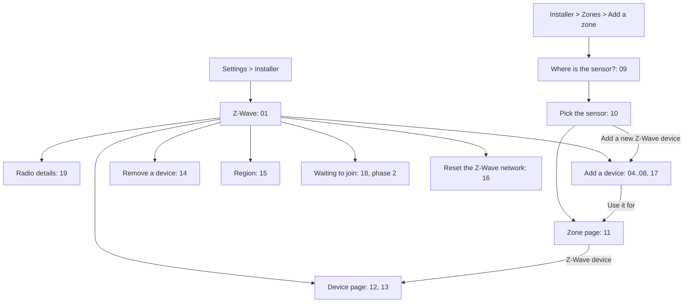

The Z-Wave row appears in the Installer menu only in builds with `ALARM_ZSRC_ZWAVE`, and says
"Not connected" (gray) until a place is chosen and the radio answers.

## 2. Installer menu ([01](screens/01_installer_menu.svg))

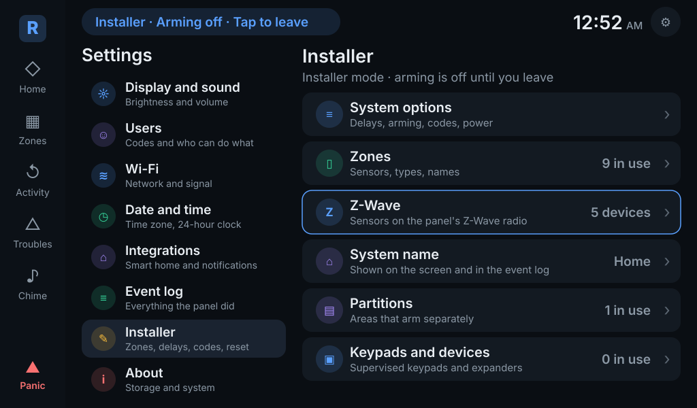

New row after **Zones**: icon Z-Wave (blue), **Z-Wave** · "Sensors on the panel's Z-Wave
radio" · value "5 devices" / "No devices" / "Not connected" (gray) / "Radio problem" (amber).

## 3. The Z-Wave page ([02](screens/02_zwave_network.svg), [03](screens/03_zwave_network_more.svg))

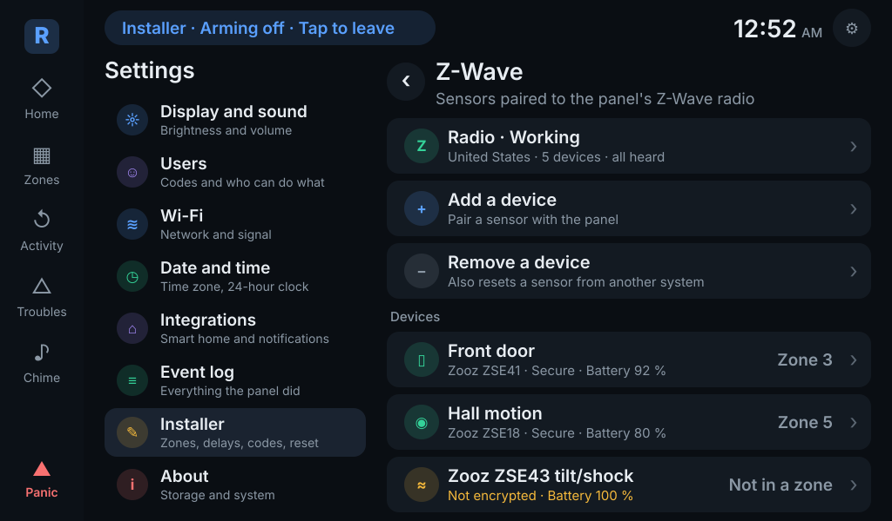
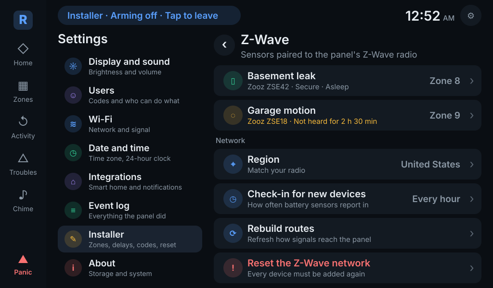

Title **Z-Wave**, subtitle "Sensors paired to the panel's Z-Wave radio". Rows, top to bottom:

| Row | Words | Goes to |
|---|---|---|
| Radio state | "Radio · Working" + "United States · 5 devices · all heard"; or "Radio · Starting"; "Radio · Not answering" (amber) + "Check its wires; the panel keeps trying"; "Radio · Not connected" + "Choose where it is wired: Flasher or console"; "Radio · Belongs to another system" (amber) + "Reset it to use it here"; "Radio · Replaced or reset" (amber) + "Add its 5 devices again"; "Radio · Update its software" (amber) when SDK < 7.22.1; "Radio · Can't be used" (amber) when the panel refuses the module (serial-api.md §4) | Radio details (19) |
| Add a device | "Pair a sensor with the panel" | 04 |
| Remove a device | "Also resets a sensor from another system" | 14 |
| **Devices** (section) | one row per device, sorted: unreachable first, then by name | device page (12/13) |
| a device | name (its zone's name, else the model) · "Zooz ZSE41 · Secure · Battery 92 %" · value "Zone 3" / "Zones 3, 4" / "Not in a zone"; amber sub-line when not encrypted, low battery, unreachable ("Not heard for 2 h 30 min"), still interviewing ("Wake it to finish setting it up"), or not usable ("Another controller: remove it") | |
| **Network** (section) | | |
| Region | "Match your radio" · value "United States" | 15 |
| Check-in for new devices | "How often battery sensors report in" · value "Every hour" (1 h / 4 h / 12 h) | a choice list |
| Waiting to join (phase 2) | "Sensors registered by their QR code" · value "1 device" | 18 |
| Rebuild routes (Z10) | "Refresh how signals reach the panel"; while running "3 of 7 done" | confirm ("Rebuild routes?" · "Rebuild"), then progress in the row; tapped while running: "Stop rebuilding routes?"; while sleepers wait, a row under it says "Wake these: Front Door, Garage tilt"; its end stays on the page until tapped to clear (no toast): "Routes rebuilt for all 7 devices" / "for 4 of 7" with "1 didn't answer · 2 skipped" (dead, Long Range or stopped are skipped, not failed) / "Stopped: 3 of 7 devices done", and a row per device named (the first six) that opens its device page (BL-152) |
| Reset the Z-Wave network | red · "Every device must be added again" | 16 |

## 4. Adding a device

### Listening ([04](screens/04_add_listening.svg))
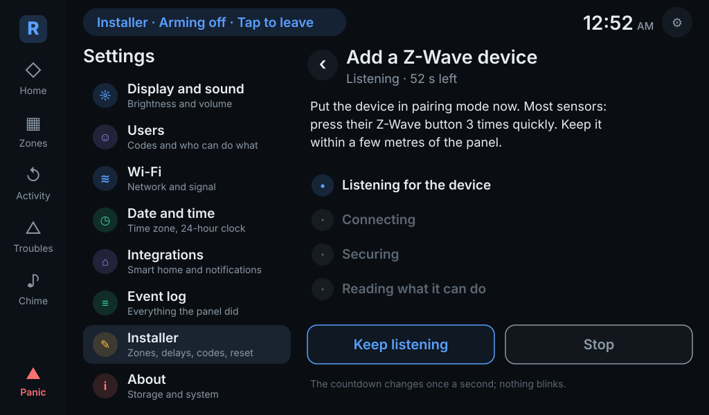

Title **Add a Z-Wave device**, subtitle "Listening · 52 s left" (once a second). Paragraph:
"Put the device in pairing mode now. Most sensors: press their Z-Wave button 3 times quickly.
Keep it within a few metres of the panel." Four steps, the current one blue, the rest gray:
"Listening for the device", "Connecting", "Securing", "Reading what it can do". Buttons
**Keep listening** (restarts the 60 s) and **Stop**. Leaving the page stops listening.
When the window runs out: "Nothing joined. Check the device's pairing steps, then try again."
with **Try again**.

When the device came from the zone editor ("Add a new Z-Wave device"), the page is the same;
at the end it returns to the zone editor with the device's inputs offered first.

### Secure connection ([05](screens/05_add_security.svg))
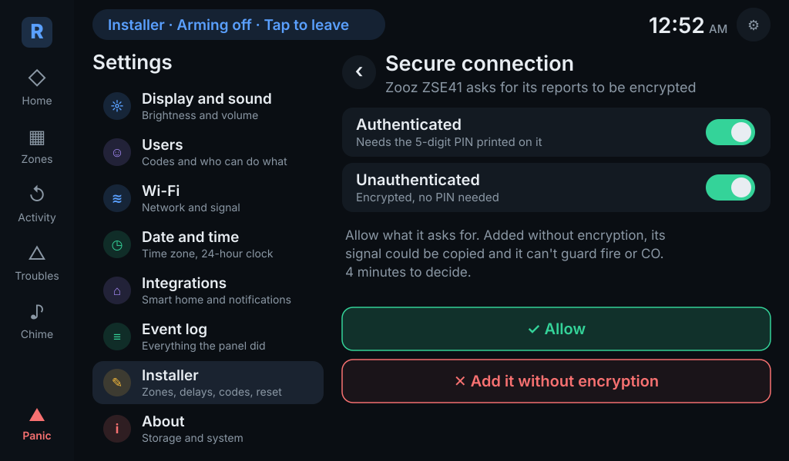

Shown when the device asks for S2 (security.md §5, step 2). Title **Secure connection**,
subtitle "Zooz ZSE41 asks for its messages to be encrypted" (the model when known, else "The
device"). One toggle per requested class, all on: **Access control** "For locks, keypads and
garage doors", **With its PIN** "Needs the 5-digit PIN printed on it", **Without a PIN**
"Encrypted, no PIN needed", **Older security (S0)** "Weaker; only if nothing else works"
(only with S0 enabled). Paragraph: "Allow it. Without encryption its messages could be faked: a
sensor can't guard fire or CO, a switch can be worked by others. 4 minutes to decide." (Its kind
isn't known before its interview.) Buttons **Allow**
(green) and **Add it without encryption** (red outline, confirms once more). Turning every
toggle off equals the red button.

### PIN ([06](screens/06_add_pin.svg))
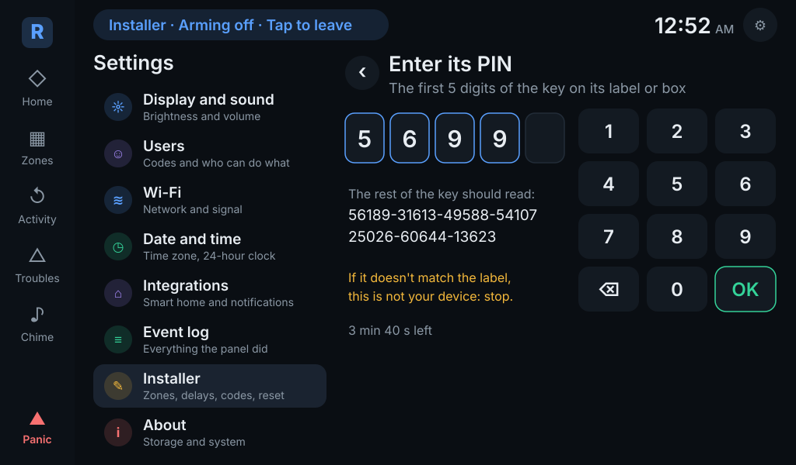

Only when Authenticated or Access Control was allowed. Title **Enter its PIN**, subtitle "The
first 5 digits of the key on its label or box". The rest of the key in two lines ("The rest
of the key should read: 56189-31613-49588-54107 / 25026-60644-13623"), the warning "If it
doesn't match the label, this is not your device: stop." (amber), a row **Time left** ("3 min
40 s", once a second), **Enter the PIN** (the panel's number keyboard; OK takes exactly 5
digits) and **Cancel** ("Stop adding it? It stays in the network without encryption.").

**Decided while building it (Z7):** the PIN is typed on the number keyboard every other number
field uses rather than five boxes and a pad of its own. Leaving the page does not cancel: the
question stays open until its time runs out, and **Add a device** shows it again.

### Progress ([07](screens/07_add_progress.svg))
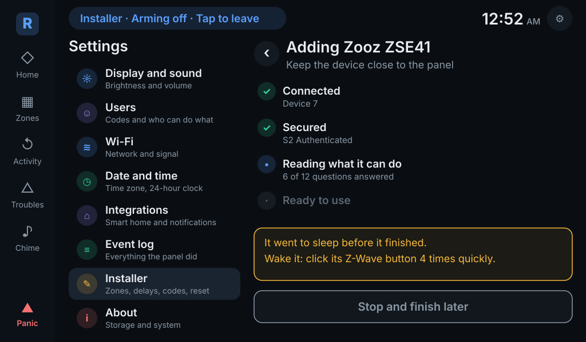

Title **Adding Zooz ZSE41**, subtitle "Keep the device close to the panel". Steps with marks:
"Connected · Device 7", "Secured · S2 Authenticated" (or, amber, "Not encrypted" or "Not
confirmed: its setup didn't finish" - an empty node information and no answer to the key exchange,
security.md §5), "Reading what it can do · step 6 of 16" (the interview's steps, network.md §5),
"Ready to use". When a **sleeping** device fell asleep, an amber box: "It went to sleep before it
finished. Wake it: click its Z-Wave button 4 times quickly." (the quirk's `wake_words`, else
"Wake it: see its manual, usually by pressing its button"). When its interview **gave up** after
its attempts (`progress.stalled`: it didn't answer - asleep or not; a device woken by the panel's
call (FLiRS) or a mains one is never said to have gone to sleep): "It stopped answering before its
setup finished. Keep it close to the panel, check its power, then try again." with **Try again**
(continues its interview, `UI_ZW_REQ_SETUP`). Button **Stop and finish later** - the device stays
in the network but is **not set up**: the page says "Setup not finished" (never "Added"), with
**Open it** (its page, in place of the add page) and **Done**; its interview goes on by itself
(a sleeping one at its next wake-up) and its page follows it.

### Results ([08](screens/08_add_done.svg), [17](screens/17_add_insecure.svg))
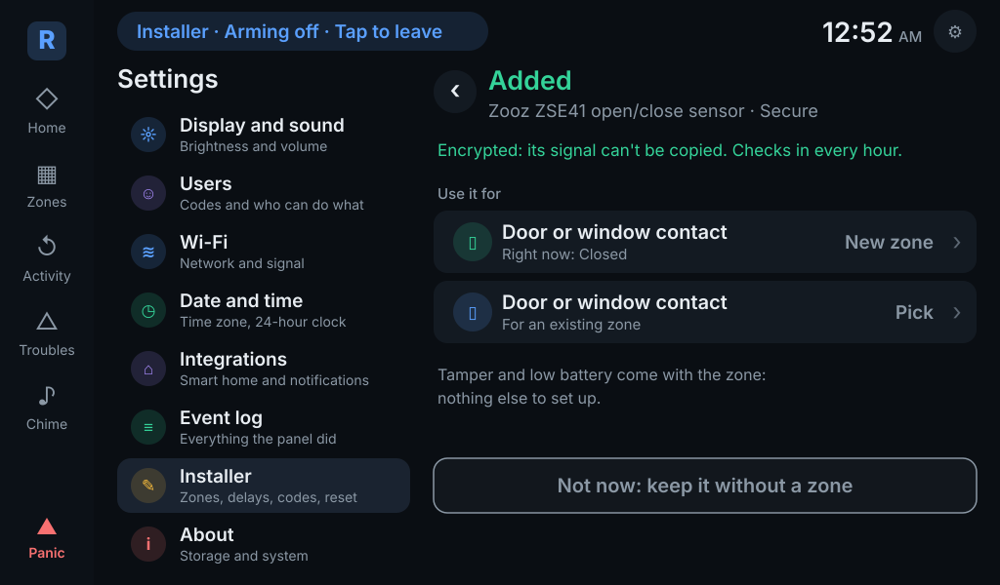
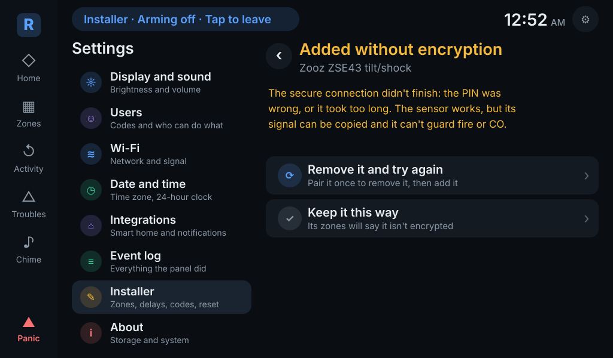

**Added** (green title), subtitle "Zooz ZSE41 open/close sensor · Secure"; the trust line in
green ("Encrypted: its signal can't be copied. Checks in every hour."). Section **Use it for**:
two rows per input it offers (zones.md §2): "New zone", with its state right now (creates a
zone of the type suggested for the input's kind, docs/features/22's `zsrc_suggest_zone_type`:
smoke and heat fire, CO CO, motion interior follower, water and temperature 24-hour aux, gas and
emergency buttons 24-hour audible, doors, windows and the rest perimeter - named "Zone 12", and
opens its zone page to name it), and "Pick" "For an existing zone" (the zone list, whose current
sensor it replaces after a confirmation). "Tamper and low battery come with the zone:
nothing else to set up." Button **Not now: keep it without a zone**.

Coming from the zone editor, there is no "Use it for": the zone editor's picker (10) opens with
this device's inputs on top, marked amber "Just added".

Other endings (same page layout, title in amber or red):

| Case | Title | Words | Buttons |
|---|---|---|---|
| S2 failed / timed out / wrong PIN / declined / no information | Added without encryption | the reason, then "Unencrypted, its signal can be copied and it can't guard fire or CO." - "The PIN didn't match the device.", "The secure connection took too long and didn't finish.", "You chose to add it without encryption.", "The device stopped the secure connection.", "It didn't say what it supports and didn't answer the secure connection: it may not have finished joining.", else "The secure connection failed." | Remove it and try again · Keep it this way |
| possible downgrade | Added with weaker security | "It supports better security than it got. Someone nearby may have interfered. Remove it and add it again." | Remove it and try again · Keep it |
| installer stopped before a device joined | Stopped | "Stopped before a device joined: nothing was added." | Try again |
| "Stop and finish later" | Setup not finished | "It joined, but the panel hasn't finished reading what it can do, so it can't be used yet. Its page shows how far it got." and its Security row | Open it · Done |
| protocol failed | Didn't join | "The device did not finish joining. Remove it (it may still belong to another system) and add it again." | Remove a device · Try again |
| already known | Already added | "This device is already paired: it's Front door." | Open it |
| a controller | Not a sensor | "That is another controller, not a sensor: the panel doesn't add controllers." | Remove it |
| does not report | Added, but it doesn't report | "It has no lifeline, so it can't tell the panel anything. It can't be used for a zone." | Remove it · Keep it |

## 5. Making a device a zone

### Where is the sensor? ([09](screens/09_source_picker.svg))
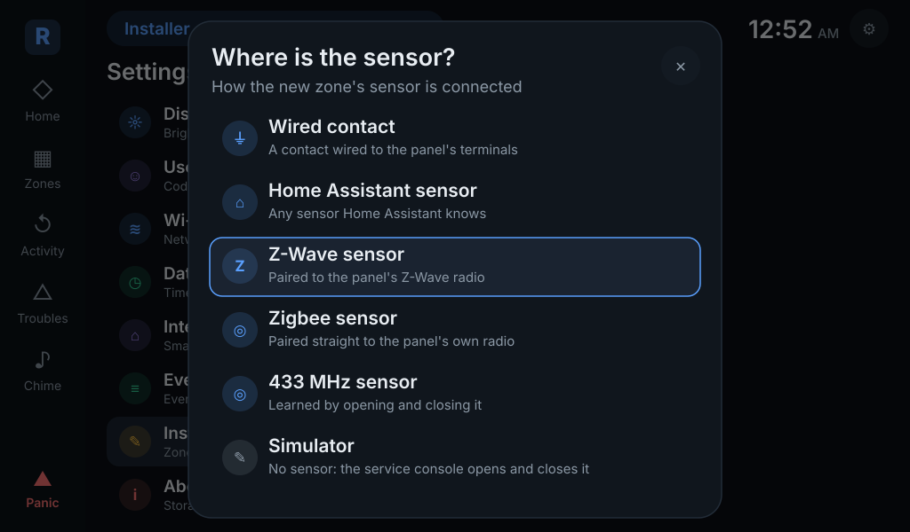

The existing dialog gains **Z-Wave sensor** · "Paired to the panel's Z-Wave radio", after
Home Assistant and before Zigbee. It is listed only when the build has Z-Wave and the radio is
working (`usable()`, ZSRC-005); otherwise it is absent (the Z-Wave page explains why).

### Pick the sensor ([10](screens/10_zwave_pick_sensor.svg))
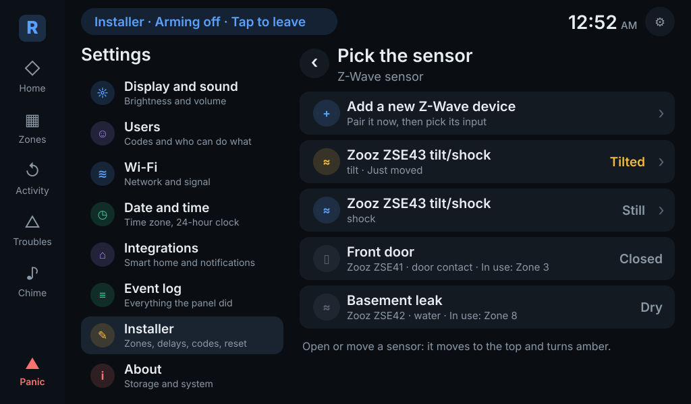

The existing learn picker (`ui_sources.c`), title **Pick the sensor**, subtitle "Z-Wave sensor".
First row **Add a new Z-Wave device** · "Pair it now, then pick its input" (goes to 04, comes
back here). Then one row per input (`candidates()`): name, "model · input" detail, state right
now. Inputs used by another zone are gray with "In use: Zone 3" and not tappable (as for every
source); the zone's own sensor says "This zone's sensor". Inputs that changed since the picker
opened move to the top in amber with "Just opened or closed" / "Just moved"; a device added from
here is marked "Just added" (`best`). Footer: "Open or move a sensor: it moves to the top and
turns amber." The list changes at most once a second.

### Zone page ([11](screens/11_zone_page.svg))
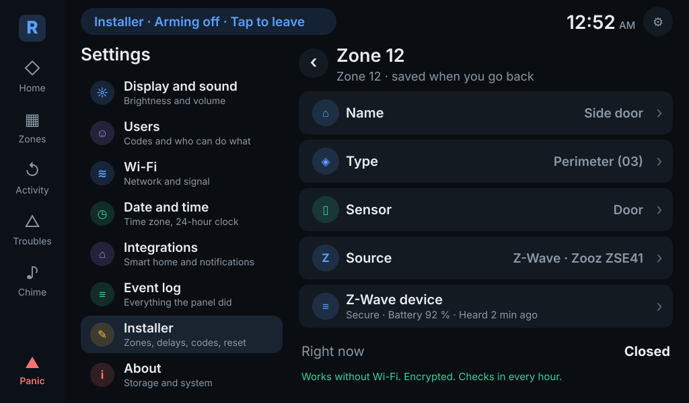

The existing zone page: **Source** reads "Z-Wave · Zooz ZSE41" (tap: the picker again). A new
row **Z-Wave device** · "Secure · Battery 92 % · Heard 2 min ago" opens the device page.
**Sensor settings** shows the contact's sense (normally closed/open) and, for momentary inputs,
"Stays active for 30 s"; it hides the separate tamper and battery inputs (they come with the
device). **Right now** and the trust facts line as for every source ("Works without Wi-Fi.
Encrypted. Checks in every hour." - amber words for the missing ones).

## 6. The device page ([12](screens/12_device_page.svg), [13](screens/13_device_unreachable.svg))

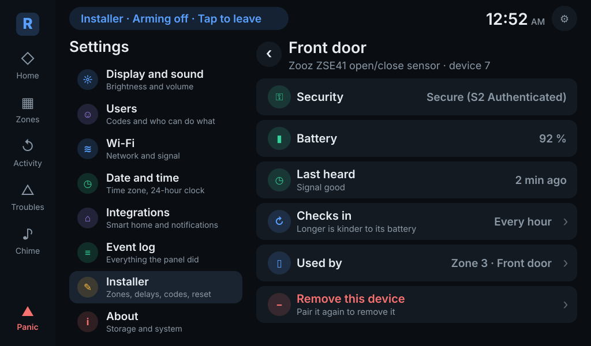
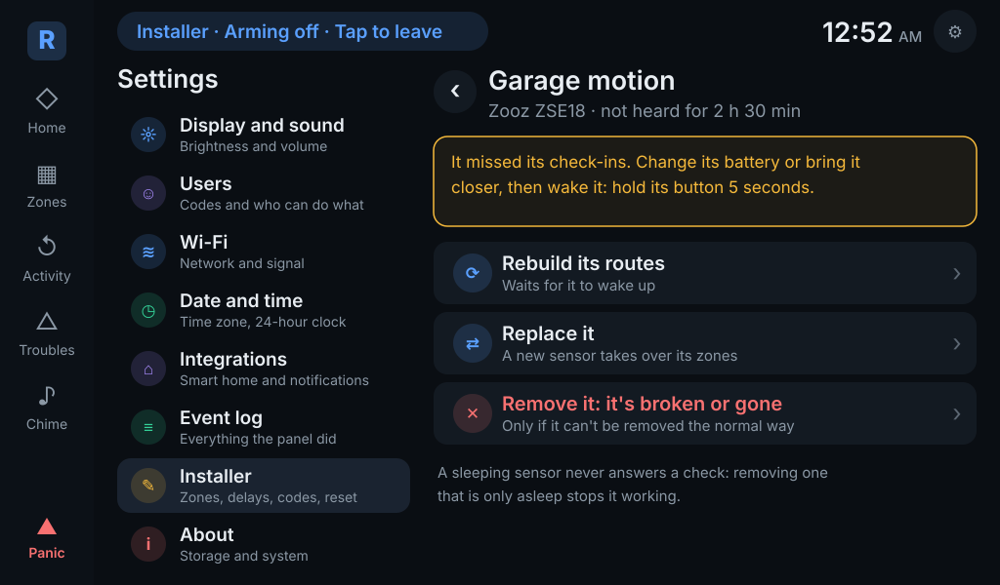

Title: the device's name; subtitle: "model · device 7". Rows:

| Row | Value / action | Who |
|---|---|---|
| Security | "Access control", "With its PIN", "Without a PIN", "Older security (S0)", "Not encrypted" (amber), "Not encrypted (it supports encryption)" (amber: it lists Security 2, its key exchange failed or was declined), "Not confirmed: its setup didn't finish" (amber: no key, and its own list of command classes not read since it joined), "Not known yet" | all |
| Battery | "92 %", "Low" (amber); without a level: "Mains powered" (only an always-listening device whose full list has no Battery command class), "Not reported yet" (it has one), "Unknown" - never guessed from its radio: a keypad woken by the panel's call runs on batteries | all |
| Last heard | "2 min ago" | all |
| Signal (ZW-040, as built) | "Good", "Fair" or "Weak", the Zigbee page's words; the row is left out until a frame was measured. From the newer of the last frame heard and the last acknowledgement: with the radio's background noise known, the margin over it (Good from 20 dB, Fair from 8 dB, else Weak); without, the level itself (Good from -75 dBm, Fair from -87 dBm). Follows the frame in place, at most once a second; its first appearance rebuilds the page | all |
| Checks in | "Every hour" (choice: 1 h, 4 h, 12 h; "Never" shown, not offered) - applied at its next wake-up ("Changes to every 12 hours when it next wakes up"); always listening: "Not needed"; woken by the panel's call: "Not needed: it answers when called" | installer |
| Used by | "Zone 3 · Front door" (each zone, tappable) or "Not in a zone" → "Make it a zone" (only a set-up device with inputs); not set up: "Finish its setup first · Nothing yet" (gray, not tappable) | installer |
| Keypad · Sounds and lights | only a keypad with a feedback profile (ZW-028): "Off", "On" (one partition) or "Partition 2" → Off / each enabled partition. Not available, gray with the reason: "Finish its setup first", "Needs secure pairing with its PIN: add it again", "Its setup found no way to drive them"; assigned but not being sent: "Waiting for it". Footnote (as built with ZW-031): "Its own sounds and lights show the panel's state. Its buttons arm and disarm with a user's code." or, with its buttons off, "... Its buttons don't arm or disarm the panel."; its buttons have rows of their own, "Arm and disarm from its buttons" and "Emergency buttons" (ZW-031, preview 166-168) | installer |
| Blink its light (phase 2) | only with Indicator v3: "Find it: its light blinks for a few seconds" | installer |
| Rebuild its routes (phase 2) | "Refresh how its signal reaches the panel"; sleeping: "Wake it now: hold its button 5 seconds" | installer |
| Removing it · Remove this device | red · "While it works: press its button when asked" → the remove flow (14) | installer |
| Removing it · Remove it: it's reset, broken or gone | red · "The radio checks it no longer answers first" → confirmation → removal as failed (network.md §10) | installer |

**Removing it, both ways (ZW-029).** Always offered to the installer, whatever state the device is
in - a device that never finished joining, was reset by hand or is dead no longer has to wait to
become unreachable first. The first way is the normal exclusion and needs the device. The second
is for a device that can't take part: the radio pings it (3 times, 2 s apart), asks its own list
whether it counts it as failed, and only then removes it from that list (RemoveFailedNode); the
panel forgets it only after the radio did, so no ghost stays in the radio, and a device that
answers is never removed this way. Confirmation: "Remove it: it's reset, broken or gone?" / "The
radio checks it no longer answers first. One that answers is kept: remove it the normal way." For
a sleeping device a footnote: "A sleeping sensor can't answer that check: use the second way only
if it was reset or is really gone." While it runs the page's top says "Checking that it no longer
answers..." (blue); how it ended stays at the top until the installer leaves the page: removed -
the page goes back to the list, without it; "It answered, so it was kept. Use Remove this device
and press its button."; "Not removed: the Z-Wave radio doesn't count it as failed yet. If it was
reset or has no power, wait a minute and try again."; "Not confirmed: the Z-Wave radio didn't
finish in time. It is still listed: try again."; "Not removed: the Z-Wave radio couldn't do it.
Nothing changed: try again."

When the device is **unreachable** (13) an amber box leads: "It missed its check-ins. Change its
battery or bring it closer, then wake it: <wake words>." Then **Replace it** "A new device
takes its place: its zones follow it" (Z10: `UI_ZW_REQ_REPLACE`; confirmed, then the add page as
"Replace a Z-Wave device" with its own words, no "Keep listening", ending "Replaced · It took the
old device's place: its zones follow it."; "Not replaced" when the old one answered or the radio
doesn't count it as failed yet). In installer mode a set-up device also has **Rebuild its
routes** ("Refresh how its signals reach the panel"; a sleeper: "Tap, then press its button to
wake it" and the toast "Wake it now: press its button"; its end a toast), and a device with
Indicator v3 **Blink its light** ("Find which device this is"; toast "Its light blinks 3 times"
- the device's own light, 3 blinks 0.8 s apart: never the panel's screen). As built (BL-152),
every listening device has **Check it now**, reachable or not and in any mode - a ping is
harmless, and Z-Wave JS lets any user ping (its answer a toast, "It answered" or "No answer"; not
while its software is updated). In installer mode a set-up device (Ready, or "can't report") has
**Set it up again** "Read what it can do again: its zones keep working" (Z-Wave JS's
re-interview, refreshInfo): confirmed first ("Set it up again?" "The panel reads what it can do
again. Its zones keep working, and it keeps its security."; a sleeper's: "It's read again at its
next wake-up. Its zones keep working, and it keeps its security. Wake it to start now." - at most
120 bytes, the confirmation holds 127), then `UI_ZW_REQ_SETUP` on the finished device reads it
from step 1, as after its software update (the same call): the same device number, keys,
generation and zone bindings, refused while another operation runs, or (busy) a listening
device's while both scratch records are in use (a sleeper's waits for its wake-up); asked while
it is being read again, the reading starts again from step 1 (one waiting for its wake-up is left
as it is), as Z-Wave JS's re-interview does (network.md §5, "Reading a set-up device again").
While it is read again the device keeps working on the facts it had: the new answers go into a
scratch record and its own record - in RAM and in NVS - is not changed or stored until the new
reading is complete, which then replaces the old facts in one step; so its inputs stay offered
(every end point's), its zones hear its reports and stay supervised across a link up, an assigned
keypad still arms, disarms and shows the panel's state. A sleeper's reading starts at its wake-up.
A reading that stops (its attempts ran out) leaves the device working on its old facts, READY; a
panel restart drops the reading and keeps the old facts. The reading and the "stopped" note are
RAM only (`zw_iv_refreshing`, `zw_iv_reread_stopped`): after a restart the page shows the device
Ready, not "stopped". The pages tell a
re-read from a first setup by its steps, all done (`setup_done == setup_total`, from the panel,
not from the visit): the device's page says "Reading it again. Its zones keep working." (blue; a
sleeper's: "It's read again at its next wake-up. Its zones keep working. To start now, wake it
(<wake words>).", blue, never the amber "Wake it to finish setting it up"), and one that stopped
"Reading it again stopped: it didn't answer. It works as before. Bring it closer or check its
power, then try again." (a sleeper's: "Reading it again stopped. It works as before. Wake it
(<wake words>), then try again.") with Try its setup again; while it runs Try its setup again is
not offered. Its list row says "Being read again", "Read again at its next wake-up" or "Read
again stopped: works as before", none a warning. The Panel Manager's device row has the same
**Set it up again** button (installer, Ready or can't-report devices; its own confirmation, then
the action `setup`).
A re-read never hides trouble: a device that stopped answering shows "Not heard for ..." in its row
and the amber "It stopped answering" box on its page (also after the re-read stopped), and a low
battery shows "Battery low" - these come before the calm words. The Panel Manager says the same (the
devices carry `setup_done` and `setup_total`). When Set it up again is refused because the panel
reads another device, the toast says "The panel is busy with another device: try again when it's done".

Its setup at the top (amber unless running): a sleeping device waiting for its wake-up: "Wake it to
finish setting it up: <wake words>."; running: "Setting it up: step 3 of 16." (blue, its words in
place); gave up (`UI_ZW_DEV_SETUP_STOPPED`: its attempts ran out and nothing runs it now): "Its
setup stopped at step 2 of 16: it didn't answer. Bring it closer or check its power, then try
again. It can't be used until then." (a sleeping one: "Wake it (<wake words>), then try again.")
with **Try its setup again** (`UI_ZW_REQ_SETUP`: its interview continues where it stopped; a
restart of the panel continues it too).

**Checks in, as built (Z7):** for a device that checks in, the row (clock icon, the value "Every 4
hours") opens a choice: **Every hour** "A silent sensor shows soonest", **Every 4 hours**,
**Every 12 hours** "The longest battery life" - only those within the device's own limits, when
it reports them; the one it has (or is about to get) is marked. "Never" (a device that wakes only
by hand) is shown and not offered, and a device still being set up shows its value without the
choice. The device takes the new check-in when it next wakes up: until then the row's second line
reads "Changes to every 12 hours when it next wakes up" and its value stays what the device does
now. The row's words follow it in place, at most once a second (the page is not made again): once
the device took it the line goes and the value reads "Every 12 hours"; a device that refuses it
keeps its interval, and the line goes too. A choice not taken before the panel restarts is sent again (network.md
§7). A refusal says why in a short message ("Only in installer mode, with everything disarmed",
"The Z-Wave radio isn't working").

**Controls, as built (ZW-034, ZW-035; preview 175-180):** a device that switches has a
"Controls" section. A switch or relay row ("Switch", "Relay 2") shows On, Off or Not known and
switches when tapped ("Tap to switch it on"); a dimmer's "Light" row opens a choice of Off, 25 %,
50 %, 75 % and Full. A command that isn't confirmed says so on the row ("It didn't confirm: check
it"). A relay has "Use relay 2 for a garage door", which picks the zone of the sensor that says
where the door is - door, window, garage door and plain contact zones only, each with its sensor's
words, Z-Wave ones first. The garage then shows **Garage door** with its sensor's word (Open,
Closed, Unknown - never "Opening" from a press alone: "Pressed to open: waiting for its sensor"),
**Open it** and **Close it** always in place, and **Garage door opener** "Relay 1 · sensor Zone 9 ·
tap to stop using it". Nothing is pressed without the sensor's word ("Nothing pressed: its sensor
hasn't said where the door is. Open or close it by hand once"), when it is there already, or while
a press is under way ("Pressed already: wait until its sensor sees it arrive"). A device with
outputs and no inputs gets its own add result ("Switch added", "Relays added") with Open it.

**Software, as built (ZW-033; preview 169-174):** the version it runs (and its hardware version),
then "Check for an update" - only when asked; nothing installs by itself. Checking: "Asking the
update service..."; the answer: "Updates · Up to date", "The update service doesn't know this
device", why it couldn't ask, or **Install version 1.20** with its notes on one line. Installing
asks first (minutes; a sleeper must be woken; keep its power or batteries), then: "Downloading its
new software and checking it...", "Wake it now: ... (4 min left)" for a sleeper, "Sending its new
software: 46 %", with **Stop the update**; removal is hidden meanwhile and the device list's row
says "Getting new software: 46 %". Its end stays on the page: "Updated: it runs version 1.20 now"
once it is read again, or why not ("It refused: its battery is low...", "It stopped answering
during the update...").

## 7. Removing ([14](screens/14_remove.svg))
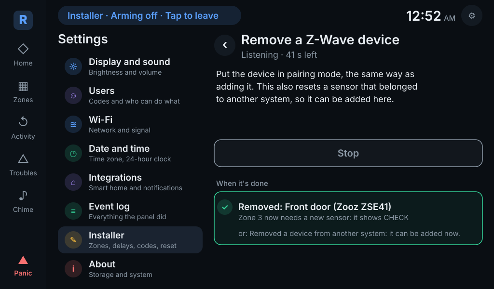

Title **Remove a Z-Wave device**, subtitle "Listening · 41 s left". "Put the device in pairing
mode, the same way as adding it. This also resets a sensor that belonged to another system, so
it can be added here." Button **Stop**. Results in the same place:
- "Removed: Front door (Zooz ZSE41)" · "Zone 3 now needs a new sensor: it shows CHECK" (green
  box), with **Remove another** and **Done**. For a SmartStart device: toggle "Forget its QR
  code too" (on).
- "Removed a device from another system: it can be added now." with **Add it now**.
- Each other ending says what happened, with **Try again**: "Stopped: nothing was removed." (the
  installer, or the console, stopped it); "No device answered in time: nothing was removed. Press
  its button while the countdown runs."; "A device answered but didn't finish leaving: it may
  still be in the network. Try again." (amber); "The Z-Wave radio couldn't remove it: nothing was
  removed." (amber).

Opened from a device page, the title is **Remove Front door** and a different device answering
says "That was another device: Hall motion was removed" (it is removed all the same: exclusion
cannot pick). When nothing was removed there, the page adds "If it was reset or no longer works,
it can't answer this. Remove it the other way:" and **Remove it: it's reset, broken or gone**
(back to the device's page, which follows the check).

**Each visit is its own removal (ZW-029, docs/bugs/B015).** Opening the page starts a new
window unless a removal is still running; a result is shown only to the visit that started it -
an earlier visit's, or one the console left, never. Leaving the page stops only the window this
page opened (and clears its result); a removal or an addition the console started is never
stopped by the touchscreen changing page.

## 8. Region, reset, radio details

### Region ([15](screens/15_region.svg))
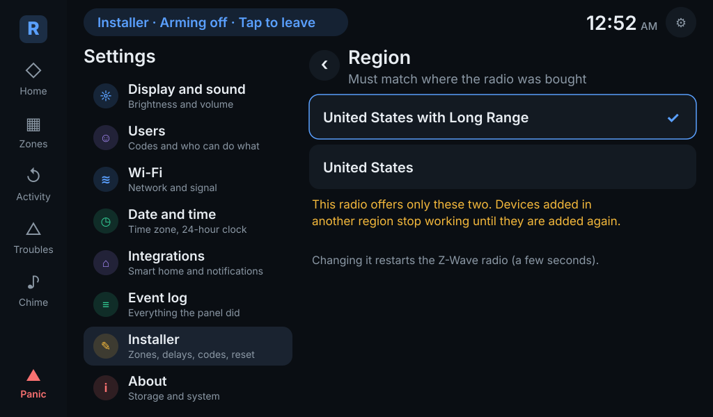

The network row's help is "Match your radio", short enough to stay on one line beside the
longest region name (preview-asserted). A choice list of what the radio offers, in words:
"United States", "United States with Long
Range", "Europe", "Europe with Long Range", "Australia and New Zealand", "Hong Kong", "India",
"Israel", "Russia", "China", "Japan", "Korea". With devices added, each other region's row says
what choosing it does (ZW-045, network.md §12): "Devices keep working" within the band (United
States and United States with Long Range, Europe and Europe with Long Range), or "5 devices stop
working" (another band: all of them; leaving a Long Range region for its classic one: the Long
Range ones). Under a region that stops devices, amber: "Devices that stop working must be added
again. Until then their zones show CHECK." Gray: "Changing it restarts the Z-Wave radio (a few
seconds)." Choosing asks once more, in the same terms: "All 5 devices keep working. The Z-Wave
radio restarts (a few seconds)."; "All 5 devices stop working. Each must be added again, and their
zones show CHECK until then." (or "2 Long Range devices stop working..."); with no devices
"Changing it restarts the Z-Wave radio (a few seconds).". A change that stops devices then asks
for the installer code once more ("Confirm the region"), exactly as the network reset does: a
master code is refused like a wrong one, and closing the pad changes nothing. With no devices, or
none that stop, no code is asked. Preview: `zwave_region`, `zwave_region_same_band`,
`zwave_region_band`, `zwave_region_drop_confirm`, `zwave_region_code`.

### Reset ([16](screens/16_reset_confirm.svg))
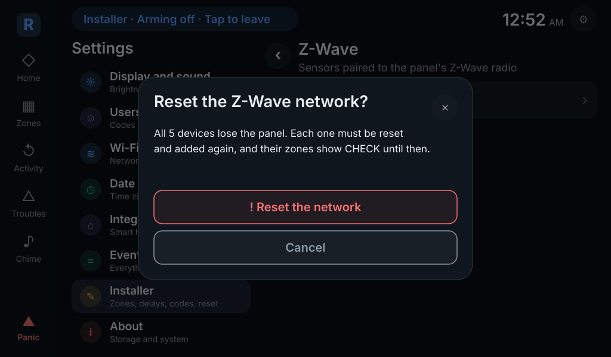

Dialog **Reset the Z-Wave network?** · "All 5 devices lose the panel. Each one must be reset
and added again, and their zones show CHECK until then." **Reset the network** (red) and
**Cancel**. Then a second confirmation on the keypad, "Confirm the reset" · "Enter the installer
code once more": only the installer code is taken (a master or user code is refused like a wrong
one). Afterwards the page shows "Radio · Working · No devices".

### Radio details ([19](screens/19_radio_details.svg))
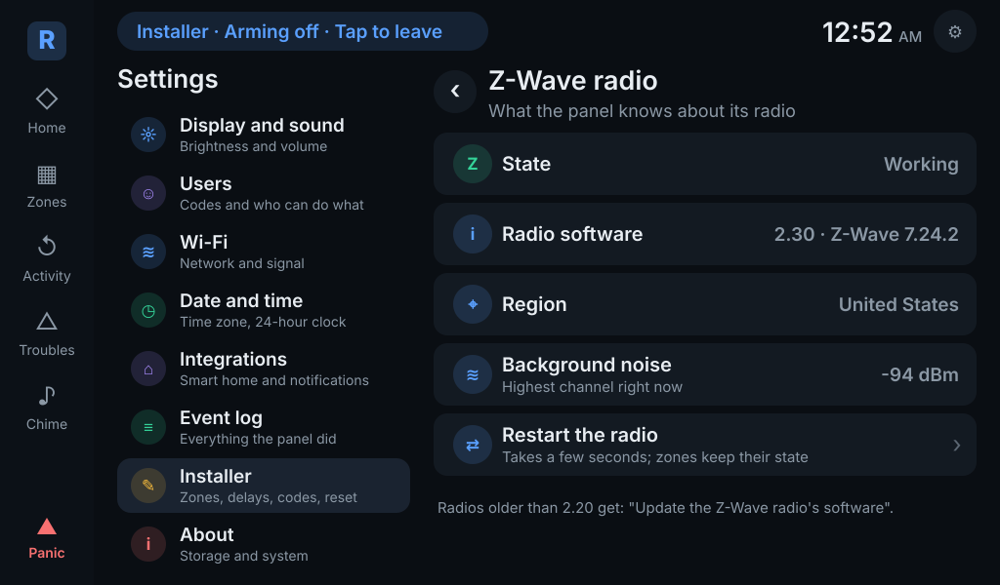

Read-only facts for the installer: State, Radio software ("2.30 · Z-Wave 7.24.2"), Region,
Background noise (phase 2, "-94 dBm (quietest channel)", "Not measured yet" before the first reading, once a second at most - the only dBm on
the touchscreen, on purpose, for finding interference), and **Restart the radio** (a soft reset;
"Takes a few seconds; zones keep their state", gray with "Not while its software installs" while the radio updates, or "Not while another change runs"). As built: "Its Z-Wave software is older than
the panel wants: update it." for an SDK before 7.22.1, and (Z11, §14) a **Software** section: "Check
for an update" (installer mode; "Checked only when you ask; nothing installs by itself"), then
"Install version 2.30" with its notes, confirmed ("Update the radio to 2.30?" · "Z-Wave sensors
aren't heard for up to 15 minutes, and arming waits until the radio is back. Keep the panel
powered." · "Update"), "Updating the radio: 38 %. Z-Wave sensors aren't heard until it's back."
in place (the State row says "Updating"), then "Updated: it runs 2.30 now." or why not (error
0x18: "from 1.50 or 2.00, install 2.20 first"); a radio the service doesn't list points to the
Panel Manager's upload. Earlier text: "Radios older than 2.20 get: Update the Z-Wave
radio's software." Nothing here offers a firmware update on the touchscreen (phase 3 does it in
the Panel Manager with a file). Superseded by the Z11 Software section above: the update
service's file installs from here; only its maker's own file goes through the Panel Manager.

**Restart, as built (Z7):** the row **Restart the radio** · "Takes a few seconds; zones keep
their state" asks once more - **Restart the Z-Wave radio?** · "Takes a few seconds; zones keep
their state." · **Restart** and **Cancel** - then the radio starts again with its devices, keys
and node cache as they were. The State row follows it in place, at most once a second: "Starting",
then "Working" (or "Not answering" when it does not come back); no message, the row says it.
Outside installer mode the row says "Done in installer mode" and does nothing. A region change
and the network reset restart the radio the same way, and the Z-Wave page's first row follows
them ("Radio · Starting", then "Radio · Working").

## 9. SmartStart (phase 2, [18](screens/18_smartstart.svg))
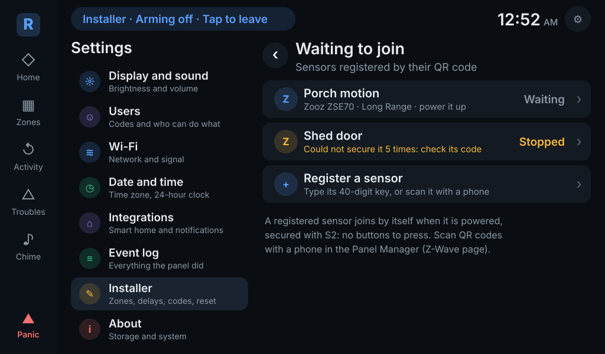

Title **Waiting to join**, subtitle "Sensors registered by their QR code". One row per entry:
name, "model · Long Range · power it up", value "Waiting" / "Joined" (then it moves to the
device list) / "Stopped" (amber: "Could not secure it 5 times: check its code"). Tapping an
entry: its classes (toggles), "Forget it". **Register a sensor**: "Type its 40-digit key, or
scan it with a phone" → a page with 8 boxes of 5 digits on the number pad (the same component
as the PIN), the model shown once the checksum of a pasted QR string is right. Footer: "A
registered sensor joins by itself when it is powered, secured with S2: no buttons to press. Scan
QR codes with a phone in the Panel Manager (Z-Wave page).

**As built (Z10, preview 182-186):** the Z-Wave page's Network section has **Waiting to join**
(value "None" / "1 device" waiting; amber "One could not be secured: check its code"). An entry
without a name is "Sensor 35455" (what its code says it is - Sensor, Switch, Dimmer, Keypad - and
its key's second group; the first group is the PIN and is never shown). Its detail: "Power it up:
it joins by itself" / "In the network: device 7" / amber "Could not secure it 5 times: check its
code" / "Turned off: it won't join". **Register a sensor** opens the number keyboard for the 40
digits (one field, not 8 boxes: the keyboard sheet already checks digits); a refusal is a toast
("That isn't a 40-digit key: check it", "That code is damaged: scan or type it again", "That code
can't join by itself: add it with its PIN", "32 sensors are registered: forget one first"). The
entry page: its state, "Key xxxxx-35455-...", **Security it may have** (Access control, With its PIN,
Without a PIN: toggles for what its code asked, all three for a typed key, never none;
read-only once joined), **Turn it off** / **Turn it on**, **Forget it** (confirmed). The removal
page's "Forget its QR code too" is on by default: the code is forgotten at the removal (a reset
device would otherwise rejoin before the installer taps Done); off puts it back. A "reset, broken
or gone" removal from the device page says "Its SmartStart code was forgotten too"."

## 10. Troubles and Activity

- The radio not answering or jammed: the existing system trouble "Sensor radio problem ·
  wireless sensors may not be heard" (`sensor_radio`, docs/features/22 interim mapping). The one
  trouble is shared by every wireless source, so the Troubles list tells the radios apart by their
  status (ZW-019, as built): when the Z-Wave radio is jammed, not answering, unusable or another
  system's, its row is titled "Z-Wave radio problem" and says "Wireless sensors may not be heard ·
  Tap to see the radio"; tapped, it opens the Z-Wave page on top of the installer menu (outside
  installer mode: the locked Installer page, the toast "Enter the installer code to see the radio",
  then the Z-Wave page once the code is taken). With the Zigbee radio in trouble too, the list shows
  a row for each ("Zigbee radio problem", "Z-Wave radio problem"), each opening its own page.
  Drawn in mockup/proposals/BL-152-zw-trouble-link.js.
- A zone's CHECK, tamper, low battery: the existing zone trouble rows (nothing new).
- Activity: the new events (network.md §15), e.g. "Z-Wave device added · Zooz ZSE41 · secure".

## 11. Panel Manager (browser, docs/features/31)

The same rights as the touchscreen (the access table per API path gets the new paths; docs/features/31
"one access table per API path"):

| Page | Contents |
|---|---|
| Z-Wave | radio state, device table (name, model, security, battery, last heard, signal (ZW-040: Good, Fair, Weak, empty until measured; the API's `signal` per device), zones), the same actions as the touchscreen; add and remove show the same steps and accept the PIN typed on the computer |
| Add by QR (phase 2) | "Scan with this phone's camera" (camera through the browser's media API; the panel's pages are HTTPS, so a phone may use its camera there) or paste the QR string / type the 40-digit key; checksum and model shown before registering |
| Radio (installer) | firmware, SDK, region, home ID, node IDs, background noise per channel, frames dropped at the wrong security level per device - the diagnostics the touchscreen leaves out |
| Update the radio (phase 3) | upload a Zooz `.gbl` for the ZAC93, checks, the interlock warning, progress in words |
| Backup (phase 3) | part of the panel's encrypted backup |

The remote keypad shows the touchscreen pages above unchanged.

**As built (Z10, `web_zwave.c`, `panel-pages.js` `zwavePage`):** GET/POST `/api/v1/zwave`, the
installer's (panel_web's access table; POST refused while armed). The page shows the radio
(state, region, devices, its software), the device table (model or kind, device number,
security, battery, "Not heard", zones) and **Waiting to join**: each registered sensor with its
key shown as `xxxxx-35455-...` (an entry is named by `id`, its key's bytes 2-15 in hex: the PIN
never crosses the wire), its state, the security it may have, its product, **Turn off / Turn on**
and **Forget** (confirmed). **Register a sensor**: one field for a QR code or a 40-digit key, a
name, **Scan with the camera** and **Register**. The browser checks a code first (SHA-1 through
`crypto.subtle`: "Checksum right · asks for Secure · product 027A:7000:E001", or why not); the
panel checks it again. The camera uses the browser's own `BarcodeDetector` (Chrome on Android,
Chrome/Edge on macOS and ChromeOS): no QR library is sent to the phone; a browser without it
(Safari, desktop Chrome on Windows/Linux) says "This browser can't read QR codes: paste or type
the code instead". While a sensor waits the page looks every 5 s and is drawn again only when
something changed (no blank page, and never while a code is typed). Adding and removing devices
from the browser (with the PIN typed on the computer), per-device actions and the radio's
diagnostics page came later ("As built (Z10 finished)" below).

**As built (Z11):** the Radio page has a **Software** card: its version, **Check for an update** /
**Check again**, **Install version 2.30** when offered, and **Its maker's file** - a .gbl chosen on
the computer, sent as `PUT /api/v1/zwave-radio` (the body is the file; the installer signed in),
**Install this file**; each confirmed ("Z-Wave sensors aren't heard for up to 15 minutes, and
arming waits until the radio is back"), then the Z-Wave page's operation card follows it ("% sent",
then "Radio updated" or why not, the bootloader's code included). POST actions `radio_check`,
`radio_install`; GET `radio.software` (check, version, words) and the progress's `fw_done`,
`fw_total`, `fw_why`, `fw_error`.

**As built (Z10 finished):** the same POST takes the touchscreen's network operations - `add`,
`remove`, `keep_listening`, `stop`, `allow` (`keys`), `pin` (`pin`, the 5-digit number), `insecure`,
`dismiss`, `restart`, `routes` (`node` 0: all) and, for a device (`node`, `generation`),
`remove_failed`, `ping`, `setup` - through `zwave_service_request()` with the Panel Manager's own
decision (installer, not armed) and every partition disarmed besides; the region, the network
reset, outputs and software updates stay at the panel. GET adds `progress` (the operation, as
zw_progress says it: step, countdown, the classes asked for, the key as printed with its PIN
group blank, the result) and `diag`. The page shows **Add a device**, **Remove a device**,
**Rebuild all routes**, **Restart the radio** and **Radio details**; each device row has **Check
it now** (listening devices), **Try its setup again** (a stopped setup), **Rebuild its routes**
and **Remove as failed** (confirmed). An operation's card follows it every second without
redrawing under a PIN being typed: the countdown with **Keep listening** and **Stop**, the
security question (a box per class it asks for, **Allow**, **Add it without encryption**), the
PIN field (five digits, checked before it is sent), "Reading what it can do · Step n of 16" with
**Stop and finish later**, then the result and **OK**. **Radio details** (`#/zwaveradio`): home
ID, the panel's node, the network manager (SUC), the radio's software, chip and product, region,
background noise per channel, the interference threshold, transmit power (and what it came with),
the Long Range maximum, the link's ups and downs, frames from other networks or that didn't parse,
and per device the frames at the wrong security level, that didn't decrypt, or came twice.

## 12. Backend and state (for `alarm_ui`)

`ui_backend_t` additions (every one optional; the UI hides what is NULL):

| Call | Returns / does |
|---|---|
| `zw_status(out)` | radio state enum, region, device count, firmware string, SDK, noise, flags (update advised, belongs elsewhere, replaced) |
| `zw_devices(out, max)` | per device: generation+node, name, model, security, battery, last heard (s), signal word, state (ready, interviewing, asleep, unreachable, gone, not usable), zone list |
| `zw_device(id, out)` | one device with its inputs (slot, endpoint, state words) and page facts |
| `zw_request(op, arg)` | start: add, remove, stop, allow (class mask), pin (5 digits), keep-insecure, replace, remove-failed, ping, identify, rebuild routes, set check-in, set region, reset, restart radio, register DSK |
| `zw_progress(out)` | the running operation: kind, step, seconds left, question count, result code, the device it concerns, the DSK text for the PIN page |

Requests go to the Z-Wave task's queue; the UI polls `zw_progress` from its existing 1 s timer
(the same rhythm that keeps the words steady). Results are enums; the words live in the UI
module (`ui_zwave.c`, new) except event sentences (notify).

## 13. Preview shots to add

They come from the Z-Wave preview, `pwsh tools/ui_preview.ps1 -ZWave`; the default preview stays
as it is even though the P4 manifest turned Z-Wave on (Z9, 2026-09-27): the PC builds take
Z-Wave from `-ZWave`, not from the manifest (`cmake/alarm_board.cmake`). Appended after
the current last shot (`131`: Z7a added 132-134), in walk-through order: installer menu with
Z-Wave, Z-Wave page (two scroll positions), add: listening, secure connection, PIN, progress
with "went to sleep", added + use it for, added without encryption, source picker with Z-Wave,
pick the sensor, zone page with a Z-Wave source, device page, a device's check-in waiting for its
next wake-up, device unreachable, remove result, region, reset confirm, radio details (after a
restart); then, after the 433 MHz scenes (ZW-029, ZW-028): a device that stopped answering while
being set up (154), "Setup not finished" (155), its page with its setup stopped (156) and both ways
to remove it (157), a normal removal that found nothing, opened again after a stop (158), the
check of a removal as failed (159), a keypad's page on batteries with its sounds and lights (160),
their choice (161) and on (162), a removal as failed kept because it answered (163) and refused by
the radio (164); phase 2: waiting to join, register a sensor. The walk-through checks each: a simulated
device added (secure and not), a door opened and closed on the picker, a check-in chosen on a
device's page and taken at its next wake-up, a sensor that misses two check-ins, a removal with
its zone's CHECK, a region change, the network reset and a restart of the radio - each followed
until the radio works again. The 4" layout (on hold, docs/features/19) gets the same pages when
that work resumes.
