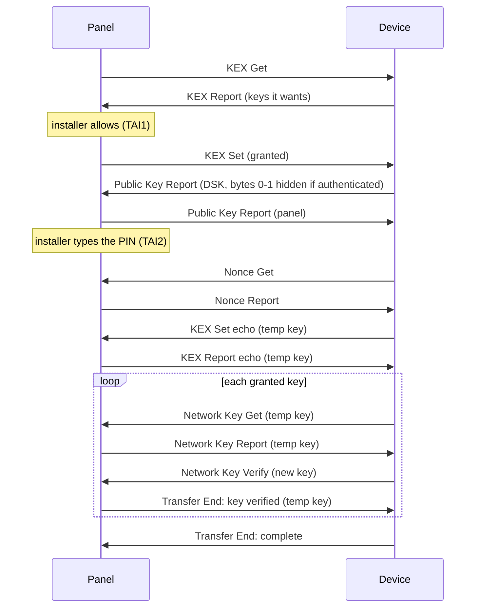

# 36 · Z-Wave: security (S2, and optional S0)

Part of [docs/features/36](README.md). The ZAC93 moves frames; it does **not** encrypt. Security
S2 and S0 live in the panel: key exchange, key storage, nonces, encryption and the rule that a
secure sensor is only believed when it speaks at its own security level. This page is enough
to implement them; the known-answer vectors in section 11 were produced by running Z-Wave JS's
own crypto code (commit `fac3872`) and must be reproduced by our implementation.

Everything is built from three primitives the platform provides through a port (README
"Components"): **AES-128 encryption of one block** (ECB), **X25519**, and a **random number
generator**. CMAC, CCM, OFB, CBC-MAC, the key derivations and the nonce generator are portable
code on top of them.

## 1. Security classes and keys

| Class | Bit in KEX key masks | Key | Long Range | Typical devices |
|---|---|---|---|---|
| S2 Unauthenticated | `01` | 16 bytes | not allowed | devices without a PIN label |
| S2 Authenticated | `02` | 16 bytes | allowed, own key | sensors with a DSK/PIN label (most 700/800 sensors) |
| S2 Access Control | `04` | 16 bytes | allowed, own key | locks, garage doors, keypads |
| S0 (legacy) | `80` | 16 bytes | not allowed | older devices |

- At first network start (and after every "Reset the Z-Wave network") the panel generates
  **six random 16-byte keys**: S2 Unauthenticated, S2 Authenticated, S2 Access Control, S0,
  and separate Long Range S2 Authenticated and Access Control keys. They are stored in NVS
  (network.md "Persistence"), never shown on any screen, console or web page, never sent
  anywhere except to a device during its key exchange, and survive firmware updates.
- A node's **highest granted class** is the first of Access Control, Authenticated,
  Unauthenticated, S0 that it was granted; "none" when it was included without security.
- The panel is the including controller: it grants keys, it never receives them.

## 2. Primitives

### AES-128
FIPS-197, one 16-byte block. `E(K, B)`.

### AES-CMAC (RFC 4493, NIST SP 800-38B)
`CMAC(K, M)` → 16 bytes.
1. `L = E(K, 0^128)`. `K1 = L << 1`, XOR `...0087` into the last byte if the top bit of `L` was
   set. `K2 = K1 << 1`, same rule on `K1`'s top bit.
2. Split `M` into 16-byte blocks; `n = ceil(len/16)`, at least 1.
3. Last block complete (and `M` not empty): `last = Mn XOR K1`. Otherwise pad it with `80 00
   ...` to 16 bytes and `last = padded XOR K2`.
4. `X = 0^128`; for blocks 1..n-1: `X = E(K, X XOR Mi)`; result `E(K, X XOR last)`.

NIST vector: `K = 2b7e151628aed2a6abf7158809cf4f3c`, `M` empty → `bb1d6929e95937287fa37d129b756746`.

### AES-CCM (RFC 3610, NIST SP 800-38C)
Nonce 13 bytes (so the length field L is 2 bytes), tag **8 bytes**, associated data as given.
Standard CCM: nothing Z-Wave specific. Plaintexts are at most a few hundred bytes.

### X25519 (RFC 7748)
Private key: 32 random bytes (the X25519 function clamps). Public key = `X25519(priv, 9)`.
Shared secret = `X25519(priv, peer_public)`, 32 bytes. RFC 7748 §6.1 vectors are in section 11.

### CTR_DRBG (NIST SP 800-90A, AES-128, no derivation function)
State: `Key` 16 bytes, `V` 16 bytes. No reseeding, no additional input.
- `Update(data32)`: `V = V+1` (128-bit big-endian increment); `T1 = E(Key, V)`; `V = V+1`;
  `T2 = E(Key, V)`; `T = (T1 | T2) XOR data32`; `Key = T[0..15]`, `V = T[16..31]`.
  (`Update` without data is the same with `data32` all zero.)
- `Instantiate(entropy32, personalization32)`: `Key = 0`, `V = 0`,
  `Update(entropy32 XOR personalization32)`.
- `Generate(n)`: repeat `V = V+1; out |= E(Key, V)` until `n` bytes; then `Update()` with no
  data; return the first `n` bytes.

**Decided while building it (hardening):** NIST's own CAVP vectors for exactly this generator
(section 11, ZW-SEC-005) come from NIST's CTR_DRBG response file, as the Z-Wave JS source tree
carries it. CAVP's procedure reseeds once: Instantiate, Reseed, Generate, Generate. The panel
never reseeds, so the test does that one Reseed itself on the port's AES (SP 800-90A 10.2.1.4
without a derivation function: `Update(entropy32)` on the running state). The library gets no
reseed function.

### AES-OFB, CBC-MAC (S0 only)
OFB: keystream `S1 = E(K, IV)`, `Si = E(K, Si-1)`; `C = P XOR keystream` (last block
truncated). CBC-MAC as used by S0: zero-pad the input to a multiple of 16, run AES-CBC with a
zero IV, take the **first 8 bytes of the last ciphertext block**.

## 3. Key derivation (CKDF)

Constants: `C33 = 33 x16`, `C26 = 26 x16`, `TE = 88 x15`, `NK = 55 x15`, `EI = 88 x15`
(`xN` = the byte repeated N times; `|` = concatenation).

| Name | Input | Computation | Output |
|---|---|---|---|
| Network key expansion | permanent network key `PNK` | `T1 = CMAC(PNK, NK|01)`, `T2 = CMAC(PNK, T1|NK|02)`, `T3 = CMAC(PNK, T2|NK|03)`, `T4 = CMAC(PNK, T3|NK|04)` | `KeyCCM = T1`, `PString = T2|T3` (32), `KeyMPAN = T4` |
| Temporary key extract | ECDH shared secret, both public keys | `PRK = CMAC(C33, shared | pubInclude | pubJoin)` (96 bytes) - **the including node's (panel's) key first** | `PRK` |
| Temporary key expansion | `PRK` | `T1 = CMAC(PRK, TE|01)`, `T2 = CMAC(PRK, T1|TE|02)`, `T3 = CMAC(PRK, T2|TE|03)` | temp `KeyCCM = T1`, temp `PString = T2|T3` |
| Nonce PRK | sender EI, receiver EI (16 each) | `NoncePRK = CMAC(C26, senderEI | receiverEI)` | 16 bytes |
| Mixed entropy input | `NoncePRK` | `T1 = CMAC(NoncePRK, EI|00|EI|01)`, `T2 = CMAC(NoncePRK, T1|EI|02)` | `MEI = T1|T2` (32) |

The panel computes the expansion once per key at start-up and keeps `KeyCCM` and `PString`
(and `KeyMPAN`, unused) in RAM.

## 4. DSK, PIN and the SmartStart home IDs

- **DSK** (device-specific key): the first 16 bytes of a device's X25519 public key. Written as
  8 groups of 5 decimal digits, each group one big-endian 16-bit word, joined by `-`:
  `56990-56189-31613-49588-54107-25026-60644-13623`.
- **PIN**: the first group (bytes 0-1). Labels and QR codes print it underlined.
- For **S2 Authenticated and Access Control**, the joining device sends its public key with
  bytes 0-1 **set to zero**; the installer types the 5-digit PIN; the panel writes it as a
  big-endian 16-bit number into bytes 0-1 before computing the shared secret. A wrong PIN
  gives a different shared secret, and the device's next encrypted frame fails to decrypt
  (section 5, step 8). For S2 Unauthenticated the device sends the whole key and no PIN is
  asked for.
- The panel shows groups 2-8 of the DSK next to the PIN field so the installer can check the
  label belongs to this device.
- SmartStart (network.md): **NWI home ID** = DSK bytes 8-11 with bits 7 and 6 of the first byte
  set and bit 0 of the last cleared. **Auth home ID** = DSK bytes 12-15 with bits 7 and 6 of the
  first byte cleared and bit 0 of the last set. (The published text has the Auth home ID bits
  the other way round; devices follow the rule written here.)

## 5. S2 key exchange (the panel includes a device)

Runs right after the protocol-level inclusion and the SUC return route (network.md "Adding a
device"). Nothing else is sent to other nodes meanwhile. Messages (all Security 2 CC, `9F`):

| Cmd | Name | Payload | Sent |
|---|---|---|---|
| `04` | KEX Get | - | panel → device, unencrypted |
| `05` | KEX Report | `flags` (bit 1 request CSA, bit 0 echo) · `schemes` (bit 1 = KEX scheme 1: `02`) · `curves` (bit 0 = Curve25519: `01`) · `keys` (section 1 mask) | device → panel unencrypted; the panel's echo encrypted with the temp key |
| `06` | KEX Set | `flags` (bit 1 permit CSA, bit 0 echo) · `scheme` (`02`) · `curve` (`01`) · `granted keys` | panel → device unencrypted; the device's echo encrypted with the temp key |
| `07` | KEX Fail | `type`: `01` no key match, `02` no scheme, `03` no curve, `05` decrypt, `06` cancel, `07` wrong security level, `08` key not granted, `09` no verify, `0A` different key | either way |
| `08` | Public Key Report | `flags` (bit 0 = sent by the including node) · 32-byte public key | both ways, unencrypted |
| `09` | Network Key Get | `key` (one bit of the section 1 mask) | device → panel, temp key |
| `0A` | Network Key Report | `key` (one bit) · 16-byte network key | panel → device, temp key |
| `0B` | Network Key Verify | - | device → panel, **encrypted with the key just sent** |
| `0C` | Transfer End | `flags` (bit 1 key verified, bit 0 key request complete) | both ways, temp key |
| `0D`/`0E` | Commands Supported Get/Report | CC list | section 9 |

Timers: `TA1..TA5` 10 s each, `TAI1` and `TAI2` 240 s (installer interaction).

1. **KEX Get**, wait for **KEX Report** (TA1). Refuse (KEX Fail, then "added without
   security") when: echo set; schemes other than exactly `{1}` (`02`); curves other than
   exactly `{Curve25519}` (`01`); CSA requested (the panel does not support client-side
   authentication: fail `06`); none of the requested keys is one the panel has (fail `01`).
2. **Grant.** The installer sees what the device asked for and allows it (default: all
   requested classes) within TAI1, or cancels (fail `06`). Nothing is ever granted that was not
   requested.
3. **KEX Set** (echo 0, permit CSA 0, scheme 1, Curve25519, granted keys). Wait for the
   device's **Public Key Report** (TA2); its "including node" bit must be 0. A KEX Fail or a
   timeout ends the exchange.
4. TAI2 starts. Generate a fresh X25519 key pair and send the panel's **Public Key Report**
   (including-node bit 1) **at once** - the device aborts if it waits too long.
5. If Authenticated or Access Control was granted, ask for the PIN (whatever is left of TAI2);
   write it into bytes 0-1 of the device's key.
6. `shared = X25519(ourPrivate, devicePublic)`; `PRK = CMAC(C33, shared | ourPublic |
   devicePublic)`; derive the temporary `KeyCCM` and `PString` (section 3). Install them as the
   device's **temporary key** and forget any SPAN with it. From now on the device keeps
   repeating its KEX Set echo roughly every 10 s until the panel answers.
7. The device will first ask for a nonce (Nonce Get) or send a frame the panel cannot decode
   yet; either way the panel answers with a **Nonce Report** (section 6).
8. Wait for the device's **KEX Set echo** (rest of TAI2), received S2-encrypted with the temp
   key. It must have echo 1, reserved bits 0 and exactly the granted keys. **If a frame from the
   device fails to decrypt a second time with a nonce already exchanged, the PIN was wrong:**
   send KEX Fail `06` and stop ("Wrong PIN").
9. Send the **KEX Report echo**: echo 1, and the device's original CSA flag, schemes, curves,
   requested keys and reserved bits, encrypted with the temp key.
10. For each granted key (as many rounds as keys granted):
    1. wait for **Network Key Get** (TA3): encrypted with the temp key, and naming a granted
       key (else fail `07` / `08`);
    2. send **Network Key Report** with that class and its key (temp key);
    3. wait for **Network Key Verify** (TA4). It arrives encrypted with the key just sent:
       accept that class for decryption for this one frame (a new SPAN, section 6); a
       different key fails the exchange (fail `09`);
    4. forget the SPAN, send **Transfer End** (key verified 1, request complete 0) with the
       temp key.
11. Wait for the device's **Transfer End** with "key request complete" (TA5). Done: record the
    granted classes and the DSK, delete the temporary key.

**An empty node information (ZW-029, docs/bugs/B015).** Step 1's "no S2" needs a node
information that lists the device's command classes without `9F`. When the AddingEndNode report
carries none (an empty or missing list - every Z-Wave Plus device lists at least `5E`), that says
nothing about Security 2, so KEX Get goes anyway: a device with S2 answers and joins securely; one
without never answers, and TA1 ends it with the failure `ZW_INCL_S2_NO_INFO` ("it didn't say what
it supports and didn't answer the secure connection"). The pages then say its security is **not
confirmed**, never "Not encrypted", until its own list is read (the interview's step 3); a device
that then lists `9F` without a granted class reads "Not encrypted (it supports encryption)". Found
on a physical panel: a keypad whose join reported no command classes was added unencrypted.

On any failure the device **stays in the network without S2**: the panel records no granted
class, deletes the temp key and says so ("Added without encryption"). It never silently falls
back to S0 or to unencrypted operation for a device that asked for S2 - the installer sees the
result and can remove the device and try again. A device that supports S2 but ends up with S0
only is flagged as a possible downgrade attack.

**The joining side** (what a real device does, and what the simulated devices of the host
tests and the PC simulator must do, README "Test and acceptance"):
1. KEX Get → KEX Report with its requested classes (echo 0, scheme `02`, curve `01`).
2. KEX Set (echo 0) → Public Key Report (including-node bit 0) with its public key, bytes 0-1
   zeroed when Authenticated or Access Control was granted.
3. The panel's Public Key Report → `shared = X25519(devicePrivate, panelPublic)`, `PRK =
   CMAC(C33, shared | panelPublic | devicePublic)` (the same order as the panel), temp keys;
   **Nonce Get** → the panel's Nonce Report → **KEX Set echo** encrypted with the temp key
   (SPAN extension), repeated about every 10 s until answered.
4. The panel's KEX Report echo → **Network Key Get** for the first granted class (temp key).
5. Network Key Report → keep the key; **Nonce Get** → Nonce Report → **Network Key Verify**
   encrypted with **that class's** key (SPAN extension).
6. Transfer End (key verified) → Network Key Get for the next granted class (back to 5), or,
   after the last, **Transfer End** (key request complete) with the temp key; then forget the
   temp key.
With a wrong PIN typed at the panel, the panel completes the device's key wrongly and derives
a different temp key, so the device's KEX Set echo does not decrypt there (the "wrong PIN" path
of step 8 above); the test drives exactly that.



**Decided while building it (Z4, `zw_incl`):** the cases above that name no KEX Fail type use
these: the echo bit already set in the device's KEX Report, or a wrong including-node bit -
`06`; a KEX Set echo that differs from what the panel sent - `07`, reported as *downgraded*;
a final Transfer End without "key request complete" - `06`. A Verify that decrypts under
another key is `09`. When one of the panel's own timers runs out it sends KEX Fail `06`.
KEX Fail always goes unencrypted. A device that ends with Transfer End after taking fewer
keys than were granted is added with the classes it took and verified (never more), and the
result names them.

## 6. S2 nonces: the SPAN

Each pair of nodes shares a **singlecast pre-agreed nonce (SPAN)**: a CTR_DRBG seeded from
two entropy inputs, one from each side, and the key's personalization string. Both sides draw
the same nonce sequence; every encrypted frame uses the next one.

Per peer the panel keeps a **SPAN entry**:

| State | Meaning |
|---|---|
| none | nothing agreed |
| local EI | the panel sent its receiver entropy (in a Nonce Report) and waits for the peer's sender entropy |
| remote EI | the peer sent its receiver entropy (in a Nonce Report); the next frame the panel sends carries a SPAN extension |
| SPAN | a generator is running: the security class it belongs to (or "temporary"), the CTR_DRBG state, and the last nonce used for sending with an expiry time |

**Establishing a SPAN.** `MEI = MEI(NoncePRK(senderEI, receiverEI))` (section 3), then
`Instantiate(MEI, PString)` with the class's personalization string (or the temp one). The
**sender** of the encrypted frame that carries the SPAN extension supplies `senderEI`; the
**receiver** is whoever sent the Nonce Report with `receiverEI`. Each nonce is the first 13 bytes
of `Generate(16)`.

**Nonce Get** (`9F 01`): `sequence number`. **Nonce Report** (`9F 02`): `sequence number |
flags (bit 1 MOS, bit 0 SOS) | receiver EI (16 bytes, present when SOS)`. Nonce Get and Report
are never encrypted.

The panel:
- **answers every Nonce Get** from a known node with a Nonce Report (SOS 1, fresh 16-byte
  receiver EI from its own CTR_DRBG) and moves that peer to "local EI" - unless a Nonce Report
  to that node is already waiting to be sent (no floods). Nonce Reports go out with transmit
  options `05` (ACK | AutoRoute, no explore) and only one attempt;
- on a frame it **cannot decrypt** (no SPAN, or authentication failed): ACK it at the Serial
  API level, count it, and send a Nonce Report (same rule), so the peer resends with a new SPAN;
- **before sending** to a peer in state "none" or "local EI", or whose SPAN belongs to a
  different class than the one the frame needs: send Nonce Get and wait for its Nonce Report
  (report timeout); on SOS the peer is in "remote EI";
- **when sending** to a peer in "remote EI": draw a fresh 16-byte sender EI from its own
  CTR_DRBG, establish the SPAN (sender = panel), and put the SPAN extension in this frame;
- **when receiving** a frame with a SPAN extension while in "local EI": establish the SPAN with
  the extension's sender EI and the panel's receiver EI. While bootstrapping, try the temporary
  key first, then the class being exchanged. Otherwise try the classes the peer may have
  (highest first), keeping the one that decrypts;
- **when receiving without an extension** in "SPAN": draw nonces one by one and try each, up to
  **5 attempts** (lost frames advance the peer's generator); 1 attempt when the frame is a
  multicast follow-up (MGRP extension). The first nonce that authenticates wins;
- **crossed frames:** if both sides sent at once with the same SPAN, accept a frame encrypted
  with the panel's own last sending nonce once, for **500 ms**, when its sequence number is
  exactly the previous one + 1;
- **after sending**, if the peer answers with a Nonce Report (SOS) within 500 ms, it could not
  decrypt: store its receiver EI ("remote EI") and send the frame once more with a SPAN
  extension; a second Nonce Report drops the frame ("the device could not decode it"). The
  500 ms end sooner when the peer's next frame shows it decoded the panel's: that frame
  decrypts on the nonce right after the panel's own, and its sequence number is the previous +1
  (none of its frames missed). The peer's generator moved past the panel's nonce, which only
  decrypting the panel's frame does, so no Nonce Report can follow. A crossing frame (on the
  panel's own nonce) shows nothing. The send ends once the peer's command has been handed over,
  so what it asks for (a firmware fragment again) is known before the next send to it goes.
  This lets a Supervision Report go as soon as a contact that holds its next report for it
  sends that report; each one used to wait 500 ms (B026's bench check).

**Sequence numbers.** Every S2 frame to a peer (Nonce Get, Nonce Report, encapsulation) carries
the panel's sequence number for that peer: random start, +1 per frame, wrapping at 256. For
each peer the panel remembers the **last** sequence number received: a frame repeating it is a
duplicate and is dropped silently (the device resends when it misses an ACK). A forgotten SPAN
(Nonce Report sent) forgets the peer's last sequence number too; the panel's own counter
continues.

The SPAN table lives in RAM only. After a restart every peer is "none": the first frame
from a sensor fails to decode, the panel sends a Nonce Report, the sensor resends. The zone
source accepts this one-frame delay (a door opened within a second of the panel booting is
still heard, a moment later).

**Decided while building it (Z4, `zw_s2`):** a Nonce Get waits for its Nonce Report 1 s plus
the round trip (serial-api.md §6.12's rule for reports). The panel's receiver EI stays valid
until one SPAN extension has used it - the peer's own Nonce Report does not cancel it - so two
frames that cross more than 500 ms apart are not both lost.

## 7. S2 Message Encapsulation (`9F 03`)

```
9F 03 | seq | flags | [unencrypted extensions] | ciphertext | tag (8)
          flags: bit 0 = unencrypted extensions follow, bit 1 = encrypted extensions inside
plaintext (before encryption) = [encrypted extensions] | inner command (CC, command, params)
```

**Extensions:** `length (including these 2 bytes) | flags (bit 7 more follow, bit 6
critical, bits 5..0 type) | data`.

| Type | Name | Length | Where | Critical | Data |
|---|---|---|---|---|---|
| `01` | SPAN | 18 | unencrypted | yes | sender EI (16) |
| `02` | MPAN | 19 | encrypted | yes | group ID, inner MPAN state (16) |
| `03` | MGRP | 3 | unencrypted | yes | multicast group ID |
| `04` | MOS | 2 | unencrypted | no | - |

Parsing: a known extension in the wrong place (encrypted SPAN/MGRP/MOS, unencrypted MPAN) is
skipped; an unknown extension is skipped unless critical, in which case the whole frame is
dropped; a length below 2 or running past the frame drops the frame; known types with a wrong
length are skipped.

**Associated data (AAD):**

```
sender node ID | destination node ID | home ID (4) | message length (2) | seq | flags | unencrypted extensions
```

- Node IDs are 1 byte each, or 2 bytes each when either is a Long Range node ID (>= 256).
- Destination = the receiver's node ID for singlecast (a multicast group ID only for true
  multicasts, which the panel does not send or decode).
- Message length = the length of the **whole** Security 2 CC frame, from `9F` to the last tag
  byte: `2 + 2 + unencrypted extension bytes + ciphertext + 8`.

**Encrypting (panel → node):** pick the class (the node's highest, or the temp key while
bootstrapping, or a named lower class when answering a lower-class query - section 9 - or, for
the interview's probe of a node whose classes are not all known, the explicit class being asked,
which may be an undecided one below a class learnt meanwhile - network.md §5 step 4), make
sure a SPAN exists (section 6), take the next nonce, `CCM(KeyCCM, nonce, AAD, plaintext, tag
8)`.

**Decrypting (node → panel):** reject when the peer has no granted class and no temporary key,
unless its classes are not known (section 8: then every S2 key the panel holds for a class not
refused is tried, highest first);
parse the unencrypted extensions; check the sequence number (duplicate → drop); compute the
AAD; decrypt as in section 6; parse the encrypted extensions; the rest is the inner command.
An MPAN extension is ignored (the panel decodes no multicast). The class that decrypted it is
**the security level of the inner command** (section 8).

**Decided while building it (Z4):** a command that fits the module's maximum payload on its
own but not together with a new SPAN extension (S2 + Supervision + Multi Channel +
Notification can reach 47 of 46 bytes) is sent after a frame that carries only the extension,
which establishes the SPAN.

## 8. Which frames the panel believes

A device's reports count only when they arrive at its **highest granted class**
([zones.md](zones.md) builds on this; requirement ZW-009). The rule is Z-Wave JS's
(`Driver.ts` `isSecurityLevelTooLow`). Z-Wave JS checks it after joining Transport Service
segments (Transport Service sits outside security; only the joined command is judged) and before
anything else; a frame that does not parse at all (a CRC-16 frame whose checksum fails) is a
decode error there, dropped before any security check:
- **A node whose highest class is S2:** every command must arrive S2-encapsulated **at that
  class**, whatever its NIF or its Commands Supported Report lists. In the clear or at a lower
  class it is **dropped** (counted per device, shown in `zwave node <n>` as "frames at the wrong
  security level"). So a Supervision Get in the clear around a Notification Report is dropped,
  and so is a Z-Wave Plus Info Report. Accepted whatever the level: a bare Security 2 command
  (Nonce Get/Report, the key-exchange commands, a Commands Supported Report - which then never
  becomes its secure list), Security 0's Nonce Get/Report and Scheme Get/Report in the clear
  (they cannot be sent encapsulated, and carry no state; a Security 0 Nonce Get is the driver's in
Z-Wave JS, so here it is heard from the node - a check-in - and goes no further: no report, nothing
a zone sees, and no answer, as the panel speaks no Security 0), Security 2 Commands Supported Get/Report
  inside S2 at any of its classes, and a singlecast follow-up of an S2 multicast (its MGRP
  extension). A CRC-16 layer is
  unwrapped and what it carries is judged (a Security 2 frame inside one is decrypted like a bare
  one); one whose checksum fails is counted malformed, never a wrong level. A Transport Service
  segment is counted as not supported (it is not reassembled: below), never a wrong level.
- **A node whose highest class is S0:** only the CCs its Security Commands Supported Report lists
  need S0; the innermost command decides. Security 0's own commands (Nonce Get/Report, Scheme
  Get/Report) are always accepted, and so is an unlisted CC in the clear. The panel cannot
  decrypt S0 yet (phase 3), so a listed CC from such a node is dropped.
- **A node with no class:** anything goes - and its zones say so ("Its signal can be copied",
  zones.md "Trust").
- **A node being bootstrapped** (its temporary key installed): not judged on its level, as in
  Z-Wave JS, whose class for it is Temporary or not yet known.
- **A node whose classes are not known** (its cache lost, before the probe of network.md §5 step
  4), as Z-Wave JS (`Security2CC.ts` `decryptSinglecast`, `getHighestSecurityClass`): each class
  is granted, refused or not decided yet (in RAM). An S2 frame the panel cannot decrypt is answered
  with a Nonce Report, as for any node, and the frame sent again is tried, highest first, with
  every class not refused whose key the panel holds. The class that decrypts it is marked granted;
  the others stay undecided and are tried again on the next new SPAN, so a later frame at a higher
  class still decrypts. Its highest class is the highest one granted, and the level check above
  then drops frames below it - so a frame decrypted first at a lower class (the device's own, or
  forged by any holder of that key) does not lock the device out of its real class. Until a class
  is granted its plaintext frames are judged like a node without keys - accepted with no level
  check, as in Z-Wave JS, and its zones count it as not encrypted. Only the interview refuses a
  class: its probe, or a node information frame without Security 2, which refuses only the
  classes still undecided - a class learnt by decrypting stays granted and is recorded (Z-Wave JS
  `Node.ts`), so a forged NIF cannot strip it. A class learnt after the interview's step 4 is added
  to the record and stored at once, as Z-Wave JS's cache-backed `securityClasses` stores it
  (network.md §5 step 4). With no S2 key at all, its S2 is dropped (unanswered).
- Frames from node IDs the panel does not know are dropped (they are not in its network).
- **Broadcast and multicast** (ZW-042): an S2-encrypted frame (Message Encapsulation) or an S2
  Nonce Get or Nonce Report received that way is dropped and counted (`not_singlecast`); other
  Security 2 commands, and everything else from a known node, pass the same check; a Get-type
  command received that way is then discarded (`shouldDiscardCC`: a command whose Z-Wave JS class
  name ends in "Get" - the panel's table holds all 147 of them). So an S2 node's plaintext
  broadcast is a wrong level, a Wake Up Notification too, while a node without keys is heard as
  if singlecast. Like `shouldDiscardCC`, the panel looks through Supervision, Multi Channel and
  CRC-16 to the command inside, but not inside a Multi Command: its commands are delivered, Gets
  included.
- **A Meter or Multilevel Sensor command** from a device (or end point) whose CC list lacks that
  CC is discarded (`shouldDiscardCC`, zwave-js issue 5510). An end point the device does not have,
  or has not described yet, is judged by the device's own list, as Z-Wave JS's
  `node.getEndpoint(i) ?? node`; where the record cannot hold an end point's list the device's
  list decides too (below). A Multi Command is not looked inside here either (Z-Wave JS hands each
  of its commands straight to `handleCommand`).

**Heard.** Any accepted frame counts as hearing from the device (the health check-in): reports,
the Nonce Get the panel answers and the Nonce Report it takes, the key-exchange commands and
Security 2 Commands Supported Get. This follows Z-Wave JS's `markAsAlive`, which runs only for
frames that passed the discard checks (and in Z-Wave JS only revives a node marked dead) - not its
`lastSeen`, which moves for every frame that parses, discarded ones included, and on every node
information frame. So an unencrypted Nonce Get sent with a sensor's node number keeps it
supervised; whether supervision should count more or fewer frames is an open question,
BL-157. **A sleeper's wake-up** follows Z-Wave JS's `markAsAwake`, a narrower set of frames
than "heard": network.md §7 "Waking" is the rule's home (a report is no wake-up; a Nonce Get is
none either; Z-Wave JS's other triggers, such as a successful send, cannot arise here).

**Sending** follows `Driver.isCCSecure`. To an S2 node, Basic and every CC it supports (its NIF
or its Commands Supported Report) go encrypted at its highest class; a CC it does not support at
all goes in the clear (a NOP ping, as Z-Wave JS avoids "S2-encapsulated pings"). To an S0 node,
Basic and its listed CCs would go S0. To a node without keys, nothing is encrypted. Security 2's
own commands go at the class the key exchange names (`Security2CC.requiresEncapsulation`).
Nothing is ever encrypted to a secure node at a lower class than its highest, except the answer
to a lower-class Commands Supported Get (§9) and the interview's probe of a node whose classes are
not all known, at an explicit undecided class (network.md §5 step 4; Z-Wave JS's
`getSupportedCommands(secClass)` does the same); a CC the node does not support goes in the clear,
as above. What a node supports comes from its node information frame only until the interview's
node-information step is done, as Z-Wave JS's `updateNodeInfo` adds a NIF's CCs only while
`interviewStage < NodeInfo`; they are added, never removed. After that a NIF changes nothing about
what goes encrypted (it only marks the node awake), so a forged one can neither make a CC go in
the clear nor make one go encrypted.

**Where the panel still differs from Z-Wave JS** (each forced by the stored format, by what the
zones rely on, or not built yet; the to-do list):
- S2 multicast (MPAN) is not received: an S2 frame that arrives broadcast or multicast is
  dropped, where Z-Wave JS decrypts it with the group's MPAN. With it, a broadcast or multicast S2
  Nonce Report from a known node is dropped, where Z-Wave JS parses it (and keeps the REI of an
  SOS report).
- Transport Service is never reassembled: a First or Subsequent Segment is counted as not
  supported and dropped (never a wrong level). Z-Wave JS joins the segments first and then judges
  the joined command, so reassembly, if it comes, goes before the level check. Segment Request,
  Complete and Wait are judged on their level, as in Z-Wave JS.
- A plaintext frame from an S2 node that does not parse is counted as a wrong level (the level
  check comes first), where Z-Wave JS drops it as a decode error before any security check; a
  CRC-16 frame whose checksum fails is the exception (malformed in both). The frame is dropped
  either way; only the counter differs, until a full parse precedes the level check.
- S0 is not implemented yet (phase 3, §10): S0 frames are not decrypted, so a CC an S0 node lists
  as secure is dropped; and an S0 Nonce Get, which Z-Wave JS answers whenever an S0 key is
  configured, goes unanswered (and an unsolicited S0 Nonce Report is not kept).
- The stored record's capacity (4 end points: the device and end points 1-3; 12 CCs per end point;
  32 CCs per device) limits the Meter / Multilevel Sensor check: an end point at index 4 or higher,
  or one whose 12-entry list is full without the CC, is judged by the device's own list, where
  Z-Wave JS judges every end point it knows by its own full list; a device CC past the 32 is not
  recorded, so its reports are discarded, where Z-Wave JS accepts them.
- To an S2 node, the panel does not check an end point's own CC list when sending: every command
  to an end point goes encrypted inside Multi Channel at the node's highest class. Z-Wave JS asks
  whether the end point (or else the node) supports the inner CC, and sends a CC it does not
  support in the clear. Not built yet (BL-162).
- Controlled CCs are not recorded, so the Meter / Multilevel Sensor check asks only whether the
  device supports the CC, where Z-Wave JS also accepts one it controls.
- The node record's security field (04) is a bitmask of granted classes with no "not decided"
  (forced by the stored format): a class the interview left undecided - one not learnt when only a
  learnt class was asked, or one the panel holds no key for (a Long Range node's Unauthenticated) -
  is stored as not granted. In RAM it stays undecided until the next start, as in Z-Wave JS, and a
  class that decrypts meanwhile is added to the record at once; after a restart the classes not
  granted by then count as not granted, where Z-Wave JS's cache would still say undecided.
- A NIF's Basic CC (0x20) is kept in the record and the security manager's NIF list, where
  Z-Wave JS's `updateNodeInfo` skips it. The zone source offers a device's Basic input from the
  record's Basic entry (`zwave_zones.c`, `zsrc_zwave.c`), so a device that lists Basic in its NIF
  but has not sent one yet would lose that input; encryption does not change (Basic always goes
  encrypted to an S2 node).
- Get-type commands come from a table of Z-Wave JS's 147 "Get" class names (made by script from
  its CC sources, 2026-10-03; one manufacturer-proprietary CC is not included), not from the class
  names themselves: a Get Z-Wave JS adds later is missing until the table is refreshed.
- A node's last-heard time follows `markAsAlive`, not `lastSeen` (Heard, above; BL-157).

This is what makes a Z-Wave S2 sensor "authenticated" in docs/features/22's trust table: a
neighbour cannot forge "door closed" without the network key, and cannot replay an old
frame (sequence numbers and single-use nonces).

**Decided while building it (Z4, aligned with Z-Wave JS in BL-152):** a node's secure CCs are one
set for the whole node until Z5 tracks endpoints. Only the interview's step 4 sets them, from its
first non-empty answer at the node's highest class (Security2CC.ts interview); a Commands
Supported Report outside the interview - unasked, or empty - changes nothing.

**Decided while building it (hardening):** Multi Channel goes encrypted to every node that holds
an S2 class, whatever its lists say. The node's end points are reached inside it, so
end point traffic of an S2 node is S2 both ways (Z-Wave JS's secureNodeSecureEndpoint test
covers an end point that supports its CC securely). An end point whose own CC list omits
Security 2, or the CC, still gets the panel's questions at the node's highest class - the panel's
own choice, not Z-Wave JS's, which decides by the end point's support (see "Where the panel still
differs"); `zw_s2_class_for_endpoint` gives the class of Multi Channel for an end point and
the CC's own for the root. A Multi Channel frame from such a node in the clear is dropped like
any other plaintext command and counted as "frames at the wrong security level", so the report
inside it cannot be forged. Sending at the node's highest class holds even when a SPAN of a lower class is
running (Z-Wave JS's decodeLowerS2Keys test). That was already so: the SPAN is renewed at the
highest class first (§6).

## 9. What the panel tells nodes it supports securely

A node asks with **Security 2 Commands Supported Get** (`9F 0D`), encrypted.
- Received at the node's **highest** class: answer **Commands Supported Report** (`9F 0E`) with
  the CCs the panel supports securely, **minus** those already in its node information
  (serial-api.md 6.2) and never Security, Security 2 or Transport Service: **Version `86`,
  Manufacturer Specific `72`, Association `85`, Association Group Information `59`,
  Multi Channel Association `8E`, Device Reset Locally `5A`**. (What the panel answers for each
  is in [command-classes.md](command-classes.md) "What the panel answers".)
- Received at a **lower** S2 class: answer with an **empty** list, encrypted with that lower
  class.
- Received unencrypted or at S0: do not answer.

The panel asks every S2 node the same question during its interview (network.md), at the
node's highest class, to learn which CCs it must use securely. A node's CCs are "secure" if
they appear in that report; everything a secure node reports is expected encrypted anyway
(section 8).

## 10. S0 (optional, phase 3)

S0 is only for devices that support S0 and not S2. It is weak (its key is sent under a
well-known key during inclusion), so the panel includes such devices **without security**
unless the installer turns "Allow S0 for older devices" on, and their zones carry the same
warning as unencrypted ones.

Keys: `AuthKey = E(S0key, 55 x16)`, `EncKey = E(S0key, AA x16)`. During inclusion the key is
sent under the all-zero key (`AuthKey0 = 9adae054...`, `EncKey0 = 8522717d...`, section 11).

| Cmd (`98`) | Name | Payload |
|---|---|---|
| `04` | Scheme Get | `00` |
| `05` | Scheme Report | `00` |
| `06` | Network Key Set | 16-byte key (sent encapsulated with the all-zero key) |
| `07` | Network Key Verify | - (sent by the device encapsulated with the new key) |
| `02`/`03` | Commands Supported Get/Report | `reports to follow | CC list` |
| `40` | Nonce Get | - |
| `80` | Nonce Report | 8-byte nonce |
| `81` | Command Encapsulation | below |
| `C1` | Command Encapsulation + Nonce Get | same, and asks for a nonce back |

Encapsulation: `98 81 | sender nonce (8) | ciphertext | receiver nonce ID (1) | MAC (8)`.
- plaintext = `frame control | inner command`; frame control: bits 3..0 sequence counter, bit 4
  sequenced, bit 5 second frame (the panel sends `00` and does not reassemble two-part frames:
  it drops them and counts).
- `IV = sender nonce | receiver nonce`; `ciphertext = OFB(EncKey, IV, plaintext)`.
- `MAC = CBC-MAC(AuthKey, sender nonce | receiver nonce | command (81 or C1) | source node |
  destination node | ciphertext length | ciphertext)`.
- The receiver nonce is one the receiver gave the sender in a Nonce Report; its ID is its first
  byte. Nonces the panel hands out are random, unique by first byte while alive, single-use and
  expire after **5 s**. To send, the panel asks the node for a nonce (Nonce Get) and uses it
  within its life.

Inclusion (after the protocol inclusion): Scheme Get → Scheme Report (10 s); Nonce Get →
Nonce Report; Network Key Set (encapsulated with the zero key) → the device answers Network
Key Verify encapsulated with the new key (10 s each). Then Commands Supported Get.

## 11. Known-answer vectors

Produced by running Z-Wave JS's own implementation (`core/src/crypto/operations.ts`,
`security/ctr_drbg.ts`, commit `fac3872`) with the inputs below, on 2026-09-25. Our host tests
must reproduce every line (tag them `ZW-SEC-NNN`). Primitive vectors (AES, CMAC, CCM, X25519,
CTR_DRBG) come from NIST SP 800-38B, RFC 3610, RFC 7748 and the NIST CAVP CTR_DRBG
(AES-128, no df) files and are added alongside.

| ID | What the test reproduces | Suite |
|---|---|---|
| ZW-SEC-001 | AES-128 block: FIPS-197 Appendix C.1, SP 800-38A F.1.1 (ECB) | `zw_crypto` |
| ZW-SEC-002 | AES-CMAC: RFC 4493 §4 (the empty message is also section 2's vector) | `zw_crypto` |
| ZW-SEC-003 | AES-CCM, 13-byte nonce, 8-byte tag: RFC 3610 packets 1-6 and 13-18 (the ones with an 8-byte tag); a changed tag, ciphertext, AAD or nonce is refused | `zw_crypto` |
| ZW-SEC-004 | X25519: RFC 7748 §5.2 and §6.1; an all-zero shared secret is refused | `zw_crypto` |
| ZW-SEC-005 | CTR_DRBG (AES-128, no df), through the SPAN nonces below; NIST CAVP CTR_DRBG `[AES-128 no df]`, prediction resistance off, 256-bit entropy, no nonce, no additional input, personalization string 0 and 256 bits: COUNT 0 and 14 of the first and last block of each | `zw_crypto` |
| ZW-SEC-006 | AES-OFB (SP 800-38A F.4.1) and S0's CBC-MAC (the real-traffic check below) | `zw_crypto` |
| ZW-SEC-007 | network key expansion | `zw_crypto` |
| ZW-SEC-008 | temporary key | `zw_crypto` |
| ZW-SEC-009 | SPAN | `zw_crypto` |
| ZW-SEC-010 | S2 encapsulation: AAD, ciphertext, tag and both frames | `zw_crypto` |
| ZW-SEC-011 | S0 | `zw_crypto` |
| ZW-SEC-012 | the device DSK and PIN as text | `zw_frame` |
| ZW-SEC-013 | CRC-16 encapsulation | `zw_frame` |

**Network key expansion**, `PNK = 000102030405060708090a0b0c0d0e0f`:

| | |
|---|---|
| KeyCCM | `27f90dd6d74697cba54eb11a0ee80617` |
| KeyMPAN | `4a46b6e046c129bc72f737e57e9b5786` |
| PString | `aa3b035d8f802f368d6482f4299a2b1255eed934805c397bb72c47c61ff7acfa` |

**Temporary key**, panel private `77076d0a...2c2a`, device private `5dab087e...e0eb`
(RFC 7748 §6.1 Alice and Bob):

| | |
|---|---|
| panel public | `8520f0098930a754748b7ddcb43ef75a0dbf3a0d26381af4eba4a98eaa9b4e6a` |
| device public | `de9edb7d7b7dc1b4d35b61c2ece435373f8343c85b78674dadfc7e146f882b4f` |
| shared secret | `4a5d9d5ba4ce2de1728e3bf480350f25e07e21c947d19e3376f09b3c1e161742` |
| PRK | `c7219805a4bd07bbe45915e8530c5975` |
| temp KeyCCM | `7dd067ed9c4fa4e9db2ef5bb0ad9a7b2` |
| temp PString | `d62e2993be086f2ad3aba4d45cef3418533fe70df5139984871b5cc2d6d2c6df` |
| device DSK | `56990-56189-31613-49588-54107-25026-60644-13623` (PIN 56990) |

**SPAN**, sender EI `101112131415161718191a1b1c1d1e1f`, receiver EI
`202122232425262728292a2b2c2d2e2f`, PString of the PNK above:

| | |
|---|---|
| NoncePRK | `91d5df52e46bb3fe8673a199e839cbc8` |
| MEI | `f15b458d77005caa77e7ca5eb120e60793b1e2c78e751d71cd23eee80a8a83d6` |
| nonce 1 | `f8648b2a31d81dea7bb3e02cef` |
| nonce 2 | `4122a17ea64ebab751c63fa29c` |
| nonce 3 | `edd75c79138b6bf058474a9193` |

**Encapsulation**, node 2 → panel (node 1), home ID `C0FFEE01`, KeyCCM above, sequence
`55`, SPAN extension with the sender EI above, nonce 1, inner command
`71 05 00 00 00 FF 06 16 00` (Notification Report: Access Control, door open):

| | |
|---|---|
| message length | 39 |
| AAD | `0201c0ffee01002755011241101112131415161718191a1b1c1d1e1f` |
| ciphertext | `ee50c2d601c41ad285` |
| tag | `02add758929a40ad` |
| frame | `9f0355011241101112131415161718191a1b1c1d1e1fee50c2d601c41ad28502add758929a40ad` |
| next frame (seq `56`, no extension, nonce 2, `80 03 FF` Battery low) | `9f035600c7d38ef47c7b1463532a4b` |

The first frame's lines were recomputed on 2026-09-25: the Z-Wave JS run had encrypted one
`00` too many (`71 05 00 00 00 00 FF 06 16 00`, a malformed report, message length 40). The
values above are for the 9-byte report as written, computed by `vectors/s2_reference.py` (its
CCM is OpenSSL's) and reproduced by `zw_crypto`. The key, nonce and AAD rules they rest on are
unchanged and still match Z-Wave JS, and so does every other line of this section.

**S0**, key `000102030405060708090a0b0c0d0e0f`, panel (1) → node 2, sender nonce
`0102030405060708`, receiver nonce `a1a2a3a4a5a6a7a8`, inner `20 02` (Basic Get), frame control
`00`:

| | |
|---|---|
| AuthKey / EncKey | `a5548f94150184202f8200aaa9d02d56` / `fbd49b091a38f87ad5c3ee2580ba414c` |
| all-zero key: AuthKey0 / EncKey0 | `9adae054f63dfaff5ea18e45edf6ea6f` / `8522717d3ad1fbfeafa1ceaafdf56565` |
| ciphertext / MAC | `7ec72f` / `d55d5cac51d9831c` |
| frame | `988101020304050607087ec72fa1d55d5cac51d9831c` |
| a real-traffic CBC-MAC check from Z-Wave JS's tests: key `c5fe1ca17d36c992731a0c0c468c1ef9`, data `ddd360c382a437514392826cbba0b3128114010cf3fb762d6e82126681c18597` | `2bc20a8aa9bbb371` |

**CRC-16 encapsulation** ([command-classes.md](command-classes.md)): CRC-16-CCITT, init
`1D0F`, over `56 01 20 02` = `4D26`.

`vectors/s2_reference.py` recomputes every value above with Python's `cryptography` package,
written from this page alone (it checks this page, not Z-Wave JS); run it after editing this
page.
