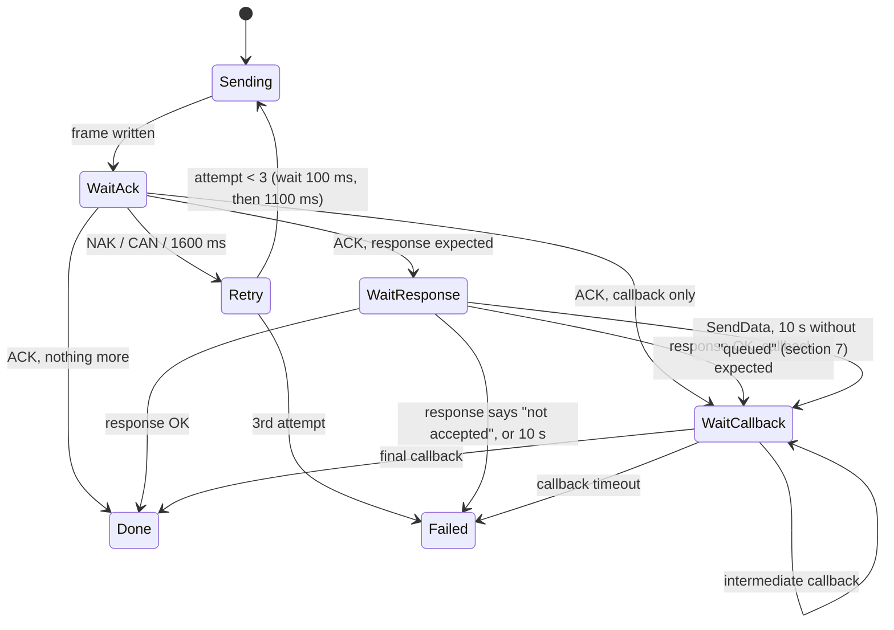

# 36 · Z-Wave: the Serial API between the panel and the ZAC93

Part of [docs/features/36](README.md). Everything the panel says to the Zooz ZAC93 over its UART, and
everything it can hear back, byte for byte. Written from the Z-Wave JS driver as it stood at
commit `fac3872` (2026-09-24) and from Silicon Labs' published Host API behaviour it follows;
nothing here needs that source again.

Conventions: numbers are hex; multi-byte fields are big-endian; "node ID" is one byte while the
module uses 8-bit node IDs and two bytes after `SetNodeIDType(16 bit)` (Long Range, see
[network.md](network.md) "Long Range"). **Every field marked `nid` below is 1 or 2 bytes
accordingly** - the codec takes the current node-ID width as an argument.

The ZAC93 runs Silicon Labs' 800-series **static controller** Serial API (Zooz calls it a
"Z-Wave Plus Static Controller"). The panel supports that firmware family only: no 500/700
series quirks, no bridge-only features, no secondary-controller functions (README, "Scope").

## 1. The wire

| | |
|---|---|
| UART | 115200 baud, 8 data bits, no parity, 1 stop bit, no flow control, 3.3 V logic |
| Direction | full duplex: either side may send a frame at any time |
| Frame kinds | a data frame (SOF ...), or one of three single bytes: ACK, NAK, CAN |

| Byte | Name | Meaning |
|---|---|---|
| `01` | SOF | start of a data frame |
| `06` | ACK | the last data frame arrived intact |
| `15` | NAK | the last data frame was damaged (bad checksum or format); send it again |
| `18` | CAN | the receiver was itself sending when your frame arrived (collision); send it again |

### Data frame

```
SOF | LEN | TYPE | FUNC | PAYLOAD (0..LEN-3 bytes) | CHK
01    n     00/01  id     ...                          xx
```

- `LEN` counts every byte after itself, the checksum included: `LEN = payload length + 3`.
- `TYPE`: `00` request (a command, an unsolicited message or a callback), `01` response
  (the direct answer to a request the other side just sent).
- `FUNC`: the Serial API function (section 6).
- `CHK = FF XOR LEN XOR TYPE XOR FUNC XOR every payload byte` (SOF is not included).

Example: `GetControllerVersion` request is `01 03 00 15 E9`
(`FF ^ 03 ^ 00 ^ 15 = E9`).

### Receiving (the panel's parser)

1. Waiting for a new frame, ignore every byte except `01`, `06`, `15`, `18` (count the
   discarded bytes; do not answer them).
2. `06`/`15`/`18`: hand to whoever waits for an acknowledgement; otherwise ignore.
3. `01`: a frame needs at least 5 bytes and exactly `LEN + 2` bytes in all. Collect them.
   **Byte timeout:** if the next byte of a partial frame does not arrive within **150 ms**,
   drop the partial frame (count it) and go back to 1. `LEN` below 3 is a format error.
4. Complete frame: check `CHK`. Wrong: send **NAK** at once and drop it. Right: send **ACK at
   once** - before parsing the payload, before any lock - then dispatch it. A frame that parses
   badly at a higher layer was still delivered: it is ACKed, then dropped and counted.
5. Frames are at most 257 bytes (`LEN` is one byte). Keep one 260-byte receive buffer.

The ACK must leave within the module's ACK timeout (we set 1600 ms, section 5, step 15; the
spec's floor). The UART task writes it itself; it never waits for the protocol task.

### Sending (one command at a time)

The host has at most **one outstanding Serial API command**. A command is finished when it has
had its ACK, its response (if it has one) and its final callback (if it has one).



| Rule | Value |
|---|---|
| ACK timeout | 1600 ms after the last byte is written |
| Retransmission after NAK or ACK timeout | up to 3 transmissions, waiting 100 ms before the 2nd and 1100 ms before the 3rd |
| Retransmission after CAN | wait 100 ms, then again; the CAN also means a frame from the module is on its way (handle it first) |
| Response timeout | 10 s (the 800 series answers within milliseconds; the long timeout only covers a module that is busy writing its flash) |
| SendData callback | abort with `SendDataAbort` after 20 s, give up after 30 s (section 6.12) |
| Other callbacks | per command below |
| Callback ID | 1..255, a wrapping counter that skips 0; 0 in a request means "send no callback" |

While the host waits for an ACK, a response or a callback, the module may send its own frames
(a sensor report, a node update). The parser ACKs and dispatches them as usual; a frame is only
"the response" when its `TYPE` is `01` and its `FUNC` is the one sent, and only "the callback"
when it is a `00` request with that `FUNC` and the command's callback ID as its first payload
byte (the inclusion and exclusion status reports are recognised the same way, section 6.16).

If the command's response (or, for a command without one, its callback) arrives while the host
still waits for the ACK, the ACK was lost on the way: the module took the frame, so the host
takes that frame as the ACK followed by the answer and never sends the command again (a second
SendData would transmit to the node twice). Its SendData 20 s / 30 s clocks start at the
"queued" response; a callback-bearing command that has a status-report sequence (`4A`, `4B`)
is finished by its first report (Ready), and the reports after it are the module's own frames
for the inclusion and exclusion logic (network.md).

Every parser of what the module sends accepts trailing bytes and ignores them (later firmware
may add fields); minimum lengths and the lengths written inside a frame are checked.

Three failed transmissions of any command mean the module is not answering: section 7.

## 2. Frames the module sends on its own

| FUNC | Name | When |
|---|---|---|
| `04` | ApplicationCommandHandler | a node sent the panel a command (sensor report, wake-up, nonce...) |
| `A8` | BridgeApplicationCommandHandler | the same, when the module runs bridge firmware (accept both) |
| `49` | ApplicationUpdate | a node information frame arrived, a SmartStart node asks to join, a node was added or removed by someone else |
| `0A` | SerialAPIStarted | the module (re)started: power-up, soft reset, watchdog, brown-out |
| `4A`/`4B` | AddNode/RemoveNode status | while inclusion or exclusion runs (section 6.16/6.17) |

A `SerialAPIStarted` the host did not ask for means the module restarted by itself: every
command in flight has failed, the node-ID width is back to 8 bits, inclusion/exclusion stopped.
The host repeats the start-up sequence from step 12 (section 5) and counts the restart.

## 3. Values used throughout

### Node lists (bit masks)

- Classic node list: 29 bytes; bit `n` of byte `b` (bit 0 = least significant) is node
  `8*b + n + 1`, nodes 1..232.
- Long Range node list: segments of 16 bytes (128 nodes); segment `s` starts at node
  `256 + 128*s`; bit `n` of byte `b` is node `256 + 128*s + 8*b + n`.
- Function mask (capabilities): 32 bytes; bit `n` of byte `b` is function `8*b + n + 1`.

### Command-class lists

A list of CC identifiers; an identifier `>= F1` takes two bytes (`F1 xx`), all others one.
`EF` ("support/control mark") separates supported CCs (before) from controlled ones (after).

### Transmit options (SendData)

| Bit | Name | Panel use |
|---|---|---|
| `01` | ACK | always: ask the destination to acknowledge |
| `02` | LowPower | never |
| `04` | AutoRoute | always |
| `10` | NoRoute | never |
| `20` | Explore | always, except nonce reports (see [security.md](security.md) §6) |

Default `25` (ACK | AutoRoute | Explore); nonce reports go out with `05`.

### Transmit status (SendData and route callbacks)

| Value | Name | Meaning for the panel |
|---|---|---|
| `00` | OK | the node acknowledged |
| `01` | NoAck | the node did not acknowledge: asleep (sleeping node) or unreachable |
| `02` | Fail | the module could not transmit; with `txTicks = 0` it never got the air: **jammed or busy channel** ([network.md](network.md) "Jamming") |
| `03` | NotIdle | the network was busy |
| `04` | NoRoute | no route to the node |

### RSSI bytes

Signed dBm (`int8`). Reserved values: `7F` not available, `7E` receiver saturated,
`7D` no signal detected.

## 4. What must be supported by the module

The panel refuses to start the Z-Wave source (the link stays down, section 7) unless:
- `GetSerialApiInitData` reports a **controller** (capabilities bit 0, see 6.3) and chip type
  `08` (800 series);
- the function mask contains every function marked **required** in section 6;
- the library type is 1 (static controller) or 7 (bridge controller);
- the protocol version is 7.22.1 or later - otherwise it starts but raises a note on the Z-Wave
  page: "Update the Z-Wave radio's software" (800-series SDKs before 7.22.1 have known mesh
  and stability bugs; Zooz firmware 1.50 and later are 7.22.1+).

## 5. Start-up sequence

Run once at boot, again after an unexpected `SerialAPIStarted`, after a region change and
after a reset of the Z-Wave network. Steps that fail are retried twice; a step that still fails
is the "module not answering" path (section 7) unless the table says otherwise.

| # | Send | Keep | Notes |
|---|---|---|---|
| 0 | (hardware) | | If the reset line is wired ([hardware.md](hardware.md)): hold it low 20 ms, release, wait up to 3 s for `SerialAPIStarted`. |
| 1 | a single `15` (NAK) | | Resets the module's receiver. Then listen 500 ms: text starting `Gecko Bootloader` means the module sits in its bootloader (section 8): choose `run`, wait for `SerialAPIStarted`, start again. |
| 2 | `GetSerialApiCapabilities` (07) | firmware version, manufacturer, product type/ID, function mask | Zooz ZAC93: manufacturer `027A`, product type `0004`, product ID `0611` (firmware 2.20 and later may report SDK defaults instead - do not require these values) |
| 3 | `GetSerialApiInitData` (02) | node list, controller flags, chip type | refuse unless controller + chip `08` (section 4) |
| 4 | `GetControllerVersion` (15) | library string, library type | |
| 5 | `GetProtocolVersion` (09) | protocol version x.y.z | the SDK version is the protocol version |
| 6 | `GetControllerCapabilities` (05) | primary/SIS/SUC flags | |
| 7 | `SerialAPISetup` `GetSupportedCommands` (0B 01) | the setup sub-commands this firmware has | |
| 8 | `SerialAPISetup` `GetMaximumPayloadSize` (0B 10), and `0B 11` for Long Range | largest CC payload in one SendData | used to refuse frames that would be too long (no Transport Service in v1) |
| 9 | `SerialAPISetup` `GetSupportedRegions` (0B 15), `GetRegionInfo` (0B 16) per region, `GetRFRegion` (0B 20) | the region list and current region | |
| 10 | `SerialAPISetup` `SetRFRegion` (0B 40) | | only when the installer's region differs from the module's; then a soft reset (step 12) makes it take effect |
| 11 | `SetApplicationNodeInformation` (03) | | the panel's own node information (section 6.2) |
| 12 | `SoftReset` (08) | | no response; wait up to 5 s for `SerialAPIStarted` (it usually comes within 1.5 s); its byte 6+n says whether Long Range is available in this region |
| 13 | `GetLongRangeNodes` (DA), segment 0, 1, ... while "more" | Long Range node list | only when Long Range is available |
| 14 | `SerialAPISetup` `SetNodeIDType` (0B 80) | | 16-bit node IDs when Long Range is available, else 8-bit (a soft reset always returns to 8-bit) |
| 15 | `GetControllerId` (20) | home ID, own node ID | own node ID is 1 on a network the panel started |
| 16 | `SerialAPISetup` `SetTxStatusReport` (0B 02 FF) | | adds the TX report to SendData callbacks (RSSI, route, "jammed") |
| 17 | `GetSUCNodeId` (56) | SUC node ID | if 0 and the panel is the primary with no SIS: `SetSUCNodeId` (54) naming itself SUC and SIS |
| 18 | `SetSerialApiTimeouts` (06) | old values | ACK 1600 ms, byte 150 ms (section 6.6) |
| 19 | (host) | | Compare the home ID with the stored network (network.md "Persistence"); reconcile the node list; start queued interviews; open SmartStart listening if the provisioning list has entries. The source link is **up** now. |

## 6. Command reference

"Required" = the panel refuses a module whose function mask lacks it (section 4); the module's
own frames ("in") are never looked up in the mask. "Phase" = when the panel first uses it
([README.md](README.md) "Phases"). A one-byte yes/no response (queued, started, sent, more)
means no when it is `00` and yes for any other value.

| FUNC | Name | Req. | Phase | Response | Callback |
|---|---|---|---|---|---|
| `02` | GetSerialApiInitData | yes | 1 | yes | - |
| `03` | SetApplicationNodeInformation | yes | 1 | - | - |
| `04` | ApplicationCommandHandler (in) | - | 1 | - | - |
| `05` | GetControllerCapabilities | yes | 1 | yes | - |
| `06` | SetSerialApiTimeouts | no | 1 | yes | - |
| `07` | GetSerialApiCapabilities | yes | 1 | yes | - |
| `08` | SoftReset | yes | 1 | - | (SerialAPIStarted) |
| `09` | GetProtocolVersion | yes | 1 | yes | - |
| `0A` | SerialAPIStarted (in) | - | 1 | - | - |
| `0B` | SerialAPISetup | yes | 1 | yes | - |
| `10` | SetRFReceiveMode | no | 3 | yes | - |
| `13` | SendData | yes | 1 | yes | yes |
| `15` | GetControllerVersion | yes | 1 | yes | - |
| `16` | SendDataAbort | yes | 1 | - | (the SendData callback) |
| `20` | GetControllerId | yes | 1 | yes | - |
| `27` | EnterBootloader | no | 3 | - | - |
| `2E`/`3D` | NVMOperations / ExtendedNVMOperations | no | 3 | yes | - |
| `3B` | GetBackgroundRSSI | no | 2 | yes | - |
| `41` | GetNodeProtocolInfo | yes | 1 | yes | - |
| `42` | HardReset | yes | 1 | - | yes |
| `46` | AssignReturnRoute | no | 2 | yes | yes |
| `47` | DeleteReturnRoute | no | 2 | yes | yes |
| `48` | RequestNodeNeighborUpdate | no | 2 | - | yes |
| `49` | ApplicationUpdate (in) | - | 1 | - | - |
| `4A` | AddNodeToNetwork | yes | 1 | - | status reports |
| `4B` | RemoveNodeFromNetwork | yes | 1 | - | status reports |
| `51` | AssignSUCReturnRoute | yes | 1 | yes | yes |
| `54` | SetSUCNodeId | yes | 1 | yes | yes |
| `55` | DeleteSUCReturnRoute | no | 2 | yes | yes |
| `56` | GetSUCNodeId | yes | 1 | yes | - |
| `60` | RequestNodeInfo | yes | 1 | yes | (ApplicationUpdate) |
| `61` | RemoveFailedNode | no | 2 | yes | yes |
| `62` | IsFailedNode | no | 2 | yes | - |
| `63` | ReplaceFailedNode | no | 2 | yes | yes |
| `80` | GetRoutingInfo | no | 2 | yes | - |
| `A8` | BridgeApplicationCommandHandler (in) | - | 1 | - | - |
| `D9` | Shutdown | no | 3 | yes | - |
| `DA` | GetLongRangeNodes | no | 3 | yes | - |
| `DB`/`DC` | Get/SetLongRangeChannel | no | 3 | yes | - |

### 6.1 `07` GetSerialApiCapabilities

Request: no payload. Response:

| Offset | Size | Field |
|---|---|---|
| 0 | 1 | application (firmware) version major |
| 1 | 1 | application version minor |
| 2 | 2 | manufacturer ID |
| 4 | 2 | product type |
| 6 | 2 | product ID |
| 8 | 32 | supported function mask (section 3) |

### 6.2 `03` SetApplicationNodeInformation

Request (no response, no callback):

| Offset | Size | Field | Panel's value |
|---|---|---|---|
| 0 | 1 | device options: bit 0 = always listening | `01` |
| 1 | 1 | generic device class | `01` (generic controller) |
| 2 | 1 | specific device class | `00` |
| 3 | 1 | CC list length (at most 35) | |
| 4 | n | CC list (section 3), supported only | see below |

The panel's node information lists only what it always supports, whatever the security of the
asker: **Z-Wave Plus Info `5E`, Security 2 `9F`, Supervision `6C`, CRC-16 Encapsulation `56`,
Multi Command `8F`**, plus **Security `98`** only when the optional S0 support is compiled in.
It advertises no controlled CCs. Transport Service `55` is not listed until it is implemented
(README, open questions). What the panel supports securely is answered separately
([security.md](security.md) §9).

### 6.3 `02` GetSerialApiInitData

Request: no payload. Response:

| Offset | Size | Field |
|---|---|---|
| 0 | 1 | Serial API version (>= 10 means the official Host API, version = value - 9) |
| 1 | 1 | capabilities: bit 0 set = **end node** (clear = controller), bit 1 = timers, bit 2 set = **secondary** (clear = primary), bit 3 = is SIS |
| 2 | 1 | node list length, 29 |
| 3 | 29 | classic node list |
| 32 | 1 | chip type (`08` = 800 series: EFR32ZG23 / ZGM230S) |
| 33 | 1 | chip version (`00`) |

Note the polarity: the published Host API text inverted bits 0 and 2 at one point; firmware
uses the encoding above.

### 6.4 `15` GetControllerVersion

Response: a NUL-terminated ASCII string (`"Z-Wave 7.22\0"`), then one byte library type:
`01` static controller, `02` controller, `07` bridge controller (others are end nodes).

### 6.5 `09` GetProtocolVersion

Response: `protocol type (00 = Z-Wave) | major | minor | patch | app framework build (2) |
git hash (16, all zero = absent)`. The SDK version is `major.minor.patch`.

### 6.6 `05` GetControllerCapabilities, `06` SetSerialApiTimeouts

`05` response: one byte of flags: `01` secondary, `02` on another network, `04` SIS present,
`08` was the real primary, `10` is SUC, `20` no nodes included yet.
The panel expects, after its own network start: not secondary, not on another network.

`06` request: `ACK timeout / 10 ms | byte timeout / 10 ms` (the panel sends `A0 0F`:
1600 ms, 150 ms). Response: the two old values in the same units.

### 6.7 `0B` SerialAPISetup

Request: `sub-command | data...`; response: `sub-command | result...`. A response whose
sub-command is `00` means "unsupported" and carries the refused sub-command.

| Sub | Name | Request data | Response data |
|---|---|---|---|
| `01` | GetSupportedCommands | - | byte 0: legacy mask (`01` 01, `02` 02, `04` 04, `08` 08, `10` 10, `20` 20, `40` 40, `80` 80 - the bit value *is* the sub-command); then, if present, a bit mask: bit `n` of byte `b` = sub-command `8b+n+1` (SDK < 7.19.1 shifted it by one, irrelevant for 7.22+) |
| `02` | SetTxStatusReport | `FF` on / `00` off | `00` failed, else OK |
| `03` | SetLongRangeMaximumTxPower | int16 dBm x10 | OK byte |
| `04` | SetPowerlevel | int8 dBm x10, int8 0-dBm calibration x10 | OK byte |
| `05` | GetLongRangeMaximumTxPower | - | int16 dBm x10 |
| `08` | GetPowerlevel | - | int8 dBm x10, int8 calibration x10 |
| `10` | GetMaximumPayloadSize | - | bytes |
| `11` | GetLongRangeMaximumPayloadSize | - | bytes |
| `12` | SetPowerlevel16Bit | int16 dBm x10, int16 calibration x10 | OK byte |
| `13` | GetPowerlevel16Bit | - | int16 dBm x10, int16 calibration x10 |
| `15` | GetSupportedRegions | - | count, then that many region bytes |
| `16` | GetRegionInfo | region | region, flags (bit 0 classic Z-Wave, bit 1 Long Range), [the classic region it is a superset of] |
| `20` | GetRFRegion | - | region |
| `40` | SetRFRegion | region | OK byte (needs a soft reset to apply) |
| `80` | SetNodeIDType | `01` 8-bit / `02` 16-bit | OK byte |

Regions: `00` Europe, `01` USA, `02` Australia/New Zealand, `03` Hong Kong, `05` India,
`06` Israel, `07` Russia, `08` China, `09` USA Long Range, `0B` Europe Long Range, `20` Japan,
`21` Korea, `FE` unknown, `FF` default (Europe). `04` and `0A` are deprecated.

Power: the panel leaves the module's power settings alone unless the installer changes them
(phase 3, network.md §12: never above the power first read). Zooz sets legal values for the
region at the factory.

### 6.8 `08` SoftReset, `0A` SerialAPIStarted

`08` request: no payload, no response. The module restarts; ACK may come back with a damaged
high nibble on some firmware - accept a lone byte whose low nibble is `6` as the ACK of a
SoftReset, once.

**Decided while building it (hardening):** the damaged ACK is a real bug of the SDK the 700 and
800 series share (Z-Wave JS's corruptACKAfterSoftReset test; their driver arms the workaround
for SDK 7.19 and later, "broken in 7.19, not fixed so far"), so the panel keeps the rule for
the ZAC93 and does not gate it on the SDK version: the ZAC93 always runs 7.x, and a version
check would only add a path to get wrong. What is narrowed is the byte. Only the bug's own
shape counts: one byte arriving on its own (a discarded run of exactly one byte), low nibble
`6`, while that SoftReset waits for its ACK, once. A byte inside longer text is never taken:
the bootloader's menu holds `v`, `6` and `F`, and before this rule the first of them in any
text would have been taken for the ACK. Without the ACK the SoftReset goes again at 1700 ms as
usual; with it, a module slower to restart than the 1600 ms ACK timeout is not sent a second
SoftReset, and its `SerialAPIStarted` ends the command.

`0A` (from the module):

| Offset | Size | Field |
|---|---|---|
| 0 | 1 | wake-up reason: `00` reset/external, `01` timer, `02` wake-up beam, `03` watchdog, `04` external interrupt, `05` power-up, `06` USB suspend, `07` software reset, `08` emergency watchdog, `09` brown-out, `FF` unknown |
| 1 | 1 | watchdog on (`01`) |
| 2 | 1 | device option: bit 0 always listening |
| 3 | 1 | generic device class |
| 4 | 1 | specific device class |
| 5 | 1 | CC list length n |
| 6 | n | CC list |
| 6+n | 1 | supported protocols: bit 0 = Long Range available (optional byte) |

Watchdog, brown-out and unknown reasons are logged as "Z-Wave radio restarted by itself": the
first at once, then at most once an hour with the count since (ZW-041; the count stops at 255).

### 6.9 `20` GetControllerId, `56` GetSUCNodeId, `54` SetSUCNodeId

`20` response: `home ID (4) | own node ID (nid)`.

`56` response: `SUC node ID (nid)`, 0 = none.

`54` request: `node ID (nid) | enable SUC (01) | transmit options (25) | capabilities
(01 = SIS) | callback ID`. Response: `00` not started / else started. Callback:
`callback ID | status (05 succeeded, 06 failed)`. For its own node ID the module answers
synchronously with the response only, without radio traffic or a callback. The panel sends
callback ID 0 and completes this step on a successful response. Verified on the ZAC93 with
SDK 7.18.3: waiting for a callback caused three 10-second waits and a needless recovery reset.

### 6.10 `41` GetNodeProtocolInfo

Request: `node ID (nid)`. Response (6 bytes, no node ID echoed):

| Offset | Bits | Field |
|---|---|---|
| 0 | 7 | always listening |
| 0 | 6 | routing |
| 0 | 4..3 | classic speed: bit 4 = 40 kbit/s, bit 3 = 9.6 kbit/s (Long Range: reserved) |
| 0 | 2..0 | protocol version |
| 1 | 7 | optional functionality |
| 1 | 6..5 | FLiRS: `10` = 1000 ms beam, `01` = 250 ms beam, `00` = none |
| 1 | 4 | supports beaming |
| 1 | 3, 1 | node type: bit 1 set = controller, else end node |
| 1 | 2 | has a specific device class |
| 1 | 0 | supports S0 security (legacy flag) |
| 2 | 2..0 | speed extension: classic bit 0 = 100 kbit/s; Long Range bit 1 = 100 kbit/s |
| 3 | | basic device class: `01` controller, `02` static controller, `03` end node, `04` routing end node |
| 4 | | generic device class |
| 5 | | specific device class (present when byte 1 bit 2) |

A sleeping sensor is **not listening and not FLiRS**. Such a node gets messages only when it
wakes up ([network.md](network.md) "Sleeping devices").

Generic device classes the panel meets on sensors: `07` notification sensor, `20` binary
sensor, `21` multilevel sensor, `A1` alarm sensor (legacy), `18` wall controller (buttons),
`40` entry control (keypads, locks), `10` binary switch (sirens, plugs), `0F` repeater.

### 6.11 `04` ApplicationCommandHandler, `A8` BridgeApplicationCommandHandler

`04` (from the module):

| Offset | Size | Field |
|---|---|---|
| 0 | 1 | receive status (below) |
| 1 | nid | source node ID |
| 1+w | 1 | CC length n |
| 2+w | n | the command (CC ID, command ID, parameters) |
| ... | 1 | RSSI of this frame (optional trailing byte) |

`A8`: `receive status | destination node (nid) | source node (nid) | CC length n | command (n)
| multicast mask length m | mask (m) | RSSI (optional)`.

Receive status: bit 0 routed busy, bit 1 low power, bits 3..2 frame type (`00` singlecast,
`01` broadcast, `10` multicast), bit 4 explore frame (broadcast only), bit 6 foreign frame,
bit 7 from a foreign home ID. **The panel acts only on frames from nodes it knows.** A broadcast
or multicast frame from a known node passes the same security check as a singlecast one (ZW-042,
as Z-Wave JS Driver.ts isSecurityLevelTooLow). A Get-type command received that way is discarded
(shouldDiscardCC) and counted (`not_singlecast`); a Multi Command is not looked inside, so the
commands in one are delivered, Gets included (shouldDiscardCC does not open a multi-encapsulating
CC). From a device without keys, a broadcast report is handled like a singlecast one (the zones
hear it, and it counts as heard), and a broadcast Wake Up Notification is a wake-up: its held
commands go and a stopped interview resumes. A report is no wake-up (network.md §7). From an S2
device, a plaintext one is dropped as a wrong level. An S2-encrypted frame (Message Encapsulation)
or an S2 Nonce Get or Nonce Report received broadcast or multicast is dropped and counted
(`not_singlecast`; S2 multicast is not received, v1); the other Security 2 commands are judged like
any other command. Any broadcast or multicast frame from an unknown node is dropped too.
Frames with bit 6 or 7 set are dropped.

### 6.12 `13` SendData, `16` SendDataAbort

Request: `node ID (nid) | length n | command (n) | transmit options | callback ID`.
Response: `01` queued, `00` not queued (the module is busy: wait 500 ms and try again, at
most 3 times). Callback: `callback ID | transmit status | TX report`.

TX report (present when `SetTxStatusReport` is on; 17 bytes or more - fewer means no report,
and the callback still counts; the optional fields below are read when the report is long
enough for them, and anything after them is ignored):

| Offset | Size | Field |
|---|---|---|
| 0 | 2 | transmit ticks (10 ms each); 0 with status `Fail` = never transmitted (jam) |
| 2 | 1 | number of repeaters |
| 3 | 1 | ACK RSSI (only if the node acknowledged) |
| 4 | 4 | ACK RSSI per repeater |
| 8 | 1 | ACK channel |
| 9 | 1 | TX channel (`>= 3` = Long Range) |
| 10 | 1 | route scheme state |
| 11 | 4 | repeater node IDs |
| 15 | 1 | bit 6 1000 ms beam, bit 5 250 ms beam, bits 2..0 route speed |
| 16 | 1 | routing attempts |
| 17 | 1 | last working node of a failed route (optional) |
| 18 | 1 | first failing node (optional) |
| 19 | 1 | Long Range: TX power (int8 dBm) |
| 20 | 1 | Long Range: measured noise floor |
| 21..23 | 3 | Long Range: the destination's ACK TX power, RSSI, noise floor |

Timeouts: if no callback within **20 s**, send `SendDataAbort` (`16`, no payload, no
response); the module then answers the pending SendData callback, normally with `NoAck`. With
no callback **30 s** after the SendData, the module is not answering (section 7).

When the ACK came but the `01` "queued" response did not within its 10 s, the module still took
the frame: the panel goes on waiting for the callback with the same ID on the same clocks,
counted from the ACK (`SendDataAbort` at 20 s, give up at 30 s), and never sends the frame
again. A callback with transmit status `OK` ends the command OK; any other status keeps the
response-timeout failure but is not a dead module (so a `NoAck` from a sleeping node is not
put back in its wake-up queue then); no callback at all is (section 7). As in Z-Wave JS's
SerialAPICommandMachine: after a SendData response timeout it keeps waiting for the callback,
a callback that is not OK keeps the response-timeout error, and a callback that comes before
the response (while it still waits for one) is ignored. The difference is the clocks: Z-Wave JS
waits 65 s for the callback after its 10 s response timeout, and its driver aborts when that
runs out; the panel keeps SendData's own 20 s abort and 30 s limit, so a module that took the
frame and hung is noticed at 30 s, as when only the callback is missing. Built: `zw_transport`
(code review ZW12).

Retries for commands to nodes (not frames to the module): a SendData to a **listening** node
whose callback says `NoAck` is sent again up to **3 times** in all (with fresh S2 encapsulation
each time, see security.md); to a **sleeping** node, `NoAck` means it is asleep: the command goes
back into its wake-up queue instead ([network.md](network.md) §7). `Fail` with 0 ticks (jammed)
waits 1 s and goes again, **5 transmissions** in all, without counting as a delivery attempt. A
command that expected a report from the node waits for it for **1 s + the round-trip time** after
the callback.

Built (ZW-037): zw_net passes the callback's status to zw_s2 (`zw_s2_sent_tx`: OK, NoAck, Fail
after time on the air, Fail with 0 ticks, NoRoute, or not parsed). NoAck, Fail with ticks above
0 (or no transmit report) and NoRoute send the frame again at once, 3 transmissions in all, each
a new frame: a new sequence number and, encrypted, the SPAN's next nonce. This applies to
listening and FLiRS nodes and to the key exchange's frames (KEX Set, Public Key Report, Network
Key Report, Transfer End: the joining device listens), so one lost frame no longer waits out the
10 s TA timer. A frame whose owner asks again by itself goes once, so it still goes at most 3
times in all: the panel's own checks' pings (supervision, removal, route checks), the
interview's questions (its 3 tries, network.md §5) and a firmware update's fragments and Gets
(their own 3 tries). A Ping asked for on a device's page is a command like any other (3). A
sleeping node's frame goes once, and a Nonce Report always goes once (security.md §6).

A lost Nonce Get is sent again like the command it opens. Z-Wave JS sends a Nonce Get once
(`maxSendAttempts: 1`), but then one lost frame would fail a command to a listening device. If
the device heard the first Nonce Get and only its ACK was lost, it answers both with different
nonces and the send may fail: without the retry it would have failed anyway. An unparsed
callback still fails the send at once.

Built (ZW-037, ZW-004): `Fail` with 0 ticks is a jammed module, not a delivery attempt, whether
jam watching (network.md §9) is on or not; when it is on, each one still counts toward the jam
trouble. The frame waits 1 s and goes again, 5 transmissions in all. It goes again as it was:
the same sequence number and, encrypted, the same nonce, since the node never heard it. An SOS
Nonce Report that arrives during the wait makes it build the frame again on the new nonce, and
so does a frame from the node that decrypts on the SPAN meanwhile (the shared SPAN has moved past
the kept frame's nonce); its jam count stays. A jammed Nonce Get goes again as it was, its round
trip timed from the new transmission. After
the 5th the module is soft-reset once (§7's recovery, `zw_host_recover`), and the frame goes once
more behind the gate, when steps 13-19 are done. If that is jammed too, the send fails and so
does every jammed frame after it, at once, without another reset, until the episode ends: a
frame delivered, the air clear again (§9) or the link down. This follows Z-Wave JS
(`retryJammed` 1000 ms, `sendDataJammed` 5, `handleJammedController`: one soft reset, then
`JammedAfterReset` with a single attempt). The wait lives in the security manager's send slot,
which already holds each frame's state and has its own deadline. Several frames can wait at once,
one per node, so zw_net would have needed its own copies and timers. The episode lives in
zw_net, beside the host and the jam watch. Counted in `zw_net_stats_t.jam_resets` and the
host's `recoveries`. A Nonce Report jammed is not sent again (one attempt, security.md §6).
The reset restarts the module, which forgets SmartStart listen mode and applies a power level set
since: zw_net marks both lost, as `zw_net_restart_link` does, so the mode is set again once the
link is up and the power is unknown until read again. Every link up also marks SmartStart lost,
which covers §7's other recoveries: their soft reset reports no restart either.

### 6.13 `60` RequestNodeInfo, `49` ApplicationUpdate

`60` request: `node ID (nid)`. Response: `01` sent / `00` not. The answer is an
`ApplicationUpdate` with type `84` (received) or `81` (failed: the node did not answer).

`49` (from the module): `update type | data`.

| Type | Name | Data |
|---|---|---|
| `84` | node info received | `node ID (nid) | length L | basic class | generic | specific | CC list (L-3)` |
| `82` | node info request done | - |
| `81` | node info request failed | - |
| `80` | routing pending | - |
| `40` | node added by another controller | as `84` (the panel ignores it: single controller) |
| `20` | node removed by another controller | `node ID (nid)` (ignored, logged) |
| `10` | SUC ID changed | `node ID (nid)` |
| `85` | SmartStart: a node asks to join (classic) | `node ID (nid, 0) | receive status | NWI home ID (4) | CC length | basic | generic | specific | CC list` |
| `87` | SmartStart: a Long Range node asks to join | as `85` |
| `86` | SmartStart: an included node powered up | as `85` |

A node information frame from a known node also means "it is awake now" (a sleeping node
sends one when its button is pressed): send it whatever is queued for it.

**Decided while building it (hardening):** `40` and `20` change nothing for the panel: no node
is added or forgotten, the node cache is not written, the link is untouched, and the named
node's next report is taken as before. The frame goes to the owner to log and is counted
(`other_controller` in the network's statistics). Z-Wave JS removes the node on a `20` (its
proxyExclusionRemovesNode test) because it lives among other controllers. The panel is its
network's only controller, so a `20` naming one of its sensors is a fault or noise, never a
reason to stop hearing that sensor. A device that is really gone shows up through supervision
(network.md §8) and is removed from the panel (network.md §10).

### 6.14 `42` HardReset

Request: `callback ID`. No response; callback `callback ID` when done. **Erases the module's
network:** new home ID, no nodes, own node ID 1. The module restarts (`SerialAPIStarted`);
run the start-up sequence again. Used only by "Reset the Z-Wave network" (network.md).

### 6.15 `51` AssignSUCReturnRoute, `55` DeleteSUCReturnRoute, `46` AssignReturnRoute, `47` DeleteReturnRoute

`51`/`55` request: `node ID (nid) | callback ID`. Response: `01` started. Callback:
`callback ID | transmit status`. Tells a node how to reach the SUC (the panel). Sent after
every inclusion (classic nodes only; Long Range does not route).

`46` request: `node ID | destination node ID | callback ID`; `47`: `node ID | callback ID`.
Responses and callbacks as `51`. The panel assigns routes only to itself (its sensors report
to nobody else), so it uses `51`/`55` and needs `46`/`47` only to clear stale routes.

### 6.16 `4A` AddNodeToNetwork

Request: `mode | callback ID` (`mode` = type | flags).

| Type | Value | Use |
|---|---|---|
| Any | `01` | classic inclusion |
| Stop | `05` | end inclusion |
| SmartStart DSK | `08` | include a SmartStart node: request is `mode | callback | NWI home ID (4) | auth home ID (4)` |
| SmartStart listen | `09` | listen for SmartStart requests (callback ID must be 0; no callback) |

Flags: `80` high power, `40` network-wide, `20` Long Range (with type `08`). The panel always
sends high power + network-wide: start `C1`, stop `C5`, SmartStart listen `49`.

Status reports (requests from the module), every status alike:
`callback ID | status | source node ID (nid) | L | L bytes of node information` - the node
information is `basic | generic | specific | CC list` (so L >= 3 when present); both the node ID
and L are 0 when a status has nothing to report (a real "Ready" is `cb 01 00 00`). The panel
also accepts a report that ends right after the status byte. The "Context" column says what the
panel reads from it.

| Status | Name | Context |
|---|---|---|
| `01` | Ready | - (the module listens) |
| `02` | NodeFound | - |
| `03` | AddingEndNode | node update payload: `node ID (nid) | L | basic | generic | specific | CC list` |
| `04` | AddingController | as `03` (the panel refuses controllers: it stops at once and reports the node ID; network.md §4.1) |
| `05` | ProtocolDone | - |
| `06` | Done | `node ID (nid)` |
| `07` | Failed | - |

The sequence and its timeouts are in [network.md](network.md) "Adding a device".

### 6.17 `4B` RemoveNodeFromNetwork

Request: `mode | callback ID`; types `01` any, `05` stop; flags as `4A` (start `C1`, stop
`C5`). Status reports have `4A`'s layout (source node ID, L, node information); the panel reads
the node ID and ignores the node information: `01` Ready, `02` NodeFound, `03` RemovingEndNode (`node ID`), `04`
RemovingController (`node ID`), `05` reserved (some firmware reports it when stopping a failed
exclusion - treat as "stopped"), `06` Done, `07` Failed. Node ID 0 in `03` means the device
belonged to another network (it has been reset anyway).

### 6.18 `61` RemoveFailedNode, `62` IsFailedNode, `63` ReplaceFailedNode

`62` request `node ID`; response `01` = the module lists it as failed (a SendData to it
recently got NoAck).

`61` request `node ID | callback ID`. Response: `00` started, else a bit set: `02` not the
primary, `04` no callback, `08` not in the failed list, `10` busy, `20` failed. Callback:
`callback ID | status` - `00` the node answered (not removed), `01` removed, `02` not removed.

`63` request `node ID | callback ID`; response as `61`. Callback statuses: `00` the node
answered, `03` ready - include the replacement now (it takes the same node ID), `04` done,
`05` failed.

### 6.19 `48` RequestNodeNeighborUpdate, `80` GetRoutingInfo

`48` request `node ID | callback ID`; callbacks `callback ID | status`: `21` started, `22`
done, `23` failed. Timeout: 76 s + 217 ms per listening node + 3.5 s per FLiRS node.

`80` request `node ID | options (80 remove bad links, 40 remove non-repeaters) | 00`;
response: the node's neighbours as a 29-byte classic node list (diagnostics only).

### 6.20 `3B` GetBackgroundRSSI

Request: no payload. Response: one RSSI byte per channel (2 classic channels, a 3rd on
3-channel regions, a 4th = Long Range). Used for jamming detection (network.md "Jamming").

### 6.21 `DA` GetLongRangeNodes

Request: `segment`. Response: `more segments follow (00/01) | segment | length (16) | 16-byte
Long Range node list for that segment`.

### 6.22 `2E` NVMOperations and `3D` ExtendedNVMOperations (phase 3: backup)

`2E`: `op | data`; ops `00` open, `01` read (`length | offset u16`), `02` write (`length |
offset u16 | data`), `03` close. Response: `status | length | offset-or-size u16 | data`;
status `00` OK, `01` error, `02` wrong operation, `03` read/write interference, `FF` end of
file. Open answers the NVM size in the offset field. `3D` is the same with 32-bit offsets and
a sub-command bit mask in the open answer. Procedure: `SetRFReceiveMode(00)` (radio off),
open, read in chunks of up to 255 bytes (fall back to 48 if a read returns nothing), close,
soft reset (7.x firmware leaves the NVM half open otherwise), radio on.

### 6.23 `27` EnterBootloader (phase 3: module firmware update)

Request: no payload. The module answers nothing on the Serial API; its Gecko bootloader prints
a text menu instead (section 8).

## 7. When the module stops answering

| Symptom | Action |
|---|---|
| No ACK after 3 transmissions | soft reset (`08`), wait for `SerialAPIStarted`; still silent: pulse the reset line if wired; still silent: link **down** |
| A command ACKed but its response missing after 10 s | as above (the 800 series answers within milliseconds); except SendData, whose callback is still awaited (section 6.12): only when that is missing too, 30 s after the ACK, as above |
| SendData callback missing after 30 s | as above |
| `SendData` response "not queued" 3 times | as above |
| `SendData` callback `Fail` with 0 ticks for 5 transmissions of a frame, 1 s apart (§6.12) | soft reset (`08`) once per jam episode, steps 13-19 again, the frame once more; the reset line and link down only if the module then stops answering |
| Unexpected `SerialAPIStarted` | redo start-up from step 12 |
| The bootloader's menu arrives unasked while the link is up | at once: the command in flight ends, `run` goes, start-up again from step 1 (below) |

While the link is down the Z-Wave source tells the hub (`zsrc_sink_t.link(ZSRC_ZWAVE,
false)`): after the source's grace that is **one** `sensor_radio` trouble, never a CHECK per
zone (docs/features/22 ZSRC-015). The service retries the whole start-up every 30 s, then every
5 minutes after 10 failures, and says why on the Z-Wave page and in `zwave status`.

Limits the host keeps within one start-up attempt (`zw_host`, Z2): a step fails after 3 tries,
then after the soft reset 3 more; at most one recovery (soft reset, then reset line); at most 2
escapes from the bootloader (a `run` with no `SerialAPIStarted` within 5 s is "stuck in the
bootloader"); at most 3 restarts of the module, the 4th takes the link down. A restart during
steps 13-19 resumes at step 13, before step 12 the same command is sent again. Own-node
SetSUCNodeId needs only its response. A refused SetRFRegion, SetNodeIDType or SetTxStatusReport does not
stop the start-up: the facts reported with the link state say what is in effect. While the
start-up or a recovery runs, only its own commands go out (the transport's gate); requests
waiting to nodes are held, and are failed when the link goes down.

**Decided while building it (hardening):** a module that crashes into its bootloader while the
link is up (Z-Wave JS's driverReadyStaleness test) is recognised the moment its menu is whole,
meaning the text `Gecko Bootloader` and an `N. run` line, however many reads it came in. It is
not left to be found seconds later through commands going unanswered. At once:
- the command in flight ends (`MODULE_RESTARTED`), with no retransmission and no
  SendDataAbort, because every byte the bootloader gets is a menu key;
- the gate closes to the host's own commands;
- the owner hears `restarted` with reason `FF` (`ZW_HOST_RESTART_BOOTLOADER`);
- the digit of `run` is written.

Its `SerialAPIStarted` brings the start-up again from step 1, within the limits above: an
application that falls straight back into the bootloader is escaped twice, then the link goes
down with the reason "bootloader". The host keeps the newest 256 bytes of text, dropping the
oldest, and clears them at link up and after each `run`, so stray text heard earlier cannot
hide the menu. A menu with no `run` line is left to the not-answering path (the table above).
So is a menu that arrives during start-up after step 1's listening window; step 1 of the next
start-up then finds it. A banner split across reads at step 1 (Z-Wave JS's bootloaderDetection
test) was already recognised, since the listening window gathers every read.

## 8. The bootloader (phase 3)

The ZAC93 is updated "over the wire" (OTW) through Silicon Labs' Gecko bootloader. Only files
Zooz publishes for the ZAC93 may be written (Zooz: other firmware voids the warranty).

1. Send `EnterBootloader` (27). The module prints a menu, `Gecko Bootloader vX.Y.Z` then
   lines `N. option` and a prompt `BL >`. Find the options `upload gbl` and `run` by their text.
2. Send the digit of `upload gbl`. Wait (5 s) for the text `begin upload`, then (1 s) for the
   byte `43` ('C': XMODEM-CRC ready).
3. Send the `.gbl` file with XMODEM-CRC: 128-byte blocks padded with `FF`; each block is
   `01 | n (1-based, mod 256) | FF-n | 128 data bytes | CRC-16-CCITT (init 0000) of the data,
   big-endian`. Wait up to 1 s per block for `06` (next), `15` (resend, at most 3 times) or
   `18` (aborted: the bootloader then prints the reason).
4. Send `04` (EOT). The bootloader prints `Serial upload complete` and shows the menu again.
5. Send the digit of `run`. Wait for `SerialAPIStarted`; run the start-up sequence.

An XMODEM error whose code has high nibble `2` may be retried from step 1 (3 attempts). As built
(Z11, `zw_host_otw_begin`): the waits are 5 s for the menu and for "begin upload" + 'C', 1 s per
block, 1 s for a cancel's reason, 10 s for "Serial upload complete" and for SerialAPIStarted after
"run"; the retry of an 0x2X error goes back to "upload gbl" (the bootloader shows its menu after
the abort). The bootloader's ACK/NAK/CAN reach the host as the link's control bytes and its 'C'
and text as text: during the update both go to the update, not the transport. Zooz
notes that updating to 2.10 from 1.50 or 2.00 can fail with error `18` (bootloader
restriction), fixed by going to 2.20 or later. A module left in the bootloader keeps the whole
Z-Wave source down, so the update is refused unless every partition is disarmed and the
installer confirms that Z-Wave zones will be unheard for up to 15 minutes; the arming
interlock stays on until the module answers again (network.md "Updating the radio").
