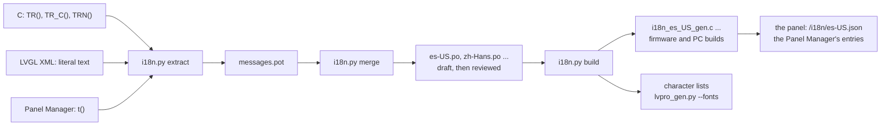

# 37 · Globalization (languages and regional formats)

**Status:** In progress - G1 to G3 are done in software: every word of the screen, the event sentences
and the Panel Manager goes through the catalog; names are 48 bytes of UTF-8 in text fonts with Latin-1
and Latin Extended-A and an accent layer; language, region and clock are preferences, changed live on
Settings > Time and language and in the Panel Manager; the test languages `en-XA` and `ar-XB` walk
every screen and fail when text is cut off. G4 is done as drafts, flagged and left out of release
builds: Spanish (`es-US`) and British English (`en-GB`) reach the screen, ntfy, Pushover, the Panel
Manager and the Home Assistant integration, so a released panel speaks only English. Every language
but English is a signed language pack installed after the firmware (phase LP, ADR-045): checked before
use, loaded into PSRAM, English whenever a pack is missing or bad; the P4 image carries no catalog
(64.0 % of its slot) and a pack may carry fonts for its own letters; Left: native reviews (G4, BL-005,
BL-110), the language kept through a restart, an update and a rollback, and the packs, on a panel
(BL-121), wide and right-to-left scripts and the guides (G5-G7, BL-047), the reference check (BL-070)
· **Milestone:** M22, phases G0-G7 · **Depends on:** 07, 09, 26, 31, 33
(coordinates with 08, 10, 11, 18, 19, 23, 24, 32)

## Goal
One firmware that speaks the household's language, writes dates, times and numbers the way they
do, and shows any name they type - in any script - on the screen, in the Panel Manager and on
their phones. English stays the language the code is written in.

The decisions (2026-09-27, ADR-043):

- **Scope: languages and regional formats.** Words, dates, times, numbers, keyboards and names in
  other scripts. Regional alarm standards (EN 50131, AS/NZS 2201: siren limits, delays, wording
  required by a country) are a separate, later feature.
- **Languages: Spanish first, then Chinese, Japanese and Korean, and the right-to-left scripts
  (Arabic, Hebrew).** The design carries every script from the start; they ship in that order.
- **Translations: machine drafts reviewed by native speakers.** A draft is flagged until someone
  who speaks the language has checked it; only reviewed languages ship.
- **Roadmap: the next main milestone, M22**, ahead of voice (docs/features/08 A0) and new UI work.

Why now: every feature adds English (the Z-Wave pages alone added about 450 lines of it), and
wrapping text costs more the more of it there is; the voice packs (docs/features/08) need the
locale identity this feature defines; and names outside ASCII are a fault for English-speaking
households too - the fonts cannot draw "Salón" or a Wi-Fi network called "Küche 5G".

Two words used below: *internationalization* is making the code able to carry any language and
format (G1-G3, G5-G6 foundations); *localization* is each language we ship (G4 onward).

## Where the panel stands
The words, dates, numbers and names of the 7" touchscreen, the event sentences and the Panel Manager
go through the catalog (G1-G3) and any Latin-script name draws (G2). Still English or Latin only: the
user and installer guides (Starlight site), the Flasher and the service console; the text fonts and
keyboards carry Latin letters, so a wide or right-to-left script waits for G5-G6 and a pack's fonts
(I18N-049).

## Reference behaviour
Keypad alarm panels with a touchscreen have a language setting for the screen - from memory of
their user guides, English and Spanish, with French in Canada - and the older fixed-word
alphanumeric keypads were sold as separate language models. **This is not yet checked against the
manuals** (open question 9, BL-070).

We copy: the language is a setting at the panel, in first-time setup and in Settings, and the
alarm behaves the same in every language. We deviate: one language for the whole panel for now
(per keypad later, with docs/features/11); languages in other scripts; regional formats as their
own choice beside the language; and the Panel Manager in a browser may use a different language
from the screen.

## Scope
| Surface | What changes | Phase |
|---|---|---|
| Touchscreen (7") | Every word through the catalog; the language and region setting; formats; fonts; keyboards | G1-G6 |
| Notifications (ntfy, Pushover) | Written in the panel's language | G1 (English), G4 |
| Panel Manager | The same catalog as JSON; the panel's language by default, a per-browser choice | G3, G4 |
| Home Assistant integration (HACS) | Its own words through Home Assistant's translations (docs/features/23) | G4 |
| User and installer guides | A Spanish edition (Starlight's multilingual support) | G7 |
| Flasher | Its words through the same catalog files | G7 |
| Voice (docs/features/08) | The same locale IDs; a voice pack per language | with 08 |
| 4" E32R40T (docs/features/19) | Latin-script languages only; its touch-calibration words go with its port (BL-079) | when it resumes |

**Out of scope:** regional alarm standards (a later feature); the service console (English, a
developer tool); anything that is an external contract - MQTT topics and JSON keys, the names in
`strings.c`, Home Assistant discovery ids, the event log's records and the configuration codec.

## Requirements
### Words
| ID | Requirement | Verified by |
|---|---|---|
| I18N-001 | Every word the panel shows on its screen, sends in a notification or shows in the Panel Manager comes from the catalog of the selected language. English is the source: the English text in the code is the key, and English needs no table | host tests (lookup), `i18n.py check`, preview |
| I18N-002 | The same English text used in two meanings gets two entries, told apart by a context ("Open" a door, "Open" a page) | host tests |
| I18N-003 | Values go into sentences through numbered placeholders (`{0}`, `{1}`) that a translation may reorder; no sentence is assembled from translated pieces; a translation uses exactly the placeholders of its source | host tests, `i18n.py check` |
| I18N-004 | Counts use the language's plural forms as CLDR defines them (English one/other; French counts 0 and 1 as one; Arabic has six forms; Chinese, Japanese and Korean one) | host tests per language |
| I18N-005 | A language is offered on a released panel only when its catalog is complete and a native speaker has reviewed every entry; the alarm, fire, CO, panic, emergency and trouble words are reviewed first. A draft language appears only in development builds, marked as a preview, and its missing entries show English | `i18n.py check --release`, the review record; host test `test_release_leaves_out_drafts` (the table a release build compiles) |
| I18N-006 | One copy of each sentence per language: the Activity list, a notification and the Panel Manager read the same entry, as ADR-029 did for English | host tests, preview |
| I18N-007 | External contracts are never translated: MQTT topics and JSON keys, the names in `strings.c`, discovery ids, the event log's records, the configuration codec and the service console. The event log stores what happened and is put into words, in the current language, when it is shown | golden payloads unchanged, review |
| I18N-008 | A translation cannot change what the code does: it is never used as a `printf` format (the formatter knows only `{n}`) and never inserted into the Panel Manager as HTML; `i18n.py check` refuses `printf` conversions and markup in translations | host tests, `i18n.py check`, web mock tests |

### Any script in names
| ID | Requirement | Verified by |
|---|---|---|
| I18N-009 | Text is UTF-8 end to end: the names of zones, users, partitions and devices, Wi-Fi network names and anything typed at the panel or in the Panel Manager are stored, shown, logged and reported in any script the panel has characters for | host tests (codec, NVS, MQTT and JSON round trips), preview |
| I18N-010 | Text is never cut inside a character: a field limits what is typed by the bytes it stores (LVGL's text area counts characters), and anything shortened for a buffer or a line ends on a whole character | host tests |
| I18N-011 | The text fonts carry ASCII and every character a shipped language uses; a letter outside that set (the rest of Latin-1 and Latin Extended-A) comes from the letters pack (docs/features/39 F3, asset-packs.md), hung last behind each text font (after a language's own font), so names in European languages draw even when the panel speaks English; a character with no glyph - such a letter on a panel without the pack - draws as a visible box, never as nothing | preview (names in several scripts; the walk without the letters pack) |

### Language, region and formats
| ID | Requirement | Verified by |
|---|---|---|
| I18N-012 | First-time setup asks for the language first, each language listed in its own name ("English", "Español", "中文", "العربية"); the region follows from it and can be changed (docs/features/09 NET-001) | preview |
| I18N-013 | Settings > Time and language sets the language, the region's formats and the clock (Automatic, 12 h, 24 h); a master or the installer may change the language and the region, like the time zone (ADR-016, docs/features/14); the clock is this keypad's, anyone's (BL-131) | preview, access test |
| I18N-014 | A new language applies at once, on every screen, without a restart, and never reaches the alarm engine or its timers; a change that arrives while an alarm, entry time or exit time is on the screen waits until it ends | simulator, HIL |
| I18N-015 | The language, the region and the clock choice are panel preferences in NVS: kept across restarts, updates and rollbacks, and part of the Panel Manager's configuration (docs/features/31) | host test (prefs), HIL |
| I18N-016 | Dates use the region's order and the language's month and day names (a date that opens with a name starts with a capital, as CLDR's stand-alone form); the clock follows the region unless the user chose 12 h or 24 h (a panel that already has 24 h keeps it) | host tests, preview |
| I18N-017 | Numbers with decimals or thousands use the region's separators; the first day of the week (docs/features/18) and the temperature unit (docs/features/24) default from the region | host tests, preview (German numbers) |
| I18N-018 | The time-zone list shows its names and places in the panel's language; the rules behind them are unchanged | preview |

### Typing
| ID | Requirement | Verified by |
|---|---|---|
| I18N-019 | The on-screen keyboard follows the language: Spanish adds ñ, ¿ and ¡, and every Latin layout reaches the accented letters through an accent layer, whose àé key is there only while the body font can draw them (with the letters pack, or a layout whose fonts carry the letters; checked as a keyboard opens), the space bar taking its place otherwise; Arabic and Hebrew have their own layouts; Chinese is typed with pinyin | preview, simulator |
| I18N-020 | Codes, PINs, addresses and other numbers are always typed and shown with the digits 0-9, in every language | preview |
| I18N-021 | Anything that can be typed at the panel can also be typed in the Panel Manager with the computer's own keyboard and input methods - the way in for a language the panel has no input method for | web mock tests |

### Fitting on the screen
| ID | Requirement | Verified by |
|---|---|---|
| I18N-022 | No text is clipped or overlapped in any shipped language; a label meant to shorten (a long name in a list) ends with "…" on a whole character. The preview checks every label of every screen, in every shipped language, by itself | preview check |
| I18N-023 | Translations stay within the byte budget of where they go: 127 bytes for a string subject (191 for the sheets' note, where a confirmation joins two sentences) and each fixed buffer's size; `i18n.py check` refuses one that doesn't fit | `i18n.py check` |
| I18N-024 | Two pseudo-languages exist for testing and never ship: `en-XA` (accented, about 40 % longer, bracketed so a cut shows) and `ar-XB` (English laid out right to left) | preview, simulator |

### Other scripts (7" P4)
| ID | Requirement | Verified by |
|---|---|---|
| I18N-025 | Right-to-left languages mirror the layout - navigation, rows, icons that point a way - and join Arabic letters correctly; the code pad, digits, times, addresses and the logo stay left to right | preview (`ar-XB`, `ar`, `he`), HIL |
| I18N-026 | Chinese, Japanese and Korean draw through a font behind the Latin one (Latin text keeps Inter), within a measured budget of flash, RAM and drawing time | G5 measurement, preview, HIL |
| I18N-027 | The selected language's font is in the panel's own flash, never only on an SD card; a language whose font is missing cannot be chosen, and a panel that loses it returns to English and says so | host test, HIL |
| I18N-028 | Display safety is the same in every language (docs/features/07 UI-020, docs/features/06 P4-012): drawing new characters for the first time may take longer but never flickers, and never holds back an alarm's screen or sound | HIL (`display watch`) |
| I18N-029 | Wide scripts are a board capability: the 4" E32R40T (docs/features/19) offers Latin-script languages only | board manifest check |

### Beyond the touchscreen
| ID | Requirement | Verified by |
|---|---|---|
| I18N-030 | Notifications (ntfy, Pushover) are written in the panel's language | host tests (request builders; in Spanish `test_spanish_reaches_a_phone`) |
| I18N-031 | The Panel Manager opens in the panel's language; a person can choose another language for their own browser without changing the panel's. What the panel words for the page (events, zone states, check results, answers) comes in the page's language | web mock tests, host test (`i18n_web_json`) |
| I18N-032 | The Home Assistant integration translates its own words through Home Assistant's translations, so Home Assistant shows them in its user's language; zone and device names are the household's own text | integration tests (docs/features/23) |
| I18N-033 | MQTT discovery and state stay as the contract defines them (docs/features/10); names the household typed pass through as UTF-8 | golden payloads |

### Translations
| ID | Requirement | Verified by |
|---|---|---|
| I18N-034 | Translations live in a `.po` file per language, made from a template extracted from the source; the build turns them into tables for the firmware, and the panel sends the Panel Manager its entries from those tables as JSON (no second copy in the image); a clean checkout builds without any translation service or key | CI |
| I18N-035 | Every entry carries a note for the translator - where it appears and its byte budget - from a `TR:` comment beside the source | `i18n.py check` |
| I18N-036 | Machine drafts stay flagged until a native speaker reviews them; the review is recorded per entry (a reviewer handle and a date, never a real name) | `i18n.py check`, review |
| I18N-038 | A variant of English, the source (`en-GB`), holds only what it writes differently; every other entry is the English. Each source entry that uses a word the variant spells differently has its entry in the variant, and the variant ships once the entries it has are reviewed. The English it varies is then named "English (US)" | tool tests (`EnglishVariant`), host tests |
| I18N-037 | A lookup allocates nothing, and switching language allocates nothing once the language's pack is loaded; a board whose catalogs are built into the image (the 4", `ALARM_I18N_BUILTIN`) keeps them under the 85 % slot rule (docs/features/19 CYD-013) | CI size check, host tests |

### Language packs
The design is [language-packs.md](language-packs.md) (ADR-045).

| ID | Requirement | Verified by |
|---|---|---|
| I18N-039 | English is built into the firmware; every other language is a language pack - one signed file per language, made with the firmware and installed after it into the `assets` partition. The P4 image carries no catalog | host tests, tool tests, the image's size |
| I18N-040 | A pack's format (format 1 in language-packs.md) is a stored contract with a frozen fixture; the panel refuses a pack with any field, offset, size, order, terminator or UTF-8 sequence out of place, without reading outside it | host tests `test_i18n_pack.c`, tool tests |
| I18N-041 | A pack is signed with the firmware's key; the panel checks the signature before it parses or uses the pack, when it is installed and each time it is loaded, and refuses one that is unsigned or signed with another key | build, bench (BL-121) |
| I18N-042 | A missing, damaged or refused pack means English - entry by entry where a pack lacks an entry - and never a broken screen; the stored language choice is kept, so the panel speaks it again once its pack is back; the alarm never waits on or depends on a pack | host tests, preview, bench (BL-121) |
| I18N-043 | A pack records the firmware version and the English it was made from; the panel says how many phrases show in English when that English is its own, and that some may when it is not | host tests, preview |
| I18N-044 | The pack store's two table copies make every change power-safe: a cut at any moment leaves the old or the new state, with every blob the table names intact. Its format 1 is a stored contract shared by the firmware and the Flasher, with a frozen fixture both read | host tests `test_pack_store.c`, `test_flasher_packstore.py` |
| I18N-045 | The Flasher installs the language chosen for a new panel after the firmware, and the panel starts in it; an update through the Flasher brings the installed languages to the new version | Flasher tests, bench (BL-121) |
| I18N-046 | The Panel Manager lists the installed languages with their state, installs one from a file, removes one and fetches one from the update source - a system or partition master or the installer, never while armed or in alarm | web tests, bench (BL-121) |
| I18N-047 | The panel fetches the languages the release manifest lists: the one it speaks when its pack is missing, and an installed one made for another version once the manifest has the pack for the running one - so languages follow an update | host tests (the manifest), bench (BL-121) |
| I18N-048 | A release firmware refuses a draft pack (I18N-005 carries over) | host tests, build |
| I18N-049 | A pack may carry fonts for characters the built-in fonts lack; while its language is on they draw behind the built-in fonts, and a character neither has shows as a box | host tests, preview |

## Design
### One catalog per language


- **Strings are marked where they are written, gettext style:** `TR("Arm Away")`,
  `TR_C("door", "Open")`, `TRN("{0} zone open", "{0} zones open", n)`, with `/* TR: ... */` for
  the translator's note. The code keeps reading as English, reviewers see the words in place, and
  `.po` files are what every translation tool reads. Numbered string IDs (`T(STR_ARM_AWAY)`) were
  the alternative: unreadable in review and a rename for each of about 1,200 lines.
- **A new portable component, `components/core/i18n`** (C11, no malloc, no mutable globals, like
  the other portable components): the catalog type, the lookup, CLDR plural rules, the `{n}`
  formatter, UTF-8 helpers (length in characters, cutting on a whole character) and the regional
  format data. A catalog is constant data in flash: entries sorted by a 32-bit FNV-1a hash of
  `context + 0x04 + English` pointing into one string block, found by binary search. With a few
  thousand entries a hash collision is unlikely but possible, so the generator checks the whole
  template and a collision is fixed by giving one of the two a context. English has no table:
  a lookup without a catalog returns the source text. With ADR-045 the same tables
  travel as a **language pack** - a signed file installed after the firmware and loaded into PSRAM
  ([language-packs.md](language-packs.md)); only a board without an `assets` partition (the 4")
  still builds them into its image.
- **Who holds the language:** the touchscreen UI keeps the current catalog in its state and wraps
  it as `ui_tr()` (the `TR` macros in `ui_internal.h`). `notify_words` takes the catalog as an
  argument - its callers, the UI (Activity list) and `net_notify` (phones), both pass the
  panel's - so `ui_text.c` keeps wrapping it as today and ADR-029 still holds.
- **The XML stays English.** `tools/lvpro_gen.py` (ours, ADR-011) generates the lookup for literal
  `text`/`title` attributes, so the layouts, the contract check and the editor are unchanged.
  LVGL 9.5's own `lv_translation` was considered and not used: it is tag-based and lives in LVGL,
  where the notification words (portable, no LVGL) cannot reach it, and it would split the words
  into two systems. A literal takes a context from a `<!-- tr-context: ... -->` comment before its
  element, which LVGL Pro ignores (`lvpro_gen.py`, `alarm_ui_tr_c`).
- **`tools/i18n.py`** (Python like the other tools; xgettext cannot read our XML and JS markers):
  `extract` (C, XML and the Panel Manager's JS into `messages.pot`, with `#:` places and `#.`
  notes), `merge` (new entries empty; a changed English source marks its translations for
  review), `build` (C tables - an entry the Panel Manager uses flagged for the web - and the
  fonts' character lists; generated files are
  committed and `--check`ed in CI, as `lvpro_gen.py` does), `check` (the template is up to date
  with the source, placeholders and plural forms match, no collisions, byte budgets, no markup or
  `printf` conversions, `--release <locale>` for completeness and review), `pseudo` (`en-XA`,
  `ar-XB`, generated, never committed) and `web` (each language's Panel Manager JSON, as a panel
  sends it, into `build/i18n/web` for the mock; never committed). A heuristic in `check` flags word-like literals in the UI
  and `notify` sources that are not marked, with `NOTR()` for text that is deliberately fixed.
- **Machine drafts** are written into the `.po` by an assistant or a translation tool, marked
  `#, fuzzy` with a `# review: draft` comment; a native speaker's review replaces it with
  `# review: <handle> <date>`. Nothing in the build calls a translation service.

### Languages and regions
A **language** is a BCP 47 tag (`en-US`, `es-US`, `zh-Hans`, `ja`, `ko`, `ar`, `he`) and selects
the catalog; the voice packs of docs/features/08 use the same tags. A **region** selects formats:
date order and patterns, the 12/24 h default, the first day of the week, decimal and thousands
separators and the temperature unit. The region follows the language and can differ (Spanish on a
panel in the US keeps US formats). A **variant of English** (`en-GB`) is a catalog of only what
it writes differently - spelling, its date patterns, am/pm - and every entry it leaves out is the
English itself (I18N-038); `i18n.py check` knows the words each variant spells differently and
fails when a source entry using one has no entry in the variant. Regions are a curated list like the time zones, with their data
taken from CLDR by hand for that list - no ICU. Month and day names and AM/PM markers are catalog
entries; date patterns use the few CLDR pattern letters the panel needs (`EEEE`, `MMMM`, `d`,
`h`, `HH`, `mm`, `a`), because the order changes with the language - Chinese and Korean put the
AM/PM marker before the time, which the Home clock's separate AM/PM label must follow.

`clock_24h` becomes a three-way choice, Automatic (the region's), 12 h and 24 h: every existing
panel is English with 12 h as its default, so a stored 24 h stays 24 h and anything else becomes
Automatic. First-time setup asks for the language first when the firmware has more than one; the
Language and Region lists need a master or installer code, the Clock list anyone's.

### Fonts
- **Latin, for every language and every name (G2):** the text fonts gain Latin-1 and Latin
  Extended-A (about 220 characters on top of today's 100) plus any character a shipped
  Latin-script catalog uses; `i18n.py build` writes the character lists that
  `lvpro_gen.py --fonts` reads, so a new translation cannot miss a glyph. That roughly triples the
  text fonts' data (an estimate, measured in G2 against the 85 % rule; the P4 image is about 57 %
  of its slot). The keypad and clock fonts stay digits: codes are always 0-9.
- **Missing characters draw as a box** (`LV_USE_FONT_PLACEHOLDER`), never as nothing.
- **Other scripts are fallback fonts behind Inter** (`lv_font_t.fallback`): Latin text keeps
  Inter's look and any character Inter lacks comes from the script's font (the Noto Sans family,
  SIL OFL 1.1 like Inter, listed in `NOTICE`). Small alphabets - Hebrew, Arabic with the
  presentation forms its letter joining needs, Greek, Cyrillic - can be bitmap fonts like today.
  Chinese, Japanese and Korean have thousands of characters: they are drawn at run time from a
  subset TrueType font (LVGL's TinyTTF, or FreeType if measured better) with the glyph cache in
  PSRAM. The subset is the catalog's characters plus a fixed list of common characters for names;
  a name outside it shows boxes (I18N-011). A useful Chinese subset is on the order of one to two
  megabytes (estimate).
- **Where a wide-script font lives** is G5's measurement: the application image, or the `assets`
  partition (2.5 MB, which docs/features/08's voice library also budgets), one wide script at a
  time. Never on SD alone (I18N-027), and no partition change.

### Right to left
LVGL's BiDi (`LV_USE_BIDI`) and Arabic/Persian letter joining (`LV_USE_ARABIC_PERSIAN_CHARS`), with
the screens' base direction set to right-to-left: flex rows and grids follow it; objects placed by
hand and icons that point a way (chevrons, back arrows) are found by an audit of the 1024x600
layout and mirrored on purpose. The `ar-XB` pseudo-language finds them before any Arabic exists.
The code pad, digits, times, addresses and the logo keep left to right.

### Typing
Keyboard maps per language, loaded with the language (`setup_keyboard` in `ui_forms.c` already
sets custom maps): Spanish with ñ ¿ ¡ and an accent layer, the accent layer for every Latin
layout, Arabic and Hebrew layouts. Chinese through LVGL's pinyin input method
(`LV_USE_IME_PINYIN`) with a dictionary chosen for size. Japanese and Korean at the panel are an
open question; until then the Panel Manager is the way to type them (I18N-021). Fields limit input
by the bytes they store, with a UTF-8-aware filter on the text area. Case-insensitive matches
(the browser sign-in, the Home Assistant entity search) fold Latin-1, Latin Extended-A, Greek and
Cyrillic (`i18n_utf8_equal_fold`). Wi-Fi network names are bytes end to end; the connection check's
words hold 40 bytes of a 32-byte name.

### Changing language
The UI fills almost every text from C (rows, sheets, subjects), so a change swaps the catalog and
the keyboard maps, refreshes Home's subjects and rebuilds the page that is open; the others are
built in the new language when opened. The XML's static texts are set again in place - the
generator knows every one of them: `alarm_ui_tr` remembers each literal as the screens are built
and `ui_language_apply` relabels it from its old translation (row and card titles are left alone).
The work runs under `board_ui_lock()`
like any other LVGL work; the alarm task is never involved. A change from the Panel Manager while
an alarm, fire, CO, entry time or exit time is on the screen is held until the tick sees it end
(I18N-014).

Rows, cards and banners of the 1024x600 layout grow with their words (the old height is the
minimum), a zone's name stops at two lines with "...", toasts and the setup's buttons wrap, so a
longer language fits without a second layout.

Words a service hands to the screen are marked where they are written (`I18N_NOOP_C(context, ...)`:
storage states, update reasons, "why" answers) and looked up by the screen with `TR_C`; the
console, the Panel Manager's API and MQTT keep the English. The connection check and the answers
that carry a number hand over a `{0}` pattern and its values (`ui_check_words.h`,
`ui_why_words.h`), and `alarm_config_check()` answers with a code and a number (docs/features/01
CORE-CFG-019) that the screen words.

### Panel Manager
`web/panel-words.js`, loaded first, gives the pages `t()`, `tc()`, `tn()`, `ht()` (escaped for
HTML), `hx()` (around values that are already HTML), `tx()` (a mark for a table of the page's own
words, read with `t()` where shown) and `nt()` (fixed text: product names, words the panel
compares); `i18n.py extract` reads them and `panel.html`'s `data-t` / `data-t-label`, so the browser
and the screen share entries (I18N-006: zone types, sensor kinds, user levels, troubles and time
zones use the screen's own words and contexts). Tables of words that can hold a household's names
are functions, read when a page is drawn. `i18n.py check` holds `panel.js`, `panel-pages.js`,
`panel-keypad.js`, `panel-words.js` and `panel.html` to the same rule as the C modules (`po/MARKED`),
and a web test renders every page in `en-XA` and fails on an English sentence left outside it.

The words come from the panel's own tables: `i18n.py build` flags each entry the pages use
(`I18N_ENTRY_WEB`), and `/i18n/<locale>.json` is written from the catalog a piece at a time
(`i18n_web_json`, 4 KB pieces, validated by the image's ETag), keyed by the entry's FNV-1a hash,
which `t()` computes over the English as `i18n_hash` does. So a language costs its catalog once,
not once more as a JSON file, and every language the panel has, its Panel Manager has. English has
no table: the page keeps its own words and hashes nothing.

The page opens in this browser's choice (Display and sound > This browser, kept in the browser)
or else the panel's language, which `/i18n/panel` names before sign-in; the sign-in page is worded
too. Requests carry `X-Panel-Language`, and what the panel words for the page - the Activity
list's sentences, zone states, connection-check lines, the SD card's state and message, the
update's reason, the answers marked "why" (including those with a number, `ui_why_words.h`) - come
in that language; keys and states the page compares stay the API's English. Translations are
inserted as text or escaped, never as HTML (I18N-008). `mock-panel.cjs` serves the test languages
(`MOCK_I18N=build/i18n/pseudo`), so each can be tried without a panel.

### Notifications, Home Assistant and MQTT
- **Notifications** are the event sentences, so they follow the panel's language through
  `notify_words`; per-recipient languages are later (open question 6).
- **The Home Assistant integration** (`../ha-addon`, docs/features/23) translates its own words
  through Home Assistant's `translations/<lang>.json` and `translation_key`, so Home Assistant
  shows them in its own user's language whatever the panel speaks. Spanish comes with G4.
- **MQTT** keeps its contract (docs/features/10): topics, keys and values are English identifiers;
  zone and user names are the household's text and pass through as UTF-8, escaped as JSON
  requires.

### Documentation, the Flasher and voice
- **The guides** get a Spanish edition through Starlight's multilingual support in G7, with
  screenshots from the preview in that language (the gallery refresh is BL-088); [UPDATING.md](https://github.com/RoboAlarms/documentation/blob/main/UPDATING.md) in RoboAlarms/documentation gains the language step.
- **The Flasher** (docs/features/34) moves its words to the same catalog files in G7.
- **Voice** (docs/features/08): a locale bundle is one application image, one voice pack and, for a
  wide script, its font. The screen language and the voice language are separate resources chosen
  together by default; the panel never mixes languages without being asked (08 AUD-024).

### Boards and build options
In the shared "Alarm features" menu (`components/services/alarm_features`):
`ALARM_FEATURE_LANG_PACKS` - languages as signed packs in the `assets` partition (on where PSRAM
is: the P4) - `ALARM_I18N_BUILTIN` - the catalogs built into the image (off when packs are on;
the 4", which has no `assets` partition, keeps them) - and `ALARM_I18N_WIDE_SCRIPTS` - BiDi,
letter joining, fallback fonts and input methods (on in the P4's manifest, off on the 4").
Since ADR-045 the image carries English only, and each other language is a [language pack](language-packs.md) installed
after the firmware, so changing to an installed language still needs no update, and a new
language costs the image nothing.

### Budgets (estimates, measured in the phase named)
| What | Estimate | Measured in |
|---|---|---|
| A Latin-script catalog in the firmware | tens of kilobytes, up to about a hundred, per language; measured in G1: the English template is 2,018 entries and about 62 KB of text (322 land in a string subject, the longest 118 of 127 bytes), so a translation should come to about 75-90 KB with its 8-byte index entries. Measured in G4 (2026-09-29): Spanish is 3,168 entries (the Panel Manager's included) - 115,398 bytes of text and 25,344 of index, 137 KB of flash and no RAM; the P4 v1 image went from 64.0 % to 66.8 % of its slot (the draft is left out of a release build). With language packs (2026-09-30) the P4 image carries none: 3,149,824 -> 3,018,752 bytes, 66.8 % -> 64.0 % of the slot, the service's static internal RAM +248 bytes; the Spanish pack is a 147,456-byte file in the `assets` partition and, once loaded, about as much PSRAM | G1 (English template, done), G4 (Spanish, done), LP (packs, done) |
| A lookup and a language change | measured in G3 on the PC: a lookup 18 ns with a catalog of 2,200 entries, a language change 4 ms; G3 cost +20 KB of flash and 11.8 KB less internal RAM (big UI statics moved to PSRAM) | G3 (done) |
| The same for the Panel Manager (JSON) | measured 2026-09-29: nothing more - the panel sends the pages their entries from its tables. The pages use 1,251 entries (894 only theirs, about 35 KB of English) that each catalog holds; the page loads about 60 KB of JSON once per image (ETag) | G3 (done) |
| Latin-extended text fonts | roughly three times today's text-font data; measured 2026-09-29: the five text fonts +131 KB of image (the P4 v1 image 59.8 % -> 62.6 % of its slot) | G2 (done) |
| A Chinese, Japanese or Korean font subset | one to two megabytes, per script | G5 |
| Glyph cache for a wide script | a fixed PSRAM budget, named in G5 | G5 |

## Interfaces and data
- **`components/core/i18n`** (API sketch; names may change in G1):
  ```c
  const i18n_catalog_t *i18n_catalog(const char *locale);            /* NULL: not built in */
  const char *i18n_text(const i18n_catalog_t *c, const char *ctx, const char *english);
  const char *i18n_plural(const i18n_catalog_t *c, const char *ctx,
                          const char *one, const char *other, uint32_t n);
  size_t i18n_format(char *out, size_t len, const char *pattern,
                     const i18n_arg_t *args, size_t nargs);            /* {0}, {1}; whole characters */
  size_t i18n_utf8_fit(const char *s, size_t max_bytes);               /* bytes to keep */
  const i18n_region_t *i18n_region(const char *region);
  size_t i18n_date(char *out, size_t len, const i18n_catalog_t *c, const i18n_region_t *r,
                   const i18n_civil_t *t, i18n_date_style_t style);    /* no libc time zones */
  ```
- **Files:** `components/core/i18n/po/messages.pot` and `po/<locale>.po` (the sources);
  `components/core/i18n/catalogs/i18n_<locale>_gen.c` and
  `components/services/panel_web/web/i18n/<locale>.json` (generated, committed, checked); the
  fonts' character lists for `lvpro_gen.py`.
- **Preferences (`panel_prefs`, NVS):** `lang` (a BCP 47 tag, default `en-US`), `region` (default
  from `lang`), `clockmode` (0 Automatic, 1 12 h, 2 24 h; read once from `clock24`). `panel_prefs` reads `clockmode` or, once, `clock24`, and still writes `clock24` as the clock it comes to
  (a rollback reads it); an unknown language or region reads as English and the language's. `ui_options_t`
  gains the same three; the Panel Manager's configuration (`web_config.c`) exposes them.
- **`.po` conventions:**
  ```po
  #. Home, the line under the state ring. At most 40 bytes.
  #: components/ui/alarm_ui/src/ui_app.c
  # review: draft
  #, fuzzy
  msgid "Ready to arm"
  msgstr "Listo para armar"
  ```
  A reviewed entry has `# review: <handle> <date>` and no `fuzzy`.
- **Kconfig:** `ALARM_I18N_LOCALES` (string list), `ALARM_I18N_WIDE_SCRIPTS` (bool); LVGL's
  `LV_USE_BIDI`, `LV_USE_ARABIC_PERSIAN_CHARS`, `LV_USE_TINY_TTF`, `LV_USE_IME_PINYIN` and
  `LV_USE_FONT_PLACEHOLDER` follow them.
- **Names of 48 bytes:** the codec writes a name cut to a whole character at 23 bytes in the old
  fields, which firmware before 48 bytes reads, and the whole name in new fields it skips (zone 0x0A,
  partition 0x06, user 0x05, device 0x05; `test_long_names_for_older_firmware`, the frozen
  `codec_fixture_v3.h`); the binding blob holds no names.
- **Unchanged:** the alarm engine, the configuration codec's field ids, the event log's records,
  MQTT topics and keys, the binding blob.

## Test and acceptance
- **Host tests** in `components/core/i18n/test/` tagged `I18N-NNN`: lookup with and without a
  context, English fallback in a preview catalog, plural categories per language against CLDR's
  sample numbers, placeholders reordered and missing, `{{` escapes, cutting 2-, 3- and 4-byte
  characters and invalid input, dates and times per region in 12 h and 24 h.
- **Other components:** `notify` in Spanish for every cause and result, within budgets;
  `alarm_proto` round-trips UTF-8 names through JSON and its strict reader within
  `PROTO_PAYLOAD_MAX`; the codec and the binding blob keep multi-byte names whole.
- **Tools:** `tools/tests/test_i18n.py` for extract, merge, check (collisions, placeholders, markup,
  budgets) and build.
- **The G1 guard:** the English preview renders every screen before and after the strings are
  wrapped and the pictures must be identical - the method ADR-029 used to move the event sentences.
- **Preview and simulator:** a `-Locale <tag>` option for `ui_preview.ps1` and `ui_sim.ps1`; the walk
  in every shipped language and in `en-XA` and `ar-XB`, with the clipping check (I18N-022); the
  simulator switches language on Home and while an alarm shows (the change waits). A real
  language (`es-US`) comes from the committed catalogs, a test language from `build/i18n/pseudo`;
  the walk finds a text by its translation under any context the template has, and through the
  pattern it came from (numbers, or one value at either end, as placeholders). The English walk
  is built with `I18N_NO_DRAFTS`, like a release, so a draft doesn't change its pictures.
- **CI:** `i18n.py check`, `i18n.py build --check`, the English preview as today plus `en-XA`, the
  image-size check with every built-in catalog.
- **On a panel (P4):** switch language disarmed; restart, update and rollback keep it;
  notifications arrive in Spanish on a phone; the Panel Manager in two languages at once from two
  browsers; for Chinese, `display watch` while paging through its screens the first time; for
  right-to-left, a visual walk.
- **Native review:** per language, a reviewer reads the `.po` and walks the preview's screenshots;
  the review is recorded in the `.po` and in this document's status.

## Open questions
1. **Which Spanish:** Decided 2026-09-28: `es-US`, neutral Latin American Spanish with US formats,
   reviewed by a Mexican-Spanish speaker; `es-MX` or `es-ES` later if asked for. Style, after a native
   speaker's first look: standard Mexican Spanish, formal *usted*; *celular*, *cochera*, *computadora*,
   *relevador*, *falla*; a sensor *reporta* or has no *señal* (it isn't "heard"); sentence case
   everywhere - the arming modes lowercase (*armado ausente*, *armado de noche*), a lowercase word
   after " · ", a screen's word inside a sentence in quotes (muestra "Revisar"), menu paths as written
   (Configuración > Zonas); month and weekday names capitalized as the reviewer writes them (*Sábado,
   19 de Septiembre*, *30 Sep*), though the RAE writes them small - a second reviewer may prefer that,
   and it is one change in the catalog (`i18n_date` starts a date that opens with a name with a
   capital, `test_date_opens_with_a_capital`).
2. **Name size:** Decided 2026-09-28: **48 bytes** (24 bytes is seven Chinese characters, or fewer than
   23 letters with accents); measured in G2: +3.4 KB of static internal RAM and +13 KB of PSRAM on the
   P4, the worst-case MQTT payloads still inside `PROTO_PAYLOAD_MAX`, the configuration blob at most
   `ALARM_CONFIG_BLOB_MAX` (about 28 KB with every slot named in full); the codec allows it (ADR-013).
3. **Where a wide-script font lives:** lean the `assets` partition, one wide script at a time
   alongside the voice pack's budget; measured in G5 (BL-047).
4. **TinyTTF or FreeType** for Chinese, Japanese and Korean: lean TinyTTF; measure speed, RAM and
   quality at 15 to 42 px in G5 (BL-047).
5. **Who may change the language:** Decided 2026-09-28: a master or the installer, like
   the time (I18N-013 as written); not anyone, as a display preference.
6. **A language per notification recipient:** lean later, with docs/features/26's recipients.
7. **Japanese and Korean typed at the panel:** lean the Panel Manager first; Korean letter
   composition is small, Japanese kana-to-kanji conversion is large.
8. **MQTT sentences:** if a payload carries a sentence meant for people (not a key or value),
   does it follow the panel's language? Lean yes for such fields only, after checking
   docs/features/10's payloads; keys and values never.
9. **Reference behaviour** (BL-070): check the language support of touchscreen and alphanumeric
   keypad alarm panels against their manuals.
10. **Digits in Arabic text:** lean the digits 0-9 everywhere (codes always are).
11. **After Spanish:** which Latin-script languages come next (French for Canada is the obvious
    one); the maintainers decide at the end of G4.
12. **The 4":** lean Latin-script languages only, even after it resumes.
13. **Date order within one language:** Decided in G3 (BL-004): date patterns are catalog entries, so the
    order follows the language, and a region turns the language's month-first patterns day-first
    (`i18n_region_t.day_first`, `i18n_date_in()`), so an English panel in the UK or Germany writes
    30 Sep.
14. **British English:** Decided 2026-09-29: `en-GB` (GB is the tag's country code), British spelling
    (cancelled, enrol, -ise), the day first ("Saturday 19 September"), am/pm and the United Kingdom's
    24-hour clock and °C through its region. The alarm words stay the panel's (Away, Stay, Night,
    Disarm, Bypass, Trouble), not the UK keypads' (Full set, Part set, Unset, Omit, Fault): the
    behaviour behind them is the US panel's.

## Tasks
Phases, each with what "done" means:

| Phase | Work | Done when | Backlog |
|---|---|---|---|
| **G0** | The decisions, this document, ADR-043; the reference check | Decisions, document and ADR-043 done; the reference check still open | BL-070 (the check) |
| **G1** | The catalog in English: `core/i18n`, `tools/i18n.py`, every string marked | English pictures identical; `i18n.py check` in CI; new strings must use `TR()` - done 2026-09-28 | BL-001 (done) |
| **G2** | Unicode for everyone: fonts, whole-character cuts, byte-aware fields, accents, name size | A zone named "Salón" or "Küche" draws, saves, reports over MQTT and shows in the Panel Manager | BL-003; names of 48 bytes (open question 2) |
| **G3** | Language and region: the setting, first-time setup, live change, formats, pseudo-languages, the Panel Manager's catalogs | `en-XA` walks every screen with nothing clipped; the setting survives restart and update (on a panel with G4) - done in software 2026-09-29 | BL-004 (done); a master or the installer (open question 5) |
| **G4** | Spanish | A native reviewer signed it off; the screen, phones and Panel Manager in Spanish on a panel | BL-005; `es-US` (open question 1) |
| **G5** | Chinese, Japanese, Korean | The measurement gate passed; Chinese reviewed and drawn on a panel without a flicker | BL-047 |
| **G6** | Arabic, Hebrew | Reviewed; the mirrored walk passes on the preview and a panel | BL-047 |
| **G7** | The guides, the Flasher, voice bundles | A Spanish edition of the guides published | BL-047 |
| **LP** | Language packs ([language-packs.md](language-packs.md)): translations out of the image, signed, installed after flashing | The P4 image has no catalog; a pack installed by the Flasher, the Panel Manager and a download, checked, kept through a restart and an update - done in software 2026-09-30 (BL-118, BL-119, BL-120) | BL-121 (on a panel) |

### G0 · Decisions and this document
- [x] The decisions: scope, languages, translations, roadmap (2026-09-27)
- [x] This document; ADR-043; the index, roadmap and cross-references in 07, 08, 09, 19, 26, 31, 32
- [ ] Check the reference behaviour against the manuals (open question 9, BL-070)

### G1 · The catalog, English only (BL-001)
- [x] `components/core/i18n`: lookup, plurals, `{n}` formatter, UTF-8 helpers, region data; host tests (BL-001, 8da3279)
- [x] `tools/i18n.py` extract, merge, check, build, pseudo; `tools/tests/test_i18n.py` (BL-001, 8da3279)
- [x] Mark the strings module by module (`ui_app.c`, `ui_forms.c`, `ui_settings.c`, ... `ui_zwave.c` last), with `TR:` notes where a budget or place isn't obvious (BL-001, 8da3279)
- [x] `lvpro_gen.py`: literal XML text through the lookup, both layouts regenerated (BL-001, 8da3279)
- [x] `notify_words` takes the catalog; `ui_text.c` and `net_notify` pass it (BL-001, 8da3279)
- [x] Month and day names, AM/PM, "Zone 3"/"User 02" and the time-zone names through the catalog (BL-001, 8da3279)
- [x] English preview identical before and after; CI runs `i18n.py check` and `build --check` (BL-001, 8da3279)
- [x] CONTRIBUTING: the `TR()` rule and `i18n` in the portable components' list; `components/README.md` (BL-001, 8da3279)
- [x] Measure the English template: entries, bytes, the longest strings bound to subjects (BL-001, 8da3279)

### G2 · Unicode for everyone (BL-003)
- [x] Text fonts with Latin-1, Latin Extended-A and the catalogs' characters (`0x20-0x7E,0xA0-0x17F`
      plus `i18n_chars.txt`; +131 KB, 62.6 % of the slot; the 4" layout follows) (BL-003, 8660657);
      since BL-124 the 7" image's range is `0x20-0x7E` and `0xA0-0x17F` is each font's `letters`
      attribute, made as the letters pack's fonts (docs/features/39 F3)
- [x] Boxes for missing glyphs: `LV_USE_FONT_PLACEHOLDER` in the firmware and the PC, checked by the
      preview's "Names in other scripts" (BL-003, 8660657)
- [x] Byte-aware text fields, whole-character cuts on every `snprintf` path, the fixed buffers reviewed
      (`i18n_utf8_copy`, `-Wformat-truncation`, 47-byte names) (BL-003, 8660657)
- [x] The keyboard's accent layer (two pages, both cases; the preview types "Zoë") (BL-003, 8660657)
- [x] Names of 48 bytes, measured first; codec, binding blob, MQTT and JSON tests with multi-byte
      names (`ALARM_NAME_LEN` 48; `test_long_names_for_older_firmware`) (BL-003, 8660657)
- [x] Wi-Fi network names outside ASCII in the scan list and the connection check (BL-003, 8660657)
- [x] Searches and comparisons reviewed for UTF-8: `i18n_utf8_equal_fold` / `_contains_fold`
      (`test_utf8_fold`) (BL-003, 8660657)

### G3 · Language and region (BL-004)
- [x] Preferences `lang`, `region`, `clockmode` (from `clock24`), `ui_options_t` and the Panel Manager's
      Display and sound lists (`panel_pages.test.cjs`) (BL-004, 581fc91)
- [x] Settings > Language and region (`ui_lang.c`) behind a master or installer code, the clock list
      anyone's (open question 5) (BL-004, d483e94)
- [x] First-time setup's language step, shown when the firmware has more than one language (BL-004, d483e94)
- [x] The live change (`ui_language_apply`), including the XML's static texts, held while an alarm or
      a delay is on the screen; `ui_preview.ps1 -Locale en-XA -Live` proves it, CI runs it (BL-004, d483e94)
- [x] The SD card's state names and messages marked `I18N_NOOP_C` and looked up by the screen (BL-004, 9720167)
- [x] The software update's reasons and the connection check's step details (`ui_check_words.h`) in the
      screen's language (BL-004, 9ff7e7a)
- [x] The answers the settings get back (address, clock, MQTT, ntfy, Pushover) marked `"why"` and looked up
      by the screen's toasts (BL-004, 9ff7e7a)
- [x] The sign-in's answers and the Z-Wave pages' words marked and looked up by the screen (BL-004, 71be1f1)
- [x] The words still handed over in English: the configuration check's code, a Z-Wave input's words, the
      answers with a number (`ui_why_words.h`), the XML's `tr-context` comments (BL-004, 8de44cd)
- [x] Region formats for times and numbers (`i18n_number`, `ui_region()`) and translated time-zone names
      (BL-004, 9720167)
- [x] Dates in the region's order (`i18n_region_t.day_first`, `i18n_date_in()`); the first weekday and the
      temperature unit from the region (docs/features/18, /24) (BL-004, 8de44cd)
- [x] `en-XA` and `ar-XB` in the preview and the simulator; the clipping check in every walk
      (`-Locale`; CI walks `en-XA`) (BL-004, ffadfc8)
- [x] The Panel Manager's `t()`, read by `i18n.py extract`; JSON catalogs and the per-browser choice,
      also in the mock (`web/panel-words.js`, `MOCK_I18N`) (BL-004, be4fd43)
- [x] The rest of the Panel Manager's words marked (1,251 entries) and checked (`po/MARKED`); the panel
      serves `/i18n/<locale>.json` from its own tables (`i18n_web_json`) (BL-004, 8de44cd)

### G4 · Spanish (BL-005)
- [x] Machine draft of `es-US` (all 3,168 entries, flagged; left out of release builds by
      `I18N_NO_DRAFTS`), reworded as standard Mexican Spanish (BL-005, 79e63a7, 8095367)
- [ ] Native review, the safety words first
- [x] The Spanish preview walk (`-Locale es-US`, 142 shots, nothing cut off); the English walk is built
      without drafts, as a release is (BL-005, 79e63a7)
- [x] Notifications in Spanish (ntfy, Pushover): `test_spanish_reaches_a_phone` (BL-005, 79e63a7)
- [x] The Home Assistant integration's Spanish translations (`../ha-addon`, docs/features/23) (BL-005, 79e63a7)
- [ ] On a panel: change, restart, update and rollback keep Spanish; the screen, a phone (ntfy,
      Pushover) and the Panel Manager in Spanish

### British English (BL-110)
- [x] English variants in the tools and the lookup (I18N-038; `EnglishVariant`) (BL-110, af69451)
- [x] The `en-GB` draft: 21 entries; `ui_preview.ps1 -Locale en-GB` walks every screen (BL-110, af69451)
- [ ] A British English speaker's review of those entries
- [ ] On a panel: English (UK) chosen, kept through a restart, update and rollback; dates and the
      clock in British form on the screen, a phone and the Panel Manager

### G5 · Chinese, Japanese, Korean (BL-047)
- [ ] Measurement gate: subset size, TinyTTF against FreeType, drawing time, RAM; where the font lives
- [ ] The fallback font chain; line breaking checked with real sentences (LVGL breaks between CJK characters)
- [ ] `zh-Hans`: draft, review, pinyin input
- [ ] `ja` and `ko`: draft, review; typing through the Panel Manager
- [ ] On a panel: `display watch` while paging through Chinese screens for the first time

### G6 · Right to left (BL-047)
- [ ] BiDi and letter joining on the P4; the `ar-XB` walk; the mirror audit of the 1024x600 layout and its directional icons
- [ ] `ar` and `he`: draft, review, keyboards
- [ ] On a panel: a visual walk in Arabic

### G7 · Beyond the panel (BL-047)
- [ ] A Spanish edition of the guides (Starlight), screenshots per language, the language step in [UPDATING.md](https://github.com/RoboAlarms/documentation/blob/main/UPDATING.md) (RoboAlarms/documentation)
- [ ] The Flasher's words through the catalog files
- [ ] Locale bundles with docs/features/08's voice packs

### LP · Language packs ([language-packs.md](language-packs.md))
The format, the store, the service and the screen (BL-118):
- [x] `tools/i18n.py pack`: the pack file (format 1) for each `.po`, signed with `espsecure` when a key is given, drafts left out with `--release`; the template fingerprint in `catalogs/i18n_template_gen.c`; the frozen fixture pack; tool tests (I18N-039, I18N-040) (BL-118, 66cfe7a)
- [x] `i18n_pack_open()` in `components/core/i18n`: the strict reader, host tests over the fixture, every truncation and mutation (I18N-040, I18N-043) (BL-118, 66cfe7a)
- [x] `components/core/pack_store`: the table format, mount, first fit, replace, remove, flags, power cuts after every step, the frozen table fixture (I18N-044) (BL-118, 66cfe7a)
- [x] `components/services/lang_packs`: the store on `assets`, load and signature check into PSRAM, the registry, the stored and default language at start, list, generation, console; `ALARM_FEATURE_LANG_PACKS` and `ALARM_I18N_BUILTIN` in the manifests; the P4 image without catalogs (I18N-039, I18N-041, I18N-042, I18N-048) (BL-118, 66cfe7a)
- [x] The screen: languages from the backend, each language's state on the language page, English when the stored one is missing, a new look after the generation changes; the English walk unchanged (I18N-042, I18N-043) (BL-118, 66cfe7a)
- [x] The firmware build makes the signed packs into `<build>/lang/`; CI with its throwaway key (I18N-039) (BL-118, 66cfe7a)

Getting a pack onto a panel (BL-119):
- [x] Installing and removing on the panel (`lang_packs_install`, `lang_packs_remove`), refused while armed; the manifest's `languages` (`proto_fw_manifest_languages`, `panel_ota`), the download task, languages following an update (I18N-046, I18N-047; the manifest's `languages`, OTA-016) (BL-119, 66cfe7a)
- [x] The Panel Manager: `GET/PUT /api/v1/languages`, `POST /api/v1/languages` (remove, download), the access rules, the page, the words' ETag with the pack (I18N-046) (BL-119, 66cfe7a)
- [x] The Flasher: packs in the bundle, the language asked at install and flagged default, languages brought to the bundle's version at update, `packstore.py` against the shared fixture (I18N-044, I18N-045) (BL-119, 66cfe7a)

Fonts in a pack (BL-120):
- [x] The fonts section written by `i18n.py pack`, handed over by `lang_packs`, loaded with `lv_binfont_create_from_buffer` and hung behind the built-in fonts while the language is on; a test font drawn in the preview (I18N-049) (BL-120, 66cfe7a)

On a panel (BL-121):
- [ ] A pack installed by the Flasher, the Panel Manager and a download; kept through a restart, an update and a rollback; a damaged and a removed pack showing English; a pack signed with another key refused; the service task's stack headroom after a download and an install (I18N-041, I18N-042, I18N-045 to I18N-047) (BL-121)
