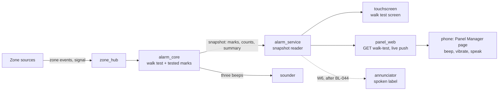

# 40 · Walk test

**Status:** Built, host-, preview- and mock-tested (W1-W3, BL-128): the engine keeps the list,
Settings > Walk test and Home's card at the touchscreen, the Panel Manager's phone page and
Overview card, MQTT's counts. On a panel (bench, 2026-10-01): start, list, Extend, End, the end
summary and the installer's entry; not yet tripping zones, the sounds, the Panel Manager or two
phones (W7). Left: W4 (live updates), W5 (signal), W6 (voice), W7 · **Milestone:** M24 · **Depends on:** 01,
04, 07, 22, 31 (live updates, BL-129); 08's voice (BL-044) when it is ready; coordinates with 05,
10, 18, 26, 36

## Goal
An installer, or the owner, walks the house and the yard: opens every door and window, walks past
every motion sensor, presses every button. The panel keeps the list: which zones have been tested,
which haven't, which are still open and, for radio sensors, how strong the signal was. The test
runs from the touchscreen or from a phone in the Panel Manager, so nobody has to walk back to the
wall or have someone shout from the hall. The panel beeps for each zone as it does now; the phone
beeps, vibrates and says the zone's name; once voice announcements exist (08) the panel says the
name too. No burglary zone alarms while the test runs; fire and CO stay live.

Voice is not started yet and this feature comes first: everything here works with tones and the
phone's own speech, and the panel's spoken names slot in later through one hook (W6) without
changing the walk test.

## What exists today

| Part | Today | Gap |
|---|---|---|
| Engine (`alarm_core`, `src/walk.c`) | `ALARM_CMD_WALK_TEST` carries `walk_op` (toggle, start, end, extend) and `walk_flags` (`ALARM_WALK_F_LIFE24`); start and extend need the installer, the system master or a partition master, end needs what a disarm needs or, as End, no code (the panel ends it); every zone the test covers beeps (`ALARM_SOUND_WALK_TEST`) and is marked instead of alarming (buttons, fobs and the keyswitch included, a tamper marks the cover, `ALARM_ZEV_TEST` marks a sensor's own test, fire and CO stay live); `walk_test_zone`, `walk_test_extend`, `walk_test_warning` (a double beep at 5 and 1 minute left) and `walk_test_end` (tested and total) events; the marks, counts and the last summary are in the status snapshot until the next start or a restart; ends by code + OFF, a Disarm button, End or `walk_test_timeout_s` (600-14400 s, default 3600) | Nothing stored (open question 7) |
| Keypad sequence | code + TEST toggles (`keyseq.c`) | No keypads yet (BL-048) |
| Touchscreen | The state card says "Walk test / Open and close each zone"; Home's right side offers "End walk test" (code pad) | **Nothing starts a walk test** (04 lists "Menu -> Walk test", never built); no list |
| Panel Manager | The installer's "Walk test ends after" option (`walk_test_timeout_s`) | Nothing starts, follows or ends one |
| MQTT, Home Assistant | `walk_test` in the partition's status; the events | No counts |
| Notifications | "Walk test started" / "Walk test ended" (`notify_words.c`) | No result in the end message |
| Sounds | Three beeps per trip, countable (`sounder`, AUD-005) | - |
| Event log | Start, end and every trip | A motion sensor in a long test fills the log with repeats |
| Zone sources | Every source reaches the engine as zone events (ZSRC-011) | No common way to read a sensor's signal; a smoke detector's own test report waits for walk test to reach the sources (36 open question 3) |
| Voice | Planned (08); "Trouble, walk test, alarms: existing tones in v1" | The walk test's spoken names (W6) |

## What a walk test needs (research 2026-09-30)

**Who may run one.** Modern panels keep the walk test with the household's master and the
installer, among the system tests; a DIY system's app lets only the owner run it (a shared user
arms and disarms). Older panels let any user code + TEST start one. Ending one is different:
code + OFF from any user who can disarm ends test mode, so a test nobody ended never keeps a house
from arming.

What we take:
- **Who:** the installer and the masters start, extend and follow a test; anyone who can disarm
  can end one.
- **A list, not just beeps:** the tester needs to know what is left.
- **The phone is the keypad:** installers carry a phone, not a keypad; the house's Wi-Fi reaches
  the yard more often than a voice reaches the hall.
- **Three beeps, then the name:** we keep the countable beeps and add the name, on the phone now
  and on the panel with voice.
- **Signal per sensor:** a sensor that only just reaches the panel works on the day of the test and
  fails in the winter.
- **A warning before the time runs out**, and a time limit that can be extended.
- **A summary at the end** (the untested zones listed), in the log and the end notification.

## Reference behaviour
A keypad alarm panel: a user or installer code + TEST starts it; the external sounder sounds for a
second; each faulted zone gives three beeps and shows its number; a single beep about every 30-40 s
reminds that the panel is in test; it ends after 4 hours, with a double beep every 30 s in the last
5 minutes, or with code + OFF; a test report goes to the central station. An installer's mode
lists the radio zones not yet heard; another lowers the receiver's gain to prove margin. Newer
touchscreen panels add the list of the partition's sensors with signal and battery, and speak each
zone's voice descriptor after the three beeps.

**We copy:** the beeps, the siren test at start, the end warning, the list with signal, the spoken
name after the beeps, per partition. **We deviate:** the phone runs it as well as the panel; start,
end and extend are separate commands; tamper and buttons are tested too; no standing reminder
beep, as on newer panels (they give only the three beeps and the name, or show the test on a
screen; a beep every 30-40 s is the older way); the end warning is given twice, not every 30 s;
fire and CO stay live (01 deliberate choice 5); nothing is reported to a central station (MQTT
JSON, 01 deliberate choice 7).

## Requirements
| ID | Requirement | Verified by |
|---|---|---|
| **Starting and ending** | | |
| WALK-001 | **Who starts one** (decided 2026-09-30: "follow modern alarm systems"): the installer, the system master, and a partition master on its own partitions, as modern panels' system tests do. It starts from the touchscreen (Settings > Walk test, with that person's code) and from the Panel Manager (System > Walk test) as the signed-in person (a password sign-in, never a workstation grant, as WEB-024); a keypad's code + TEST keeps toggling it for the same codes. A standard, arm-only, guest or duress code can't start or extend one, nor see the list in the Panel Manager (at the touchscreen the list and the summary show without a code, WALK-025). This narrows the earlier rule (standard and above; CORE-TEST-004, CORE-USR-027 now follow it) | `test_who_starts_extends_and_ends`, `test_signed_in_users_follow_the_same_rules`; `panel_pages.test.cjs` (start, extend and end by the installer, the system master and a partition master; a standard user and a guest refused, the list too) against the mock; the preview's `walk_walk_test` (Settings > Walk test asks for a master's code to start; the list's Extend and the summary's new start ask for one) |
| WALK-002 | Start, end and extend are separate commands: a start on a partition already in walk test, or an end on one that isn't, does nothing and says so, so a retried request never undoes itself. Start only while the partition is disarmed, silent and out of installer mode (as now, CORE-PROG-002). The engine's `ALARM_CMD_WALK_TEST` carries the operation (`walk_op`: toggle, start, end, extend); a zeroed command toggles, which is the keypad's code + TEST | `test_start_end_and_extend_are_separate`, `test_start_needs_a_quiet_disarmed_partition` |
| WALK-003 | At start the siren gives its 1 s test pulse (as now, CORE-TEST-001) | `test_walk_test` |
| WALK-004 | It ends with End (a question at the touchscreen, WALK-025; the sign-in in the Panel Manager), code + OFF, the time limit (as now) or a restart (a walk test isn't kept through one). Five minutes and one minute before the limit the panel double-beeps once and the screen and the phone say so, with Extend, which starts the full limit again. No reminder beep otherwise (decided 2026-09-30). The engine gives the warnings (`walk_test_warning`, arg the minutes left, and the `walk_test_warning` double beep) and logs Extend (`walk_test_extend`) | `test_end_warnings_and_the_time_limit`, `test_a_short_limit_warns_only_where_it_can`, `test_extend_starts_the_limit_again`, `test_a_restart_ends_it`, `test_the_walk_test_warning_is_a_double_beep`; the preview's `walk_walk_test` (Extend with a code; "Walk test ends in 5 minutes" on Home, steady, and in the status bar away from it: `home_walk_test_ends_soon`, `zones_walk_test_ends_soon`); planned: simulator |
| WALK-025 | **Anyone who can disarm the partition can end its walk test**: code + OFF (as now), a keyfob's Disarm (as now; the press is marked first, WALK-007), End on the touchscreen's walk test screen or Home, and End on the Panel Manager's Overview (their sign-in). So a test nobody ended never keeps a household from arming. A duress code ends it as it disarms, with the silent duress report. At the touchscreen End needs no code (decided 2026-10-01): ending only gives the protection back, so "End the walk test?" with End test / Keep testing guards a stray tap, and the log says the panel ended it (no user; the summary reads "Ended before its time ran out"); the engine takes an End without a code that way. The list during the test and the summary after it show there without a code too. Extend and a new start stay with those who may start one (WALK-001) | `test_who_starts_extends_and_ends`, `test_end_needs_no_code`, `test_signed_in_users_follow_the_same_rules`, `test_buttons_are_marked_and_arm_nothing`; `panel_pages.test.cjs` (a standard user and a guest end it, code + OFF ends it, the end works while another partition is armed) against the mock; the preview's `walk_walk_test` (End on Home asks, Keep testing keeps it, End test ends it: `walk_test_end_confirm`; the list and the summary open without a code) |
| WALK-005 | While a walk test runs on a partition, nothing arms it (as now); the arming surfaces say why ("A walk test is running") | the preview's `walk_walk_test` (an arming pad open when a test starts elsewhere says "A walk test is running", `walk_test_arm_refused`); planned: `alarm_core` tests |
| **The list** | | |
| WALK-006 | The panel keeps, for each partition, which zones its walk test has tested (the first fault, button press or sensor test from any source) and whose cover it tested, with how each was first marked, when (seconds after the start) and how many trips beeped; and the partition's counts, who started it, from where and when, and `walk_seq`, which grows with every new mark and every start. The marks and the summary stay after the end until the partition's next walk test starts (which clears only that partition's zones) or a restart. A zone whose type or partition changes loses its mark (as its state does, CORE-CFG-018); the configuration can't change while a test runs | `test_first_trip_marks_and_logs_repeats_only_beep`, `test_the_summary_stays_until_the_next_start`, `test_a_changed_zone_loses_its_mark`, `test_a_restart_ends_it` |
| WALK-007 | Tested by a fault: burglary and no-response zones (as now), monitor and momentary-exit zones (they beep and do nothing else), button, keyfob and keyswitch zones (a press beeps and is marked; nothing arms). A keyfob's or button's Disarm is marked and then ends the test, as code + OFF does (WALK-025), so a tester presses it last. These zones make the test's total. Fire and CO stay live and aren't counted (01 deviation 5, decided 2026-09-30). 24-hour zones and panic buttons stay live and aren't counted unless the start's option *Include panic and 24-hour zones* is on (off by default, decided 2026-09-30; the walk test screen says so while it is on): then they beep, are marked and counted instead of alarming. A keypad's panic stays live. A sensor's own test report (`ALARM_ZEV_TEST`: a smoke detector's test button over Z-Wave or Zigbee) marks it tested without an alarm, fire and CO included (36 open question 3); outside a walk test it is a check-in | `test_buttons_are_marked_and_arm_nothing`, `test_24_hour_zones_only_with_the_option`, `test_fire_and_co_stay_live_but_their_test_marks_them`; the preview's `walk_walk_test` (the start's switch; fire and CO "Stay on during the test", `walk_test_list_end`); planned: `zone_hub` tests |
| WALK-008 | A tamper during a walk test (a cover off) beeps and marks the zone's cover tested; it never alarms; its trouble behaves as it does while disarmed. Only the zones the test covers (WALK-007) | `test_tamper_marks_the_cover`; the preview's `walk_walk_test` ("Cover tested", `walk_test_list`) |
| WALK-009 | Each zone on the list shows one of: not tested, tested (when, how many times), open now, can't be reached (CHECK); and whether its cover was tested; and, where the source knows it, the signal of the report that tested it (W5) | the preview's `walk_walk_test` (tested with its time and count, open now, cover tested: `walk_test_list`); planned: mock tests |
| WALK-010 | At the end a summary: N of M zones tested, the untested ones by name, those still open, weak signals; kept until the next test or a restart. `walk_test_end` carries N and M (`arg`, `arg2`), and the end notification says "14 of 16 zones tested" | `test_buttons_are_marked_and_arm_nothing`, `test_end_warnings_and_the_time_limit`, `test_the_summary_stays_until_the_next_start`; the preview's `walk_walk_test` (the status bar's "Walk test ended: 4 of 5 tested" until the summary is seen, then Settings > Walk test with who ended it and the untested zones first: `home_walk_test_ended`, `walk_test_summary`); planned: `notify` tests |
| WALK-011 | The event log gets the start, the end with its counts and each zone's first trip; repeat trips beep but are not logged, so a long test doesn't push real events out of the flash ring. A zone's first cover test is logged too; `walk_test_zone`'s `arg` says how it was marked (fault, cover, button, the sensor's test) | `test_first_trip_marks_and_logs_repeats_only_beep`, `test_tamper_marks_the_cover` |
| **Feedback** | | |
| WALK-012 | The panel gives three beeps for every trip, repeats included (as now, AUD-005) | `test_sounder.c` |
| WALK-013 | The touchscreen has a walk test screen: the count, the time left, the list (not tested first), Extend and End. Nothing flashes or blinks (UI-020); a tested zone moves in the list at most once a second (UI-023) | `panel_pages.test.cjs` (the Panel Manager's page: the styles hold no animation, one read a second) against the mock; the preview's `walk_walk_test` (Home's card and the list, a zone tripped while it is open moves within a second: `home_walk_test`, `walk_test_list`); planned: simulator |
| WALK-014 | The Panel Manager's walk test page works on a phone first. On each zone's first test the phone beeps (Web Audio), vibrates where the browser can (Android) and says the zone's name (the Web Speech API: the phone's own voice, in the page's language); each is a switch on the page, remembered in that browser; a repeat trip gives a short tick only. The page keeps the phone's screen on (Screen Wake Lock) while the test runs | `panel_pages.test.cjs` (a beep and a name for a first test, a tick for a repeat, the buzz, the saved switches, the page's language) against the mock; planned: two phones (W7) |
| WALK-015 | Speech never piles up: at most one name waits; more become "3 more zones tested". After the phone was asleep or off the Wi-Fi it catches up from the panel's list and says how many zones were tested meanwhile, never a backlog of names | `panel_pages.test.cjs` (one name waits, more become a count; after being away or off the Wi-Fi only a count) against the mock |
| WALK-016 | Whenever the voice is ready - Announcements on or off: the walk test has no switch (decided 2026-10-12) - the panel says the zone's approved spoken name after the three beeps on every trip (AUD-008, AUD-016); a zone without words keeps its beeps alone; and "Walk test started", "Walk test ended" with "All zones tested" or "Some zones were not tested", and "Walk test ends in five minutes" after the warning's double beep; the one-minute warning stays a double beep. Missing or unready audio leaves the beeps alone (AUD-014); speech never plays during an alarm (AUD-010) | policy: `components/core/annunciator/test/test_annunciator.c` - the name after every trip's beeps (repeats, chime off, Announcements off; none for a zone without words or at volume 0), start after the acknowledgement and bell test, end results (all, some, zero of zero), the end canceling trip names, the five-minute warning, the one-minute warning tone-only, an extension making a warning stale; planned: all trip types on the panel, alarm cancellation in the mix (BL-202) |
| WALK-022 | **The panel's screen stays awake during a walk test**, at the day brightness: no screen saver, no screen going dark, no night-hours dimming (UI-043), from the start to the end of the test, wherever it was started (decided 2026-09-30: the walk test is part of setting the system up and checking that the sensors work). The saver and dark already stay off (`ui_app.c`: a walk test isn't a calm state); the night brightness is the part to add, as for an alarm (`ui_light_percent()`) | the preview's `walk_walk_test` (night hours and 70 idle seconds: day brightness, no saver); planned: simulator |
| WALK-023 | **A walk test started anywhere else shows at the panel.** Started from the Panel Manager (or later a keypad, BL-048), the panel wakes its screen and shows the same walk test screen as a test started there, headed by a steady notice saying who started it and from where ("Walk test started by Alex from the Panel Manager"), which stays for the whole test; the start's ack and the siren's 1 s test sound as for any start. If someone is in the middle of something at the panel (a code half typed, a sheet open, Settings), the screen isn't taken from them: a steady banner in the status bar ("Walk test from the Panel Manager · Show"), as the remote keypad's (UI-039), and the walk test screen when they leave it. Whoever is at the panel can end it (End, no code, WALK-025). Ended from elsewhere, the panel shows the summary with who ended it. Nothing flashes (UI-020); it is the screen, not a toast (UI-028) | the preview's `walk_walk_test` (started from the Panel Manager over the screen saver: the screen wakes to Home's card headed by who and from where, `home_walk_test_from_panel_manager`; with an arming pad open: the status bar's banner, and the card once the pad closes, `walk_test_arm_refused`); planned: simulator (its "Walk test from the Panel Manager" button), mock + simulator together |
| WALK-024 | **A walk test started at the panel shows in the Panel Manager:** the Overview says a walk test is running on the partition, who started it and from where, with the count and a link to the walk test page; for someone who may not start one, the count and End instead of the link (WALK-025) | `panel_pages.test.cjs` (status' walk test fields for a test started at the panel, `MOCK_WALK`; the Overview's card and the nav's count for a shared and a standard role) against the mock; planned: hardware |
| **The Panel Manager and integrations** | | |
| WALK-017 | The Panel Manager's walk test page shows a trip within a second without live updates (it reads `walk-test?key=<key>` every second while open) and at once with them (BL-129); nothing is missed either way, because the list is the panel's, not the page's | `panel_pages.test.cjs` (the list follows each trip; an unchanged `key` answers `unchanged`; the page reads with the key every second) against the mock; planned: W7 |
| WALK-018 | The page and the list show only the partitions that person may use (WEB-016); zone names as the Zones page shows them | `panel_pages.test.cjs` (a partition master sees and acts on its partitions only) against the mock; planned: the page |
| WALK-019 | MQTT's partition status keeps `walk_test` and adds `walk_test_tested`, `walk_test_total` and `walk_test_remaining_s`; the `walk_test_zone` events go out as events. A walk test can't be started from MQTT or Home Assistant (nobody is there to walk); the integration shows the counts in step with RoboAlarms/ha-addon (23) | planned: `alarm_proto` tests |
| **Signal (W5)** | | |
| WALK-020 | A source that knows a sensor's signal says so per sensor (433 MHz: RSSI in dBm and the noise floor from the CC1101; Zigbee: LQI; Z-Wave: the frame's RSSI and the background noise; wired, Home Assistant and the simulator: none). The list shows it in words and bars with the number behind them; to start with "weak" under 12 dB over the noise floor and "too weak" under 6 dB, tuned on the bench | planned: `zone_hub` tests, panel |
| WALK-021 | A radio zone also shows "heard" when anything arrives from its sensor (a check-in, a tamper, a restore), apart from "tested": a sensor that is heard but never faults is a sensor in the wrong place | planned: `zone_hub` tests, panel |

## Design

**Engine (`alarm_core`, `src/walk.c`).** The partition keeps its walk test (`walk_test`,
`walk_test_until`) with the start time, who started it and from where, the start's flags, the
counts, `walk_seq` (it grows with every new mark and every start, so a reader can ask "anything
since 41?") and, after the end, who ended it and how (`alarm_walk_end_t`: End, disarm or button,
time limit). Each zone has a 4-byte mark (`alarm_walk_zone_rt_t`: tested and cover bits, how it
was first marked as `alarm_walk_mark_t`, the trip count, the first mark's seconds after the
start); a zone belongs to one partition, so a start clears only that partition's zones.
`ALARM_CMD_WALK_TEST` carries `walk_op` (`alarm_walk_op_t`: toggle, the keypad's code + TEST;
start; end; extend; WALK-002) and `walk_flags` (`ALARM_WALK_F_LIFE24`, the start's *Include
panic and 24-hour zones*). `eng_zone_fault()` keeps its early return for a walk test but marks
the zone first, for every zone the test covers (WALK-007); a tamper marks the cover (WALK-008);
`ALARM_ZEV_TEST` (the sensor reports its own test) marks a zone during a walk test and is a
check-in otherwise. `walk_test_zone` is emitted on a zone's first mark and its first cover mark
only (WALK-011; `arg` is the `alarm_walk_mark_t`); repeats only sound. `walk_test_end` carries
the counts on every way it ends (WALK-010). The end warning is the engine's (`walk_test_warning`
and the `walk_test_warning` double beep at 5 minutes and at 1 minute left, timed through
`alarm_engine_next_deadline()`), so every surface hears the same thing; Extend sets the full
limit again and is logged (`walk_test_extend`). Who may: `can_test()` drops the standard user
(installer, master, partition master; WALK-001) for start, extend and a toggle that starts; end,
and a toggle that ends, need only what a disarm of that partition needs (WALK-025), as
`eng_disarm()` already ends it. Nothing of it is kept through a restart.

**The record (the engine's, in the snapshot).** The marks, counts and summary are the engine's,
so they are in `alarm_snapshot_t` with no other code: `alarm_partition_status_t` gains
`walk_test_remaining_ms` (like `delay_remaining_ms`), `walk_tested`, `walk_total`, `walk_seq`,
`walk_flags`, `walk_started_by`, `walk_started_src`, `walk_started_ms`, `walk_ended_by` and
`walk_end_how`; `alarm_zone_status_t` gains `walk` (`ALARM_WALK_ZS_TESTED`, `_COVER` and the
kind, `ALARM_WALK_ZS_KIND()`), `walk_trips` and `walk_first_s`, and stays 8 bytes. The
touchscreen, the Panel Manager, MQTT and the PC preview read the snapshot as they do everything
else. Only the signal the hub reported with a zone's first trip (W5) is outside the engine; the
alarm service keeps it beside the snapshot.

**Zone sources (`zone_hub`).** A sensor's own test report becomes `ALARM_ZEV_TEST` (Z-Wave's
smoke test, Zigbee IAS's test bit). For W5, an optional `signal_of()` in `zone_source_ops_t`
returns a small struct (kind: dBm, LQI or none; the latest value; the noise floor where known;
when it was measured) - optional like `caps_of()`, so the sources that can't say stay as they
are. The 433 MHz source already pairs RSSI with frames (`zsrc_rf_noise()`, RF-005); Zigbee keeps
an LQI per device (`zsrc_zb`); the Z-Wave Serial API reports an RSSI with each received frame,
which `zwave_host` doesn't read yet (it reads only the background noise, `zw_jam`).

**Touchscreen.** The walk test screen is two places: Home's card while a test runs, and
Settings > **Walk test** (`ui_walk.c`). Settings > Walk test opens with the installer's, the
system master's or a partition master's code as Wi-Fi does (14 "Who can change what"; Settings is
locked while armed anyway, UI-022): pick the partition if there are several, Start; during the test
the count, the time left, Extend, End and the list; after it the summary. The list during a test
on this keypad's partition and the summary after it open without a code (only Extend and a new
start then ask for one); Home's card needs none. During the test, Home's state card stays "Walk
test" and the right side becomes the card - the count, the time left, Extend (on the code pad),
End (a question, "End the walk test?", WALK-025) and **Show zones**, which opens the list. In the
last five minutes the card's time left reads "Walk test ends in 5 minutes" in amber, beside Extend;
away from Home the status bar says it. After the end a steady status-bar banner ("Walk test ended:
4 of 5 tested · Show") leads to the summary until it is seen or the partition arms. The installer
menu's **Walk test** closes installer mode and starts the test in one step, since the engine
keeps the two apart (CORE-PROG-002/003); with several partitions it opens Settings > Walk test to
pick one. Steady colours: not tested neutral, tested green, open
now amber, CHECK as the trouble colour; nothing blinks when a zone trips (UI-020). The screen is
held awake at the day brightness for the whole test (WALK-022): `MODE_WALK_TEST` is already
outside the saver's calm states; `light_apply()` lights it as for an alarm.

A start from elsewhere (WALK-023) reaches the UI as the partition's new state with the
snapshot's `walk_started_src` and `walk_started_by`, which give the notice its words ("by Alex
from the Panel Manager"; not this touchscreen, keypad 0). The UI wakes the screen and opens the walk test screen unless someone is busy
at the panel (the same test the saver uses: a code pad with digits, a sheet, Settings, the
setup); then it raises a status-bar banner beside UI-039's, and opens the screen when they
leave. The notice heads the walk test screen until the test ends; the summary names who ended
it.

**The phone (Panel Manager).** A **Walk test** page in the **System** group, after System
health: modern panels keep it among their system tests, and the first group stays the pages
everyone uses.
It has the access level `shared` (the installer, the system master and partition masters, as
Wi-Fi and the time; `panel_web.c` ACC_SHARED); nobody else sees it, and the server refuses its
`GET` and actions to them. While a test runs, its nav entry shows the count, and the Overview
links to it (WALK-024). Laid out for a phone held in one hand: the partition, a big
Start; then the count and the time left at the top, the last tested zone as a steady card, the
list with the untested first, End and Extend within reach of a thumb. The switches *Beep*,
*Vibrate*, *Say zone names* and *Keep the screen on* remember themselves in that browser. The
Panel Manager unlocks the phone's audio and speech on its first tap anywhere (one listener for
the whole app, set at start: iOS allows them only inside a tap), so a test started at the panel and
followed on a phone beeps the same, with no "turn on sound" step; a page opened straight from a
bookmark plays nothing until its first tap, while the panel's own beeps carry on. The page
follows the panel's list, never its own: polling `walk-test?key=<key>` every second (WALK-017)
until the live updates (BL-129) push each mark at once. Away from the Wi-Fi the page says "Not
connected - the test goes on at the panel" and catches up when back (WALK-015). At the end the
summary, with **Save report** (a text/CSV file made in the browser, for the customer's records)
and **Test the untested again**. A walk test running on a partition, wherever it was
started, shows on the Overview with who started it, from where, the count and a link to this page
(WALK-024). API: `GET walk-test` (the viewer's partitions; for each: running,
started, by, remaining, `walk_seq`, the summary, each eligible zone's mark, time, count, open,
CHECK, cover and signal); `POST partition {action: "walk_test_start" | "walk_test_end" |
"walk_test_extend"}`, added to WEB-024's table with its own state guard so each runs only in the
state it is for.

**Voice (W6, after BL-044).** The walk test needs nothing from voice now: `on_sound` already
carries the zone with `ALARM_SOUND_WALK_TEST`, which is the hook. When the annunciator exists,
the walk test becomes one more semantic target beside the chime: after the three beeps, the
zone's spoken label (the same binding, so a renamed zone never says its old name, AUD-016),
coalesced per zone and expiring after a few seconds like a chime (AUD-012), plus the full status
phrases in WALK-016. The phrases are in the library's script, joined from parts like the
status messages (08 voice-library.md). The phone's speech stays as it is: it is the tester's,
not the house's.

**What stays the same.** Fire and CO, and 24-hour zones and panics unless the start includes
them, alarms during a walk test, the time-limit setting, installer mode's rules, the keypad's
code + TEST and code + OFF.

**Mockup.** [mockup/walk-test.template.html](mockup/walk-test.template.html) is the Panel
Manager's walk test page and Overview card, drawn with the real `panel.css`, icons and brand mark;
`node docs/features/40-Walk-Test/mockup/build.cjs` writes one file that opens on its own,
`build/mockups/walk-test/walk-test-mockup.html`. Its striped bar switches the page, the test's
stage, the connection, who started it, who is signed in (installer, master, standard user), the
partitions, the theme and a 390 px phone frame, and trips zones (with the phone's beeps,
vibration and speech); a state can be linked (`?phase=ended&role=standard&theme=light`). Its
"PROPOSED for panel.css" block is the styling W3 adds.

## Interfaces and data
- Engine: `alarm_cmd_t` walk operation (toggle, start, end, extend); `ALARM_ZEV_TEST`;
  the snapshot's `alarm_partition_status_t` (`walk_test`, `walk_test_remaining_ms`, `walk_tested`,
  `walk_total`, `walk_seq`, `walk_flags`, `walk_started_by`/`_src`, `walk_ended_by`, `walk_end_how`)
  and `alarm_zone_status_t` (`walk`, `walk_first_s`, `walk_trips`);
  `walk_test_zone` (`arg` = fault, cover, button, sensor test; first mark only); `walk_test_end`
  (`arg` = tested, `arg2` = eligible); `walk_test_extend`; `walk_test_warning` (`arg` = minutes left).
- Zone hub: `zone_source_ops_t.signal_of()` (optional, W5).
- Panel Manager: `GET walk-test[?key=<key>]`; `POST partition` walk test actions (WEB-024's
  table); live updates' `walk_test` topic (BL-129, [31 live-updates.md](../31-Browser-Panel-Manager/live-updates.md)).
- MQTT: partition status `walk_test_tested`, `walk_test_total`, `walk_test_remaining_s`
  (an additive change to an external contract, versioned as docs/features/README.md
  "Conventions" asks).
- Nothing stored: a walk test and its marks live in RAM and end with a restart (open question 7).

## Test and acceptance
- **Host:** `alarm_core` tests named by WALK ID (the commands, the marks, the eligible zones,
  tamper, buttons, the sensor's test, a config change mid-test, the end warning, the counts, the
  log's first-trip-only rule); `zone_hub` for `ALARM_ZEV_TEST` and `signal_of()`; `alarm_proto`
  for the JSON; `notify` for the end message.
- **Preview and simulator:** the walk test screens in both layouts in the preview's walk (no
  cut-off words, two test languages); a walk test in the PC simulator with simulator zones, by
  ear.
- **Panel Manager:** the mock panel runs a walk test with zones it trips on timers; the node
  tests cover the page's catch-up, the speech queue and the access table; the Browser pane at
  phone width.
- **On a panel (W7):** wired, 433 MHz and Z-Wave sensors (Zigbee once BL-036); an iPhone (Safari)
  and an Android phone (Chrome) on the house Wi-Fi, outdoors at the edge of its reach, the screen
  locked and unlocked mid-test; the time limit and its warning; the event log's count of entries
  after a long test; `display watch` while the screen's list changes (Display safety).

## Open questions
1. **Fire and CO in a walk test.** Decided 2026-09-30: they stay live (01 deliberate choice 5);
   a detector's own test report counts (WALK-007). A fire test like a fire panel's (each smoke
   detector beeps and is logged, the panel resets it) only if it is ever asked for.
2. **Panic and 24-hour zones.** Decided 2026-09-30: the start option *Include panic and
   24-hour zones*, off by default, for those who may start one: the installer, the system master and a partition
   master on its partitions (as the touchscreen and the engine; the reading of
   the 2026-09-30 decision, standard users being unable to start one at all since) (WALK-007);
   can change later.
3. **A reminder beep every 30-40 s?** Decided 2026-09-30 ("follow more
   modern alarm panels"): no; the modern panels give only the beeps and the name per sensor and
   show the test on the screen. The end warning at 5 minutes and 1 minute stays (WALK-004).
4. **The time limit:** a fixed one (as now) or one that runs from the last trip (15 or 20
   min with no zone activity)? Leaning: fixed, with the warning and Extend.
5. **Tested means faulted**, or faulted and back to normal (a door opened and closed)? Leaning:
   faulted marks it; "open now" shows on the list and in the summary.
6. **The panel's screen during a walk test.** Decided 2026-09-30: it stays awake at the
   day brightness, no saver, no dark, no night dimming; the walk test is part of setting the
   system up (WALK-022).
7. **"Last walk-tested" per zone kept through restarts** (one small record written at the end,
   never per trip)? Leaning: later, if installers ask.
8. **Who may start one.** Decided 2026-09-30 ("follow modern alarm systems"): the
   installer, the system master and partition masters, not standard
   users; anyone who can disarm can end one (WALK-001, WALK-025). The page sits in the
   Panel Manager's System group.
9. **A walk test started from the Panel Manager** must be plain at the panel. Decided 2026-09-30:
   the panel shows the same walk test screen with a notice of who started it and from
   where (WALK-023); and the Panel Manager shows one started at the panel (WALK-024).

## Tasks
- [x] W1 Engine: the walk operations, the marks and `walk_seq`, the wider eligible zones, the
  *Include panic and 24-hour zones* option, tamper, buttons, `ALARM_ZEV_TEST`, first-trip-only
  events, the end warning at 5 and 1 minutes, the counts, `can_test()` without the standard user
  (WALK-001, WALK-025); 01's CORE-TEST rows (CORE-TEST-004), CORE-USR-027 and deliberate choice 5 brought
  in step; 14's "Who can change what" gets the walk test's row (BL-128, 5153415)
- [x] W2 Touchscreen: Settings > Walk test (master and installer codes), the walk test screen, the installer menu's entry; the
  screen held awake at day brightness (WALK-022, once UI-043's dimming is in); a start from
  elsewhere shown with its notice or banner (WALK-023); the preview's walk; the simulator (BL-128, 5153415)
- [x] W3 Panel Manager: `GET walk-test`, the walk test actions in `POST partition` (start and
  extend at `shared` access, end as a disarm), the System group's phone page
  with beep, vibrate, speech and wake lock, polling every second; the Overview's walk test line
  (WALK-024); the mock panel and node tests (BL-128, 5153415)
- [ ] W4 The walk test page on the live updates once BL-129 is built (BL-128)
- [ ] W5 Signal and heard: `signal_of()` for 433 MHz, Z-Wave and Zigbee, the thresholds tuned on
  the bench (BL-128)
- [ ] W6 The panel's spoken names and phrases, once voice announcements are built (BL-128, after
  BL-044)
- [ ] W7 On a panel: real sensors per source, two phones outdoors, the time limit, the log, the
  display checks (BL-128)
